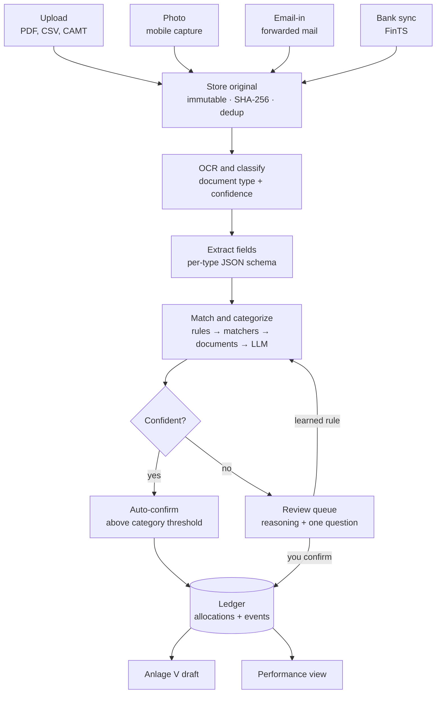
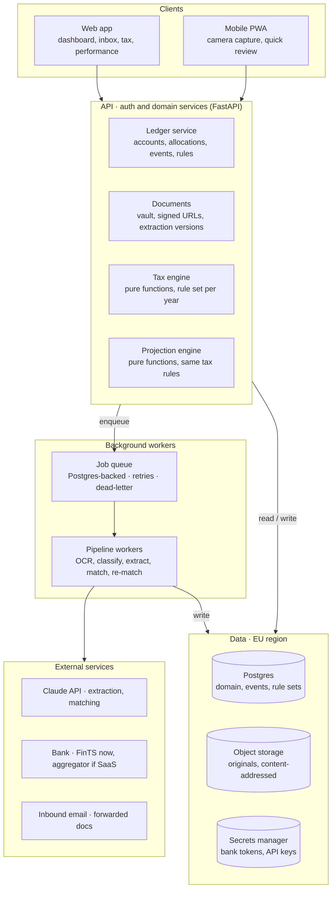

# Hausbuch — Architecture Spec

Nov 4, 2026 · Luis

## Purpose and scope

Hausbuch is a single-household finance workspace, built SaaS-ready. Its first module, the landlord ledger, turns bank statements, invoices and letters into a traceable property ledger, a draft Anlage V each year, and a running profit view through to sale; planned phases 6–9 add every account and asset of the household, the capital-income and crypto forms (Anlage KAP, Anlage SO), and financial health (agreed 6 Nov 2026, design in `docs/design/household-finances.md`).

**In scope (v1)**

- Properties, units, tenancies and tenants, with a full event history per unit
- A document vault: upload, photo capture, email-in; typed and linked to what it proves
- AI-assisted ingestion of bank statements and documents into categorized, split transactions
- A human review queue for anything the system is not sure about
- A deterministic Anlage V draft per property and tax year, every figure traceable to sources
- Performance: actuals plus an adjustable projection to sale, including the 10-year Spekulationsfrist
- Exports: a field-by-field sheet for typing into ELSTER, plus a yearly CSV + PDF archive

**Non-goals (v1)**

- Filing directly to ELSTER (ERiC integration is a later option, not a launch need)
- Multi-user property management for third parties (WEG-Verwaltung, Hausverwaltung)
- Tenant-facing portal, rent collection or payments
- Betriebskostenabrechnung generation (data is captured so it can be added in phase 4)
- Tax advice: the app drafts and explains; the user decides. No DATEV export
- Trading, payments or any write access to an account; naming investment products the household does not already hold (no Anlageberatung)

## Architecture principles

Seven rules every component and every agent-written PR is checked against (the seventh added 10 Nov 2026).

1. **AI explains, code calculates.** LLMs extract, classify, match and explain. Every euro figure in a tax or performance view is computed by deterministic, tested code from stored data.
2. **Every number is traceable.** Each derived figure links to the allocations, transactions and documents it came from. No orphan totals.
3. **Human-in-the-loop by confidence.** Auto-accept only above a per-category threshold; everything else lands in the review queue with the model's reasoning and a concrete question.
4. **Append-only history.** Domain changes are recorded as events; corrections are new events, never overwrites. The History timeline and the audit trail are the same data.
5. **Tax rules are versioned data, not branches in code.** A rule set is keyed by tax year and effective dates, so 2026 stays reproducible after 2027 rules change.
6. **Originals are immutable.** Uploaded files are stored content-addressed (SHA-256) and never modified; extractions, splits and categories are layers on top. A person may delete a document nothing relies on, with its layers (phase 2 D193, 14 Nov 2026); a document any record relies on cannot be deleted.
7. **The user needs no tax knowledge.** The app works out the tax treatment itself and proposes it, in a suggestion the user confirms or corrects: what a document implies (every record, each part on its line, whichever account paid it), and every gap it knows of as a plain to-do with the button or link that resolves it. A feature that only works if the user knows to do a tax step by hand is incomplete; no screen states a gap in tax words without saying what to do. Principle 3 still holds: the user confirms, the app never decides alone.

## Domain model

The core chain is Property → Unit → Tenancy → Tenant; money flows in as Transactions and is split into Allocations, which are what every tax and performance figure sums over.

| Entity | Key fields | Relations | Notes |
| --- | --- | --- | --- |
| Owner | name, tax ID ref, ownership share, expected gross pay per year and deductions (`income_input`), church tax yes/no and Bundesland, optional per-year rate override; the typed `marginal_tax_rate` field is dropped (phase 4 spec D90) | owns Properties | Two owners at 50/50, married and filing jointly: one Anlage V carrying both shares. The marginal rate is derived from income, not typed in (see Performance). Phase 4b (specced 10 Nov 2026; the tables and the rules live since 10 Nov 2026, the screens since the same day) adds the return facts per year in `return_input` (certificate and payslip figures, itemised Werbungskosten, wage-replacement benefits; the household's children, childcare, §35a services, donations) and the yearly questionnaire's answers in `questionnaire_answer` (phase 4b spec D97, D109, D110, D112); phase 8 (specced 16 Nov 2026, not built) adds the `return_input` kinds `kap_certificate`, `freistellungsauftrag`, `so_position`, `so_unclaimed_rewards` (household) and `kap_other_income`, `kap_requests`, `so_loss_carryforward`, `so_service_costs` (owner) (phase 8 D225) |
| Property | address, type (ETW, EFH, MFH), build year, purchase date, notarized date, price, Nebenkosten, building/land split + split source (Kaufvertrag, BMF Arbeitshilfe, appraisal) | has Units, Loans, Documents | Notarized date starts the Spekulationsfrist; split drives AfA; privately paid rental costs and trips to the property are `tax_input:private_cost` rows (phase 4b spec D111, live since 10 Nov 2026) |
| Unit | label (WE 3), m², rooms, MEA share (WEG) | belongs to Property; has Tenancies | One Unit for an ETW; many for an MFH |
| Tenancy | start, end, type (unbefristet / Staffel / Index), Kaltmiete, NK-Vorauszahlung, Kaution + account, rent due day, running-cost terms (Vorauszahlung / Pauschale / inklusive; phase 3 spec D67, D72) | links Unit and Tenant(s); has RentSchedule | Rent changes are dated RentSchedule rows, never edits |
| Tenant | name, contact, IBAN (hashed for matching) | in Tenancies | Personal data; see privacy section |
| Loan | lender, principal, rate, fixed until, follow-up rate (user-set), annuity, schedule | belongs to Property | Schedule splits each payment into interest and Tilgung |
| Account | bank, IBAN (masked), source (upload / FinTS; aggregator only if SaaS) | has Transactions | The rental runs on a dedicated account, so every line is property-related; transfers to and from the owners' private accounts are recognized by their IBANs |
| Wallet / WalletAddress (phase 7) | a wallet is one Account of kind `wallet` (provider, owner shares, no IBAN); `wallet_address`: chain (a registry code), address, masked address, keyed hash, label, kind, `discovered_from`, active | one Account per wallet, one WalletAddress row per chain; each on-chain transaction touching an own address becomes one movement group | The plaintext address is stored on `wallet_address` only, because the app must query the chain for it; everywhere else it is masked and HMAC'd like an IBAN (phase 7 D179). The tables exist since migration 0041 (deployed 15 Nov 2026); wallets and their addresses are created under Konten since phase 7 step 1 (PR #374, deployed 16 Nov 2026; this cell said creating one was refused until then) |
| MovementTaxInput (phase 8) | movement, kind (`airdrop_consideration`, `no_market_price`, `reward_class`, `acquisition_backfill`), value, optional document, the row it supersedes | one answer about one movement | Append-only, superseded like every input; read by the lot and Anlage SO rules as plain arguments; specced 16 Nov 2026, not built (phase 8 D225) |
| Transaction | booking date, value date, amount, counterparty, IBAN, purpose text, source line hash | from Account; has Allocations | Immutable as imported; dedup on source line hash |
| Allocation | amount, category, tax treatment, property, unit, service period, recurring flag, confidence, status (the tax year it counts in is derived by that year's tax rules from the dates, period and flag, not stored; decided 6 Nov 2026) | splits one Transaction; links Documents | Sum of allocations = transaction amount (enforced) |
| Document | file hash, type, extracted fields, dates, amounts | links to any entity | Original immutable; extraction versioned |
| HouseholdScenario (phase 9, specced 16 Nov 2026; written and read since step 2, deployed 18 Nov 2026, PR #429, no screen until step 3; this said „not built“ until then) | name, levers (reserve target in months, buffer, horizon, reserve accounts, savings-plan overrides, income changes, one-offs, the typed yearly value change for funds and for crypto, the confirmed limits of the marks; from phase 10, specced 20 Nov 2026, not built: the household's own budget targets and its needs/wants overrides, D274), supersedes, withdrawn, default | one default per workspace | Append-only like phase 4's `projection_scenario`: a change is a new row (phase 9 spec D248). The workspace setting `advice_mode` (`own_use` or `generic`, default `own_use`) decides what the plan and its explanation may name (D251) |
| HealthSnapshot (phase 9, specced 16 Nov 2026; stored by the daily task since step 1, deployed 17 Nov 2026, PR #426; this said „specced, not built“ until 19 Nov 2026) | month-end, the net worth run it read, the key figures, rule version | one or more per closed month, the newest shown; beside that month's net worth run | Stored once when a month closes and never changed; the screens compute on read and show a difference from the stored row (D242); what the done criterion compares (D259) |
| PlanExplanation (phase 9, specced 16 Nov 2026; written by the job `explain_plan` and read by `GET /household-plan/explanation` since step 4, deployed 19 Nov 2026, PRs #446 and #447, shown on Planung › Haushalt since step 5, PR #449, 19 Nov 2026 (this said „no screen until step 5“ until then); this said „specced, not built“ until then) | scenario, advice mode, status (model or template) with the reason, facts, labels (for rendering only), the validated paragraphs with their slots, violation codes, the AI call ids, versions of prompt, validator, lexicon and vocabulary | per workspace and scenario | Only a validated text or the app's template text is stored for display; the request to the model is built from the facts without the labels (D253, D255, D257) |
| Rule | matcher (counterparty, IBAN, text pattern), output (category, split template) | created from reviews | How the system learns from your answers |
| Event | type, entity ref, payload, actor (user / system / AI), timestamp | on every entity | Source of the History timeline and audit trail |

Categories are a fixed taxonomy mapped to Anlage V lines through the tax rule set (next sections), so renaming a category never changes a return.

## Ingestion pipeline

Every input — upload, photo, forwarded mail or bank sync — runs through the same asynchronous pipeline, and only confirmed allocations reach the ledger.



The review queue is the only place a person has to act; each answer can become a rule, so the same counterparty is never asked about twice.

- **Idempotent imports:** a statement re-uploaded or overlapping a sync is deduplicated on the source line hash, so imports can be retried safely.
- **Jobs, not requests:** each stage is a queued job with retries and a dead-letter state shown in the inbox as "couldn't read this".
- **Re-run on new evidence:** when a missing document arrives (e.g. the Wirtschaftsplan), affected allocations are re-matched and their splits updated as new events.
- **Sync and email-in use the same path (phase 5):** a bank sync stores the bank's camt documents as one immutable ZIP and runs the same import as an upload, and only when it brings a new line; email-in stores each attachment of a forwarded mail as an upload (source `email`) and never the mail itself.

## AI layer

The AI does four bounded jobs, each with a strict output schema and a fallback to the review queue; it never writes ledger data directly.

| Job | Input | Output (schema) | Model tier | Fallback |
| --- | --- | --- | --- | --- |
| Classify document | file + OCR text | type ∈ {statement, invoice, letter, contract, Bescheid, Zinsbescheinigung, Wirtschaftsplan, Hausgeldabrechnung, other}, plus Lohnsteuerbescheinigung and Gehaltsabrechnung from phase 4b (D96, live 10 Nov 2026, PR #111) and the Einkommensteuerbescheid as a subtype of Bescheid (phase 4b D129, live 10 Nov 2026, PR #128), and about forty catalogue subtypes in seven groups, each read for its title and date (phase 2 D130, D131, live 10 Nov 2026, PR #135), with the Jahressteuerbescheinigung (classified since phase 6) read in full from phase 8 (D216, specced 16 Nov 2026, not built), confidence | small, fast | type = other → review |
| Extract fields | file + type | per-type fields (dates, amounts, IBANs, parties, line items, periods), each with page + quote; from phase 8 (D216, specced 16 Nov 2026, not built) the Jahressteuerbescheinigung's printed lines, identifiers scrubbed | mid | missing required field → review |
| Pre-fill proposal | extraction + existing records | records to create or patch, applied only through the existing commands after the user verifies each value | none (code) | nothing applied without the user |
| Match and categorize | transaction + candidate tenancies, loans, documents, rules | allocations[], links[], confidence, reasoning, question? | mid; large only for ambiguous cases; a private account's line one tier down, small then mid for ambiguous (phase 6 D194, 14 Nov 2026) | confidence < threshold → review |
| Explain and ask | allocation + rule context; for the household plan (phase 9, specced 16 Nov 2026; built in step 4, deployed 19 Nov 2026, PRs #446 and #447, Haiku, shown on Planung › Haushalt since step 5, PR #449, 19 Nov 2026 (this said „no screen until step 5“ until then); this said „not built“ until then) also the plan's facts as keys with their values and kinds, never a label or a text a person typed (D252, D253) | plain-language reasoning + one concrete question; for the household plan, sentences with slots and no digit or name: code writes every figure and every name (D252) | small | template text; for the household plan the app's own text from the same facts, marked „Standardtext“ (D257) |

**Matching order (cheapest first)**

1. Exact rules learned from your past answers (counterparty IBAN + pattern)
2. Deterministic matchers: tenant IBAN + amount = rent; loan account + amount = annuity, split by schedule
3. Document match: amount ± 0.01, date window ±10 days, IBAN or invoice number in purpose text
4. LLM categorization with retrieved context (similar past allocations, the property's open items)

**Guardrails**

- Structured outputs validated against JSON Schema; invalid output is retried once, then sent to review. Extraction of document fields uses citations instead (page + quoted text per value) because the API does not combine citations with JSON-schema output; the lines are parsed and validated against the Pydantic field types in code, and a value not recoverable from its quote is marked low-confidence (phase 2, D15)
- Allocation sums must equal the transaction amount; the validator, not the model, enforces it
- The model sees only the minimum context: no other tenants' data, IBANs masked except the one being matched
- Prompt-injection hardening: document text is passed as fenced data; extracted instructions are ignored
- Every AI decision stores model, prompt version, input hash and output, so a category can be explained and replayed
- An eval set of real (anonymized) statements and invoices gates prompt and model changes in CI
- The household plan's explanation (phase 9, specced 16 Nov 2026; built in step 4, deployed 19 Nov 2026, PRs #446 and #447; this said „not built“ until then) is shown only after a deterministic validator passed it. The validator fails closed and rejects what it does not know; a failed text is asked for once more and then replaced by the app's own template text, so an unvalidated text is never shown (phase 9 spec D255, D257). Three eval layers gate it, two of them in CI, one of which places every instrument name of an eval list into the text and requires a rejection each time (D258)

## Tax rules engine (Anlage V)

A pure function `draft(property, taxYear, ruleSet) → AnlageVDraft` turns confirmed allocations into form lines, each carrying the ids of its sources; nothing here calls a model.

**Shape**

- `RuleSet` = tax year + effective dates + a list of rules + a form mapping (category → Anlage V field for that year's form), keyed by stable line codes with the Zeile and the ELSTER Kennzahl per form year; a year whose form is not yet published reuses the previous mapping marked provisional (phase 3 spec D53). Form line numbers move between years, so the mapping is maintained per year, never hard-coded.
- Each rule is a small tested function over allocations and property facts, returning lines, warnings and open items.
- Output `AnlageVDraft` = income lines, Werbungskosten lines, result, warnings, missing documents, and a source list per line.

**Rules for v1**

| Rule | Logic | Data it needs |
| --- | --- | --- |
| Zuflussprinzip (§11 EStG) | Income and costs in the year paid; recurring payments within 10 days of year end, *and due within the same days* (BFH X R 2/21), go to the year they belong to | booking date, recurrence flag, service period, due date (loan schedule, the tenancy's rent due day, the period) |
| AfA linear (§7 Abs. 4) | Rate by completion year: before 1925 2.5%, 1925–2022 2%, from 2023 3%; pro rata by month in the purchase year | build year, transfer-of-ownership month, building share of the purchase price *and of the Nebenkosten rows*, split source; `purchase_price` and `acquisition_cost` allocations are evidence only (phase 3 spec D55); costs capitalised later join the basis gross (D73) |
| Anschaffungsnahe Herstellungskosten (§6 Abs. 1 Nr. 1a) | Renovation performed within 3 years of the handover (to the same calendar day, inclusive) above 15% of building cost (net of VAT) → capitalized into AfA basis, not expensed; a Herstellungskosten election counts toward the 15%, an Erweiterung does not (phase 3 spec D74–D76) | renovation allocations with their service period, net amounts, purchase date |
| Erhaltungsaufwand | Deductible in year paid; optional spread over 2–5 years (§82b EStDV) as a user choice | category, user election |
| Schuldzinsen vs. Tilgung | Interest deductible, repayment not; Geldbeschaffungskosten deductible | loan schedule, Zinsbescheinigung to reconcile |
| Hausgeld split | Umlagefähig and Verwaltung deductible when paid; Erhaltungsrücklage only when the WEG spends it (from the Hausgeldabrechnung) (BFH IX R 19/24: contributions to the Erhaltungsrücklage are deductible only when the WEG spends them; the Hausgeldabrechnung's Entnahme, confirmed by the user, goes to the Erhaltungsaufwand line) | Wirtschaftsplan, Hausgeldabrechnung |
| Umlagen | NK prepayments and settlement back-payments are income; refunds to tenant reduce income | tenancy, settlement documents |
| Verbilligte Vermietung (§21 Abs. 2) | Rent below 50 % of the local comparable (warm) rent → the letting is split and only the paid share's costs count (Z87); 50–66 % → warning that a Totalüberschussprognose is needed; ≥ 66 % → full deduction (§21 Abs. 2 EStG as of 2021) | Mietspiegel net cold rent per m² entered by user, plus the year's umlagefähige costs from the ledger (phase 3 spec D61) |
| Private sale (§23) | Sale more than 10 years after the notarized purchase → tax-free; otherwise gain = sale price − selling costs − (cost − AfA claimed) | notarized dates, AfA history (the building AfA and a fitted kitchen's AfA claimed, from the recomputed drafts; Freigrenze per spouse from the sale year's rule set, €1,000 since 2024; phase 4 spec D88, D93, D94); the same per-person pot holds crypto disposals (phase 8 D204, specced 16 Nov 2026, not built) |

Each rule ships with fixture tests built from worked examples, reviewed against the official guidance for that year before the year's rule set is published.

**Anlage N, the whole return and the yearly questionnaire (phase 4b, specced 10 Nov 2026; rules live 10 Nov 2026, PR #109; screens live the same day, PR #115).** The Anlage N rules are per-year data (`anlage_n/<year>.yaml`, D99), with the 2025 form mapping marked provisional for 2026. The whole-return estimate applies the Progressionsvorbehalt, the Kindergeld-or-Freibeträge check and the §35a credit in one `assessed_tax`, which also becomes phase 4's T (D98, D101, D109, D112). The questions the household answers each year are per-year data too (`questionnaire/<year>.yaml`, D110), pre-filled from the previous year, with reminders for what the app does not compute; §33, Riester, Unterhalt, Vorauszahlungen and capital income are not modelled and the screen says so (D95).

**Anlage KAP and Anlage SO (phase 8, specced 16 Nov 2026 in PR #384, not built).** Both forms are rule data per tax year (`anlage_so/<year>.yaml`, `anlage_kap/<year>.yaml`, D197), and their drafts are computed on read from confirmed data only (D198). The Anlage SO counts crypto disposals from phase 7's FIFO lots and income from services such as staking, each split to a person by the account's owner shares; the §23 Freigrenze (1,000 €) and the 256 € limit for services are cliffs tested per person, never moved between spouses (D199, D204, D206). The Anlage KAP, one per owner, takes the bank side only from each institution's confirmed Jahressteuerbescheinigung (D216, D217), adds capital income no bank certifies (D218), shares the Sparer-Pauschbetrag between spouses (D220), compares the flat tax with the tariff (the Günstigerprüfung) and states whether filing it is required, worthwhile or not needed (D222). Futures (Termingeschäfte) are deferred (D219).

**Rule data 2027 (phase 5, D124).** The 2027 files are written from the Bundesgesetzblatt only. As of 10 Nov 2026 the Einkommensteuerreformgesetz 2027 (Grundfreibetrag 12,564, Kindergeld 267, Kinderfreibetrag 3,564, Arbeitnehmer-Pauschbetrag 1,430, §35a Handwerker 15 %, a 47 % zone) and the Rechengrößen 2027 are a bill and a draft Verordnung; only the 2.9 % average Zusatzbeitrag is published. Until the data PR, 2027 is served by the 2026 files marked `reused_from`, as D81 and D99 intended for a projected year. The Grundsteuer instalment dates and amounts come from the Bescheid as a confirmed `grundsteuer_schedule` tax input (phase 5 spec D126).

**Ownership:** the property is held 50/50 by spouses filing jointly, so the engine produces one Anlage V with both owners' shares and no separate Feststellungserklärung. Unmarried co-owners would need one (ESt 1 B); that is a SaaS-phase extension.

**AfA split source:** when a property is added, the user picks the Kaufvertrag split, the BMF Arbeitshilfe (guided input, result stored), or an appraisal (Gutachten stored as evidence). The engine records which one was used and warns when a contract split gives a building share far above the BMF result, since that is what the Finanzamt tends to question.

The draft is a planning aid; the UI says so on every export.

## Performance and projection

Performance = actuals from confirmed allocations, plus a year-by-year projection to a chosen sale year that reuses the same tax rules, so the forecast and the return never disagree on treatment.

**Actuals (per property, per year)** — rent in (Kaltmiete), cash paid out, tax effect (the tax with the rental result minus the tax without it, on the derived taxable income; phase 4 spec D82), net cash, and principal repaid. Umlagen are shown as pass-through so cash isn't distorted by settlement timing.

**Projection inputs**

- User levers: value growth %, rent growth %, expected gross pay per owner (or a marginal-rate override), sale year
- From the ledger: loan schedule, AfA basis and rate, current rent, Hausgeld split, purchase and Nebenkosten
- Defaults the user can edit: upkeep per year, cost inflation, selling costs %

**Per projected year**

1. Rent = current Kaltmiete × (1 + rent growth)^n
2. Interest and Tilgung from the loan schedule (after the fixed period, a user-set follow-up rate, defaulting to today's rate)
3. Taxable result = rent − interest − AfA − deductible costs; tax effect = T(zvE + result) − T(zvE) (phase 4 spec D82)
4. Cash after tax = rent − annuity − costs paid − tax effect (a saving, which is a negative tax effect, adds cash; corrected 9 Nov 2026, phase 4 spec §10.4)
5. Value = purchase price × (1 + value growth)^n; equity = value − loan balance

**Marginal rate (decided 6 Nov 2026)**

The rate is computed, not remembered: people know their gross pay, not their Grenzsteuersatz, and the assessment (Einkommensteuerbescheid) that states the real taxable income arrives months after the year it covers, so the current and future years always need an estimate.

1. Per owner and year, the user enters expected gross pay; standard deductions (Werbungskosten-Pauschbetrag, employee social-insurance share, Sonderausgaben) are estimated by default and editable. The result is marked as an estimate. Unemployment-insurance contributions are not deducted (the §10 Abs. 4 cap is used up by health and care insurance, phase 4 spec D84).
2. The rental result for that year comes from the ledger (actuals) or the projection, and is added to the estimated taxable income (zvE) automatically.
3. The joint splitting tariff (§32a EStG) gives the marginal rate at that zvE, plus the solidarity surcharge where it applies and church tax (8 or 9% by state) when the user says yes. The tariff is versioned rule data per tax year like every other rule; a projected year without a published tariff reuses the latest one. The rate the screen shows is the effective rate on the rental result (effect ÷ result), not the tariff's slope (phase 4 spec D82).
4. When a Bescheid arrives, its zvE replaces the estimate for that year as a new event (append-only, the estimate stays in History); the user types it in or uploads the Bescheid, whose zvE the model reads and proposes for confirmation (phase 4b D129, live 10 Nov 2026, PR #128; until then this point promised a reading that had never been built).
5. An explicit rate entered by the user always overrides the derived one for that year, and the UI shows which source each year used (estimate, Bescheid, override).
6. From phase 4b (specced 10 Nov 2026; the rules and the hook live 10 Nov 2026, PR #109; the documents are read since step 2, PR #111): once a payslip or a Lohnsteuerbescheinigung is confirmed, its pay and Vorsorgeaufwendungen and the itemised Werbungskosten replace the estimate for that year; a typed deductions override still wins; T includes the Progressionsvorbehalt, the children's Günstigerprüfung and the §35a credit when the household has such rows (phase 4b spec D98, D109, D112). From phase 8 (specced 16 Nov 2026, PR #384, not built; its step 6), T also includes the taxable Anlage SO income, and the tax effect is a difference of two household computations that each choose the cheaper of flat tax and tariff for capital income, so it still measures the rental result alone (phase 8 D223).

**At sale**

```
Profit = (V_sale − C_sell − T_sale − L_sale) + Σ CF_y − E₀
```

V = sale value, C = selling costs, T = tax on the sale (zero after the Spekulationsfrist), L = remaining loan, CF = yearly cash after tax, E₀ = initial equity. A profit bridge (appreciation, debt paid down, cash flow, buying costs, selling costs, sale tax) explains where it came from. Annualized return on equity is shown as a simple CAGR; and an IRR on dated cash flows (phase 4).

The sale-year lever shows the §23 cliff explicitly: a sale inside 10 years adds the claimed AfA back into the taxable gain.

**The household plan (phase 9, specced 16 Nov 2026; computed by `GET /household-plan` since step 2, deployed 18 Nov 2026, PR #429, its screen step 3; this said „not built“ until then).** The household plan on Planung › Haushalt calls this same projection and reads the flat's yearly cash before the derived tax (net cash plus the tax effect; phase 9 spec D247); it computes no tax of its own. Its key figures count a payment in the calendar month of its booking date, not by §11 (D230), so the cash view and the tax view differ on purpose. The household's net-worth projection (Luis, 16 Nov 2026) takes the flat's `value` and `loan_balance` from the same projection and ends the year before its sale year; it applies a yearly rate to funds and to crypto only when a member typed one, and the app proposes none (D247 amended).

## System architecture and stack

A modular monolith on one Postgres: one API, one worker pool, no microservices until there is a second user to justify them. It is SaaS-ready from day one: every table carries a workspace id (the household, distinct from the Owner entity) that Postgres row-level security enforces.



Requests never wait on a model: the API enqueues, workers call the LLM and write results back as pending allocations for the review queue.

In v1 the job worker runs inside the API process (a FastAPI lifespan task) in the one container that serves port 8080, so "Background workers" is a task in the API container rather than a second deployable; a separate worker container comes only when load justifies it (decided 5 Nov 2026, see Decisions; phase 2: Procrastinate, its schema applied by migration 0005, its tables outside row-level security, spec D20).

| Layer | Choice | Why |
| --- | --- | --- |
| Language | Python 3.12 for API, workers and rule engine; TypeScript only in the frontend | python-fints for bank sync; Pydantic models double as LLM output schemas; frontend types generated from OpenAPI |
| Web + PWA | Next.js with a PWA manifest for capture | One codebase; camera access works in mobile browsers |
| API | FastAPI with OpenAPI generated from Pydantic models; py_webauthn for passkeys | Agents can code against a typed contract |
| Database | Postgres 16+, SQLAlchemy + Alembic migrations, row-level security keyed on workspace | Relational ledger, JSONB for extractions, events in the same transaction |
| Queue | Procrastinate (Postgres-backed) on the same Postgres | No extra infrastructure; jobs commit atomically with data |
| Files | S3-compatible object storage in an EU region | Cheap, immutable originals, signed URLs |
| AI | Claude API: Haiku 5.5 to classify and explain, Sonnet 5.5 to extract and match, Opus 5.5 for ambiguous matches; citations for extraction, structured outputs for classification and matching; one `ModelClient` interface so an EU-hosted route (Bedrock, Vertex) can replace it | Schema-valid JSON, tiering keeps cost per statement low |
| Bank | CSV/CAMT/PDF uploads (phase 2), FinTS via python-fints 5.x for your own accounts (phase 5: HKCAZ camt only, read-only facade, decoupled pushTAN); licensed aggregator only if it goes SaaS; phase 6 (spec 12 Nov 2026): FinTS for the household's own accounts at the Sparkassen and DKB, one connection per institute and login with the PIN as a named container secret `HAUSBUCH_FINTS_PIN_<SLOT>` (built 12 Nov 2026, PR #220), DKB's CSV export read by code (built, PR #221) and camt over FinTS only if its bank parameters offer it, the credit card's PDF statements read by code (built 13 Nov 2026, PR #237; a second issuer, Consors Finanz, PR #260); quirion via documents built 13 Nov 2026 (PR #244), BISON and Binance via their CSV exports built 13 Nov 2026 (D178, PR #256) (phase 6 D163, D165, D173, D176) | Value first; FinTS needs only a free product registration; all behind one BankSource interface |
| Market and chain data (phases 6–8; the ETF issuers' NAV, Kraken, CoinGecko and the ECB built 13 Nov 2026, PR #254, the CoinGecko Demo key a container secret `HAUSBUCH_COINGECKO_KEY`) | Solana over standard JSON-RPC against a configurable URL (the public endpoint, or Luis's Helius plan, whose parsed descriptions are labels only), Bitcoin over the Esplora API (mempool.space, Blockstream, self-hostable), Etherscan API V2 for Ethereum and Arbitrum (EVM has no standard history call; BNB Smart Chain is paid there since 2025 and is read balance-only over BNB Chain's public RPC), every page read stored as the original so a provider is replaceable (phase 7 D192); the Etherscan key and the Solana and BNB Smart Chain RPC URLs are container secrets (`HAUSBUCH_ETHERSCAN_KEY`, `HAUSBUCH_SOLANA_RPC_URL`, `HAUSBUCH_BSC_RPC_URL`, since a provider's key can sit in the URL; the BSC URL a secret since the EVM wiring's review, PR #386, until then listed as a plain setting; the optional `HAUSBUCH_HELIUS_KEY` for labels only) and the other base URLs plain settings (`HAUSBUCH_ESPLORA_URL`, `HAUSBUCH_ETHERSCAN_URL`), read from phase 7 step 1 on; CoinGecko + Kraken public daily prices, ECB FX; ETF prices from the issuers' own published daily NAV per ISIN (`issuer_nav`, one adapter per issuer, the depot's documents as the fallback; since 19 Nov 2026 also Amundi, Xtrackers, Invesco, ARK, BNP Paribas, Legal & General (latest NAV only) and HANetf, the ECB's full rate history read for days the 90-day file lacks, and a fund's first read refused when its quarter-end NAV is more than 2 % from the depot report's price (phase 6 D174 amended, PRs #451, #452, images 25027af14f41, no migration; Xtrackers, ARK and Legal & General read at Luis's word „Read them, own use only“ despite their robots.txt or terms, one request a day per held fund, and since 20 Nov 2026 for a fund sold since at most 10 runs for the days it was held (phase 6 D174 amended 20 Nov 2026)); since 19 Nov 2026 Lang & Schwarz's daily exchange price (`exchange_close`, „Börsenkurs Lang & Schwarz“) for a held fund no issuer prices daily, an issuer NAV of the same day winning, at Luis's informed choice for private use despite the venue's terms on storing its data (phase 6 D264, PR #460, images ec4bdafd2c2a, migration 0049 applied); own use under the issuers' personal-use terms, a licensed NAV feed for SaaS; phase 6 D174, Luis 12 Nov 2026); behind `ChainSource` and `PriceSource` | Free tiers cover own use; providers are non-EU and must be replaced or contracted for SaaS |
| Hosting | Scaleway (EU): Serverless Containers for API+worker and web, Managed PostgreSQL on a private network, Object Storage; one-off admin commands run from the operator's computer with `uv` (decided 5 Nov 2026) | EU-only vendor, DPA, data and backups; about €20/month ex VAT at this load; compatibility tested 5 Nov 2026 |
| Tests | pytest for rules, golden-file tests for extraction evals, Playwright for flows | Rules and prompts change safely |

## Security, privacy and retention

The app holds bank data, tenant personal data and tax records, so it is built as if it will be audited: EU-only hosting, encryption everywhere, least-privilege access, and explicit retention per document type.

**Security**

- EU region for database, object storage and backups; AI calls through a provider and settings with no training on inputs and EU data processing where offered. Checked 6 Nov 2026: the Claude API offers US or global inference only, no EU option; data is processed under the DPA's standard contractual clauses and deleted within 30 days; tenant documents are sent only after the controller's explicit decision (phase 2 spec §11)
- Encryption at rest (storage + DB) and in transit; IBANs stored masked plus a keyed hash for matching
- Passkey login (decided 5 Nov 2026); short-lived sessions; a bank PIN is never stored in readable form: it is a container secret, or, typed into the app, encrypted in the database (AES-256-GCM under a key derived from the session key, which exists only in the API container), bound to the FinTS address it was typed for and refused at any other with „Die gespeicherte PIN gilt für eine andere FinTS-Adresse“ (a PIN typed before 16 Nov 2026 must be typed again; the container-variable PIN is not bound and follows the connection; the FinTS session never follows a redirect; phase 6 D196 amended, 16 Nov 2026), and the bank login name is stored encrypted the same way; the provider keys, RPC addresses and mail settings typed on Einstellungen › Zugangsschlüssel (phase 6 D260, 16 Nov 2026) are encrypted under their own key derived from the same session key, a typed value wins over the container variable, an unreadable one never falls back to it, and rotating the session key means typing them again too; the database URL, the session key, the IBAN HMAC key and the owner URL stay container-only; neither is ever shown, logged, put into an event or a job payload, or returned by an endpoint (phase 6 D196, 15 Nov 2026; until then this bullet said "FinTS PIN and any bank tokens in a secrets manager, never in the DB", and the login name was a readable column) (phase 5: the PIN and the DK product id are secret environment variables of the API container, like the API key (Scaleway's Serverless Containers cannot reference Secret Manager, so the container variable is the store and a Secret Manager copy is optional, Luis 11 Nov 2026; the product id arrived 11 Nov 2026 and is never published); the FinTS client state, without the PIN, is stored HMAC'd; the `fints` logger runs at WARNING, and the app's own trace of each FinTS exchange (segments, non-secret settings, answer codes with the segment they refer to) is logged redacted, never a PIN, login, product id, system or dialog id, IBAN, amount or camt content (phase 5 D148, 11 Nov 2026); the Google app password for email-in is a container secret too, and it opens the whole mailbox, so the limit to one label is enforced by the app's code, which issues only read-only IMAP commands, decided by Luis on 10 Nov 2026 over a separate account)
- Object storage private; files served via short-lived signed URLs
- Wallets are tracked by public address only; no private keys, seeds or exchange trading keys are ever accepted; chain and price provider keys are container secrets or, since phase 6 D260 (16 Nov 2026), typed on Einstellungen › Zugangsschlüssel and stored encrypted (until then this said they „live in the secrets manager“, which the container variables already were not); addresses and hashes are masked in events and never sent to the model (agreed 6 Nov 2026, phases 6–9); the plaintext address is stored on `wallet_address` only, because the app must query the chain for it; everywhere else it is masked and HMAC'd like an IBAN, never in an event, a log, a card or a prompt (phase 7 D179), and in an export only in a Steuerreport the user asked for with full addresses (phase 8 D226 (3), specced 16 Nov 2026, not built)
- Audit log = the Event table; admin actions and AI decisions included (sign-in and passkey actions go to the server log in phase 1 and join the Event table in the phase 2 spec PR, decided 5 Nov 2026)
- Database reachable on the private network for the app, plus a public endpoint that accepts only the operator's IP for the rare admin commands; `CONNECT` revoked from `PUBLIC` and granted to the two Hausbuch roles only

**Privacy (GDPR)**

- The landlord is the controller for tenant data; the app documents what it stores and why (lease performance, deposit, Betriebskostenabrechnung)
- Data minimization in AI prompts (see AI layer); no tenant data in logs
- Email-in (phase 5) reads only the attachments of mails a member forwarded to a token address in the household's own Gmail account, authenticated by Gmail's own DKIM/SPF result; the sender, subject and body are never stored and nothing in the mailbox is changed; the forwarded documents are at Google (US) before the app sees them, by the household's choice of mail provider, so the app adds no processor; tenant documents are better uploaded than forwarded, and forwarded ones meet the `ai_tenant_documents` gate exactly as uploads do. Reminder emails carry the kind of deadline, its date and a property or unit label only, never an amount or a tenant's name (phase 5 spec D121, D123)
- Export and delete per person; deletion respects retention holds below
- From phase 4b (live 10 Nov 2026, PR #111): the owners' Lohnsteuerbescheinigungen and payslips are read by the model under the same terms as the property documents (the second owner agreed on 9 Nov 2026), and from phase 4b D129 the Einkommensteuerbescheid too (the agreement covers it, Luis 10 Nov 2026; only the year, the zvE, the date, the assessment type and the addressee are stored); only the tax figures, the employer and the period are stored, never the Identifikationsnummer, Sozialversicherungsnummer, date of birth, IBAN or address; a child is stored as a birth date only; questionnaire answers are codes, never free text (phase 4b spec D96, D103, D109, D110). The household's own answers are never written into this public repository; specs and fixtures use invented owners A and B (Luis, 10 Nov 2026)
- From phase 9 (specced 16 Nov 2026; built in step 4, deployed 19 Nov 2026, PRs #446 and #447; this said „not built“ until then): the request that asks the model to explain the household plan carries figures, kinds, asset classes and opaque keys only. It carries no account label, provider, asset name, ISIN, scenario name or note, and no other text a person typed; a number typed as a lever travels as a figure. It is built only while `ai_private_accounts` is on; without it the app shows its own template text (phase 9 spec D253, D257)
- From phase 8 (specced 16 Nov 2026, not built): each institution's Jahressteuerbescheinigung is read by the model behind `ai_private_accounts`, like every depot document; the reading keeps the tax year, the institution, whether the certificate is for one person or a couple and whether it is corrected, and each printed line of the official sample with its page and quote, never the Identifikationsnummer, the depot and account numbers, the IBAN or the address (phase 8 D216)

**Retention defaults (user-adjustable)**

| Document class | Default retention | Why |
| --- | --- | --- |
| Purchase contract, Kaufpreisaufteilung, loan contract | Life of ownership + 10 years | AfA basis and §23 gain calculation |
| Bank statements, invoices, Bescheide | 10 years after the tax year | Covers assessment and correction periods with margin |
| Lease, handover protocol, deposit records | End of tenancy + 4 years | Claims after move-out and deposit settlement |
| Tenant contact data | End of tenancy + 4 years, then deleted | Minimization |
| Lohnsteuerbescheinigung, Gehaltsabrechnung (phase 4b) | 10 years after the tax year | The return's evidence until the assessment is final; conservative |
| Jahressteuerbescheinigung, Steuerreport, exchange exports (phase 8, specced 16 Nov 2026) | 10 years after the tax year | The evidence for capital income and crypto on the return until the assessment is final; conservative |

Retention periods are conservative defaults, not legal advice; confirm with a Steuerberater before enabling auto-delete.

## Delivery phases

Ten phases plus a small phase 4b (Anlage N, added 9 Nov 2026; phase 10, Layout und Budget, added 20 Nov 2026), each shippable on its own; phase 3 is the first one that saves real time at tax season, so phases 1–3 are the MVP of the landlord module, and phases 6–9 (planned, agreed 6 Nov 2026) extend it to the whole household.

| Phase | Delivers | Done when |
| --- | --- | --- |
| 1 · Vault and ledger | Properties, units, tenancies, tenants, loans; document upload with manual typing and linking; History timeline from events; a per-property document checklist from the data phase 1 holds (added 6 Nov 2026) | Closed 6 Nov 2026 with everything built and live; the real data moves to phase 2's AI pre-fill (Decisions) |
| 2 · AI inbox | AI pre-fill of property, Nebenkosten, loan, tenant, tenancy and rent records from uploaded documents, each value shown with its page and quote so it is verified, not typed (first, added 6 Nov 2026); CSV/CAMT/PDF statement import, document classification and extraction, matching pipeline, review queue, learned rules, PWA mobile capture | The real flat, loan and tenancy were entered through pre-fill; a month's statement imports with ≥ 80% auto-matched, zero allocation-sum errors, every statement reconciling to its balances, and a repeat answer is never asked twice |
| 3 · Tax year | Spec `docs/phases/phase-3.md` merged 9 Nov 2026 with its step 0 (schemas, migration 0013, rule sets, fixtures; PR #79), migration 0013 applied; steps 1 and 2 (rules, Anlage V draft with source links, Steuern screen, tax inputs, certificate pre-fill, checklist entries) merged and deployed 9 Nov 2026 (PR #81); step 3 (ELSTER field sheet PDF, yearly ZIP archive, export history) merged and deployed 9 Nov 2026 (PR #84); the Erweiterung guard (D78, PR #85) and a shorter useful life from a Gutachten (D79, migration 0014 applied, PR #88) and the fitted kitchen as its own 10-year asset (D80, migration 0015 applied, PR #93) merged and deployed the same day; step 4 (closing against a hand calculation) not started. Rule set 2026 (form mapping provisional until ELSTER publishes the 2026 Anlage V), Anlage V draft with source links, missing-document checklist (extends the phase 1 checklist's requirement list with rule-derived items), 15% limit tracker, ELSTER field sheet and yearly CSV + PDF archive | The 2026 draft reproduces a hand-calculated return to the euro, and every line opens its sources |
| 4 · Performance | Spec `docs/phases/phase-4.md` with its step 0 (schemas, migration 0016, tariff 2026, fixtures) merged 9 Nov 2026 (PR #95), migration 0016 applied and deployed the same day; step 1 (tariff, income inputs, Steuerwirkung) merged and deployed the same day (PR #97); the net-cash sign corrected (PR #100); steps 2 (actuals, projection, sale) and 3 (Planung screen) merged and deployed the same day (PRs #98, #101); an electricity category and the Pauschale check over the months in force (D92, migration 0017, PR #103) deployed the same day; the §23 Freigrenze as rule data and the kitchen AfA added back at a taxable sale (D93, D94, PR #105) deployed the same day; step 2c, the Pauschale rise test as its own card on Planung with to-dos and the letter to a tenant (D155), merged and deployed 12 Nov 2026 (PR #214, images 6c08f5167d20, no migration), with the letter (D155 (7)) and two review fixes (no false Grundsteuer rise in the first year of instalments; a recorded change ends the to-do at once); step 4 (closing: Luis's real projection checked against its sources, no spreadsheet since 17 Nov 2026) not started. Actuals, projection, profit bridge, §23 sale check, IRR, marginal rate derived from expected income, a Pauschale check (costs vs flat rates); the Betriebskostenabrechnung generator is step 5, built once the first prepayment lease exists (D91, Luis 9 Nov 2026) | Projection matches a spreadsheet model for 3 scenarios ("one settlement generated from real 2026 data" dropped, Luis 9 Nov 2026) |
| 4b · Lohn und Einkommensteuer (spec merged 10 Nov 2026, steps 1–4 live 10 Nov 2026) | Spec `docs/phases/phase-4b.md` drafted 9 Nov 2026 and revised 10 Nov 2026 with the household's decisions (kept outside the repo) and a yearly guided questionnaire, merged 10 Nov 2026 (PR #107); step 0 (schemas, migration 0018, rule data, fixtures) written 10 Nov 2026 and merged 10 Nov 2026 in PR #108; step 1 (Anlage N rules, whole-return estimate, questionnaire rules and services, privately paid rental costs, the hook into phase 4's tax effect; review fixes and D113, D114) merged and deployed 10 Nov 2026 in PR #109 with migration 0018 applied (images 7f517c3472aa); screens followed in step 3; step 2 (reading the Lohnsteuerbescheinigung and the Gehaltsabrechnung with the identifier scrub; review fixes) merged and deployed 10 Nov 2026 in PR #111 (images 5db0d59de899); step 3 (the Anlage N tab, the Gesamt card on Steuern, the Jahresfragen flow at /tax/<year>/fragen, the Kinder and Haushalt blocks on Eigentümer) merged and deployed 10 Nov 2026 in PR #115 (images 00bf528b429c); step 4 (the Anlage N field sheet per owner, and both sheets and the estimate as pages of the yearly archive) merged and deployed 10 Nov 2026 in PR #117 (images aceb0838f80c); the step 3 follow-ups deployed 10 Nov 2026 (PR #120, images 4627b63ac8bf); step 5 (closing against the real 2026 certificates) in 2027; an owner with no pay for the year still brings typed wage-replacement benefits into the Progressionsvorbehalt (D102 amended, PR #338, images c9f7a6de3492, no migration, deployed 15 Nov 2026); „Kein Arbeitslohn in <Jahr>“ records that an owner had no pay in one year, ending the to-do „Arbeitslohn <Jahr> fehlt“, so a carried expected pay no longer counts a salary that did not exist and no wage certificate is asked for (D195, PR #347, images f4c4c92ebbea, migration 0038 applied, deployed 15 Nov 2026). Both spouses' Anlage N from each employer's Lohnsteuerbescheinigung (AI pre-fill, every value confirmed), payslips to keep the year's pay estimate current, itemised employment Werbungskosten (commute, home office, work equipment) checked against the Arbeitnehmer-Pauschbetrag per spouse, and a whole-return estimate (refund or back-payment) on phase 4's tariff engine; the confirmed figures replace phase 4's estimated gross pay and deductions; also the häusliches Arbeitszimmer, payslips read monthly, Vorsorgeaufwendungen from the certificates, the Progressionsvorbehalt, children (Kindergeld or Freibeträge, childcare), the household's §35a credit and donations, the §46 filing check, privately paid rental costs on the Anlage V, and a yearly guided questionnaire (Jahresfragen) as per-year data | The 2026 Anlage N for both spouses matches a hand check, the whole-return estimate matches a hand calculation of the joint tax, and every question of the year's questionnaire is answered |
| 5 · Automation (spec merged 10 Nov 2026) | Spec `docs/phases/phase-5.md` drafted 10 Nov 2026 and revised the same day with Luis's decisions (PIN as a container secret, daily sync, Gmail label for email-in, digest emails, all eleven reminder kinds, 2027 data from the Bundesgesetzblatt only), merged 10 Nov 2026 (PR #119); step 0 (schemas, migration 0019 with retried reminder emails, fixtures) merged 10 Nov 2026 in PR #125, 0019 applied and deployed (images b176fe3e3818); step 4 (email-in from the Gmail label, with the review's fixes: a card when the poll cannot log in, find its label or reach Gmail, and one refused mail no longer blocks the rest) merged and deployed 10 Nov 2026 in PR #129 (images e8b0dcc718e6, no migration); it stays inert until the four inbox secrets are set (runbook step 16); parked on 12 Nov 2026 (Luis): the household's Gmail account cannot create an app password, so email-in would need a separate Gmail account used only for Hausbuch, which needs no code change; step 3 (in-app reminders: eleven kinds on Übersicht and Zu prüfen with acks, the Grundsteuerbescheid expected from the first full year of ownership, the `grundsteuer_schedule` tax input from the Bescheid; review fixes: the Grundsteuer card outside the draft) merged and deployed 10 Nov 2026 in PR #139 (images edebd21b1ec3, no migration); a twelfth reminder kind, „Kontoauszug fällig“: an account fed by uploaded statements (a bank account without the daily fetch, a credit card, a depot) gets a card with „Kontoauszug hochladen“ ten days after the end of the month that follows its last statement (D122 amended), merged and deployed 15 Nov 2026 (PR #351, images c0ea032894d6, no migration); on the live data that day it showed one card at once (a credit card with only its January statement in the app), the depots and the other card due 10 Dec 2026, the private bank accounts 10 Jan 2027; a credit card whose last statement closed at 0 € gets none until a bank debit after it shows the card was used again (its issuer sends no statement for an idle month; D122 amended (6), PR #354, images ba3bf0e212fd, no migration, merged and deployed 15 Nov 2026), so that one card was a false alarm; a bank report that holds no booked entry (a private Sparkasse account quiet since its last export) ends the sync as nothing new instead of failing with `statement.empty`, the HKSAL balance still checked (D127 amended, merged and deployed 15 Nov 2026, PR #361, images ae1ad2a6f3c2, no migration); step 1 (the manual FinTS sync, D141 from its review) merged and deployed 11 Nov 2026 (PR #160, images 2b2a05dbecae, no migration), the first successful sync ran on 12 Nov 2026 once the Sparkasse had the registration: 23 lines from 1 Apr to 12 Nov 2026, 22 recognised as already imported from the export by the bank's reference and one new (an electricity payment, matched and confirmed by Luis), the file's own balances reconciled (Q-O34 in part, Q-O36 answered); step 2 (the daily automatic fetch at 06:30 UTC with the „Täglich automatisch abrufen“ switch; a pushTAN demand ends the run and shows a Zu prüfen card, no retry until a person acts; a refused run is never retried automatically) merged and deployed 12 Nov 2026 (PR #200, images 52f8c4aeaf16, no migration); step 2b (the bank's own PDF statements fetched by number into the yearly archive, D154, migration 0024) merged and deployed 12 Nov 2026 (PR #212, images a8d6bde53f05, migration 0024 applied); the switch „Kontoauszüge als PDF abrufen“ was turned on by Luis on 13 Nov 2026 (this line said it was off until he did); the first daily run after it (14 Nov 2026) stored no statement although the bank's parameters offer them by number (HIEKPS, recorded 13 Nov 2026), because the bank refused the request with 9370 („Es liegt keine Auftragsberechtigung im Institut vor“, read from the run's log on 14 Nov 2026): the bank offers the business transaction but has not authorised this online-banking access for it, and the app read that refusal as „no such statement“ and showed nothing; the DK code list names 9370 „Signaturberechtigung reicht nicht aus“ (this login's signing authority on the account is not enough), and this Sparkasse's bank parameters do not offer HKEKB, the FinTS request to apply for electronic statements, so the permission cannot be asked for from the app (checked 14 Nov 2026); Luis switched „Kontoauszüge als PDF abrufen“ off again on 14 Nov 2026 until the Sparkasse enables it, and the archive relies on the app's own `zahlungsnachweise.pdf` meanwhile; the refusal is shown on the Bankabruf card and in Zu prüfen while the switch is on (D154 amended, merged and deployed 14 Nov 2026, PR #273, images 90913baa3a60, no migration); step 3b (the daily reminder digest email: the Scaleway Transactional Email client, the 06:00 UTC `send_reminders` task with one digest per enrolled member, the „Erinnerungen per E-Mail“ switch on Einstellungen, runbook step 15; review fixes: the `workspace.notification_sent` event written) merged and deployed 12 Nov 2026 (PR #197, images 9e3324cad122, no migration); the sending domain mail.rcubed.fr was verified the same day; the sending key and the three settings were added to the API container and „Erinnerungen per E-Mail“ switched on 12 Nov 2026 (checked 13 Nov 2026: the daily run succeeded twice and sent nothing, since no deadline had reached one of its email lead days; this line said it was still inert until then). FinTS read-only sync of the rental account through the unchanged camt import path, the ZIP kept only when it brings a new line (D115–D117, D127); pushTAN approval by polling (D118); PIN and product id as container secrets (D119); a daily schedule inside the 180-day window (D120); email-in by reading one label of the household's own Gmail account over IMAP, read-only, attachments only (D121); deadline reminders computed on read with in-app cards and a daily digest email (D122, D123); the Grundsteuer schedule confirmed from the Bescheid (D126); rule set 2027 as a data PR gated on enactment (D124) | Statements arrive without manual upload; reminders fire for Grundsteuer and the tax return deadline; the settlement reminder (§556 Abs. 3 BGB) is built for a prepayment lease and covered by its fixture until the first such lease exists (the household's leases are flat-rate, D72/D91; amended 10 Nov 2026, phase 5 spec D128). The first Grundsteuerbescheid for a property bought in 2026 arrives early in 2027, so the real-data close is expected in Q1 2027 |
| 6 · Konten & Vermögen (spec drafted 12 Nov 2026, `docs/phases/phase-6.md`; step 0 (schemas, migration 0025, fixtures) merged and deployed 12 Nov 2026, PR #218, images 9c894a3e8a1a, migration 0025 applied; step 3 (FinTS per bank login, DKB) deployed 12 Nov 2026, PR #220, images 5e1b12eb986b; step 1 (private accounts, taxonomy, owner shares, DKB CSV) deployed 12 Nov 2026, PR #221, images 62e07f992b64, no migration; step 2 (transfers, D161's paths, the Haushalt screen) deployed 12 Nov 2026, PR #232, images 6e72509fa19e, no migration; step 2b (the credit card, migration 0026) deployed 13 Nov 2026, PR #237, images 712048c6c464; an already-linked pair no conflict and a new private account re-checking the lines that name it, PR #239, images 91a5d6925d03, no migration; a statement's own opening balance offered as the account's starting balance, a missing statement named, never bridged, PR #242, images 0192ee0f6120, no migration; step 4 (the quirion depot by its documents, the ETF tab, and D177: every depot document explained in plain words) deployed 13 Nov 2026, PR #244, images 74ab1bbf3b42, migration 0027 applied, and „Depot“ in the account form, PR #246, images 021bd0e15213, and „Auf Konto importieren“ for a card or depot statement stored under Dokumente, PR #249, images 5d3f82d7b2db, no migration, and „Konto anlegen und einlesen“ for a statement whose account does not exist yet, PR #258, images df408ec4c68c, no migration, and a second card issuer's statements read by code, PR #260, images 7831ebd7cc55, no migration; and Zu prüfen shows a waiting card or depot line's payee, amount and payment date; it had loaded the bank accounts' lines only, PR #252, images 4dd89b555161, no migration; step 5b, prices from the ETF issuers, Kraken, CoinGecko and the ECB, PR #254, images 507515e4fff8, no migration; step 5a, BISON's and Binance's exports read by code, PR #256, images b2aca2d75fe8, migration 0028 applied; finer household categories and „Erstattung“ (a refund lowers spending), „Alle N bestätigen“ per category on Zu prüfen, and a one-off re-ask of the lines parked in coarse codes (D159 amended) merged and deployed 13 Nov 2026 (PR #263, images 1b26e89791f2, migration 0029 applied); the re-ask queued 297 lines the same day and left 4 possible purchase costs alone; a counterparty IBAN used by two or more payees (a bank's card clearing IBAN) treated as shared, so a learned rule there names the payee and the question names the payee, „Alle N bestätigen“ listing its lines with tick boxes, and a typed 0 kept as 0 (D160 amended) merged and deployed 14 Nov 2026 (PR #265, images a66bbbdfb6b0, no migration); „Differenz als Korrektur buchen“, a coin's typed difference an exchange export misses booked by a person with a reason (D178 amended), merged and deployed 14 Nov 2026 (PR #268, images 4db7c2024bfb, migration 0030 applied); a learned rule that contradicts the payee's earlier answers offers „Diese auch auf <Kategorie> umbuchen“, which re-books those earlier lines with the rule in one step, a payment that cannot be re-booked named with „Zahlung öffnen“, and „Empfänger suchen“ on Zu prüfen (D160 amended (2), merged and deployed 14 Nov 2026, PR #275, images 9dcfccdb81f6, no migration); a household category „Tanken (Auto)“ (`hh_fuel`, inside Mobilität) and `household-reask --category` (D159 amended 14 Nov 2026, migration 0031) merged and deployed 14 Nov 2026 (PR #285, images 23c287afbce1, migration 0031 applied; the re-ask queued 37 Mobilität lines); a suggested purpose-pattern rule for a line without an IBAN, such as the bank's fee line (D160 amended (3)), merged and deployed 14 Nov 2026 (PR #286, images 3bbd320f57bb, no migration; this line said merged only); a private payment of a bill already recorded as a Nebenkosten or privately paid cost (the Grunderwerbsteuer, the notary, the Grundbuch) proposed as that bill's payment, and the down payment to the seller recognised by the seller's IBAN, with `hausbuch rematch-bills` (D161 amended), merged and deployed 14 Nov 2026 (PR #287, images dc54b0a00430, no migration; `rematch-bills` and a re-check of the uncategorised private lines proposed all five of the flat's private payments the same day); a card, depot or bank statement the app reads by code is typed by code („Kontoauszug“, a depot's „Depotauszug“) when it is stopped before the model, so Dokumente shows its type before the import (Luis: „The type of the depot document is not suggested“), merged and deployed 14 Nov 2026 (PR #288, images 23ea38dbf9f2, no migration; this line said merged only); 42 household subcategories inside the spending groups (Streaming, Supermarkt, Restaurant, Eis & Süßes, Kfz-Versicherung and others), each group's old code kept as its fallback („Sonstige …“), the dining group renamed „Essen gehen & bestellen“, the Haushalt screen opening a group into its subcategories, and a one-off `hausbuch household-resort` that proposes a subcategory for lines in the fallback codes, confirmed ones included (D159 amended (2), migration 0032), merged and deployed 14 Nov 2026 (PR #289, images 28abdacb50cd, migration 0032 applied; this line said merged only); `household-resort` queued all 523 lines in the fallback codes (276 proposed, 247 confirmed) the same day, after Luis raised the month's AI limit; a cash withdrawal („Bargeldabhebung“) can learn a rule (D159 amended (3), PR #296, images 8a85f33f7f96, no migration) and a household category „Kabel- & Pay-TV“ (`hh_pay_tv`) for Sky (D159 amended (4), PR #297, images fa370fdc43c1, migration 0033 applied), both merged and deployed 14 Nov 2026; one payee however a statement spells it (an address or branch after the name, card codes, the merchant behind PayPal, Klarna and Google Pay; a loose match only proposes) and `hausbuch rematch-waiting` (D160 amended (4)), merged and deployed 14 Nov 2026 (PR #299, images 50b1765ca1a3, no migration); a re-check never replaces a waiting subcategory with its group's fallback, and learning a subcategory without the IBAN disables the IBAN's fallback rule (D160 amended (4), PR #300, images 8cba933e8b7f, no migration); „Alle N prüfen und bestätigen“ lists a waiting line with a model question too, ticked, its question shown under the payee (D159 amended, Luis 14 Nov 2026), merged and deployed 14 Nov 2026 (PR #302, images 460a99ef1458, no migration); a learned rule reaches its payee's other forms: a PayPal or Klarna merchant rule the merchant's card line, and an IBAN rule the same payee on another IBAN, booking there only at the amount of its latest confirmed line, else proposing (D160 amended (4), Luis 14 Nov 2026), merged and deployed 14 Nov 2026 (PR #304, images b4d34147ee29, no migration); statement files follow their account: a bank, card or depot statement waiting under Dokumente is imported onto its account when the account is created, created by hand with its IBAN or number, or numbered by its first statement, and a later upload whose IBAN or number one account holds is imported at once; a depot document pre-selects the depot whose number it prints, ready depot suggestions are rebuilt when a depot is created, and depot documents get their Steuerjahr by code (a year-end certificate the year it reports on); an Einbuchung of several funds under one reference is no longer refused as already booked; `hausbuch follow-accounts` for the files that waited before (D165 (a) and D176 (3) amended, Luis 14 Nov 2026), merged and deployed 15 Nov 2026 (PR #307, images 41f40240f7e8, no migration; `follow-accounts` imported the seven waiting quirion statements the same day); the earliest of several statements before an account's starting balance offers „Anfangssaldo daraus übernehmen“ when they chain to it (PR #308, images 422b2771ede9, no migration); money to family (`hh_family_transfers`) can learn „Künftig immer so zuordnen“ while the model never books it alone (D159 amended, PR #309, images c8ae6047ec8c, no migration), both merged and deployed 15 Nov 2026; a quarterly report's rows read when the model keeps „EUR“ after an amount (two real reports had proposed no position and three had lost their Umsätze list; PR #312, images afaa05e98fa4, no migration) and the „Depot“ field's hint corrected after PR #307 (PR #311, images 8a8a592e07ff), both merged and deployed 15 Nov 2026; A cash rule (`hh_cash`) books a card withdrawal on another IBAN at any amount when the line it was learned from and the new line both read as a card withdrawal („Debitk.“, girocard, Geldautomat, Bargeld): the Sparkasse prints another IBAN for another machine, and the amount check meant for subscriptions had left a 20 € withdrawal waiting after a rule learned on a 100 € one; any other line on that IBAN still needs the amount (PR #315, images f4bcd8cfba3f, no migration, merged and deployed 15 Nov 2026; `rematch-waiting` booked that withdrawal the same day); a household subcategory „Bar & Kneipe“ (`hh_bar`, in „Essen gehen & bestellen“ after Café; D159 amended (5), migration 0034), merged and deployed 15 Nov 2026 (PR #319, images 981bd4a3d001, migration 0034 applied); transfers between own accounts that kept waiting: the leg a bank debit names (a depot's cash credit) booked as a transfer and linked when only the model had answered it, a credit up to three banking days before its debit (never a card's), a re-link after every depot import and `hausbuch relink-transfers`, an exchange deposit credited up to 2 € short split into the transfer and its fee, the exchange's deposit IBAN learned from the first „Als Einzahlung verknüpfen“ (never a shared IBAN), and a payee whose first word starts the other's one payee only when a name repeats the merchant (D162 amended, D160 amended (4), migration 0035), merged and deployed 15 Nov 2026 (PR #321, images afcfb50203d4, migration 0035 applied; `relink-transfers` linked 10 transfers and `rematch-waiting` booked the waiting Booking.com line by its rule the same day); Geldanlage split into Immobilien, Wertpapiere & ETF, Krypto, Sparen & Tagesgeld and „Sonstige Geldanlage“ (the fallback), the down payment proposed as Immobilien, `household-resort --category`, and the Haushalt's saved figure opening into them (D159 amended (6), migration 0036), merged and deployed 15 Nov 2026 (PR #323, images 6161f7c9abb4, migration 0036 applied); a report's price stored once its trades are booked after it (a confirmation applied later, „Neu auslesen“), and a fund its depot's latest report disagrees about gets no separate „Kein Kurs“ card, the depot card saying the report prices its funds once it agrees, with `hausbuch store-report-prices` (D167 amended (c)), merged and deployed 15 Nov 2026 (PR #325, images 7ec2eb18c093, no migration; `store-report-prices` stored 0 prices the same day, since no trade confirmation of the two depots is booked yet); Zu prüfen lists a line a transfer card's button books on that card only (tied by an own IBAN, or the short exchange deposit of a proposed card), a credit card's payment credited up to three banking days before the bank debit linked when the debit names the card's payment IBAN (never a merchant refund), and no „Gegenbuchung fehlt“ card for a leg nothing can pair yet, decided by the own account it names (D162 amended (5)), merged and deployed 15 Nov 2026 (PR #327, images 91196af3f70c, no migration; `relink-transfers` linked nothing new, since Luis had linked the one Consors pair by hand the day before); a card whose statements are not in the app (`hh_credit_card`) can learn „Künftig immer so zuordnen“ too, so its settlement is booked by the rule at a new amount each month while the model never books it alone (D159 amended, Luis: „Can't click immer so für the credit card payments“), merged and deployed 15 Nov 2026 (PR #331, images 86a02c3ba44d, no migration); „Umsätze aus dem Bericht buchen“ on a depot's „Depotbericht stimmt nicht“ card books the trades the depot's current reports list and nothing books yet, from the report's confirmed reading, one booking at a time per depot, a fund only when it then agrees with the latest report and an unreadable row named, never repaired (D165 amended), merged and deployed 15 Nov 2026 (PR #330, images 814666ae7f85, no migration); a returned payment (a recall or Retoure credit and the debit it returns on the same private account) offered on the card „Rücküberweisung erkannt“ and booked with „Als Rücküberweisung verbuchen“ as a pair that counts neither as spending nor as income, with `hausbuch pair-returns` (D162 amended (7)), merged and deployed 15 Nov 2026 (PR #335, images e0dfa0a46d80, no migration); household categories „Auto: Kauf & Finanzierung“ (`hh_car_purchase`) and „Elterngeld & Lohnersatz“ (`hh_wage_replacement`), and a to-do „Lohnersatzleistungen <Jahr> eintragen“ when the year's booked benefits exceed what the household typed on the Anlage N, Kurzarbeitergeld left out since the wage certificate carries it (D159 amended (7), (8), migration 0037), merged and deployed 15 Nov 2026 (PR #334, images 486fdb9d01ca, migration 0037 applied); „Künftig immer so zuordnen“ offered for every household code a person's answer can safely repeat (the Finanzamt, interest, refunds, investments, donations, the Kita and others) and hidden where no rule can be learned, never from a line naming an own IBAN, a transfer the matcher linked no longer blocking a name rule (a card not in the app at the same issuer as one that is), and a bill a private line pays proposed before a learned rule (D160 amended (5)), merged and deployed 15 Nov 2026 (PR #336, images 8942d2607f22, no migration); the Anlagen overview counts an exchange's euros after its trades: each confirmed trade's euro leg joins the exchange's EUR position, as the exchange page already reconciles it (Binance had shown about 4,000 € of euros it does not hold; D178 amended (2), Luis: „It says that Binance has 4k in euros which is not the case“), merged and deployed 15 Nov 2026 (PR #343, images 473658f2b15f, no migration); a booked transfer whose counterpart cannot be in the app yet, because the own account it names (a depot, a credit card, a bank account) has statements only up to before the payment, gets no „Gegenbuchung fehlt“ card until that account's next statement is in, in both directions for a credit card (D162 amended (9), Luis: „There are two transfers from the dkb account to the Quirion Depot that weren't automatically booked.“), merged and deployed 15 Nov 2026 (PR #345, images 6381f72ac1c3, no migration); an exchange learns its deposit IBAN when a person confirms a bank payment linked to its euro deposit and leaves the box „IBAN als Einzahlungskonto von <Börse> merken“ ticked, the box naming the deposit by date and amount (D162 amended (8), Luis: „Yes the app should learn Bison's account number“), merged and deployed 15 Nov 2026 (PR #349, images 855c26171d79, no migration); a bank login's PIN typed on the Bankabruf card and stored encrypted, the login name (Anmeldename) encrypted too, „PIN ändern“ and „PIN löschen“, the container variable still honoured (D196, Luis: „The app never shows the password.“), merged and deployed 15 Nov 2026 (PR #353, images 57268b899c10, migration 0039 applied; the review's verdict was ship after fixes, all five applied; this image cannot be rolled back, since its first start stores the logins encrypted only); checked the same day on the live data: the rental account's login was sealed at the first start (its readable column emptied), no PIN typed in the app yet (stale the same evening: two PINs were typed on 15 Nov 2026 before the address binding of PR #382, so both are refused at their next sync after it deployed and must be typed again; Luis met the refusal on the DKB login on 16 Nov 2026, and the Bankabruf card and the Zu prüfen card now say why (PRs #393 and #395, deployed 16 Nov 2026, images 88c3669b7672 and c8f0b42074b9, no migration)); a line linked as a transfer between own accounts is booked once the other leg ties it by an own IBAN, though only the model had proposed it, and a card's settlement before the paying account's history gets no „Gegenbuchung fehlt“ card (D162 amended (6), Luis: „I think I still see redundant bank lines“), merged and deployed 15 Nov 2026 (PR #329, images c36adc9dd1f3, no migration; `relink-transfers` booked 4 lines the same day); the household's net worth on Übersicht (the Nettovermögen card and the split by kind, every balance, position, the property's estimate and its loan, owner shares on the day) and a month-end stored at 08:00 UTC on the 1st or with „Monatsabschluss festhalten“ (step 6, D167 (5) amended, D172 amended), merged and deployed 15 Nov 2026 (PR #364, images aab24238a9b4, migration 0040 applied; no month-end stored yet, the funds priced only by their 30 Sep reports, to be checked against each account's own source once a month-end is stored (Luis dropped the spreadsheet comparison on 17 Nov 2026)); a held iShares or SPDR fund the registry does not name found in its issuer's own fund list, so its daily price is fetched from the issuer (D174 amended 16 Nov 2026), merged and deployed 16 Nov 2026 (PR #381, images 07438ec2d478, no migration), and its three follow-ups (a fund whose issuer moved its price file found again, the „no current price“ card shown when the issuer's latest run failed it, a NAV in any ECB currency converted by its own day's rate and never by a frozen one) merged and deployed the same day (PR #391, images e4f92a339fd7, no migration); each exchange trade's legs (euros, coin and fee) kept together as one trade, so a fee joins the coin's purchase cost, with `hausbuch group-exchange-trades` for the trades already booked (D178 amended (3), migration 0043), merged and deployed 16 Nov 2026 (PR #380, images 646aa95d5c4c, migration 0043 applied; the command's dry run on the live data found 26 trades to group, the real run the same day after 08:10 UTC grouped those 26 trades (51 movements) and gave no acquisition a EUR fee); Binance exports read in the time zone their file names name (UTC+1 for the household's), every Binance time having been read as UTC an hour late so that each wallet receipt from a Binance withdrawal stood before its purchase and the wallet's coins had no Einstand (D178 amended (4), Luis: „I'm still confused with the price transaction part“), with `hausbuch repair-exchange-times`, merged and deployed 16 Nov 2026 (PR #414, images fb283ae32cd4, no migration; the repair moved 64 movements the same evening, and the wallet's lots without a purchase fell from 12 to 1); a PIN typed into the app sent only to the FinTS address it was typed for, the bank's server never followed to a redirect (D196 amended), merged and deployed 16 Nov 2026 (PR #382, images 90404265d9cb, no migration; a PIN typed before this fix must be typed again under „PIN ändern“); BISON's export separated by commas (its export of 17 Nov 2026, refused as „not a BISON export“) read like the semicolon one, the separator decided by the header (D166 amended (3), PR #420, images ed75ef44a354, no migration, merged and deployed 17 Nov 2026); a credit card idle by D122 amended (6) (its last statement closed at 0, not paid since) counts at 0 with no „Kreditkartenabrechnung hochladen“ to-do, so it no longer holds every month-end incomplete (D172 amended, Luis: the Consors Finanz card unused since January), merged and deployed 18 Nov 2026 (PR #437, images 7e3927a33077, no migration); daily NAV from seven more fund issuers (Amundi, Xtrackers, Invesco, ARK, BNP Paribas, Legal & General, HANetf), the ECB's full rate history and a first-read check against the depot report (D174 amended), merged and deployed 19 Nov 2026 (PRs #451, #452, images 25027af14f41, no migration; three held funds (UBS, WisdomTree, Dimensional) have no usable issuer source and kept their report prices until the exchange prices of Lang & Schwarz, Luis's choice of 19 Nov 2026); those exchange prices (D264, the `exchange_close` source, an issuer NAV of the day winning, a card when a stored price is more than 2 % from the newest depot report) merged and deployed 19 Nov 2026 (PR #460, images ec4bdafd2c2a, migration 0049 applied; the image cannot be rolled back once an exchange price is stored; this said „until … are built“ until then); a fund sold since priced for the days it was held, a sold fund asked until a read after the sale finds nothing missing or at most 10 runs (D174 amended 20 Nov 2026, found in phase 9's closing: 30 Apr and 31 May could not be stored), merged and deployed 20 Nov 2026 (PR #468, images 6fc08c1cf0cb, no migration); the money paid toward the flat before its handover counted in the net worth as „Anzahlung Kaufpreis“ and the loan as far as paid out, with `hausbuch recapture-months` (D265, Luis: „Start point 2“), merged and deployed 20 Nov 2026 (PR #469, images 2393751b1aca, no migration; once a key-figures snapshot holding the advance is stored the image cannot be rolled back; the month-ends of 30 Jun to 30 Sep, stored before it without the down payment, captured again by `recapture-months` the same day, each now holding the down payment, and 31 Mar again for the issuers' daily prices stored since); step 7 not built) | Account kinds with owner shares, private Sparkasse accounts with a household taxonomy, generalized internal-transfer matcher, quirion depot via document extraction (statements, quarterly reports, dividend notes, trade confirmations, tax certificate), BISON CSV import, assets, prices and valuations, Konten and Anlagen screens, household overview | Every account in with an owner share; second month ≥ 80 % auto-categorized; all internal transfers linked, zero counted as income or cost; one month-end net worth whose every account and position agrees with its own source on that day, which the app already checks by code (a bank or card account's statement balance, a depot's report, an exchange's typed balance, a wallet's on-chain balance), and whose total Luis finds plausible; no hand-made spreadsheet (Luis, 17 Nov 2026: „Regarding the spreadsheets. It's too much work for validating the phase. First creating the sheet could also have mistakes, and second filing it out would also take time. I don't think it's worth it.“) |
| 7 · Krypto-Ledger (spec drafted 13 Nov 2026, `docs/phases/phase-7.md`, merged as a draft in PR #262, with Luis's answers: a Solana wallet and a Tangem with Bitcoin, BNB Smart Chain (balance only), Ethereum-family and Solana addresses, owned 50/50; Solana read over standard RPC with Helius optional (D192), the full history classified; step 0 (schemas, migration 0041, chain registry, 14 fixture files) merged and deployed 15 Nov 2026 (PR #366, images 169d42394cd1, migration 0041 applied); step 5's pure transfer matcher (PR #367, 15 Nov 2026) and step 6's pure lot rules (PR #368, 16 Nov 2026), the Bitcoin reader (PR #369), the Ethereum-family reader (PR #371) and the Solana reader (PR #372, all three 16 Nov 2026) merged, all three readers called by the daily sync since PRs #387, #386 and #385 deployed the same day (the Solana wiring PR #385, images e95c96215f4d, no migration); migration 0042 (on-chain quantities to 18 decimal places, a spam token hidden from Anlagen and the net worth, a chain token priced through its `priced_as` symbol) merged and deployed 16 Nov 2026 (PR #373, images 1230fd73f0a9, migration 0042 applied); step 1 (wallets and addresses: a wallet account under Konten with its addresses per chain, owner shares, the address shown only through „Adresse anzeigen“ with its event; review fixes: two adds of one address at once serialised, a wallet or exchange takes no bank statement, a wallet keeps a provider, a too-short address refused) merged and deployed 16 Nov 2026 (PR #374, images ae567771ab03, no migration), no wallet created at the time (the household's Tangem wallet was added 16 Nov 2026); the chain core and sync loop (step 2a) merged and deployed 16 Nov 2026 (PR #375, images bbc6c0fa8b73, no migration): the daily wallet sync at 06:45 UTC and a first sync queued when an address is added, with no chain family registered yet, so an address would end as „Quelle nicht verfügbar“ (`wallet.source_unavailable`) until its family is wired; the Ethereum-family wiring (Ethereum and Arbitrum through Etherscan, BNB Smart Chain by balance only; review fixes: a token an exchange sent is an exchange transfer, not spam, and an unlisted token reconciles) merged and deployed 16 Nov 2026 (PR #386, images d3dab52cc1b0, no migration) and the Bitcoin wiring (Esplora, the change-address card with `answer_payee`, no screen yet; review fixes: an empty page never ends the history, two answers at once serialised, a run that asks a question keeps its original, migration 0044) merged and deployed the same day (PR #387, images ebddf019110b, migration 0044 applied), so an Ethereum, Arbitrum, BNB Smart Chain or Bitcoin address is read daily once added (Etherscan needs `HAUSBUCH_ETHERSCAN_KEY`, BNB Smart Chain `HAUSBUCH_BSC_RPC_URL`, both container secrets, neither set yet, and a probe of Etherscan's block tag, Q-O161, comes before the first real Ethereum or Arbitrum address); the Solana wiring (standard JSON-RPC over the public endpoint unless `HAUSBUCH_SOLANA_RPC_URL` is set; review fixes: a run cut by its request budget resumes where it stopped, one finalized height per run, a token row it cannot place a card, never a guess) merged and deployed the same day (PR #385, images e95c96215f4d, no migration; this said it was in review fixes until then), so a Solana address is read daily too once added; a wallet whose first read needs more requests than one day's budget would stall (Q-O162, open) (this said all three wiring PRs were in review until #386 and #387 deployed) (this line said nothing would be read „until the sync core is in“ after the core had deployed); (this line called 0042 the only phase 7 change reaching the running app until step 1 deployed, and before that said only „steps 1–7 being built“ after both readers had merged); the sync follow-ups (PR #397, images e73578f4a20e), step 6 (lots by FIFO, „steuerfrei ab“, the Anlagen › Krypto tab, the 31 Dec holdings statement and its export, a thirteenth reminder kind; PR #399, images 20bc1800334f), the wallet screens and cards (answers, „Antwort zurücknehmen“; PR #398, images 0afac0d2659e) and step 5 (coin transfers between own accounts linked only when the units fit; PR #396, images 1ce90108542c) merged and deployed 16 Nov 2026, no migration; D261, a person's link between an own wallet and an exchange teaching the app the exchange's deposit address or a withdrawal pair so code links the rest, and a first read's pair under one transaction hash confirmed by code (Luis: „I would prefer if the app would learn the address and book the rest by itself“), merged and deployed 16 Nov 2026 (PR #407, images c7d715aa47a5, migration 0046 applied); `hausbuch relink-chain` the same day linked and confirmed 9 coin transfers from an exchange to Luis's wallet by their hash (found on the live data: the Krypto tab had counted none of them, since a wallet's first read waits for a person; two gaps it also showed were fixed and deployed the same day (PRs #410 and #412; this said „being fixed“ until then): the Krypto tab and Anlagen do not say how many coins are read but wait for confirmation, and a BNB Smart Chain address gets no deposit from an exchange withdrawal, because the lookup by hash of D181 (c) was never called after step 5 deployed); the household's Tangem wallet was added 16 Nov 2026 (this said „no wallet created yet“ until then); the Krypto tab, Anlagen and the net worth name a wallet's coins that are read but wait for confirmation, with „Transaktionen prüfen“, and Ether (Portal) on Solana is in the registry, a stored token adopting its registry row at the next sync (D186 amended (4), D180 amended (c), Luis: „It seems it booked less coins than are in the wallet“, merged and deployed 16 Nov 2026, PR #410, images 935d97145faa, no migration); a BNB Smart Chain address gets its deposits from exchange withdrawals, looked up by their hash, or for a withdrawal with none (BISON) by one „An eigene Wallet“ pick that the app learns, a Binance withdrawal waiting for its withdrawal history (D181 (c) amended, PR #412, images 11a68cc9c129, no migration, merged and deployed 16 Nov 2026; the first lookup booked the four Binance BNB withdrawals the same evening); a card that says „Bestätigen“ has the button: a swap through a program Hausbuch does not know (the household's 27 Mar swap through Jupiter had shown no button, Luis: „I had already clicked confirm but it still shows in the list“) is confirmed with its legs as read, and a stranger's receipt worth less than 0.01 € that day (address poisoning) is proposed as a Kleinstbetrag that „Bestätigen“ books as a 0 € acquisition, never income and never flagging the coin as spam (D262, PR #417, images a8ed559e4a14, no migration, merged and deployed 17 Nov 2026; the review's open points under Q-O163); a stranger's dust transaction that sent 1 lamport to an own token account without a token row had been left out of the Solana address's booked SOL, so the Tangem wallet showed „not reconciled“ by 1 lamport (0.000000001 SOL) once nothing waited any more: such lamports now count, and `hausbuch repair-solana-lamports` corrected the stored receipt (D186 amended (5), Luis: „There's a problem with the tangen wallet conciliation“), merged and deployed 18 Nov 2026 (PR #440, images cc738ffaf22c, no migration; the repair corrected that one receipt the same day); step 7 (closing) waits for the keys, the addresses and a first read, and the 31 Dec 2026 statement for the year's end; phases 8 and 9 wait until Luis has tested phase 7 (16 Nov 2026) (this said „the other steps being built“ until then); this row said „nothing built“ until then, and the edits the spec's §17 asks of this file, promised with step 0, were made only after its merge, the same day) | Chain registry, `ChainSource` per chain over replaceable providers (D192): Esplora (Bitcoin), Etherscan V2 (Ethereum, Arbitrum), standard JSON-RPC (Solana, any provider), balance-only RPC (BNB Smart Chain); wallet sync with on-chain balance reconciliation, movement categories, protocol decoders as data, lots with FIFO per wallet and the holding-period countdown, year-end holdings statement | Every wallet reconciles to its balance; the Solana wallet's full history classified with ≥ 90 % auto on the second sync; the 31 Dec 2026 statement exists for every wallet and every exchange |
| 8 · Steuern KAP + SO (spec merged 16 Nov 2026 (PR #384), not built; `docs/phases/phase-8.md`, with Luis's answers of 16 Nov 2026: a liquidity pool counted as position B, nothing sold at deposit; gains split by the owner shares recorded on each account; the 2026 Anlage SO aimed at the app with a checkpoint on 1 Jun 2027; futures left out for now; no proposal for splitting the Sparer-Pauschbetrag between banks; a question each January about staking rewards not yet collected; step 0 brings migration 0048, 0047 having gone to the ELSTER Hersteller-ID; deferred by Luis on 17 Nov 2026 („I think I'll leave phase 8 for later“), so phase 9 took migration 0048 and this phase takes the next free number when it starts) | Rule set SO (BMF letter of 6 Mar 2025), KAP from Jahressteuerbescheinigungen, Termingeschäfte deferred (phase 8 D219, Q-O102: the KAP tab says futures results are not included), per-owner Freigrenzen and Pauschbetrag, Steuern tabs, a field sheet per form and one for all forms (V, N, KAP, SO) (phase 8 D226 (1)), Steuerreport export | A year's SO draft reproduces a hand calculation to the euro with every line opening its lots and prices; the KAP verdict matches a hand check |
| 9 · Finanzgesundheit & Planung (spec `docs/phases/phase-9.md` drafted 16 Nov 2026 and revised the same day with Luis's answers, merged 16 Nov 2026 in PR #388; step 0 (schemas, migration 0048, fixtures; 0049 until 17 Nov 2026, when phase 8 was deferred) (Luis: „Let's start only with step 0“) merged and deployed 17 Nov 2026 (PR #424, images 39a343f81cbe, migration 0048 applied; review: ship after one fix, a rate typed as a bare number made a decimal string); step 1 (the household month and key figures: `rules/health/`, `services/health.py`, `GET /health`, `/health/months`, `/health/net-worth-series`, `POST /health/snapshots`, any past month-end stored with that day's estimate (D241), the daily step at 08:30 UTC that captures a month's month-end itself and stores its key figures once the month is closed, its month-end complete and the month before it closed (D242 amended), the marks' rules, `hausbuch health-check`, the Haushalt screen's and the Cashflow card's Sparquote the household's (D235); review: ship after fixes, all applied) merged and deployed 17 Nov 2026 (PR #426, images 71dfc9dea541, no migration; the Cashflow card in PR #427, images bd573025ef9c); step 2 (the household plan behind „Anlegbar pro Monat“: `rules/plan/`, `services/plan.py`, `GET /household-plan`, household scenarios with `/household-scenarios` (list, create, supersede, withdraw), the savings plans detected from the private transfers, the paths to the reserve target and the net-worth projection on the household's typed rates (D244–D248); review: ship after fixes, all applied) merged and deployed 18 Nov 2026 (PR #429, images 7be79f9560b5, no migration); step 3 (the screens: Planung › Haushalt with the plan, its paths and the projection on typed rates, the refund one-off with a month a member picks (Q-O168), Übersicht's reserve card, Kennzahlen with marks only after „Ampel-Grenzen festlegen“, Vermögen im Verlauf, and Haushalt's averages over the closed months; review: ship after fixes, all applied, §7.3 amended so a past one-off stays in a scenario, D250's sentence `savings_rate.red_limit`, no refund proposed before the wage certificate) merged and deployed 18 Nov 2026 (PR #434, images f1d6a214ce2f, no migration); step 3b (spending in play per category and the saved plan beside the real month, D263, mockups 12d and 10b approved 18 Nov 2026) merged and deployed 18 Nov 2026 (PR #436, images 3016f84e9732, no migration; review: ship after fixes, all applied: a carried percent change whose category has no mean any more keeps its saved mean, raises a „Szenario prüfen“ to-do and no longer blocks a save; this said „being built“ until then); step 4 (the AI explanation of the household plan: the deterministic validator and the app's template text in `rules/advice/`, `services/advice.py`, the job `explain_plan` queued by the daily task when a month closes, `GET` and `POST /household-plan/explanation`, `advice_mode` on `PATCH /workspace/settings`; D255 and D256 amended 19 Nov 2026 (PR #445); review: ship after fixes, all applied; recorded runs honest 16/20 in each mode against the 80 % floor, red team 12/12 rejected) merged and deployed 19 Nov 2026 (PRs #446 and #447, images 454428e14f10, no migration); no request is sent while „Private Konten mit KI zuordnen“ is off; step 5 (the explanation on Planung › Haushalt and „Hinweis-Modus“ on Einstellungen) merged and deployed 19 Nov 2026 (PR #449, images ab7c074e11e5, no migration); step 6 (closing) done 20 Nov 2026 on March to May 2026 (Luis: „Use the march till May closing funds“): April and May stored the same day, once a price run started by hand fetched the prices of two funds held in spring and sold since (phase 6 D174 amended 20 Nov 2026, deployed the same day), `health-check` found every key figure of all three months equal to its stored value (March captured again for those prices), and Luis found the figures plausible („Yeah these look right“); phase 9 is closed (this said „in progress“ until then) (this said „not started“ until then) (this said „steps 5 and 6 not started“ until then, and „steps 4 to 6 not started“ before that) (this said „steps 3 to 6 not started, no new screen yet“ until then)) | Net worth, savings rate, reserve months, debt ratios, LTV, investable surplus; household plan with levers; AI explanation limited to amounts, asset classes and existing accounts, with a validator; `advice_mode`; and from Luis's answers of 16 Nov 2026: green, amber and red marks on the key figures against limits the household confirms (D250), and a projection of the net worth on yearly rates the household types, the app proposing none (D247) | Metrics recomputed by `hausbuch health-check` from the stored rows equal the stored snapshot for three months, each input agreeing with its own source and the figures plausible to Luis (no spreadsheet, D259 amended 17 Nov 2026; it said „match a spreadsheet“ until then); the validator rejects every instrument name in the eval set |
| 10 · Layout und Budget (spec `docs/phases/phase-10.md` drafted 20 Nov 2026 from mockups 14-C2, 15-B2, 16-C2 and 17-C2, chosen by Luis that day; not built; Luis's default sorting of the spending codes into needs and wants (Q-O176) answered the same day, Friseur under needs; mockups of the remaining screens drawn before the build, at his word) | The menu as a bottom bar on the phone and tabs with „Mehr“ on the computer, Mieter and Eigentümer inside Immobilien and the owners' tax data under Steuern › „Einkommen & Haushalt“ (D266); one detail panel beside the list on the computer and sliding in from the right on the phone (D267); Übersicht (D268) and Konten › Umsätze with a month summary from the server (D269); Planung in five sections (D270) with the Budget: the month's income split into Notwendiges, Wünsche and Sparen as a partition of phase 9's household month, the housing share beside them, targets the household sets itself and the published splits as reference points (D272–D277); no migration | Luis uses the new menu and every screen on phone and computer without a scroll past the menu; the Budget's Sparen ÷ income equals the Sparquote `hausbuch health-check` recomputes for the same window; Luis finds the split plausible; nothing is coloured before a target is saved |

Phases 6–9 were agreed on 6 Nov 2026 in this order, after 4 and 5 (Luis kept the original order). Design: `docs/design/household-finances.md`; each still starts with its own spec PR; phase 6 is specced (12 Nov 2026, `docs/phases/phase-6.md`, with Luis's answers: three current accounts at three institutes, the AI may read private lines and depot documents once a member switches it on (both owners agreed; a second click was dropped the same day, D168), no loan besides the property's, ETF prices from the issuers), and its steps 0 to 3 are deployed (12 Nov 2026, PRs #218, #221, #232, #220), and step 2b, the credit card, on 13 Nov 2026 (PR #237), and step 4, the depot by its documents, on 13 Nov 2026 (PR #244); phase 7 is specced (13 Nov 2026, `docs/phases/phase-7.md`) and its step 0 (schemas, migration 0041, fixtures) deployed on 15 Nov 2026 (PR #366), its wallets and the daily read of every chain family deployed on 16 Nov 2026 (PRs #374, #375, #385, #386, #387), steps 5 and 6 and the wallet screens deployed the same day (PRs #396, #399, #398), step 7 (closing) waiting for a first read of real wallets (this said „steps 5 to 7 being built“ until then); phase 9 is specced (16 Nov 2026, `docs/phases/phase-9.md`, merged in PR #388, with Luis's answers of that day: marks on the key figures against limits the household confirms, and a net-worth projection on rates it types) and its step 0 (schemas, migration 0048, fixtures) deployed 17 Nov 2026 (PR #424), and its step 1 (the household month and key figures, stored per closed month by the daily task) deployed the same day (PRs #426, #427), and its step 2 (the household plan's calculations and household scenarios, no screen) deployed 18 Nov 2026 (PR #429), its screens (steps 3 and 3b, PRs #434, #436) the same day, the AI explanation (steps 4 and 5, PRs #446, #447, #449) on 19 Nov 2026, and its closing (step 6) done on 20 Nov 2026, so phase 9 is closed (this said „the rest not built“ until 20 Nov 2026, two days after steps 3 and 3b had deployed; before that „nothing else of it built“ until step 1, and named only steps 0 and 1 until step 2); none of phases 6–9 is otherwise built (this sentence did not mention phase 7 until 15 Nov 2026, and until 16 Nov 2026 named only phase 7's step 0 as deployed). Phase 8 is specced (16 Nov 2026, `docs/phases/phase-8.md`, PR #384) and not built. The 2026 Anlage SO is aimed at the app (Luis, 16 Nov 2026, phase 8 Q-O99): the capital-income side (KAP) is built before the 2026 certificates arrive in spring 2027, and a checkpoint on 1 Jun 2027 decides: if every wallet reconciles and the SO tab is complete, the 2026 return (due 2 Aug 2027, since 31 Jul 2027 is a Saturday) is filed from the app; if not, the 2026 crypto figures are prepared with a commercial tax tool from the same exports, the app's draft serving as a cross-check, and the app takes over from 2027 (until 16 Nov 2026 this sentence said only that the 2026 Anlage SO „may not come from the app in time for the 31 Jul 2027 deadline“).

Each phase starts with a short spec PR (schemas, rule fixtures, eval cases) before agents write implementation code.

**Input for the phase 2 spec (agreed 6 Nov 2026).** A design check before the spec PR found five places where the pipeline above assumes something the real account and paperwork do not do. The spec PR settles each one in its schemas and fixtures:

1. **Owner transfers, not private lines** (corrected the same day). This point first assumed private and property money share one account; Luis confirmed the rental has a dedicated account, so there are no private lines to filter. What remains: top-ups from and withdrawals to the owners' own accounts are neither income nor cost. A deterministic matcher recognizes the owners' IBANs and books them as owner transfers without the model or the review queue.
2. **Dedup that neither misses nor merges.** The source line hash uses the bank's own reference where the format has one (CAMT entry and end-to-end references); otherwise it includes the line's position among identical lines in the file, so two genuinely equal payments on one day both survive. The same payment imported in two formats (CSV and CAMT) hashes differently, so a likely cross-format duplicate (same account, amount, date, counterparty) goes to review rather than being booked twice or dropped.
3. **Statements reconcile.** Each imported statement must satisfy opening balance + Σ lines = closing balance, checked by code. A statement that fails (typically a misread PDF amount) goes to review as a whole and none of its lines reach matching. Reconciliation uses an opening anchor per account and a closing balance declared per import: read from the file for Sparkasse's camt.052 XML export (checked 6 Nov 2026: every daily report states both balances) and for PDF statements, typed only for the CSV export, which carries none (phase 2 spec D21, D33).
4. **Allocations carry the period they pay for.** An allocation stores the service period (e.g. rent for January 2027) and whether the payment is recurring. The §11 ten-day rule in phase 3 and rent-arrears tracking both need it; it is set at match time, defaulting from the purpose text and the schedule.
5. **Learned rules store how to split, not amounts.** A rule for a Hausgeld or annuity payment says "split by the current Wirtschaftsplan" or "split by the loan schedule", never this year's euro amounts, so a new Wirtschaftsplan or a rate change cannot be silently mis-split by an old rule.

Also for the spec: how documents are read (the OCR step has no engine named; the API container is too small for a classic OCR engine, so the default is Claude reading the PDF or image directly, plus the text layer of digital PDFs); confirming the Claude API's data-processing terms (EU processing, no training, retention) before tenant documents are sent; and moving sign-in and passkey events into the Event table (deferred to this spec on 5 Nov 2026).

**Input for the phase 3 spec (7 Nov 2026, not decided).** The Finanzamt usually receives no documents with the return (since 2017 they are kept and sent only on request, then as PDFs through ELSTER), but what is sent must open everywhere. Two of Luis's real documents do not: the Darlehensvertrag is an Adobe-only XFA form (D43 in the phase 2 spec; only Adobe can draw it), and a room lease has its hand-drawn signatures as PDF annotations that some viewers do not draw (no digital signature in either). The yearly PDF archive could carry a "Finanzamt copy" per document, made by the app by merging annotations into the page and stored next to the untouched original (principle 6); an XFA form still needs a copy printed from Adobe Reader by hand. → Settled by the phase 3 spec D65/Q8 (9 Nov 2026): copies by hand for 2026, with a warning per document that needs one.

**Input for the phase 3 spec: rent before the handover (7 Nov 2026; decided 9 Nov 2026: rental income, see the end of this paragraph).** Luis's purchase contract pays the price in two instalments and passes Besitz, Nutzen und Lasten only on full payment. Until then the rent claims belong to the parties in proportion to the price already paid, assigned to the buyer for the buyer's share (an "Ersatzmiete" in that share while the flat is empty), so the seller forwarded that share of the rent for several months in 2026 from the seller's own account. The first room leases named the seller as landlord; they were replaced by new leases from May 2026 that name Luis as landlord (corrected the same day: this note first said the seller was the landlord, read from one of the replaced leases), while the rent still reached Luis through the seller until full payment. The same contract carries a rent guarantee (the seller pays the shortfall below an agreed Kaltmiete for 24 months) and hands the tenants' deposits over at the handover. How the forwarded share counts is a tax question the spec must settle with evidence, not assume: Vermietung income (with Luis as landlord from May, the likelier reading; then also whether the income is the full rent or only the forwarded share, and how the share the seller kept counts), a reduction of the purchase price (lowering the AfA basis), or capital income for paying early; a search on 7 Nov 2026 found no ruling on exactly this case (BFH V R 2/09 treats a rent-guarantee payment as damages, not a price reduction, but for VAT). Interest on the loan for the first instalment is deductible before the handover either way (vorab entstandene Werbungskosten). Until then, these lines are booked as `other_income` from the seller's IBAN, never as the tenant's rent; the property's purchase date (the AfA start) is the day of full payment, which the Kaufvertrag pre-fill already leaves empty with the clause quoted (phase 2 spec §6.2). **Decided 9 Nov 2026 (Luis):** the share was forwarded only for months in which the leases already named Luis as landlord (from the month after the first instalment), so it is his Vermietung income, the share he received only; the phase 3 draft adds those lines to the flat's rent line through a recorded `pre_handover_income` input (phase 3 spec D63/Q1). Still open, only if it occurs: a payment under the rent guarantee.

**Input for the phase 3 spec: the purchase price paid from the account (8 Nov 2026).** Luis's rental account paid the purchase price to the seller and received the loan's payout; these lines are booked as `purchase_price` (capitalized) and `loan_disbursement` (pass_through) since phase 2 D44. The AfA basis comes from the property record's price, price split and Nebenkosten rows, so the phase 3 rules must not sum `purchase_price` allocations into it as well (and must decide how an `acquisition_cost` allocation and the cost row it pays relate, so a Nebenkosten bill is not counted twice either). → Settled by the phase 3 spec D55 (9 Nov 2026): the basis comes from the property record only; both kinds of allocation are payment evidence and never summed.

**Input for the phase 4 spec: flat-rate Nebenkosten (7 Nov 2026; the field is settled by the phase 3 spec D72 on 9 Nov 2026: a tenancy's `operating_costs_terms` = prepayment, flat rate or included, which phase 4's generator reads).** Luis's room leases charge one Nebenkostenpauschale that covers Betriebs-, Heiz-, Warmwasser- and Stromkosten, with "Eine gesonderte Neben- oder Betriebskostenabrechnung erfolgt nicht" (only a claim for misuse, and a raise when costs drift by more than €10 a month). Phase 2 stores it as the rent row's `operating_costs_prepayment` (PR #53), which has no flag for a Pauschale. The Betriebskostenabrechnung generator must not produce a settlement for such a tenancy, so the phase 4 spec needs a way to tell a Pauschale from a Vorauszahlung (a rent-row or tenancy field, read from the lease). For the tax return both are rental income in the year received either way. → Phase 4 spec D91/Q1 (9 Nov 2026): no settlement is generated for the current flat-rate leases; the generator is phase 4 step 5, built once the first prepayment lease exists; a Pauschale check (costs vs flat rates) is in step 2.

**Input for a later phase: the layout on the phone and the computer (18 Nov 2026, not decided, nothing built; „the phone layout“ until Luis added the same day „Not only for the phone but for the pc as well.“).** Luis on the phone: „In general for the phone there's just too much scrolling“, and on the menu: „I'll need mock ups for this. But I would like a modern look that doesn't involve too much scrolling or clicking and the information is presented in a chest [clear] and understandable way. We can leave UI changes for later but let's note it down that it needs to change.“ What was seen on 18 Nov 2026: below 800 px the sidebar becomes a header that wraps all eleven menu entries over several lines at the top of every page (`globals.css`, the `max-width: 799px` block), so each page starts with a scroll past the menu; wide tables sit in `.table-wrap` with `overflow-x: auto`, so a phone must scroll sideways to read a column, which hid the effect of a spending change on Planung › Haushalt („Ausgaben durchspielen“, phase 9 D263) until Luis scrolled right („Now I saw it. I needed to scroll horizontally“). Two smaller points on the same screen wait for the same pass: the box „Was eure Änderungen bewirken“ prints the first stretch of months in bold even when a change starts later (a change from Jan 2027 showed its 28.8 % only on a grey line under the unchanged 43.8 %), and its first stretch can start in a month already over while the newest closed month lags (Oct 2026 on 18 Nov 2026, the newest closed month being Sep). Drafted 20 Nov 2026 (taken up with the needs-and-wants budgets, Luis: „Let's improve the UI. We can also include the need and wants feature into this UI overhaul.“, and „Also provided several ideas not just one“): three design directions in `docs/mockups/` 14–17 (A „Ruhig & klassisch“, B „Dashboard kompakt“, C „Mobil zuerst“), each with the menu, Übersicht, a table and Planung › Haushalt at phone and computer width, compared in `docs/mockups/layout-gallery.html`; not approved, nothing built; the bold first stretch of „Was eure Änderungen bewirken“ is drawn fixed, the stretch starting in a month already over is not yet. Luis chose on 20 Nov 2026 to mix the directions screen by screen („I want to mix. Let's go one by one.“); for the menu C „Mobil zuerst“, with Eigentümer and Mieter taken out of the menu and put inside Immobilien („So there should be only one Immobilien Card.“), drawn the same day in `docs/mockups/` 14-C2 at both widths and revised at his word („Let's move the tax stuff from the Immobilien to the tax section“; on the phone a tapped card's details „could slide from the right into view“, as the computer's side panel shows them), chosen the same day („I like the mock up“), and that sliding panel made a rule for the whole app („You can make this sliding from the side when clicking a design choice for the whole app“; Decisions, „Layout: menu and detail panels“). Übersicht drawn the same day as 15-B2 at his word („B but with the cashflow under the netto vermögen“; a tapped tile shows „a summary slide from the right and then a button there to go to the section“), chosen the same day with the key figures' marks as a dot before the name instead of a colour word („You can go with the dots“). Next (this said „Luis picks a direction“ until then, and „Next: mockups … to approve“ before that): Übersicht (chosen, 15-B2), the tables (Konten › Umsätze drawn 20 Nov 2026 as 16-C2 at Luis's word „Mix of mobil zuerst for the bank lines and dashboard kompact for the account summary“, chosen the same day) and Planung (drawn 20 Nov 2026 as 17-C2 at Luis's word „I would go with mobil zuerst. But there's too many tiles on this section. We should try to split them up into their own sections“: five sections, Budget with needs, wants and saving against the household's own targets, chosen the same day: „Yeah this looks good“) one by one (this said „his approval of 14-C2“ until it was chosen), then a spec (phase 10, `docs/phases/phase-10.md`, drafted 20 Nov 2026) and one build; originally: mockups at phone and computer width in `docs/mockups/` for Luis to approve (the menu, the tables, the long pages, how much each page shows before a scroll or a click), then one build; options already shown to him for the menu were a bottom bar with four entries and „Mehr“, or a slim top bar with a „Menü“ button.

**Input for a later phase: filing through ERiC (10 Nov 2026, not decided, nothing built).** Luis registered as an ELSTER software maker on 10 Nov 2026 and applied for a Hersteller-ID; the ERiC 45.1.5.0 package (beta of the November 2026 release) was read from his computer, never committed. Findings: ERiC is a C library with a ctypes Python sample; Debian 12 and 13 on amd64 are supported platforms, so it can run in the API image (about 55 MB for the income-tax plugin of one year), with one initialised instance or a pool in the worker. It validates a return and prints a preview PDF without sending (`ERIC_VALIDIERE`), but even that needs the maker's own Hersteller-ID (the documentation's 74931 is for illustration only). The return is the XML Datenart `ESt_2026` (Anlage N per spouse, Anlage V per property), keyed by Feldkennungen (`E` + 7 digits), which are not the Kennzahlen phase 3's form mapping stores, so filing needs a Feldkennung per line and form year from that year's Jahresdokumentation. A real submission must be signed with the filer's own Mein ELSTER certificate (.pfx and PIN) or the ID card; unsigned income-tax returns are no longer accepted. A beta release sends test cases only (Testmerker). The licence (read by Luis's assistant, an interpretation, not legal advice) grants use and distribution only together with the maker's own software, so ERiC's files stay out of this public repository and would be fetched into the image from a private location; it also requires showing users a data-protection notice before first use, a notice that operating-system data is sent, and a notice about ERiC's log files. Each year the app must move to the November release before the April minimum-version rise. Next, once the Hersteller-ID arrives: a validation-only spike on a synthetic Anlage V and N.

## Parked for later („Für später geparkt“)

Ideas and work that are agreed to wait, in one list (added 19 Nov 2026 at Luis's request; until then they were spread over the phase specs, two notes above and the assistant's own notes). Each entry says what it is, why it waits and what would unblock it; the detail stays where the link points. Nothing here is decided or built unless the entry says so. When an entry is taken up, it moves to a phase spec and its line here says where.

| Since | Idea | Why it waits | What unblocks it | Detail |
| --- | --- | --- | --- | --- |
| 18 Nov 2026 | The layout on the phone and the computer: less scrolling and clicking, the menu, wide tables | Luis: „We can leave UI changes for later“ | Drafted 20 Nov 2026: three directions in `docs/mockups/` 14–17 and `layout-gallery.html`, not approved (this said only „mockups at both widths“ until then); Luis mixes them screen by screen: menu = C with Mieter and Eigentümer inside Immobilien and the owners' tax data under Steuern (14-C2, chosen 20 Nov 2026), details of a tapped row or card in the side panel on the computer and sliding in from the right on the phone, app-wide (chosen 20 Nov 2026); Übersicht from B with the cash flow under the net worth (15-B2, chosen 20 Nov 2026); Konten › Umsätze drawn as C's day-grouped list under B's account card (16-C2, chosen 20 Nov 2026); Planung drawn as C in five sections with the needs-and-wants Budget (17-C2, chosen 20 Nov 2026); specced 20 Nov 2026 in `docs/phases/phase-10.md` (D266–D271, D278), then one build | „Input for a later phase: the layout“ above |
| 10 Nov 2026 | Filing the return through ERiC, ELSTER's own library | Not decided; a beta release sends test cases only | A validation-only spike on a synthetic Anlage V and N with the Hersteller-ID (arrived 16 Nov 2026) | „Input for a later phase: filing through ERiC“ above |
| 12 Nov 2026 | Email-in from the household's Gmail label (built, inert) | The household's Gmail account cannot create an app password | A separate Gmail account used only for Hausbuch; no code change | `docs/phases/phase-5.md` step 4 |
| 9 Nov 2026 | The Betriebskostenabrechnung generator | The household's leases are flat-rate (Pauschale), so there is nothing to settle | The first lease with Nebenkosten prepayments | `docs/phases/phase-4.md` step 5, D91 |
| 14 Nov 2026 | The bank's own PDF statements over FinTS (built, switched off) | The Sparkasse refuses this login the permission (9370) | The Sparkasse enabling electronic statements for the login | `docs/phases/phase-5.md` D154 amended |
| 17 Nov 2026 | Phase 8, Anlage KAP and Anlage SO | Luis: „I think I'll leave phase 8 for later“ | Luis's go; the 2026 Anlage SO checkpoint is 1 Jun 2027 | `docs/phases/phase-8.md` |
| 13 Nov 2026 | An overview by kind of investment: each kind its own section (Immobilien, ETF, Krypto, …) as the mockups draw them, and on Übersicht the net worth card plus a card per investment and account showing how it performs | Luis: after the steps in progress; not specced | Drawn 20 Nov 2026 inside the layout drafts (`docs/mockups/` 15-A, 15-B, 15-C: a card per kind of investment on Übersicht), not approved; built with the layout pass; 15-B2 chosen 20 Nov 2026, the tile per kind specced as phase 10 D268, a return per investment still parked | `docs/mockups/` 09b, 09c |
| 19 Nov 2026 | Money paid for the property before the handover counted in the net worth: between the first payment of the purchase price and the handover the paid amount is in no line (the property counts from its purchase date), so those month-ends read too low | Found during phase 9's closing; a separate change | Taken up 20 Nov 2026 (Luis: „Start point 2“) as phase 6 D265: the own money paid toward the price counts as „Anzahlung Kaufpreis“ until the handover and the loan as far as paid out (before, neither counted, so only the own money was missing); merged and deployed 20 Nov 2026 (PR #469, images 2393751b1aca, no migration; this said „being built“ until then) | `docs/phases/phase-6.md` D265 |
| 19 Nov 2026 | **A finer invoice reader for household purchases**: an invoice or receipt of a mixed purchase (an online order, a supermarket receipt) read line by line, each item proposed with its own household subcategory, so one payment is split across categories instead of booked to one | New idea (Luis). Rental invoices are already split by cost line for the tax treatment (phase 2 D135); household purchases are booked per payment only | Luis's go; a short spec: which documents, the split as allocations of the one payment (sum enforced by code), matching the receipt to its bank or card line, the AI switch „Private Konten mit KI zuordnen“ | none yet |
| 19 Nov 2026 | **Help finding deductible costs**: the app looks through the bank and card lines and the documents for costs that could lower the tax (for example work equipment, a craftsman's or household service under §35a, donations, insurance, the costs of the rental flat paid privately) and proposes each as a to-do to confirm or dismiss | New idea (Luis). Must stay inside the non-goal „no tax advice“ and principles 1, 3 and 7: the model only flags a candidate with its reason and a question, code decides whether a rule of the year's rule set covers it and computes every euro, the user confirms; nothing is claimed without its document | Luis's go; a spec listing which deductions the rule data already knows (phase 4b's itemised Werbungskosten, §35a, donations, privately paid rental costs) and which would be new | none yet |
| 19 Nov 2026 | **Needs, wants and savings, with budgets and a recommended split** (Luis: „redo the cards based on must needs and wants. And create a financial plan based on budgets and recommended split. Like for example no more than 30% of your total income on housing“): Planung's cards regrouped into needs (housing, food, insurance, mobility), wants and saving; each household category gets a needs-or-wants field in the taxonomy (like the one-off field, phase 9 D236); a budget per group against a reference split, such as 50/30/20 or housing at most 30 % of income, each with its source | Reverses a decision: „Advice and budgets“ (6 Nov 2026, „no budgets, measured figures only“) and phase 9 D249 (no budget, no spending target). Luis asked for research first: which splits are published, by whom, for German net income, and whether the 30 % housing rule (a US rule of thumb) has a German counterpart | Taken up 20 Nov 2026 with the layout pass. Research done the same day (50/30/20 a rule of thumb from Warren and Tyagi, 2005, which the Sparkasse names with 60/20/20 and 70/20/10; no German authority sets a split; Destatis counts housing costs above 40 % of disposable income as an overburden; an IWU study for the Mieterbund rates under 30 % acceptable and 30–40 % high). Luis's decision of 20 Nov 2026: **the household's own targets** — the published splits shown as reference points with their sources, the household picks and adjusts a target per group (needs, wants, saving, housing share), colours only after it confirms them, as D250's marks; amends the row „Advice and budgets“ and phase 9 D249 once specced. Mockup of Planung with needs and wants drawn 20 Nov 2026 (`docs/mockups/` 17-C2, chosen the same day; this said „Next: mockups“ until then); specced 20 Nov 2026 in `docs/phases/phase-10.md` (D272–D277), not built | Advice and budgets row below; `docs/phases/phase-9.md` D249, D250 |
| 19 Nov 2026 | **A net-worth goal with a plan** (Luis: „Be able to set a goal. Like have 500k net worth in 5 years. Then have a plan on how it could be achieved.“): a member types a target and a date; the plan shows the gap, the monthly saving that closes it on the rates the household typed, and the levers (saving more, a longer horizon, the rates), computed by code from the household plan and its net-worth projection; amended the same day (Luis: „It doesn't need to propose investment ideas but it should be able to say something like, your investments to have this apr to reach your goal plus how much needs to be invested or saved“): the plan also solves the other way round, the yearly return the investments would need to reach the goal at the saving the household does or plans, and how much must be saved or invested per month at a return the household typed. Such a required return is a result of the household's own goal, not a rate the app proposes (D247), and is shown with how it compares with the rates the household typed, never with a product | A goal the household sets is new; the app proposes no target (D249) and no rate (D247), and the plan names no product (non-goal „no Anlageberatung“), so the spec must say what „how it could be achieved“ may show: amounts and the household's own levers only | Luis's go; a spec amending D249 for a goal the household sets; mockups | `docs/phases/phase-9.md` D244–D249 |
| 19 Nov 2026 | **What house we could afford** (Luis: „if we plan to buy a house, how much could we afford based on our net worth and budgets“): a price range from the equity that could be used (the liquid part of the net worth less the reserve target), the purchase costs per Bundesland (Grunderwerbsteuer, notary, Grundbuch, broker), and a loan whose monthly rate fits the household's free cash at a rate the household types, with the banks' usual limits shown beside it | Not specced; needs research on how German banks assess affordability (share of net income for the rate, equity for the purchase costs, the Bundesbank's borrower figures phase 9 D239 already uses) | Research on the banks' rules and their sources; Luis's go; a spec reusing phase 4's loan schedule and phase 9's free cash and reserve | `docs/phases/phase-9.md` D237–D239, D244 |
| 19 Nov 2026 | **A mortgage-rate tracker** (Luis: „an interest rate tracker which says if it's a good time to buy a house or not. Or to invest in a property.“): the current rate for housing loans by fixed period and its history, from the Bundesbank's published interest-rate statistics (free, monthly), what today's rate means in euros (the monthly rate and the price the household could afford, the affordability entry above), and for a property bought to let, the rent's yield beside the loan rate (whether the rent covers interest and costs at today's rate); the same figure feeds the refinancing of the household's own loan | „A good time to buy“ is a forecast of rates and prices, which no source can give and the app must not pretend to (principle 1, non-goal „no tax advice“, no Anlageberatung): the app shows the facts and their effect in euros, never a buy or wait verdict; the Bundesbank's terms and series to be checked | Luis's go; research on the Bundesbank series and terms; a spec, best together with the affordability entry above | none yet |
| 19 Nov 2026 | **Refinancing heads-up for the property loan**: ahead of the end of the fixed-rate period (a forward loan can fix the follow-up rate up to five years before), a to-do with what today's rates mean for the monthly payment and the balance left, and an extra repayment (Sondertilgung) compared with keeping the money, in euros | Assistant's suggestion of 19 Nov 2026; Luis: „Add all your ideas. We can decide on them later.“ | The loan's fixed-until date, schedule and follow-up rate are stored (phase 4); today's rate comes from the rate tracker above | `docs/phases/phase-4.md` |
| 19 Nov 2026 | **Rent increase check**: when and by how much a rent may legally rise (local Mietspiegel, the Kappungsgrenze of 15–20 % in three years, index and stepped leases), proposed as a to-do with the letter drafted, like the Pauschale letter (phase 4 D155) | Assistant's suggestion of 19 Nov 2026; Luis: „Add all your ideas. We can decide on them later.“ | Research on the household's Mietspiegel and the rules per lease type; a spec | `docs/phases/phase-4.md` D155 |
| 19 Nov 2026 | **Running costs against a published benchmark**: the flat's costs per m² compared with the tenants' association's Betriebskostenspiegel, so a Pauschale that is too low or an unusually high cost shows early | Assistant's suggestion of 19 Nov 2026; Luis: „Add all your ideas. We can decide on them later.“ | Research on the benchmark's terms and data; a spec | none yet |
| 19 Nov 2026 | **Subscriptions and contracts**: every recurring payment listed, a price rise flagged, one that stopped being used named; with the contract documents, notice deadlines as reminders (car insurance usually by 30 Nov) | Assistant's suggestion of 19 Nov 2026; Luis: „Add all your ideas. We can decide on them later.“ | A spec; the recurring lines and the reminder kinds exist (phases 5, 6) | none yet |
| 19 Nov 2026 | **Year-end checklist in December**: what only counts if done by 31 Dec (paying a craftsman's bill this year, donations, a crypto lot that turns tax-free soon), each from the stored data, never advice | Assistant's suggestion of 19 Nov 2026; Luis: „Add all your ideas. We can decide on them later.“ | Best with the deductible-costs entry above; a spec | none yet |
| 19 Nov 2026 | **Idle cash**: a plain fact when money above the reserve target sits on accounts paying no interest for months; what to do with it stays the household's choice and no product is named | Assistant's suggestion of 19 Nov 2026; Luis: „Add all your ideas. We can decide on them later.“ | A spec within the non-goal „no Anlageberatung“; the reserve target exists (phase 9 D237) | `docs/phases/phase-9.md` D237 |
| 19 Nov 2026 | **A monthly one-page report by email**: on the 2nd of each month the net worth's change, the savings rate and what is still open, with no amount in the mail unless the household opts in (phase 5 D123 sends kinds and dates only) | Assistant's suggestion of 19 Nov 2026; Luis: „Add all your ideas. We can decide on them later.“ | A spec amending D123's privacy rule; the digest mail exists | `docs/phases/phase-5.md` D123 |
| 19 Nov 2026 | **Emergency folder (Notfallordner)**: one up-to-date PDF of every account, depot, wallet, insurance, loan and contact, so a spouse finds everything at once; never a PIN, key, seed or full wallet address | Assistant's suggestion of 19 Nov 2026; Luis: „Add all your ideas. We can decide on them later.“ | A spec on what it prints and where it is kept | none yet |

## Decisions

All open questions were settled on 4 Nov 2026; the sections above reflect them. Later decisions carry their date.

| Question | Decision | What it changes |
| --- | --- | --- |
| Audience | Personal tool, built SaaS-ready | Workspace id + row-level security on every table; no sign-up or billing yet |
| Bank data | Uploads in phase 2, FinTS for own accounts in phase 5, licensed aggregator only if it goes SaaS | One `BankSource` interface; no provider contract needed for v1 |
| Ownership | Joint 50/50 with spouse, married, filing jointly | One Anlage V with both shares; no Feststellungserklärung |
| AfA split | Support all three sources: Kaufvertrag, BMF Arbeitshilfe, appraisal | Property stores the split plus its source and evidence document |
| Mobile | PWA | One codebase; no app-store releases |
| Tax adviser | None | ELSTER field sheet is the main export; yearly CSV + PDF archive; no DATEV |
| Refinancing | User-set follow-up rate, defaulting to today's rate | One extra projection input per loan |
| Language | Python API, workers and rules; Next.js frontend | FastAPI, Pydantic, python-fints; TypeScript types generated from OpenAPI |
| Login (5 Nov 2026) | Passkeys (WebAuthn) only; no passwords, no TOTP | Phase 1 API step builds passkey registration and sign-in |
| Hosting (5 Nov 2026) | Scaleway, all in an EU region | Compatibility test passed: non-superuser roles, `btree_gist`, forced RLS and workspace creation work without a superuser; database creation needs one setup step (`deploy/scaleway.md`) |
| Worker placement (5 Nov 2026) | The job worker runs inside the API process in the container that serves port 8080, min-scale 1 | Scaleway Serverless Containers stop a process that does not listen on 8080; a separate worker only when load justifies it |
| Provisioning (5 Nov 2026) | Workspaces and first users are created by `hausbuch bootstrap`, a CLI running as the schema-owner role; members join by one-time enrollment link; recovery is a new link from the CLI | No sign-up endpoint; the owner DB URL is an operator secret the API never holds |
| Admin commands (5 Nov 2026, revised) | `bootstrap`, `invite` and migrations run from Luis's computer with `uv` (no Docker), against the database's public endpoint allow-listed to his IP | Scaleway Serverless Jobs cannot join a private network (found while building the deploy artefacts), so the planned Jobs could not reach a private-only database; the owner URL stays on Luis's machine |
| Image builds (5 Nov 2026) | The API and web images are built and pushed to the Scaleway registry by a hand-started GitHub Actions job (`publish-images`), from `main` only; tags come from the commit and are never overwritten | No Docker on Luis's computer, which is not powerful enough to run it comfortably; GitHub holds one Scaleway key that can only push images |
| Sessions (5 Nov 2026) | Opaque server-side sessions in Postgres, 12 h absolute / 2 h idle, `SameSite=Lax` + Origin check | Gives "short-lived sessions" a number; tunable per environment |
| UI style (5 Nov 2026) | The app uses the mockups' visual style (`docs/mockups/`): green palette, Manrope self-hosted from npm, left sidebar shell; dark mode kept with a green-derived palette | Replaces the original teal, system-font look and the top bar; still plain CSS, no component library, German labels |
| Marginal rate (6 Nov 2026) | Derived from each owner's expected gross pay plus the ledger's rental result on the joint splitting tariff, with church tax and Soli; a Bescheid's zvE replaces the estimate for its year as a new event; a user-set rate overrides | Owner stores expected income and church-tax flag instead of a typed rate; the §32a tariff becomes per-year rule data; the phase 4 spec PR starts from this |
| Document checklist (6 Nov 2026) | Build a per-property, per-year document checklist in phase 1 from what phase 1 already knows (purchase, price split, acquisition costs, loans, tenancies, ETW paperwork); its requirement catalogue is data that phase 3's tax rules extend; since phase 3 D142 (11 Nov 2026) a deposit is also proven by its confirmed bank payment, not only a document | Moves the first part of phase 3's missing-document checklist forward so the real data can be checked while it is entered (phase 3 extends it with two entries, spec D64/§8); one new document subtype (`grundsteuerbescheid`, migration `0004`); spec amendment 3 in `docs/phases/phase-1.md` |
| Phase 2 inputs (6 Nov 2026) | Owner transfers recognized by IBAN (the rental account is dedicated, so no private-line filter); reference-based dedup with cross-format duplicates sent to review; statement balance reconciliation; service period and recurrence on allocations; learned rules store split methods, not amounts (Delivery phases, input for the phase 2 spec) | Phase 2 done-criterion requires reconciled statements; the Allocation schema gains period and recurrence fields |
| Tenant retention after a party change (6 Nov 2026) | A tenant's retention hold follows every tenancy they were ever a party of, including one they were later removed from | Erasure reads the event log as well as the current parties; a co-tenant who moved out early stays held until that tenancy ends + 4 years (or on request after it ends) |
| Phase 1 closed, data by AI pre-fill (6 Nov 2026) | Phase 1 is closed with everything built and live; the real flat, tenancy, loan and paperwork are entered by AI pre-fill instead of by hand: the AI reads each uploaded document and fills the forms, Luis checks every value against its source quote, and nothing is saved until he confirms | Pre-fill becomes phase 2's first step, ahead of statement import; Luis's accept/edit per field is the first eval signal; the phase 2 spec PR (`docs/phases/phase-2.md`, being drafted) settles it |
| Pre-fill, value by value (6 Nov 2026) | Master data is entered by AI pre-fill from documents, each value verified against its page and quote and applied through the existing commands only | Phase 2 step 1; `proposal` and `ai_call` tables; phase 2 spec D13–D15 |
| Tenant documents and the model (6 Nov 2026) | Tenant documents (lease, handover protocol, deposit proof, tenant letters) are not sent to the model until the landlord enables `ai_tenant_documents`, after choosing between first-party US processing under the DPA, an EU-hosted route, or manual entry. Luis chose first-party US processing on 6 Nov 2026; the tenants were told about the AI processing on 7 Nov 2026, so the setting is switched on through the settings page (Einstellungen), deployed with step 2 the same day; Luis switched it on (settings changes on 7 and 8 Nov 2026; checked in the database on 10 Nov 2026, when this row still said it stayed off), so tenant documents are read by the model | A workspace setting and a classifier gate; phase 2 spec §11.2 |
| Extraction via citations (6 Nov 2026) | Field extraction uses citations (page + quote), parsed and validated in code; structured outputs stay for classification and matching | The structured-outputs guardrail wording (AI layer) |
| Statement balances (6 Nov 2026) | Reconciliation on balance anchors: an opening balance per account and a declared closing balance per import. Sparkasse's camt.052 XML export (a ZIP of daily reports) is the primary format and states both balances, so nothing is typed; the CSV is a fallback | `account.opening_balance`, `statement_import.declared_*`; statement format `camt` covers camt.052 and camt.053; ZIP uploads accepted; phase 2 spec D21, D33, D34 |
| Sign-in events (6 Nov 2026) | Sign-in and passkey events go to the Event table on entity `user`, with no IP or user agent | Closes the 5 Nov 2026 deferral |
| Eval set (6 Nov 2026) | Recorded synthetic evals run in CI; real documents are evaluated from Luis's computer, never committed | Refines "an eval set of real (anonymized) statements … in CI" |
| AI processing location and account (6 Nov 2026) | All documents are processed with `inference_geo = us` (one named location, +10 % price); a `hausbuch` Console workspace with a $25 monthly limit for the live app and a `hausbuch-evals` workspace with a $10 limit for runs from Luis's computer | `HAUSBUCH_AI_INFERENCE_GEO` defaults to `us`; two API keys; phase 2 spec §11.3 |
| Allocation tax year (6 Nov 2026) | An allocation stores no tax year; phase 3's rule set derives it (the §11 ten-day rule) from booking and value date, service period and the recurring flag. The due date was missing; phase 3 adds `tenancy.rent_due_day` (D67) and takes the loan's from the schedule (9 Nov 2026) | Keeps a tax year reproducible under the rule set that applies to it; phase 2 spec D31 (from the step 0 review) |
| Household finances (6 Nov 2026) | Hausbuch grows into the household's finance workspace; the landlord ledger is its first module; phases 6–9 follow phases 4 and 5 (Luis kept the original order) | Scope line; sidebar grows to Übersicht, Zu prüfen (named Posteingang until 8 Nov 2026), Konten, Anlagen, Haushalt, Immobilien, Steuern, Planung, Dokumente; one inbox and one tax screen for all forms (`docs/design/household-finances.md` §1) |
| Household accounts and owners (6 Nov 2026) | Every account carries owner shares: quirion depot joint 50/50; BISON in Luis's wife's name; the old Solana wallet Luis's; the hardware wallet (four chains) joint 50/50 because its coins were paid from the joint account (Luis, 13 Nov 2026, the 6 Nov argument unchanged; phase 7 D179; this row named a BNB cold wallet until then) (reason stored with the record). **Amended 16 Nov 2026 (phase 8 spec, PR #384, not built):** gains and income are split by the owner shares recorded on the account on the day (D199, Q-O98, Luis kept the recorded shares); units moved between own accounts with different owner shares change owner as a transfer between spouses, not a sale, and keep their purchase day and cost (D199 (2)); each exchange's figures are shown as the exchange reports them, in its account holder's name, beside the split (D229) | Per-owner Freigrenzen and Pauschbetrag; the SO tab shows BISON's own (wife's-name) figures next to the split |
| Chains and wallets (6 Nov 2026) | Solana wallet read in full via Helius; the BNB cold wallet only by balance via a free RPC node, its lots from the BISON export through the transfer link; Ethereum and Arbitrum stay in the chain registry; no Etherscan paid plan needed now; no bot wallets yet (when the bots trade real money: one balance plus the bot's trade log). **Amended 13 Nov 2026 (phase 7 D179, D181):** the cold wallet is a Tangem hardware wallet with an address per coin on Bitcoin, BNB Smart Chain, the Ethereum family and Solana, read in full wherever a usable indexer exists; BNB Smart Chain keeps the balance-only path with the flag when coins leave (Luis, 13 Nov 2026); Bitcoin added; "no Etherscan paid plan needed now" stands; Solana is read over standard JSON-RPC from any provider, Helius optional (D192) | Chain registry rows; a balance-only wallet kind; a flag when coins leave a balance-only wallet; one `ChainSource` per chain family (phase 7 D181) |
| Crypto tax treatment (6 Nov 2026) | Rule set SO per year as data: FIFO per wallet and token, one-year holding period, €1,000 Freigrenze per spouse, §22 Nr. 3 rewards with €256, perps as Termingeschäfte on KAP; wrapping and canonical bridges are not disposals; LP deposits stay `undecided` with both results shown until Luis picks a position; daily close prices, the trade's own euro leg first. **Amended 16 Nov 2026 (phase 8 spec, PR #384, not built):** FIFO only, the average method not offered (D201, Q-O101); an airdrop asks whether anything was done for it, and one received for nothing is a lot of 0 € on the day received (D210); the household's LP position is B, nothing sold at deposit, a difference in units on withdrawal a disposal, A's result still shown beside it (D209, Q-O97, Luis); perps are not on the KAP in phase 8 (D219 deferred, Q-O102); the positions taken are printed in the Steuerreport (D226 (2)) | Phase 8 spec; the Steuerreport export attaches settings and positions |
| History range (6 Nov 2026) | Bank accounts from 1 Jan 2026; crypto with full history (Solana wallet, full BISON export), used before 2026 for lots only | Phase 6 and 7 imports |
| Advice and budgets (6 Nov 2026) | `advice_mode = own_use`: the AI may name existing accounts and plans, never a new product; no budgets, measured figures only; no account write access, ever. **Amended 16 Nov 2026 (phase 9 spec; (a) built in step 4, deployed 19 Nov 2026, PRs #446 and #447, with D256 amended 19 Nov 2026 (PR #445): a paragraph that names a held asset or a kind of investment only describes; this said „specced, not built“ until then):** (a) the plan's explanation may also name an asset the household already holds, only through a slot that code fills and never in a sentence with a recommendation or a transaction word (D251, D256); this is the spec's reading of the non-goals line, which draws the limit at products the household does not already hold, and not one of Luis's answers (phase 9 Q-O140). (b) Luis's answers of 16 Nov 2026 go beyond measured figures in two places. **Marks**: a key figure gets a green, amber or red mark only against limits the household confirmed; the limits are rule data, each marked as the household's own lever with its reference points, since no source that was read sets a limit for a household's own figures; each is editable and each colour comes with a plain sentence (D250). **A projection of the net worth** over some years, on yearly rates a member types for funds and for crypto; the app proposes no rate, shows no default and names no instrument (D247). "No budgets" stays: the app proposes no savings target, and for the savings rate only one limit, red below 0, the point where more was spent than earned (D249, D250); no account write access, ever, stays. **Amended 20 Nov 2026 (phase 10 spec, D274, D275, not built; Luis: the household's own targets):** a household may set its own budget targets for needs, wants, saving and the housing share in its default scenario; the published splits (50/30/20 and its variants, the housing thresholds) are shown as reference points with their sources, and a one-tap button only fills the form; the app proposes no target, colours nothing before a target is saved, and no reminder, email or AI sentence names one. **Amended 18 Nov 2026 (phase 9 D263, Luis: „let's go for what if plus comparison“):** a member may type a planned monthly amount (or a percent change of the measured mean) per spending category in a household scenario, see its effect on the savings rate, „Anlegbar“, the reserve paths and the net-worth projection without saving, and the Haushalt screen compares each month's real spending with the saved plan for the categories it names. The app still proposes no amount and no target, and the comparison has no colour, mark, reminder or email. Built and deployed 18 Nov 2026 (phase 9 step 3b, PR #436, images 3016f84e9732; this said „Specced, not built“ until then) | Phase 9 spec; non-goals line; `docs/phases/phase-9.md` D247, D249–D251, D256, §18 |
| AI auto-confirm limits (7 Nov 2026) | Even with auto-accept switched on, a model answer for rent, Nebenkosten prepayment, loan interest or principal, Hausgeld or an owner transfer, or any model answer that splits an amount, always goes to the review queue (phase 2 spec D40) | Principle 3 gets a hard floor: only the deterministic matchers and learned rules book those categories without a person; the model never computes a euro split on its own |
| Pre-fill fills, the user completes (7 Nov 2026) | The AI pre-fills only what it can read; every other field of a record a suggestion creates can be typed by hand, and a matched link (a tenancy's unit, a Kaution's tenancy) can be picked when code found none or the wrong one | The review shows every field of the create model, not only the proposed ones; a suggestion is never stuck because a value was not found (phase 2 spec §6.4, PR #56) |
| Purchase categories and the inbox re-check (7 Nov 2026, live 8 Nov) | Two categories: `loan_disbursement` (Darlehensauszahlung, neither income nor cost) and `purchase_price` (Kaufpreiszahlung, capitalized); a learned rule or a change to a loan, a tenant's IBAN, a tenancy or an owner account re-checks the payments already waiting in the inbox, with rules and matchers only | Migration 0009; phase 3 must never add `purchase_price` allocations to the AfA basis, which comes from the property record (phase 2 spec D44, D45) |
| Loans paid out in parts (8 Nov 2026) | A loan can be marked "interest only before the first payment": the bank's interest-only debits between the payout and the first annuity are booked as loan interest from the amount the bank states in the purpose text, and the first schedule period covers one month; a payment from a loan's own account is matched only to that loan | Migration 0010; amends the phase 1 schedule convention (D10); phase 2 spec D46, PR #64 |
| Review page name (8 Nov 2026) | The review queue is called "Zu prüfen", not "Posteingang": it holds decisions, not messages. It is grouped by what needs deciding and shows its open count in the sidebar, and each bank line on Konten › Umsätze shows whether it is booked | Labels only; route `/inbox` and the API keep their names; phase 2 spec D48, PR #69 |
| Several kinds of payment from one IBAN (8 Nov 2026) | Learned rules still store no amount. When a counterparty's confirmed history holds more than one kind of booking (e.g. the Hausverwaltung's Hausgeld and its management fee), a rule books a line only when its amount equals the latest confirmed line of its own kind, or when its split checks the amount itself (Wirtschaftsplan, loan schedule). Otherwise the closest kind is proposed for review. When other waiting amounts exist, ticking "Künftig immer so zuordnen" asks whether they belong too, and "Nein" stores a yes/no flag on the rule. A correction of a line a rule booked replaces that rule; a second kind adds one | Refines the "learned rules store how to split, not amounts" input (phase 2 spec D25); migration 0011 (`matching_rule.same_amount_only`); phase 2 spec D49, PR #71 |
| Rental management fee and learned splits (9 Nov 2026) | A category `property_management` (Mietverwaltung, deductible), separate from the WEG administrator's share inside the Hausgeld. A split answer no other split method explains (e.g. a Hausgeld split typed from the payment text) can become a rule "wie zuletzt aufgeteilt": it copies the parts of the latest confirmed line of the same kind dated on or before it, but only at exactly the same amount, never over a line already confirmed, and never for rent or a loan's interest and repayment; it stores categories, never amounts. A model's loan suggestion names the only loan, and a payout names its contract | Migration 0012; phase 2 spec D51 |
| Lines of 0 € (9 Nov 2026) | When the model reads a bank line of exactly 0 € (the rental account's monthly fee line) as one ordinary category, such as bank fees, its answer is booked without review even while model answers otherwise always go to review (the one exception to the first-month rule). Not for rent, a loan's payments, Hausgeld, owner transfers, deposits, the purchase, an answer it could not categorize, or a part tied to a tenancy or a loan: those still go to a person. A 0 € booking changes no total, tax figure or balance | One new review routing rule; no migration; phase 2 spec D52 |
| Phase 3 spec (9 Nov 2026) | Tax rules are YAML rule sets per tax year with a form mapping keyed by stable line codes, the Zeile and the ELSTER Kennzahl per form year; the 2026 form is not published, so 2026 reuses 2025's mapping marked provisional (D53). A payment's tax year follows §11 with the Fälligkeit condition, from a new `tenancy.rent_due_day` and the loan schedule (D54, D67). The AfA basis comes from the property record only; `purchase_price` and `acquisition_cost` allocations are evidence (D55). Contributions to the Erhaltungsrücklage count only when the WEG spends them, read from the Hausgeldabrechnung and confirmed (D57, BFH IX R 19/24). User tax decisions and confirmed certificate figures live in an append-only `tax_input` table, exports in an immutable `tax_export` table (D58, D65). Drafts are computed on read from confirmed allocations only; exports are snapshots (D59). Written in step 0: costs capitalised into the AfA basis (a Herstellungskosten election, or the 15 % limit crossed) enter it gross, VAT included, under §9b Abs. 1 EStG (D73, confirmed in the step 0 review against BMF 26 Jan 2026 Rn. 54, 68). From the same review: a Herstellungskosten election counts toward the 15 % test (D74), the three-year window ends on the same calendar day three years after the handover, inclusive (D75), and the date tested is when the work was done, the service period's end, else the booking date (D76). Step 3 caps an archive at 100 MiB because it is built in memory in a 512 MB container (D77). An Erweiterung is excluded from the 15 % test only on a renovation elected Herstellungskosten (D78). A building's shorter actual useful life from a Gutachten (§7 Abs. 4 S. 2) is a tax input; the AfA then spreads the remaining book value over the remaining months (D79). A fitted kitchen bought with the flat is its own asset: its estimated share of the price and the Nebenkosten leaves the building basis (never the land) and is depreciated over 10 years on Z42–45 (D80) | Migration 0013 (`tenancy.rent_due_day`, `tenancy.operating_costs_terms`, `property.living_area_m2`, tables `tax_input`, `tax_export`); rule sets under `rules/tax/rulesets/`; fixtures under `tests/fixtures/phase3/`; the Zuflussprinzip, AfA, Hausgeld and Verbilligte Vermietung rows above; phase 3 spec D53–D80; migrations 0014, 0015 |
| Phase 4 spec (9 Nov 2026) | The income tax tariff (§32a, Soli, church tax per state, deduction defaults) is per-year rule data with a latest-year fallback (D81); the tax effect of a rental result is a difference of two tariff computations, never result × rate (D82); household income in an append-only `income_input` table, levers in an append-only `projection_scenario` table (D83, D87); the projection runs phase 3's draft over synthesized payments, so every tax rule applies unchanged (D86); §23 adds back the building AfA, Freigrenze per spouse (D88); `owner.marginal_tax_rate` carried into a 2026 override row and dropped, owners gain church tax and Bundesland (D90); the Betriebskostenabrechnung generator becomes step 5 and a Pauschale check joins step 2 (D91) | Migration 0016; tariff file `rules/tax/tariffs/2026.yaml`; fixtures under `tests/fixtures/phase4/`; phase 4 spec D81–D91 |
| Electricity and the Pauschale check (9 Nov 2026) | The flat's electricity, paid from the rental account and covered by the tenants' Nebenkostenpauschale, is its own category `electricity` (Strom, deductible, Anlage V umlagefähige Kosten); it counts in the Pauschale check and the projection's costs, not in the reduced-rent comparison (Q-O9). The check divides the gap by the months the flat rates were in force since the handover, up to today's month in the year being booked; the lease's €10 rise test waits for a second booked year | Migration 0017; phase 4 spec D92, steps 2b and 2c |
| The Pauschale rise test (12 Nov 2026) | A flat-rate tenancy's Nebenkostenpauschale may be raised only for cost increases since it was set (§560 Abs. 1, 6 BGB), so the check compares the monthly costs in force when each Pauschale was set with those in force now, per category with its source, splits the flat's rise by the tenancies' Pauschalen, and shows a to-do on a rise above 10 € a month per tenancy (the lease's clause) or on any fall (§560 Abs. 3); only Betriebskosten items count, the flat's own electricity is shown but never triggers it; its own card on Planung; the app drafts the increase or reduction letter per tenancy as a PDF from the same figures, and pre-fills the „Mietänderung“ that records it (Luis: "It should be featured more prominently"; "Yes the app should create the letter") | No migration; replaces phase 4 D92 (3)'s wait for a second year; phase 4 spec D155, step 2c, Q-O68, Q-O69; merged and deployed 12 Nov 2026 (PR #214, images 6c08f5167d20, no migration), with the letter (D155 (7)) and two review fixes (no false Grundsteuer rise in the first year of instalments; a recorded change ends the to-do at once) |
| Phase 6 spec (12 Nov 2026) | Every account of the household as an account with a kind, purpose and owner shares; the rental account keeps its matchers, private accounts get a household taxonomy and name-pattern rules; one transfer matcher over every own account; the depot by its documents and the exchange by its CSV, both by code; assets, an append-only price table read date-first, valuations on read and a month-end snapshot (D156–D172). Luis's answers 12 Nov 2026: three current accounts at three institutes, so one FinTS connection per institute and login, each PIN a container secret named by its slot (D163, answers phase 5 Q-O43); DKB supported, by its CSV export first and over FinTS once its bank parameters are known (D173, amends phase 5 D120's first window); the model reads private lines and the depot's documents behind `ai_private_accounts`, switched on by one member for the household (D168; it first required both owners' own clicks, which a one-member workspace could never give, amended 12 Nov 2026); ETF prices from the issuers' daily NAV (D174); an exchange withdrawal keeps network, fee and hash so phase 7 carries the purchase date across, and a deposit into an own wallet is never a purchase (D175); capital-income tax items stay in phase 8 (D170); the household's credit card, at an issuer with no FinTS access, is an account of kind `credit_card` fed by its uploaded PDF statements (read by code from their text layer, no model; the payment IBAN they print makes the settlement a transfer by IBAN), its monthly settlement linked as a transfer and its balance a debt in the net worth (D176, Luis 12 Nov 2026, migration 0026 with step 2b; corrected 12 Nov 2026: the PDF statement path D176 relied on was never built, so the card is its own step) | Migration 0025 (applied 12 Nov 2026); fixtures under `tests/fixtures/phase6/`; phase 6 spec D156–D175, Q-O59–Q-O76; step 0 merged and deployed 12 Nov 2026 (PR #218, images 9c894a3e8a1a), with the review fix that a household, transfer or depot category is refused on a rental line; step 3 merged and deployed 12 Nov 2026 (PR #220, images 5e1b12eb986b); step 1 merged and deployed 12 Nov 2026 (PR #221, images 62e07f992b64), with review fixes: a counterparty's history read per account purpose, so no private line reaches a rental prompt, and DKB lines hashed by position (D173 (3)), and a follow-up keeps the model from auto-confirming a private account's first import (PR #224, images 582094db656f); step 2 (internal transfers linked between own accounts by the account the line names, D161's three paths for a rental bill paid from a private account, the Haushalt screen and the Übersicht's Cashflow card; two review rounds: a third party's credit of the same amount is never the counterpart, a matcher link ends when one of its legs is re-booked, a privately paid bill proven by a line of another year gets the card „In <Jahr> zählen“, no silent dead end after „Beleg hochladen“, a bill read after its private line still proposes its private cost) merged and deployed 12 Nov 2026 (PR #232, images 6e72509fa19e, no migration), with D162 amended: a link the matcher wrote counts only while both legs are booked as transfers, decided on read (no migration); four fixes from the first private imports (bank-fee rules on a private account, D160 amended; the DKB closing balance on the account page and „Anfangssaldo daraus übernehmen“, D173 amended) merged and deployed 13 Nov 2026 (PR #235, images dc79be87f362, no migration); step 2b (the credit card, D176 amended: routed by the customer number, a bill already booked as spending re-booked as a transfer when linked, learned rules on the payment IBAN switched off) merged and deployed 13 Nov 2026 (PR #237, images 712048c6c464, migration 0026 applied); D162 amended 13 Nov 2026: linking two legs already linked to each other returns that link, and a private account created with an IBAN re-checks the lines that name it (PR #239, images 91a5d6925d03, no migration); D176 amended 13 Nov 2026: a statement that prints its opening (the card's Alter Saldo) offers it as the account's starting balance on the earliest import, a later import whose opening misses the previous closing names the missing statement and is never bridged, and a month without a statement needs no waiver (PR #242, images 0192ee0f6120, no migration); step 4 (13 Nov 2026): D156 and D165 amended from quirion's real documents (a depot's IBAN, the cash statement read by code, several depots, units moved between own depots), D177 (every depot document explains itself in plain words, rule data filled by code), merged and deployed (PR #244, images 74ab1bbf3b42, migration 0027 applied: also `holding_statement.superseded_by` and `document.depot_kind`); D176 (3) and D165 (b) amended 13 Nov 2026: a card or depot statement stored under Dokumente is imported onto its account from the stored original with „Auf Konto importieren“, no second upload (PR #249, images 5d3f82d7b2db, no migration), and a statement no account holds yet creates its account and is imported in one step with „Konto anlegen und einlesen“, a bank export never reaching the model (PR #258, images df408ec4c68c, no migration); D167 amended 13 Nov 2026 (step 5b): a price a person types wins on its own day so a wrong fetched price can be corrected, and a depot position is valued only through its last quarterly report that agrees with the booked movements, checked on read (merged and deployed 13 Nov 2026 (PR #254, images 507515e4fff8, no migration)); D178 (6) amended 13 Nov 2026 (step 5a): a typed EUR balance on an exchange reconciles within the cent rounding of its EUR-quoted trades, coins exactly (merged and deployed 13 Nov 2026 (PR #256, images b2aca2d75fe8, migration 0028 applied)); D159 amended 13 Nov 2026: fifteen finer household codes (Friseur, Kleidung, Restaurant, Reisen, Geldanlage and others) and „Erstattung“, a refund that lowers spending and is never income, „Alle N bestätigen“ on Zu prüfen confirming per category only the lines the person was shown, and a one-off re-ask of the lines parked in coarse codes whose model answers stay proposals; no new code reaches a tax form (migration 0029; merged and deployed 13 Nov 2026 (PR #263, images 1b26e89791f2, migration 0029 applied)); D160 amended 14 Nov 2026: a counterparty IBAN used by two or more payees (a bank's card clearing IBAN) is shared, a rule learned on it names the payee too and a rule on the IBAN alone never applies there, so one answer can never book every card payment of an account (merged and deployed 14 Nov 2026, PR #265, images a66bbbdfb6b0, no migration); D178 amended 14 Nov 2026: when an exchange's export misses a movement, a person may book a coin's typed difference as a `balance_correction` with a reason (never EUR, only on the newest import, refused once the movements changed), never a trade or transfer; how phase 8 counts it is open (merged and deployed 14 Nov 2026 (PR #268, images 4db7c2024bfb, migration 0030 applied)); D160 amended (2) 14 Nov 2026: when a learned name rule would contradict the payee's earlier answers, „Diese auch auf <Kategorie> umbuchen“ re-books those earlier private lines through the ordinary correction and learns the rule in the same transaction, all or nothing, a payment that cannot be re-booked is named first; the rule's checks count only lines of its amount sign; „Empfänger suchen“ on Zu prüfen (merged and deployed 14 Nov 2026, PR #275, images 9dcfccdb81f6, no migration); a household category „Tanken (Auto)“ (`hh_fuel`, inside Mobilität) and `household-reask --category` (D159 amended 14 Nov 2026, migration 0031) merged and deployed 14 Nov 2026 (PR #285, images 23c287afbce1, migration 0031 applied; the re-ask queued 37 Mobilität lines); a suggested purpose-pattern rule for a line without an IBAN, such as the bank's fee line (D160 amended (3)), merged and deployed 14 Nov 2026 (PR #286, images 3bbd320f57bb, no migration; this line said merged only); a private payment of a bill already recorded as a Nebenkosten or privately paid cost (the Grunderwerbsteuer, the notary, the Grundbuch) proposed as that bill's payment, and the down payment to the seller recognised by the seller's IBAN, with `hausbuch rematch-bills` (D161 amended), merged and deployed 14 Nov 2026 (PR #287, images dc54b0a00430, no migration; `rematch-bills` and a re-check of the uncategorised private lines proposed all five of the flat's private payments the same day); a card, depot or bank statement the app reads by code is typed by code („Kontoauszug“, a depot's „Depotauszug“) when it is stopped before the model, so Dokumente shows its type before the import (Luis: „The type of the depot document is not suggested“), merged and deployed 14 Nov 2026 (PR #288, images 23ea38dbf9f2, no migration; this line said merged only); 42 household subcategories inside the spending groups (Streaming, Supermarkt, Restaurant, Eis & Süßes, Kfz-Versicherung and others), each group's old code kept as its fallback („Sonstige …“), the dining group renamed „Essen gehen & bestellen“, the Haushalt screen opening a group into its subcategories, and a one-off `hausbuch household-resort` that proposes a subcategory for lines in the fallback codes, confirmed ones included (D159 amended (2), migration 0032), merged and deployed 14 Nov 2026 (PR #289, images 28abdacb50cd, migration 0032 applied; this line said merged only); `household-resort` queued all 523 lines in the fallback codes (276 proposed, 247 confirmed) the same day, after Luis raised the month's AI limit; a cash withdrawal („Bargeldabhebung“) can learn a rule (D159 amended (3), PR #296, images 8a85f33f7f96, no migration) and a household category „Kabel- & Pay-TV“ (`hh_pay_tv`) for Sky (D159 amended (4), PR #297, images fa370fdc43c1, migration 0033 applied), both merged and deployed 14 Nov 2026; one payee however a statement spells it (an address or branch after the name, card codes, the merchant behind PayPal, Klarna and Google Pay; a loose match only proposes) and `hausbuch rematch-waiting` (D160 amended (4)), merged and deployed 14 Nov 2026 (PR #299, images 50b1765ca1a3, no migration); a re-check never replaces a waiting subcategory with its group's fallback (D160 amended (4), PR #300, images 8cba933e8b7f, no migration); „Alle N prüfen und bestätigen“ lists a waiting line with a model question too, ticked, its question shown (D159 amended, Luis 14 Nov 2026, PR #302, images 460a99ef1458, no migration); a learned rule reaches its payee's other forms: a PayPal or Klarna merchant rule the merchant's card line, and an IBAN rule the same payee on another IBAN, booking there only at the amount of its latest confirmed line, else proposing (D160 amended (4), Luis 14 Nov 2026), merged and deployed 14 Nov 2026 (PR #304, images b4d34147ee29, no migration); statement files follow their account: a bank, card or depot statement waiting under Dokumente is imported onto its account when the account is created, created by hand with its IBAN or number, or numbered by its first statement, and a later upload whose IBAN or number one account holds is imported at once; a depot document pre-selects the depot whose number it prints, ready depot suggestions are rebuilt when a depot is created, and depot documents get their Steuerjahr by code (a year-end certificate the year it reports on); an Einbuchung of several funds under one reference is no longer refused as already booked; `hausbuch follow-accounts` for the files that waited before (D165 (a) and D176 (3) amended, Luis 14 Nov 2026), merged and deployed 15 Nov 2026 (PR #307, images 41f40240f7e8, no migration; `follow-accounts` imported the seven waiting quirion statements the same day); the earliest of several statements before an account's starting balance offers „Anfangssaldo daraus übernehmen“ when they chain to it (PR #308, images 422b2771ede9, no migration); money to family (`hh_family_transfers`) can learn „Künftig immer so zuordnen“ while the model never books it alone (D159 amended, PR #309, images c8ae6047ec8c, no migration), both merged and deployed 15 Nov 2026; a quarterly report's rows read when the model keeps „EUR“ after an amount (two real reports had proposed no position and three had lost their Umsätze list; PR #312, images afaa05e98fa4, no migration) and the „Depot“ field's hint corrected after PR #307 (PR #311, images 8a8a592e07ff), both merged and deployed 15 Nov 2026; A cash rule (`hh_cash`) books a card withdrawal on another IBAN at any amount when the line it was learned from and the new line both read as a card withdrawal („Debitk.“, girocard, Geldautomat, Bargeld): the Sparkasse prints another IBAN for another machine, and the amount check meant for subscriptions had left a 20 € withdrawal waiting after a rule learned on a 100 € one; any other line on that IBAN still needs the amount (PR #315, images f4bcd8cfba3f, no migration, merged and deployed 15 Nov 2026; `rematch-waiting` booked that withdrawal the same day); a household subcategory „Bar & Kneipe“ (`hh_bar`, D159 amended (5), migration 0034), merged and deployed 15 Nov 2026 (PR #319, images 981bd4a3d001, migration 0034 applied); transfers between own accounts that kept waiting: the leg a bank debit names (a depot's cash credit) booked as a transfer and linked when only the model had answered it, a credit up to three banking days before its debit (never a card's), a re-link after every depot import and `hausbuch relink-transfers`, an exchange deposit credited up to 2 € short split into the transfer and its fee, the exchange's deposit IBAN learned from the first „Als Einzahlung verknüpfen“ (never a shared IBAN), and a payee whose first word starts the other's one payee only when a name repeats the merchant (D162 amended, D160 amended (4), migration 0035), merged and deployed 15 Nov 2026 (PR #321, images afcfb50203d4, migration 0035 applied; `relink-transfers` linked 10 transfers and `rematch-waiting` booked the waiting Booking.com line by its rule the same day); Geldanlage split into Immobilien, Wertpapiere & ETF, Krypto, Sparen & Tagesgeld and „Sonstige Geldanlage“ (the fallback), the down payment proposed as Immobilien, `household-resort --category`, and the Haushalt's saved figure opening into them (D159 amended (6), migration 0036), merged and deployed 15 Nov 2026 (PR #323, images 6161f7c9abb4, migration 0036 applied); a report's price stored once its trades are booked after it (a confirmation applied later, „Neu auslesen“), and a fund its depot's latest report disagrees about gets no separate „Kein Kurs“ card, the depot card saying the report prices its funds once it agrees, with `hausbuch store-report-prices` (D167 amended (c)), merged and deployed 15 Nov 2026 (PR #325, images 7ec2eb18c093, no migration; `store-report-prices` stored 0 prices the same day, since no trade confirmation of the two depots is booked yet); Zu prüfen lists a line a transfer card's button books on that card only (tied by an own IBAN, or the short exchange deposit of a proposed card), a credit card's payment credited up to three banking days before the bank debit linked when the debit names the card's payment IBAN (never a merchant refund), and no „Gegenbuchung fehlt“ card for a leg nothing can pair yet, decided by the own account it names (D162 amended (5)), merged and deployed 15 Nov 2026 (PR #327, images 91196af3f70c, no migration; `relink-transfers` linked nothing new, since Luis had linked the one Consors pair by hand the day before); a card whose statements are not in the app (`hh_credit_card`) can learn „Künftig immer so zuordnen“ too, so its settlement is booked by the rule at a new amount each month while the model never books it alone (D159 amended, Luis: „Can't click immer so für the credit card payments“), merged and deployed 15 Nov 2026 (PR #331, images 86a02c3ba44d, no migration); „Umsätze aus dem Bericht buchen“ on a depot's „Depotbericht stimmt nicht“ card books the trades the depot's current reports list and nothing books yet, from the report's confirmed reading, one booking at a time per depot, a fund only when it then agrees with the latest report and an unreadable row named, never repaired (D165 amended), merged and deployed 15 Nov 2026 (PR #330, images 814666ae7f85, no migration); a returned payment (a recall or Retoure credit and the debit it returns on the same private account) offered on the card „Rücküberweisung erkannt“ and booked with „Als Rücküberweisung verbuchen“ as a pair that counts neither as spending nor as income, with `hausbuch pair-returns` (D162 amended (7)), merged and deployed 15 Nov 2026 (PR #335, images e0dfa0a46d80, no migration); household categories „Auto: Kauf & Finanzierung“ (`hh_car_purchase`) and „Elterngeld & Lohnersatz“ (`hh_wage_replacement`), and a to-do „Lohnersatzleistungen <Jahr> eintragen“ when the year's booked benefits exceed what the household typed on the Anlage N, Kurzarbeitergeld left out since the wage certificate carries it (D159 amended (7), (8), migration 0037), merged and deployed 15 Nov 2026 (PR #334, images 486fdb9d01ca, migration 0037 applied); „Künftig immer so zuordnen“ offered for every household code a person's answer can safely repeat (the Finanzamt, interest, refunds, investments, donations, the Kita and others) and hidden where no rule can be learned, never from a line naming an own IBAN, a transfer the matcher linked no longer blocking a name rule (a card not in the app at the same issuer as one that is), and a bill a private line pays proposed before a learned rule (D160 amended (5)), merged and deployed 15 Nov 2026 (PR #336, images 8942d2607f22, no migration); the Anlagen overview counts an exchange's euros after its trades: each confirmed trade's euro leg joins the exchange's EUR position, as the exchange page already reconciles it (Binance had shown about 4,000 € of euros it does not hold; D178 amended (2), Luis: „It says that Binance has 4k in euros which is not the case“), merged and deployed 15 Nov 2026 (PR #343, images 473658f2b15f, no migration); a booked transfer whose counterpart cannot be in the app yet, because the own account it names (a depot, a credit card, a bank account) has statements only up to before the payment, gets no „Gegenbuchung fehlt“ card until that account's next statement is in, in both directions for a credit card (D162 amended (9), Luis: „There are two transfers from the dkb account to the Quirion Depot that weren't automatically booked.“), merged and deployed 15 Nov 2026 (PR #345, images 6381f72ac1c3, no migration); an exchange learns its deposit IBAN when a person confirms a bank payment linked to its euro deposit and leaves the box „IBAN als Einzahlungskonto von <Börse> merken“ ticked, the box naming the deposit by date and amount (D162 amended (8), Luis: „Yes the app should learn Bison's account number“), merged and deployed 15 Nov 2026 (PR #349, images 855c26171d79, no migration); a bank login's PIN typed on the Bankabruf card and stored encrypted, the login name (Anmeldename) encrypted too, „PIN ändern“ and „PIN löschen“, the container variable still honoured (D196, Luis: „The app never shows the password.“), merged and deployed 15 Nov 2026 (PR #353, images 57268b899c10, migration 0039 applied; the review's verdict was ship after fixes, all five applied; this image cannot be rolled back, since its first start stores the logins encrypted only); checked the same day on the live data: the rental account's login was sealed at the first start (its readable column emptied), no PIN typed in the app yet (stale the same evening: two PINs were typed on 15 Nov 2026 before the address binding of PR #382, so both are refused at their next sync after it deployed and must be typed again; Luis met the refusal on the DKB login on 16 Nov 2026, and the Bankabruf card and the Zu prüfen card now say why (PRs #393 and #395, deployed 16 Nov 2026, images 88c3669b7672 and c8f0b42074b9, no migration)); a line linked as a transfer between own accounts is booked once the other leg ties it by an own IBAN, though only the model had proposed it, and a card's settlement before the paying account's history gets no „Gegenbuchung fehlt“ card (D162 amended (6), Luis: „I think I still see redundant bank lines“), merged and deployed 15 Nov 2026 (PR #329, images c36adc9dd1f3, no migration; `relink-transfers` booked 4 lines the same day); the household's net worth on Übersicht (the Nettovermögen card and the split by kind, every balance, position, the property's estimate and its loan, owner shares on the day) and a month-end stored at 08:00 UTC on the 1st or with „Monatsabschluss festhalten“ (step 6, D167 (5) amended, D172 amended), merged and deployed 15 Nov 2026 (PR #364, images aab24238a9b4, migration 0040 applied; no month-end stored yet, the funds priced only by their 30 Sep reports, to be checked against each account's own source once a month-end is stored (Luis dropped the spreadsheet comparison on 17 Nov 2026)); a held iShares or SPDR fund the registry does not name found in its issuer's own fund list and priced from the issuer (D174 amended 16 Nov 2026, PR #381, images 07438ec2d478, no migration, and its three follow-ups (a fund whose issuer moved its price file found again, the „no current price“ card shown when the issuer's latest run failed it, a NAV in any ECB currency converted by its own day's rate and never by a frozen one) merged and deployed the same day (PR #391, images e4f92a339fd7, no migration)), and each exchange trade's legs kept together as one trade so a fee joins the coin's purchase cost, with `hausbuch group-exchange-trades` (D178 amended (3), PR #380, images 646aa95d5c4c, migration 0043 applied), both merged and deployed 16 Nov 2026; and Binance exports read in the time zone their file names name, the stored times moved to UTC by `hausbuch repair-exchange-times` (D178 amended (4), PR #414, images fb283ae32cd4, no migration, merged and deployed 16 Nov 2026; the repair moved 64 movements the same evening) |
| Phase 7 spec (13 Nov 2026) | The household's own wallets are read by public address into a crypto ledger beside the exchanges (spec `docs/phases/phase-7.md`, merged as a draft in PR #262). One `wallet` account per wallet, one `wallet_address` row per chain, the plaintext address stored there only (D179). Chains and on-chain assets are registry data; an on-chain asset is identified by its chain and contract (mint), never by its ticker (D180); amended 15 Nov 2026 by the step 0 review: a token is its chain and contract, its symbol a label (not unique, NULL for a spam or unlisted token), and EVM contract and wallet addresses are stored lower-case. One read-only `ChainSource` per chain family, each speaking a protocol more than one provider serves, keys and URLs container secrets never in a logged URL (D181). A sync is a job per address with a cursor, the provider's answer stored as the sync's original when it brings a new movement or asks a new question (amended 16 Nov 2026, migration 0044, PR #387), a chain movement hashed by what identifies it on the chain (D182). Every transaction touching an own address becomes one `movement_group` with one movement per asset leg and one for the fee, its kind from deterministic rules and decoders kept as data, never from a model (D183). Transfers between own accounts on a chain are linked by the transaction hash, bridges and wraps by asset, quantity and window, every link moving the lots with their acquisition day and cost (D184). Bitcoin is accounted per UTXO, a change address the app does not know proposed for confirmation, never assumed (D185). A chain movement is confirmed without a person only when code knows what it is and both sides of its value; reconciliation is Σ movements against the chain's balance per address and asset, a mismatch a card, never a plug (D186). Spam tokens are recognised by code, hidden, never priced and never a lot (D187). Lots are computed on read by FIFO per account and asset; the holding period follows §23 Abs. 1 Nr. 2 EStG with the day arithmetic of §108 AO on the Berlin calendar; an unpriced cost is a to-do, never 0 € (D188). No model call in phase 7 (D189). The 31 Dec holdings statement is computed on read and exported as an immutable snapshot per account in `holdings_export` (D190). What a person teaches the classifier is stored per workspace, never in the public registry files (D191). **D192 (Luis on the Helius plan: "if I stop using it then the app breaks"): a provider is replaceable, and nothing already read depends on it.** Every `ChainSource` speaks a protocol more than one provider serves (Esplora for Bitcoin; standard Solana JSON-RPC; Etherscan's API, which Blockscout and self-hosted indexers mirror) against a configurable base URL, a provider-specific feature is at most an enrichment that sets no kind, amount or confirmation (Helius's labels, D181 (d)), and every page ever read is stored as the sync's original in the protocol's own shape and replayable without the provider (D182 (3)). The test of the rule, per chain, is in `chains.yaml`: the same recorded records through two base URLs produce the same `ChainTx`, and a replay over stored originals with no source configured produces the same movements. Where the rule cannot hold in full (EVM history needs an indexer, D181 (b)) the spec says so and names what is lost (the future, not the past). Q-O92 settled 15 Nov 2026: §108 Abs. 3 AO (a period ending on a weekend or holiday ends on the next working day) does not reach the §23 holding period, which is a period of time, not a deadline for an act, so a holding period ending on a weekend or holiday is not extended; it is computed by §108 Abs. 1 AO with §§ 187 Abs. 1, 188 Abs. 2 and 3 BGB only (sources: two tax advisers' articles, kanzlei-arndt.com and steuerberater-pressler.de, „Fristberechnung bei der Veräußerung von Kryptowährungen“) | Migration 0041 (`0041_wallets`: tables `wallet_address`, `wallet_sync`, `movement_group`, `chain_decoder`, `chain_pair`, `holdings_export`; `asset` gains `chain`, `contract_address`, `priced_as_asset_id` and `spam`); the registry `rules/chain/chains.yaml` and the token rows in `rules/household/assets.yaml`; 14 fixture files under `tests/fixtures/phase7/`; amends the rows „Chains and wallets“ and „Household accounts and owners“ above, the Stack row „Market and chain data“, the Security bullet on wallets and the Domain model (Wallet / WalletAddress); step 0 merged and deployed 15 Nov 2026 (PR #366, images 169d42394cd1, migration 0041 applied); step 5's pure transfer matcher (PR #367, 15 Nov 2026) and step 6's pure lot rules (PR #368, 16 Nov 2026), the Bitcoin reader (PR #369), the Ethereum-family reader (PR #371) and the Solana reader (PR #372, all three 16 Nov 2026) merged, all three readers called by the daily sync since PRs #387, #386 and #385 deployed the same day (the Solana wiring PR #385, images e95c96215f4d, no migration); migration 0042 (on-chain quantities to 18 decimal places, a spam token hidden from Anlagen and the net worth, a chain token priced through its `priced_as` symbol) merged and deployed 16 Nov 2026 (PR #373, images 1230fd73f0a9, migration 0042 applied); step 1 (wallets and addresses: a wallet account under Konten with its addresses per chain, owner shares, the address shown only through „Adresse anzeigen“ with its event; review fixes: two adds of one address at once serialised, a wallet or exchange takes no bank statement, a wallet keeps a provider, a too-short address refused) merged and deployed 16 Nov 2026 (PR #374, images ae567771ab03, no migration), no wallet created at the time (the household's Tangem wallet was added 16 Nov 2026); the chain core and sync loop (step 2a) merged and deployed 16 Nov 2026 (PR #375, images bbc6c0fa8b73, no migration): the daily wallet sync at 06:45 UTC and a first sync queued when an address is added, with no chain family registered yet, so an address would end as „Quelle nicht verfügbar“ (`wallet.source_unavailable`) until its family is wired; the Ethereum-family wiring (Ethereum and Arbitrum through Etherscan, BNB Smart Chain by balance only; review fixes: a token an exchange sent is an exchange transfer, not spam, and an unlisted token reconciles) merged and deployed 16 Nov 2026 (PR #386, images d3dab52cc1b0, no migration) and the Bitcoin wiring (Esplora, the change-address card with `answer_payee`, no screen yet; review fixes: an empty page never ends the history, two answers at once serialised, a run that asks a question keeps its original, migration 0044) merged and deployed the same day (PR #387, images ebddf019110b, migration 0044 applied), so an Ethereum, Arbitrum, BNB Smart Chain or Bitcoin address is read daily once added (Etherscan needs `HAUSBUCH_ETHERSCAN_KEY`, BNB Smart Chain `HAUSBUCH_BSC_RPC_URL`, both container secrets, neither set yet, and a probe of Etherscan's block tag, Q-O161, comes before the first real Ethereum or Arbitrum address); the Solana wiring (standard JSON-RPC over the public endpoint unless `HAUSBUCH_SOLANA_RPC_URL` is set; review fixes: a run cut by its request budget resumes where it stopped, one finalized height per run, a token row it cannot place a card, never a guess) merged and deployed the same day (PR #385, images e95c96215f4d, no migration; this said it was in review fixes until then), so a Solana address is read daily too once added; a wallet whose first read needs more requests than one day's budget would stall (Q-O162, open) (this said all three wiring PRs were in review until #386 and #387 deployed) (this line said nothing would be read „until the sync core is in“ after the core had deployed); (this line called 0042 the only phase 7 change reaching the running app until step 1 deployed, and before that said only „steps 1–7 being built“ after both readers had merged); the sync follow-ups (PR #397, images e73578f4a20e), step 6 (lots by FIFO, „steuerfrei ab“, the Anlagen › Krypto tab, the 31 Dec holdings statement and its export, a thirteenth reminder kind; PR #399, images 20bc1800334f), the wallet screens and cards (answers, „Antwort zurücknehmen“; PR #398, images 0afac0d2659e) and step 5 (coin transfers between own accounts linked only when the units fit; PR #396, images 1ce90108542c) merged and deployed 16 Nov 2026, no migration; D261, a person's link between an own wallet and an exchange teaching the app the exchange's deposit address or a withdrawal pair so code links the rest, and a first read's pair under one transaction hash confirmed by code (Luis: „I would prefer if the app would learn the address and book the rest by itself“), merged and deployed 16 Nov 2026 (PR #407, images c7d715aa47a5, migration 0046 applied); `hausbuch relink-chain` the same day linked and confirmed 9 coin transfers from an exchange to Luis's wallet by their hash (found on the live data: the Krypto tab had counted none of them, since a wallet's first read waits for a person; two gaps it also showed were fixed and deployed the same day (PRs #410 and #412; this said „being fixed“ until then): the Krypto tab and Anlagen do not say how many coins are read but wait for confirmation, and a BNB Smart Chain address gets no deposit from an exchange withdrawal, because the lookup by hash of D181 (c) was never called after step 5 deployed); the household's Tangem wallet was added 16 Nov 2026 (this said „no wallet created yet“ until then); the Krypto tab, Anlagen and the net worth name a wallet's coins that are read but wait for confirmation, with „Transaktionen prüfen“, and Ether (Portal) on Solana is in the registry, a stored token adopting its registry row at the next sync (D186 amended (4), D180 amended (c), Luis: „It seems it booked less coins than are in the wallet“, merged and deployed 16 Nov 2026, PR #410, images 935d97145faa, no migration); a BNB Smart Chain address gets its deposits from exchange withdrawals, looked up by their hash, or for a withdrawal with none (BISON) by one „An eigene Wallet“ pick that the app learns, a Binance withdrawal waiting for its withdrawal history (D181 (c) amended, PR #412, images 11a68cc9c129, no migration, merged and deployed 16 Nov 2026; the first lookup booked the four Binance BNB withdrawals the same evening); a card that says „Bestätigen“ has the button: a swap through a program Hausbuch does not know (the household's 27 Mar swap through Jupiter had shown no button, Luis: „I had already clicked confirm but it still shows in the list“) is confirmed with its legs as read, and a stranger's receipt worth less than 0.01 € that day (address poisoning) is proposed as a Kleinstbetrag that „Bestätigen“ books as a 0 € acquisition, never income and never flagging the coin as spam (D262, PR #417, images a8ed559e4a14, no migration, merged and deployed 17 Nov 2026; the review's open points under Q-O163); a stranger's dust transaction that sent 1 lamport to an own token account without a token row had been left out of the Solana address's booked SOL, so the Tangem wallet showed „not reconciled“ by 1 lamport (0.000000001 SOL) once nothing waited any more: such lamports now count, and `hausbuch repair-solana-lamports` corrected the stored receipt (D186 amended (5), Luis: „There's a problem with the tangen wallet conciliation“), merged and deployed 18 Nov 2026 (PR #440, images cc738ffaf22c, no migration; the repair corrected that one receipt the same day); step 7 (closing) waits for the keys, the addresses and a first read, and the 31 Dec 2026 statement for the year's end; phases 8 and 9 wait until Luis has tested phase 7 (16 Nov 2026) (this said „the other steps being built“ until then) |
| Layout: menu and detail panels (20 Nov 2026) | Luis mixes the three layout drafts screen by screen. The menu is direction C „Mobil zuerst“: a bottom bar on the phone (Übersicht, Zu prüfen, Haushalt, Anlagen, „Mehr“), tabs with a „Mehr“ drop-down on the computer; „Mehr“ holds Konten, Immobilien, Steuern, Planung, Dokumente and Einstellungen. Mieter and Eigentümer leave the menu: Immobilien shows one card per property with its tenancies and owners' shares, and the owners' income for the tax and „Kinder und Haushalt“ move to a Steuern tab „Einkommen & Haushalt“. For the whole app, a tapped row or card opens its details beside the list without leaving the page: the side panel on the right on the computer, a panel sliding in from the right on the phone (Luis: „You can make this sliding from the side when clicking a design choice for the whole app“) | Mockups 14-C2 and `docs/mockups/README.md` „Chosen so far“; nothing built; Übersicht chosen the same day (15-B2: B's tiles, the cash flow under the net worth, a key figure's mark a dot before its name, no colour words); Konten › Umsätze drawn the same day as C's day-grouped list under B's account card, a tapped line opening beside the list (16-C2, chosen the same day, „Looks good“; this said „the tables … are chosen next“ until then); Planung with needs and wants drawn the same day as 17-C2 (C split into five sections, the Budget against the household's own targets), chosen the same day („Yeah this looks good“); specced as phase 10 the same day (`docs/phases/phase-10.md`, not built), then one build; the routes `/owners` and `/tenants` lose their menu entries in that build |
| Phase 10 spec (20 Nov 2026) | The layout Luis chose and the needs-and-wants Budget in one phase (`docs/phases/phase-10.md`, not built). The shell of 14-C2 with every route kept (D266); one `DetailPanel`, its state in the URL hash (D267); Übersicht 15-B2 from existing endpoints (D268); Konten › Umsätze 16-C2 with a new `GET /accounts/{id}/month` so no figure is summed in the browser (D269); Planung in five sections (D270); the fix of „Was eure Änderungen bewirken“ in the screen only, so `rules/plan/` and the stored snapshots' rule version stay (D271). The Budget: a `budget_class` (need, want) on every household spending code in the taxonomy (D272); a partition of phase 9's household month, so Sparen ÷ income is the Sparquote (D273); targets and per-code overrides in the default scenario's levers, green when met and amber when missed, no red (D274); the published splits in `rules/budget/references.yaml`, outside the folders `rule_version()` hashes, one tap filling the form only (D275); the housing share and what each published threshold measures (D276); spending in play reached from a class (D277); undrawn screens get the shell only (D278), amended the same day: every remaining screen is drawn first, so the build covers the whole app | No migration; amends the row „Advice and budgets“ above and phase 9 D249; the Parked rows on the layout, needs and wants and the overview by kind point to it; Q-O176 answered 20 Nov 2026 |
| Phase 8 spec (16 Nov 2026) | Capital income and crypto on the tax return (spec `docs/phases/phase-8.md`, merged 16 Nov 2026 in PR #384, not built). Both forms are rule data per tax year, the §23 Freigrenze read from the one field the property sale already uses (D197); drafts are pure functions computed on read, one Anlage SO for the household with a column per person and one Anlage KAP per owner (D198); income is attributed by the account's owner shares on the day, and units moving between own accounts with different shares are a transfer between spouses, not a sale (D199). A disposal is a sale, the given leg of a swap or a payment in crypto, its proceeds the trade's euro leg or the market value received (D200); lots are consumed first in, first out per account and asset, no other method (D201); the holding period is one year, never ten (D202); one documented daily price per asset, a change of source listed (D203); the §23 Freigrenze is a cliff tested per person over the whole pot, crypto and a property sale together (D204); a §23 loss is carried forward and never offsets other income (D205); staking and lending rewards and airdrops given for something are income from services at the day's price with a 256 € cliff per person (D206); staking, wrapping and canonical bridging are not disposals (positions, D207, D208); a liquidity pool counts by a position chosen per year, the household's being B (D209); an airdrop asks one question (D210); fees (D211); a balance correction is a lot of unknown cost that asks when it is sold (D212); spam counts as nothing, a promoted NFT as an other asset (D213); the SO form takes totals and the Steuerreport is its separate statement (D214); a 2027 reform only from the Bundesgesetzblatt (D215). The Jahressteuerbescheinigung is read by the model with page and quote and confirmed line by line (D216), and it is the only source of the bank side, the depot's own movements a cross-check (D217); capital income no certificate covers is typed, every sign of it a to-do (D218); Termingeschäfte deferred (D219); the Sparer-Pauschbetrag shared between spouses and the Freistellungsaufträge recorded, with no proposal for next year's split (D220); the Vorabpauschale a forecast that never reaches the form (D221); the flat tax, the Günstigerprüfung and a verdict on whether the Anlage KAP must be filed, is worth filing or is not needed (D222); both forms join the whole-return estimate while phase 4's tax effect holds them constant (D223); the Jahresfragen gain the forms' questions (D224); the inputs are `return_input` kinds plus one append-only `movement_tax_input` table (D225); four export kinds, the Steuerreport masking addresses unless the user asks for a second export with them in full (D226); screens state facts, never advice, and two reminder kinds (D227); the model reads the certificate and nothing else (D228); the exchange's reported figures beside the app's (D229). Luis's answers of 16 Nov 2026: liquidity pools as position B (Q-O97); owner shares as recorded, the exchange's per-holder figures beside them (Q-O98); the 2026 Anlage SO aimed at the app with a checkpoint on 1 Jun 2027 (Q-O99); futures left out for now (Q-O102); a question each January, per staking position, about rewards not collected by 31 Dec (Q-O104); no allowance-split proposal (Q-O105). Q-O100 (an exchange's own tax report kept as a document, never a source of figures), Q-O101 (FIFO only) and Q-O103 (addresses masked by default) settled on their recommendations the same day | Migration 0048 (`0048_tax_kap_so`, step 0; 0043 went to phase 6's exchange trades, 0044 to phase 7's sync originals, 0046 to phase 7's learned transfers, 0047 to the ELSTER Hersteller-ID; this said 0047 until 16 Nov 2026): eight new `return_input` kinds and `return_input.account_id`, the table `movement_tax_input`, `asset.fund_class` and `accumulating`, four `tax_export` kinds with a household scope; rule data `rules/tax/anlage_so/`, `rules/tax/anlage_kap/`, `rules/tax/basiszins.yaml`; fixtures under `tests/fixtures/phase8/`; amends the rows „Crypto tax treatment“ and „Household accounts and owners“ above, the Tax rules engine, the Marginal rate point 6, the AI layer, the Domain model and the Security, Privacy and Retention sections; amends phase 4 D82 and D88, phase 4b D95, D98, D101, D104 and D110, phase 5 D122, phase 6 D165, D170 and Q-O96, phase 7 Q-O90, Q-O91, D179, D188 and D190 |
| Employment income, Anlage N (9 Nov 2026) | The app also prepares both spouses' Anlage N and a whole-return estimate, as a small phase 4b right after phase 4, so it can help with the 2026 return (due 31 Jul 2027); it builds on phase 4's tariff engine. ELSTER's pre-filled return already carries the employers' figures, so the value is the work costs and the whole picture, not retyping. Not specced | Phase 4's per-owner income model stores a source per figure so confirmed certificate figures can replace estimates; a new phase 4b spec after phase 4; the household design's forms table gains Anlage N; specced 10 Nov 2026 (next row) |
| Phase 4b spec (9–10 Nov 2026) | Two document types (D96); an append-only `return_input` table with owner and household scopes and yearly vs spanning kinds (D97); `zve_base`/`tax_effect` gain employment and household contexts, settling phase 4 Q-O2 (D98); Anlage N rules and form mapping as per-year data, 2026 provisional (D99); union dues beside the allowance (D100); the whole-return estimate with the §46 filing check (D101) and the Progressionsvorbehalt (D102); no new AI switch, the second owner's consent recorded (D103); `tax_export.owner_id` (D104); payslips read monthly and projected on read (D105); the Arbeitszimmer rule (D106); business trips an Auswärtstätigkeit, Reisekosten deferred (D107); prior-year AfA, subscriptions, phones, relocation dropped (D108); children as rule data and the Günstigerprüfung (D109); a yearly guided questionnaire as per-year data with carry-forward and reminders (D110, Luis 10 Nov 2026); privately paid rental costs as a phase 3 `tax_input` kind (D111); telecom, §35a, donations, childcare and other insurance computed, the rest reminders (D112). The household's answers stay out of the public repo (Luis, 10 Nov 2026) | Migration 0018; `rules/tax/anlage_n/`, `rules/tax/questionnaire/`; fixtures under `tests/fixtures/phase4b/`; amendments to the phase 3 and phase 4 specs (phase 4b spec §13) |
| Phase 5 spec (10 Nov 2026) | A FinTS sync is a `BankSource` producing the same camt ZIP as the export, imported through the unchanged path; the bank's reference is the overlap guarantee and reconciliation the backstop; the ZIP is kept only when it brings a new line (D115–D117, D127). Decoupled pushTAN only, polled by the job (D118). PIN and product id as container secrets, the client state MAC'd under a key derived from the session key, a read-only facade, the `fints` logger pinned (D119; Luis chose this over typing the PIN). Daily schedule with an approval card inside the 180-day window (D120). Email-in reads one label of the household's Gmail account over IMAP, read-only, attachments only, with Gmail's authentication result and a token address; the app password opens the whole mailbox and the label limit is the app's code (D121; Luis's informed choice over a separate account). Reminders computed on read, eleven kinds (twelve since 15 Nov 2026: „Kontoauszug fällig“, D122 amended, PR #351; thirteen since 16 Nov 2026: phase 7's „Bestandsnachweis 31.12.“ (`crypto.holdings_statement`, D190), PR #399), acks and sent notifications append-only (D122); a daily digest email through Scaleway TEM with kind and date only (D123). Rule data 2027 from the Bundesgesetzblatt only, `household_services` rates per class (D124). The Grundsteuerbescheid expected from the first full year of ownership (§9, §10 GrStG) through the checklist, the schedule confirmed from the Bescheid into a `grundsteuer_schedule` tax input, 'pay' until a direct-debit line shows a mandate (D126). Done criterion amended, real-data close in Q1 2027 (D128) | Migration 0019 (`bank_connection`, `bank_sync`, `inbound_mail`, `inbound_mail_attachment`, `reminder_ack`, `notification`; `balance_source` gains `bank`; `tax_input.kind` gains `grundsteuer_schedule`; `workspace.reminder_emails`); `services/bank/fints.py`; fixtures under `tests/fixtures/phase5/`; the phase 5 done criterion; the Security and Privacy bullets |
| Phase 4b step 1 review (10 Nov 2026) | Employer names are compared one way everywhere (case and spacing ignored), so one employer spelled two ways never doubles the projected pay. An owner with expected pay only gets phase 4's default insurance deductions in the whole-return estimate (D113). Under a Bescheid's zvE the tax effect keeps the year's wage-replacement benefits for the Progressionsvorbehalt and nothing else (D114, amends D98) | No migration; phase 4b spec D113, D114, Q-O30–Q-O32 |
| Reading the Einkommensteuerbescheid (10 Nov 2026) | A subtype `einkommensteuerbescheid` of Bescheid is classified and read by the model; its "zu versteuerndes Einkommen" is proposed as the year's `bescheid_zve` with page and quote and applied only after the user confirms; an Änderungsbescheid supersedes; identifiers (IdNr, Steuernummer, IBAN) are never extracted and are scrubbed from quotes; upload buttons beside the zvE field and on the Anlage N tab | Migration 0020 (applied 10 Nov 2026); phase 4b spec D129, §8.4, step 6; live 10 Nov 2026 (PR #128) |
| A subtype for financing bills (11 Nov 2026) | A bill that is only a cost of the loan (a notary's or the Grundbuchamt's bill for the Grundschuld) is typed „Rechnung zur Finanzierung (Grundschuld, Darlehen)“ by code, never by the model (the classify request is unchanged); it sits in the catalogue's loan group, kept 10 years after the tax year; replaces D35's empty subtype, which looked like a gap the user had to fill (principle 7) | Migration 0022 (applied 11 Nov 2026); phase 2 spec D138, Q-O49 (a hand-typed one whose text names no financing term is still not treated as a loan cost); merged and deployed 11 Nov 2026 (PR #156, images a9baa13e4e07) |
| Title and date for every document (10 Nov 2026) | A document outside the named kinds (a letter, an appraisal, `other`, a contract the classifier cannot place) is read for its title and date (extraction kind `general`); a property-management contract (Verwaltervertrag) is its own subtype, linked to its property by address and kept for the life of ownership + 10 years; the tenant gate is unchanged | Migration 0021; phase 2 spec D130; merged and deployed 10 Nov 2026 (PR #135, images 3515d91440f0, migration 0021 applied) |
| Document catalogue (10 Nov 2026) | About forty subtypes in seven groups (property and purchase, WEG, loan, tenancy, running costs, income tax, household finances), each read for its title and date and linked to its property, loan or tenancy; the tenancy group is behind the tenant gate; retention by group; no new record or euro figure from any of them | Migration 0021 with D130; phase 2 spec D131, §6.2.1 with its as-built notes (only a property's own address is kept by the scrub; two tenancy documents link the tenancy by hand); merged and deployed 10 Nov 2026 (PR #135, images 3515d91440f0, migration 0021 applied) |
| A bank line proves a deposit (11 Nov 2026) | A tenancy's Kautionsnachweis is also satisfied by its confirmed deposit payments on the rental account when they cover the agreed deposit, and a tenancy that ended before the handover needs none (the seller settled it, §566a BGB). When one deposit line was booked without a tenancy (one payment for several rooms), the to-do offers „Kaution aus Bankumsatz zuordnen“, which splits it to the tenancies through the existing answer command (Luis: the departed tenant's deposit was kept by the seller and passed on as the new tenant's) | No migration, no endpoint; amends the phase 1 checklist's `deposit_record` entry (amendment 3's table) and the Document checklist row above; phase 3 spec D142, Q-O51 (the matcher does not link a deposit line to its tenancy); merged and deployed 11 Nov 2026 (PR #166, images 965013722d63) |
| Payment proofs for the Finanzamt (11 Nov 2026) | The bank's camt file is not something a clerk can read, and ELSTER's Belegnachreichung takes PDF only, so the yearly archive carries `zahlungsnachweise.pdf`: every payment the draft counts from the rental account, printed by the app from the stored bank data, each tied to the untouched bank file by its SHA-256 (principle 6). It names the payee and purpose only for costs paid to a third party (Luis: "for costs only", an exception to phase 3 D5 for this one file), with IBANs masked; incoming lines print no name. The bank's own PDF statements would go under `kontoauszuege/`, which stays empty until one is stored (filled by the bank's own PDF statements fetched over FinTS since phase 5 D154, deployed 12 Nov 2026, PR #212, once the account's switch is on) | No migration; phase 3 spec D144; phase 5 Q-O53 (whether the bank serves PDF statements over FinTS); merged and deployed 11 Nov 2026 (PR #167, images bc781287de2f) |
| Proof of payment per bill (11 Nov 2026) | Every bill the Anlage V draft counts needs its proof of payment (Luis: "each invoice should have its respective payment proof which the app doesn't enforce"). A bill paid from the rental account is proven by its matched bank line; any other bill still counts and gets the to-do „Zahlungsnachweis hochladen“, whose upload is typed by code as a payment proof, linked to its bill, read for amount and date with the payer's identifiers scrubbed, and checked against the bill's total (the combined total when a bill is split into a purchase part and a privately paid part). A proof that shows a privately paid cost was paid in another year proposes moving it to that year (§11 Abs. 2 EStG), applied only when the user confirms | Migration 0023 (a document can link to another document); phase 3 spec D143, Q-O54 (one transfer paying several bills, undecided); `afa.cost_row_unpaid` now only for a cost row without a document; merged and deployed 11 Nov 2026 (PR #177, images 43ee4ff1dfbc, migration 0023 applied) |
| FinTS exchange trace (11 Nov 2026) | Every message the app sends to the bank and every answer is logged as one record, redacted and built as a whitelist: the segments by type and number, their non-secret settings, the HTTP outcome, and each answer code with the segment it refers to, so a refusal names the part of the message the bank rejected; a transport failure logs its exception classes only (Luis: "properly debug any issue with the fints protocol"). Never a secret, an IBAN, an amount or camt content | No migration; phase 5 spec D148; amends D119's codes-only logging; merged and deployed 11 Nov 2026 (PR #183, images 284a728ee504) |
| FinTS answer codes (11 Nov 2026) | The app keeps every answer the bank sends, for the whole message and for each of its segments, before python-fints reads them, and shows the one that says why by the DK code list: a lock first (so a locked access is never shown as a wrong PIN), then a segment's specific reason, then the first general code; the card explains 22 known codes and the next step (Luis: "check that our wrapper decodes all the codes correctly now that we have the doc"; the fourth sync's reason, 9078 product not registered, had been shown as 9010) | No migration; phase 5 spec D151, Q-O55 (a one-step button to drop a stale connection); the `sync_failed` event's code may be 3938; merged and deployed 11 Nov 2026 (PR #189, images add2114bf6a6) |
| The bank's PDF statements (12 Nov 2026) | The rental account's own PDF statements are fetched over FinTS (HKEKP) in the same dialog after the camt, **by number and year only**: the empty request prints a new statement and the receipt (HKQTG) confirms delivery, both state changes the read-only facade never sends. Each PDF is stored as an original tied to the account, typed as a statement by code, never imported as lines (the camt stays their source) and never read by the model (it names tenants and IBANs in clear); the yearly archive's `kontoauszuege/` takes them by the bank's statement year. A refusal of one number ends the statement fetch for the run and never fails the sync. A switch „Kontoauszüge als PDF abrufen“, default off (Luis: "better to use the bank statements as it's an official document") | Migration 0024 (`bank_statement`, `bank_connection.fetch_statements`); phase 5 spec D154, §4.8, step 2b, Q-O56–Q-O58; merged and deployed 12 Nov 2026 (PR #212, images a8d6bde53f05, migration 0024 applied); the switch „Kontoauszüge als PDF abrufen“ was turned on by Luis on 13 Nov 2026 (this line said it was off until he did); the first daily run after it (14 Nov 2026) stored no statement although the bank's parameters offer them by number (HIEKPS, recorded 13 Nov 2026), because the bank refused the request with 9370 („Es liegt keine Auftragsberechtigung im Institut vor“, read from the run's log on 14 Nov 2026): the bank offers the business transaction but has not authorised this online-banking access for it, and the app read that refusal as „no such statement“ and showed nothing; the DK code list names 9370 „Signaturberechtigung reicht nicht aus“ (this login's signing authority on the account is not enough), and this Sparkasse's bank parameters do not offer HKEKB, the FinTS request to apply for electronic statements, so the permission cannot be asked for from the app (checked 14 Nov 2026); Luis switched „Kontoauszüge als PDF abrufen“ off again on 14 Nov 2026 until the Sparkasse enables it, and the archive relies on the app's own `zahlungsnachweise.pdf` meanwhile; the refusal is shown on the Bankabruf card and in Zu prüfen while the switch is on (D154 amended, merged and deployed 14 Nov 2026, PR #273, images 90913baa3a60, no migration) |
| A payment proof finds its bill (11 Nov 2026) | A payment proof uploaded through the normal upload is recognized by the classifier (a receipt of one payment, never an account's statement) and proposed for the bill it pays: the bills still waiting for a proof are offered by amount, one that fits is pre-selected, otherwise the user picks; the bill's to-do offers „Vorhandenen Nachweis zuordnen“ when one stored proof fits. However it is linked, a privately paid cost then gets the proposal to count in the year paid. A proof's Steuerjahr is filled from its payment date (Luis: "the AI didn't suggest to connect it to anything") | No migration; phase 3 spec D149, amends D143; merged and deployed 11 Nov 2026 (PR #185, images 633ac2375742) |
| A proof of one buyer's share (11 Nov 2026) | A payment proof whose amount equals one cost line of its bill (one buyer's Grunderwerbsteuer in a document holding both notices) fits part of the bill: it is pre-selected for that bill, and until the other part's proof is linked the to-do says which amount is still to prove instead of „Betrag passt nicht“ | No migration; phase 3 spec D150, amends D143 and D149; merged and deployed 11 Nov 2026 (PR #187, images 0bad29f4c02e); A receipt and the bank line of the same payment prove a bill once, not twice: the Grunderwerbsteuer's two shares, each uploaded as a receipt and booked from a private account, had read as 22,748 € paid against 11,374 € and kept „Zahlungsnachweis fehlt“ (D143 amended, Luis: „This is wrong“), merged and deployed 15 Nov 2026 (PR #358, images d8cf6db9c3ef, no migration). |
| A Gutachten proves a shorter useful life (11 Nov 2026) | A Gutachten on the building's remaining useful life (§7 Abs. 4 S. 2 EStG) is classified as an appraisal and read for its remaining life and Stichtag; code proposes the shorter useful life as the property's `useful_life` tax input with the Gutachten as evidence: the life at the handover (the Gutachten's figure less the months since a Stichtag before it, plus the months to a Stichtag after it), rounded up to whole years, from the purchase year; nothing when it is not shorter than the statutory life. The user confirms it on the suggestion card (Luis: the Gutachten "suggested Grundriss" and nothing filled the Nutzungsdauer) | No migration; phase 2 spec D147; merged and deployed 11 Nov 2026 (PR #178, images e2b927416e08) |
| Grunderwerbsteuer notices per buyer (11 Nov 2026) | Each buyer gets their own Grunderwerbsteuerbescheid for their share, so one notice is no reason to lower the typed Grunderwerbsteuer. The first notice that is smaller than the row sets the row to its amount with the notice as Beleg and proposes a second row for the rest, without a Beleg, which the other buyer's notice fills later; the total stays. A document holding both notices is read as two lines that sum to the total. Once a notice has been processed, a reading only patches as before. „Übernehmen“ refuses the rest row if the row is not lowered with it (Luis: "fix one and add a new card which then totalled 11k") | No migration; phase 2 spec D145, Q-O52 (a first notice with nothing typed yet creates a row of its share only); merged and deployed 11 Nov 2026 (PR #168, images 9c56247cb5fa); a row lowered by the earlier rule is not repaired automatically. Follow-up D146 (PR #173, images 89b4e68ed6ea): the card says the document becomes the row's Beleg, and the Bescheid gets the Steuerjahr of its due date |
| Seventh principle (10 Nov 2026) | "The user needs no tax knowledge" joins the architecture principles (Luis: "The user should not need to know about tax law to use the app"; "it shouldn't apply just to this case but for everything"), after the real data needed four hand steps that only a person who knew the tax rules would find: picking the contract's price split as the AfA basis, cutting a land-register bill to its purchase part, and entering two privately paid loan costs | Reviews check every change against it; phase 2 D135 (every cost document turned into every record it implies, including costs paid from another account) and phase 3 D136 (every gap a to-do with an action, on every screen) are its first applications; D136 merged and deployed 10 Nov 2026 (PR #148, images ac28bfb6e549), D135 merged and deployed 11 Nov 2026 (PR #150, images e669516b2fe7), and its one known gap, a repair paid from another account missing from the 15 % test, closed by phase 3 D137 (a bill's repair part paid privately counts toward the limit and joins the AfA basis when it crosses it), merged and deployed 11 Nov 2026 (PR #154, images 00c7e2d68e08) |
| A lease sets its Nebenkosten terms and due day (11 Nov 2026) | The lease reading quotes the Nebenkosten clause and the rent due clause; code maps them to the tenancy's arrangement (Vorauszahlung, Pauschale, inklusive) and due day, proposed on a new tenancy and as a change to an existing one where they differ, saved only when the user confirms (Luis: the Pauschalen-Check never showed because every tenancy kept the default Vorauszahlung) | No migration; phase 2 spec D152; amends phase 3 D67 and D72 ("typed on the tenancy form"); merged and deployed 11 Nov 2026 (PR #190, images 6526aabbd3cb) |
| A re-read lease stays on its tenancy (12 Nov 2026) | A lease already linked to a tenancy is re-read onto that tenancy, whatever room or start date it prints; a different room is named on the card, and the tenancy's unit stays (Luis: a lease's room number was a typo, and the re-read proposed a second tenancy) | No migration; phase 2 spec D153; merged and deployed 12 Nov 2026 (PR #195, images 82936b122659) |
| One pre-filled form (10 Nov 2026) | Every field of a document, read by the model or computed by code, is shown in its suggestion and saved by its one "Übernehmen"; what neither could fill is typed there; the document page's own typing form is hidden while a suggestion waits, and a value asked in another card (an invoice's amount in its Nebenkosten row) also reaches the document's reading (Luis: "no double form for any document at all") | No migration; phase 2 spec D132; merged and deployed 10 Nov 2026 (PR #141, images d6056418983c) |
| The price split and privately paid loan costs (10 Nov 2026) | A building/land split recorded from a document or by hand becomes the AfA basis when the property has none selected yet; a split the user chose is never replaced (phase 2 D133: the real contract's split had been confirmed but never selected, so the draft had no AfA). A cost of the loan paid from a private account, such as the Grundschuld's notary, is a privately paid cost of class `financing` and lands on the Geldbeschaffungskosten line, not Sonstige Kosten (phase 4b D134, amends D111) | No migration; merged and deployed 10 Nov 2026 (PR #142, images 3cfae4929f83, no migration) |
| Deleting a document (14 Nov 2026) | „Dokument löschen“ deletes a document nothing relies on, with its own layers and its stored original, and writes a `document.deleted` event without its name or hash; anything that relies on it (an import, an allocation, an applied suggestion, a link, a cost row, a tax input, an export) blocks it with a plain reason (Luis: "Is it possible to delete documents? I uploaded the wrong statement") | No migration; phase 2 spec D193; principle 6 gains its one exception; merged and deployed 14 Nov 2026 (PR #294, images 940cb015cf5a) |
| AI cost (14 Nov 2026) | A private account's line is categorized by Haiku with Sonnet for an ambiguous answer, never Opus; a rental line keeps Sonnet then Opus; every system prompt is sent marked for prompt caching, the stored input hash unchanged (Luis: „Implement the AI cost saving features“, „You can consider using haiku and sonnet as the pair“; categorization was about 18 $ of the month's 21 $, half of it the Opus second opinion) | No migration; phase 6 spec D194; merged and deployed 14 Nov 2026 (PR #293, images 956d794f3202); Haiku's accuracy on household lines not yet measured by an eval, and the 523 lines `household-resort` queued earlier the same day were answered by the old Sonnet/Opus pair |
| Bank PIN and login in the app (15 Nov 2026) | A bank login's PIN can be typed on the Bankabruf card and is stored encrypted (AES-256-GCM, a random nonce per write, the AAD binding it to its workspace and slot; since D196 amended, 16 Nov 2026, also bound to the FinTS address it was typed for, key version 2, so a changed address refuses it with `bank.pin_server_changed` before any client is built, a version-1 PIN is typed again, and `PUT /bank-credentials/{slot}` takes `{pin, fints_url}`) under a key derived by HKDF from `HAUSBUCH_SESSION_KEY`, so no new secret or Scaleway step; the login name is encrypted the same way, the readable column emptied by the API at its start-up. The typed PIN wins over the container variable for its slot, and deleting it falls back to the variable. Never shown, logged, put into an event or payload, or returned; a copy of the database alone reveals neither, the container's environment reveals all, as before; rotating the session key means typing the PINs and logins again (Luis: „Is there any way to input the information in the app without adding the variable to Scaleway. The app never shows the password.“, „Encrypted in database“; „Maybe the username as well?“) | Migration 0039 (`bank_credential`, the encrypted login columns); phase 6 spec D196, amends phase 5 D119 and phase 6 D163 (the product id alone is now a valid configuration); the Security bullet above; runbook step 17; phase 7's step 0 moves to migration 0041 (0040 goes to phase 6 step 6's frozen month-end); merged and deployed 15 Nov 2026 (PR #353, images 57268b899c10, migration 0039 applied; the review's verdict was ship after fixes, all five applied; this image cannot be rolled back, since its first start stores the logins encrypted only); checked the same day on the live data: the rental account's login was sealed at the first start (its readable column emptied), no PIN typed in the app yet (stale the same evening: two PINs were typed on 15 Nov 2026 before the address binding of PR #382, so both are refused at their next sync after it deployed and must be typed again; Luis met the refusal on the DKB login on 16 Nov 2026, and the Bankabruf card and the Zu prüfen card now say why (PRs #393 and #395, deployed 16 Nov 2026, images 88c3669b7672 and c8f0b42074b9, no migration)) |
| Provider keys typed in the app (16 Nov 2026) | Fourteen provider keys and settings (fifteen since D260 amended (10), the ELSTER Hersteller-ID, deployed 16 Nov 2026, PR #408, images 3a3886b53d29, migration 0047 applied, read by nothing yet) can be typed under Einstellungen › Zugangsschlüssel instead of set as container variables (Luis: „I want to be able to add the secrets in the app not through scaleway“): the Anthropic key; the Etherscan, Helius and CoinGecko keys and the Solana and BNB Smart Chain RPC addresses; the FinTS product id; the Scaleway TEM key, project and sender; the Gmail inbox's user, app password, address and label. Each is stored encrypted (AES-256-GCM, HKDF over the session key with its own label, the AAD binding workspace and name), a typed value wins over the container variable, deleting it falls back, and an unreadable value (after a session-key rotation) never falls back. A secret is never returned, logged or put into an event. Each consumer resolves its value per workspace when it runs, so the start-up checks that required a key in the environment move to the moment of use. Not movable: the database URL, the session key, the IBAN HMAC key and the owner URL | Migration 0045 (`app_secret`, forced RLS); phase 6 spec D260; the Security bullet above; runbook steps 13–19; phase 8 moves to migration 0046 and phase 9 to 0047 (later 0048 and 0049, after 0046 went to phase 7 D261 and 0047 to the ELSTER Hersteller-ID); review: ship, with one open point that an unreadable typed value shows only on Einstellungen, not as a card in Zu prüfen (this said „a follow-up being built“ until D260 amended (9), a Zu prüfen card „Gespeicherte Zugangsschlüssel lassen sich nicht mehr lesen“ with „Zugangsschlüssel öffnen“, merged and deployed 16 Nov 2026, PR #405, images 7a31c26a406f, no migration); merged and deployed 16 Nov 2026 (PR #403, images 11156b6bfc8f, migration 0045 applied) |
| Phase 9 spec (16 Nov 2026) | The household's key figures and its plan (spec `docs/phases/phase-9.md`). Every figure is computed on read by pure functions from stored data; the phase adds no ledger data, and a flow counts in the calendar month of its booking date, not by §11 (D230). Flow figures run over closed months only, a window of at least 3 and up to 12 (D231). One function defines the household month: phase 6's cashflow of the private accounts plus the rental account's cash, counted once and with phase 4's own category sets (D232, D233); a payment that buys or builds the property is invested, not spent (D234). Savings rate = Σ saved ÷ Σ income over the window, the loan's repayment counted as saving and shown beside the rate (D235, Luis); "one-off" is a field of the taxonomy, set on the car purchase only (D236). Reserve = the private current and savings accounts less the credit cards' debt, in months of the monthly need (mean regular spending plus the flat's shortfall), against a target that is a lever, 6 months by default (D237, D238, Luis). Four debt figures, defined as the Bundesbank's borrower rules define them (D239); the split of the assets is the net worth's own and never gets a mark (D240). Net worth over time comes from the stored month-end runs only, and any past closed month-end can be stored, with the property's estimate of that day, which amends phase 6 D167 (5) (D241); a closed month's key figures are stored once in `health_snapshot` (D242); stocks are split by owner, flows are not (D243). Free cash and „Anlegbar pro Monat“ with a buffer (D244); savings plans detected by code from the transfers (D245); the paths to the reserve target computed month by month, none recommended (D246); future months reuse measured means and phase 4's projection before the derived tax, and compute no tax (D247). Levers in an append-only `household_scenario` (D248); no budget, no spending target and no savings target (D249). **From Luis's answers of 16 Nov 2026, both against the draft's recommendation:** green, amber and red marks on the key figures, only against limits the household confirmed; the limits are rule data (`rules/health/bands.yaml`), each marked as the household's own lever with its reference points, because no source that was read sets a limit for a household's own figures; each is editable and each colour has its sentence (D250 amended); and a projection of the net worth on yearly rates a member types for funds and for crypto, with no default and no proposal from the app, the flat's value and loan taken from phase 4's projection, ending the year before its sale year (D247 amended). `workspace.advice_mode` (`own_use`, `generic`) decides what may be named (D251); the model writes sentences with slots and code writes every figure and every name (D252); no label and no typed text is sent, and the job runs only under `ai_private_accounts` (D253); "already held" is a set that code builds (D254); the validator is deterministic, fails closed and has thirteen checks (D255); the text may explain what the household holds and speak about kinds of investment, never recommend a transaction in a specific one (D256); an explanation is shown only after it passed, otherwise the app's template text (D257); three eval layers, two in CI (D258); the done criterion is measured by `hausbuch health-check`, recomputing the stored rows (D259; amended 17 Nov 2026: no spreadsheet, Luis: „I don't think it's worth it“). His answers were written as amendments inside the existing rows, since every number of D230–D259 was in use (Q-O150) | Migration 0048 (`0048_household_plan`, 0049 until 17 Nov 2026, when phase 8 was deferred: `workspace.advice_mode`, tables `household_scenario`, `health_snapshot`, `plan_explanation`) and seventeen fixture files under `tests/fixtures/phase9/`, both step 0's, merged and deployed 17 Nov 2026 (PR #424, images 39a343f81cbe, migration 0048 applied; review: ship after one fix, a rate typed as a bare number made a decimal string); amends the row "Advice and budgets" above, the phase 9 delivery row, the AI layer's "Explain and ask" row and its Guardrails, the Domain model, Performance and projection, and the Privacy bullets; amends phase 6 D161, D167 (5) and D172 and its Haushalt screen (noted in `docs/phases/phase-6.md`); phase 9 spec D230–D259, Q-O130–Q-O151; spec merged 16 Nov 2026 in PR #388, step 0 merged and deployed 17 Nov 2026 (PR #424, images 39a343f81cbe, migration 0048 applied), step 1 (the household month and key figures: `rules/health/`, `services/health.py`, `GET /health`, `/health/months`, `/health/net-worth-series`, `POST /health/snapshots`, any past month-end stored with that day's estimate (D241), the daily step at 08:30 UTC that captures a month's month-end itself and stores its key figures once the month is closed, its month-end complete and the month before it closed (D242 amended), the marks' rules, `hausbuch health-check`, the Haushalt screen's and the Cashflow card's Sparquote the household's (D235); review: ship after fixes, all applied) merged and deployed 17 Nov 2026 (PR #426, images 71dfc9dea541, no migration; the Cashflow card in PR #427, images bd573025ef9c); step 2 (the household plan behind „Anlegbar pro Monat“: `rules/plan/`, `services/plan.py`, `GET /household-plan`, household scenarios with `/household-scenarios` (list, create, supersede, withdraw), the savings plans detected from the private transfers, the paths to the reserve target and the net-worth projection on the household's typed rates (D244–D248); review: ship after fixes, all applied) merged and deployed 18 Nov 2026 (PR #429, images 7be79f9560b5, no migration); step 3 (the screens: Planung › Haushalt with the plan, its paths and the projection on typed rates, the refund one-off with a month a member picks (Q-O168), Übersicht's reserve card, Kennzahlen with marks only after „Ampel-Grenzen festlegen“, Vermögen im Verlauf, and Haushalt's averages over the closed months; review: ship after fixes, all applied, §7.3 amended so a past one-off stays in a scenario, D250's sentence `savings_rate.red_limit`, no refund proposed before the wage certificate) merged and deployed 18 Nov 2026 (PR #434, images f1d6a214ce2f, no migration); step 3b (spending in play per category and the saved plan beside the real month, D263, mockups 12d and 10b approved 18 Nov 2026) merged and deployed 18 Nov 2026 (PR #436, images 3016f84e9732, no migration; review: ship after fixes, all applied: a carried percent change whose category has no mean any more keeps its saved mean, raises a „Szenario prüfen“ to-do and no longer blocks a save; this said „being built“ until then); step 4 (the AI explanation of the household plan: the deterministic validator and the app's template text in `rules/advice/`, `services/advice.py`, the job `explain_plan` queued by the daily task when a month closes, `GET` and `POST /household-plan/explanation`, `advice_mode` on `PATCH /workspace/settings`; D255 and D256 amended 19 Nov 2026 (PR #445); review: ship after fixes, all applied; recorded runs honest 16/20 in each mode against the 80 % floor, red team 12/12 rejected) merged and deployed 19 Nov 2026 (PRs #446 and #447, images 454428e14f10, no migration); no request is sent while „Private Konten mit KI zuordnen“ is off; step 5 (the explanation on Planung › Haushalt and „Hinweis-Modus“ on Einstellungen) merged and deployed 19 Nov 2026 (PR #449, images ab7c074e11e5, no migration); step 6 (closing) done 20 Nov 2026 on March to May 2026 (Luis: „Use the march till May closing funds“): April and May stored the same day, once a price run started by hand fetched the prices of two funds held in spring and sold since (phase 6 D174 amended 20 Nov 2026, deployed the same day), `health-check` found every key figure of all three months equal to its stored value (March captured again for those prices), and Luis found the figures plausible („Yeah these look right“); phase 9 is closed (this said „in progress“ until then) (this said „not started“ until then) (this said „steps 5 and 6 not started“ until then, and „steps 4 to 6 not started“ before that)  (this said „steps 3 to 6 not started, no new screen yet“ until then, „steps 2 to 6 not started“ before that, before that „steps 1 to 6 not started“, and before that „step 0 not started, nothing built“) |
