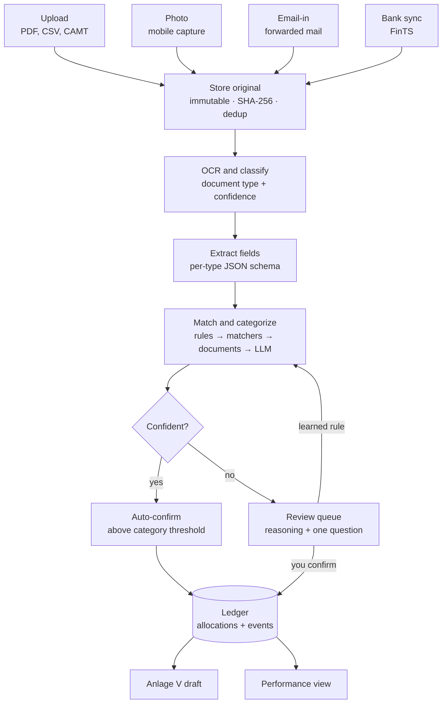
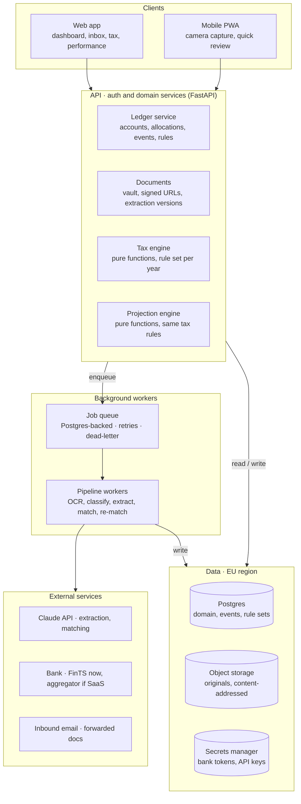

# Hausbuch — Architecture Spec

Nov 4, 2026 · Luis

## Purpose and scope

Hausbuch is a single-household finance workspace, built SaaS-ready. Its first module, the landlord ledger, turns bank statements, invoices and letters into a traceable property ledger, a draft Anlage V each year, and a running profit view through to sale; planned phases 6–9 add every account and asset of the household, the capital-income and crypto forms (Anlage KAP, Anlage SO), and financial health (agreed 6 Nov 2026, design in `docs/design/household-finances.md`).

**In scope (v1)**

- Properties, units, tenancies and tenants, with a full event history per unit
- A document vault: upload, photo capture, email-in; typed and linked to what it proves
- AI-assisted ingestion of bank statements and documents into categorized, split transactions
- A human review queue for anything the system is not sure about
- A deterministic Anlage V draft per property and tax year, every figure traceable to sources
- Performance: actuals plus an adjustable projection to sale, including the 10-year Spekulationsfrist
- Exports: a field-by-field sheet for typing into ELSTER, plus a yearly CSV + PDF archive

**Non-goals (v1)**

- Filing directly to ELSTER (ERiC integration is a later option, not a launch need)
- Multi-user property management for third parties (WEG-Verwaltung, Hausverwaltung)
- Tenant-facing portal, rent collection or payments
- Betriebskostenabrechnung generation (data is captured so it can be added in phase 4)
- Tax advice: the app drafts and explains; the user decides. No DATEV export
- Trading, payments or any write access to an account; naming investment products the household does not already hold (no Anlageberatung)

## Architecture principles

Seven rules every component and every agent-written PR is checked against (the seventh added 10 Nov 2026).

1. **AI explains, code calculates.** LLMs extract, classify, match and explain. Every euro figure in a tax or performance view is computed by deterministic, tested code from stored data.
2. **Every number is traceable.** Each derived figure links to the allocations, transactions and documents it came from. No orphan totals.
3. **Human-in-the-loop by confidence.** Auto-accept only above a per-category threshold; everything else lands in the review queue with the model's reasoning and a concrete question.
4. **Append-only history.** Domain changes are recorded as events; corrections are new events, never overwrites. The History timeline and the audit trail are the same data.
5. **Tax rules are versioned data, not branches in code.** A rule set is keyed by tax year and effective dates, so 2026 stays reproducible after 2027 rules change.
6. **Originals are immutable.** Uploaded files are stored content-addressed (SHA-256) and never modified; extractions, splits and categories are layers on top.
7. **The user needs no tax knowledge.** The app works out the tax treatment itself and proposes it, in a suggestion the user confirms or corrects: what a document implies (every record, each part on its line, whichever account paid it), and every gap it knows of as a plain to-do with the button or link that resolves it. A feature that only works if the user knows to do a tax step by hand is incomplete; no screen states a gap in tax words without saying what to do. Principle 3 still holds: the user confirms, the app never decides alone.

## Domain model

The core chain is Property → Unit → Tenancy → Tenant; money flows in as Transactions and is split into Allocations, which are what every tax and performance figure sums over.

| Entity | Key fields | Relations | Notes |
| --- | --- | --- | --- |
| Owner | name, tax ID ref, ownership share, expected gross pay per year and deductions (`income_input`), church tax yes/no and Bundesland, optional per-year rate override; the typed `marginal_tax_rate` field is dropped (phase 4 spec D90) | owns Properties | Two owners at 50/50, married and filing jointly: one Anlage V carrying both shares. The marginal rate is derived from income, not typed in (see Performance). Phase 4b (specced 10 Nov 2026; the tables and the rules live since 10 Nov 2026, the screens since the same day) adds the return facts per year in `return_input` (certificate and payslip figures, itemised Werbungskosten, wage-replacement benefits; the household's children, childcare, §35a services, donations) and the yearly questionnaire's answers in `questionnaire_answer` (phase 4b spec D97, D109, D110, D112) |
| Property | address, type (ETW, EFH, MFH), build year, purchase date, notarized date, price, Nebenkosten, building/land split + split source (Kaufvertrag, BMF Arbeitshilfe, appraisal) | has Units, Loans, Documents | Notarized date starts the Spekulationsfrist; split drives AfA; privately paid rental costs and trips to the property are `tax_input:private_cost` rows (phase 4b spec D111, live since 10 Nov 2026) |
| Unit | label (WE 3), m², rooms, MEA share (WEG) | belongs to Property; has Tenancies | One Unit for an ETW; many for an MFH |
| Tenancy | start, end, type (unbefristet / Staffel / Index), Kaltmiete, NK-Vorauszahlung, Kaution + account, rent due day, running-cost terms (Vorauszahlung / Pauschale / inklusive; phase 3 spec D67, D72) | links Unit and Tenant(s); has RentSchedule | Rent changes are dated RentSchedule rows, never edits |
| Tenant | name, contact, IBAN (hashed for matching) | in Tenancies | Personal data; see privacy section |
| Loan | lender, principal, rate, fixed until, follow-up rate (user-set), annuity, schedule | belongs to Property | Schedule splits each payment into interest and Tilgung |
| Account | bank, IBAN (masked), source (upload / FinTS; aggregator only if SaaS) | has Transactions | The rental runs on a dedicated account, so every line is property-related; transfers to and from the owners' private accounts are recognized by their IBANs |
| Transaction | booking date, value date, amount, counterparty, IBAN, purpose text, source line hash | from Account; has Allocations | Immutable as imported; dedup on source line hash |
| Allocation | amount, category, tax treatment, property, unit, service period, recurring flag, confidence, status (the tax year it counts in is derived by that year's tax rules from the dates, period and flag, not stored; decided 6 Nov 2026) | splits one Transaction; links Documents | Sum of allocations = transaction amount (enforced) |
| Document | file hash, type, extracted fields, dates, amounts | links to any entity | Original immutable; extraction versioned |
| Rule | matcher (counterparty, IBAN, text pattern), output (category, split template) | created from reviews | How the system learns from your answers |
| Event | type, entity ref, payload, actor (user / system / AI), timestamp | on every entity | Source of the History timeline and audit trail |

Categories are a fixed taxonomy mapped to Anlage V lines through the tax rule set (next sections), so renaming a category never changes a return.

## Ingestion pipeline

Every input — upload, photo, forwarded mail or bank sync — runs through the same asynchronous pipeline, and only confirmed allocations reach the ledger.



The review queue is the only place a person has to act; each answer can become a rule, so the same counterparty is never asked about twice.

- **Idempotent imports:** a statement re-uploaded or overlapping a sync is deduplicated on the source line hash, so imports can be retried safely.
- **Jobs, not requests:** each stage is a queued job with retries and a dead-letter state shown in the inbox as "couldn't read this".
- **Re-run on new evidence:** when a missing document arrives (e.g. the Wirtschaftsplan), affected allocations are re-matched and their splits updated as new events.
- **Sync and email-in use the same path (phase 5):** a bank sync stores the bank's camt documents as one immutable ZIP and runs the same import as an upload, and only when it brings a new line; email-in stores each attachment of a forwarded mail as an upload (source `email`) and never the mail itself.

## AI layer

The AI does four bounded jobs, each with a strict output schema and a fallback to the review queue; it never writes ledger data directly.

| Job | Input | Output (schema) | Model tier | Fallback |
| --- | --- | --- | --- | --- |
| Classify document | file + OCR text | type ∈ {statement, invoice, letter, contract, Bescheid, Zinsbescheinigung, Wirtschaftsplan, Hausgeldabrechnung, other}, plus Lohnsteuerbescheinigung and Gehaltsabrechnung from phase 4b (D96, live 10 Nov 2026, PR #111) and the Einkommensteuerbescheid as a subtype of Bescheid (phase 4b D129, live 10 Nov 2026, PR #128), and about forty catalogue subtypes in seven groups, each read for its title and date (phase 2 D130, D131, live 10 Nov 2026, PR #135), confidence | small, fast | type = other → review |
| Extract fields | file + type | per-type fields (dates, amounts, IBANs, parties, line items, periods), each with page + quote | mid | missing required field → review |
| Pre-fill proposal | extraction + existing records | records to create or patch, applied only through the existing commands after the user verifies each value | none (code) | nothing applied without the user |
| Match and categorize | transaction + candidate tenancies, loans, documents, rules | allocations[], links[], confidence, reasoning, question? | mid; large only for ambiguous cases | confidence < threshold → review |
| Explain and ask | allocation + rule context | plain-language reasoning + one concrete question | small | template text |

**Matching order (cheapest first)**

1. Exact rules learned from your past answers (counterparty IBAN + pattern)
2. Deterministic matchers: tenant IBAN + amount = rent; loan account + amount = annuity, split by schedule
3. Document match: amount ± 0.01, date window ±10 days, IBAN or invoice number in purpose text
4. LLM categorization with retrieved context (similar past allocations, the property's open items)

**Guardrails**

- Structured outputs validated against JSON Schema; invalid output is retried once, then sent to review. Extraction of document fields uses citations instead (page + quoted text per value) because the API does not combine citations with JSON-schema output; the lines are parsed and validated against the Pydantic field types in code, and a value not recoverable from its quote is marked low-confidence (phase 2, D15)
- Allocation sums must equal the transaction amount; the validator, not the model, enforces it
- The model sees only the minimum context: no other tenants' data, IBANs masked except the one being matched
- Prompt-injection hardening: document text is passed as fenced data; extracted instructions are ignored
- Every AI decision stores model, prompt version, input hash and output, so a category can be explained and replayed
- An eval set of real (anonymized) statements and invoices gates prompt and model changes in CI

## Tax rules engine (Anlage V)

A pure function `draft(property, taxYear, ruleSet) → AnlageVDraft` turns confirmed allocations into form lines, each carrying the ids of its sources; nothing here calls a model.

**Shape**

- `RuleSet` = tax year + effective dates + a list of rules + a form mapping (category → Anlage V field for that year's form), keyed by stable line codes with the Zeile and the ELSTER Kennzahl per form year; a year whose form is not yet published reuses the previous mapping marked provisional (phase 3 spec D53). Form line numbers move between years, so the mapping is maintained per year, never hard-coded.
- Each rule is a small tested function over allocations and property facts, returning lines, warnings and open items.
- Output `AnlageVDraft` = income lines, Werbungskosten lines, result, warnings, missing documents, and a source list per line.

**Rules for v1**

| Rule | Logic | Data it needs |
| --- | --- | --- |
| Zuflussprinzip (§11 EStG) | Income and costs in the year paid; recurring payments within 10 days of year end, *and due within the same days* (BFH X R 2/21), go to the year they belong to | booking date, recurrence flag, service period, due date (loan schedule, the tenancy's rent due day, the period) |
| AfA linear (§7 Abs. 4) | Rate by completion year: before 1925 2.5%, 1925–2022 2%, from 2023 3%; pro rata by month in the purchase year | build year, transfer-of-ownership month, building share of the purchase price *and of the Nebenkosten rows*, split source; `purchase_price` and `acquisition_cost` allocations are evidence only (phase 3 spec D55); costs capitalised later join the basis gross (D73) |
| Anschaffungsnahe Herstellungskosten (§6 Abs. 1 Nr. 1a) | Renovation performed within 3 years of the handover (to the same calendar day, inclusive) above 15% of building cost (net of VAT) → capitalized into AfA basis, not expensed; a Herstellungskosten election counts toward the 15%, an Erweiterung does not (phase 3 spec D74–D76) | renovation allocations with their service period, net amounts, purchase date |
| Erhaltungsaufwand | Deductible in year paid; optional spread over 2–5 years (§82b EStDV) as a user choice | category, user election |
| Schuldzinsen vs. Tilgung | Interest deductible, repayment not; Geldbeschaffungskosten deductible | loan schedule, Zinsbescheinigung to reconcile |
| Hausgeld split | Umlagefähig and Verwaltung deductible when paid; Erhaltungsrücklage only when the WEG spends it (from the Hausgeldabrechnung) (BFH IX R 19/24: contributions to the Erhaltungsrücklage are deductible only when the WEG spends them; the Hausgeldabrechnung's Entnahme, confirmed by the user, goes to the Erhaltungsaufwand line) | Wirtschaftsplan, Hausgeldabrechnung |
| Umlagen | NK prepayments and settlement back-payments are income; refunds to tenant reduce income | tenancy, settlement documents |
| Verbilligte Vermietung (§21 Abs. 2) | Rent below 50 % of the local comparable (warm) rent → the letting is split and only the paid share's costs count (Z87); 50–66 % → warning that a Totalüberschussprognose is needed; ≥ 66 % → full deduction (§21 Abs. 2 EStG as of 2021) | Mietspiegel net cold rent per m² entered by user, plus the year's umlagefähige costs from the ledger (phase 3 spec D61) |
| Private sale (§23) | Sale more than 10 years after the notarized purchase → tax-free; otherwise gain = sale price − selling costs − (cost − AfA claimed) | notarized dates, AfA history (the building AfA and a fitted kitchen's AfA claimed, from the recomputed drafts; Freigrenze per spouse from the sale year's rule set, €1,000 since 2024; phase 4 spec D88, D93, D94) |

Each rule ships with fixture tests built from worked examples, reviewed against the official guidance for that year before the year's rule set is published.

**Anlage N, the whole return and the yearly questionnaire (phase 4b, specced 10 Nov 2026; rules live 10 Nov 2026, PR #109; screens live the same day, PR #115).** The Anlage N rules are per-year data (`anlage_n/<year>.yaml`, D99), with the 2025 form mapping marked provisional for 2026. The whole-return estimate applies the Progressionsvorbehalt, the Kindergeld-or-Freibeträge check and the §35a credit in one `assessed_tax`, which also becomes phase 4's T (D98, D101, D109, D112). The questions the household answers each year are per-year data too (`questionnaire/<year>.yaml`, D110), pre-filled from the previous year, with reminders for what the app does not compute; §33, Riester, Unterhalt, Vorauszahlungen and capital income are not modelled and the screen says so (D95).

**Rule data 2027 (phase 5, D124).** The 2027 files are written from the Bundesgesetzblatt only. As of 10 Nov 2026 the Einkommensteuerreformgesetz 2027 (Grundfreibetrag 12,564, Kindergeld 267, Kinderfreibetrag 3,564, Arbeitnehmer-Pauschbetrag 1,430, §35a Handwerker 15 %, a 47 % zone) and the Rechengrößen 2027 are a bill and a draft Verordnung; only the 2.9 % average Zusatzbeitrag is published. Until the data PR, 2027 is served by the 2026 files marked `reused_from`, as D81 and D99 intended for a projected year. The Grundsteuer instalment dates and amounts come from the Bescheid as a confirmed `grundsteuer_schedule` tax input (phase 5 spec D126).

**Ownership:** the property is held 50/50 by spouses filing jointly, so the engine produces one Anlage V with both owners' shares and no separate Feststellungserklärung. Unmarried co-owners would need one (ESt 1 B); that is a SaaS-phase extension.

**AfA split source:** when a property is added, the user picks the Kaufvertrag split, the BMF Arbeitshilfe (guided input, result stored), or an appraisal (Gutachten stored as evidence). The engine records which one was used and warns when a contract split gives a building share far above the BMF result, since that is what the Finanzamt tends to question.

The draft is a planning aid; the UI says so on every export.

## Performance and projection

Performance = actuals from confirmed allocations, plus a year-by-year projection to a chosen sale year that reuses the same tax rules, so the forecast and the return never disagree on treatment.

**Actuals (per property, per year)** — rent in (Kaltmiete), cash paid out, tax effect (the tax with the rental result minus the tax without it, on the derived taxable income; phase 4 spec D82), net cash, and principal repaid. Umlagen are shown as pass-through so cash isn't distorted by settlement timing.

**Projection inputs**

- User levers: value growth %, rent growth %, expected gross pay per owner (or a marginal-rate override), sale year
- From the ledger: loan schedule, AfA basis and rate, current rent, Hausgeld split, purchase and Nebenkosten
- Defaults the user can edit: upkeep per year, cost inflation, selling costs %

**Per projected year**

1. Rent = current Kaltmiete × (1 + rent growth)^n
2. Interest and Tilgung from the loan schedule (after the fixed period, a user-set follow-up rate, defaulting to today's rate)
3. Taxable result = rent − interest − AfA − deductible costs; tax effect = T(zvE + result) − T(zvE) (phase 4 spec D82)
4. Cash after tax = rent − annuity − costs paid − tax effect (a saving, which is a negative tax effect, adds cash; corrected 9 Nov 2026, phase 4 spec §10.4)
5. Value = purchase price × (1 + value growth)^n; equity = value − loan balance

**Marginal rate (decided 6 Nov 2026)**

The rate is computed, not remembered: people know their gross pay, not their Grenzsteuersatz, and the assessment (Einkommensteuerbescheid) that states the real taxable income arrives months after the year it covers, so the current and future years always need an estimate.

1. Per owner and year, the user enters expected gross pay; standard deductions (Werbungskosten-Pauschbetrag, employee social-insurance share, Sonderausgaben) are estimated by default and editable. The result is marked as an estimate. Unemployment-insurance contributions are not deducted (the §10 Abs. 4 cap is used up by health and care insurance, phase 4 spec D84).
2. The rental result for that year comes from the ledger (actuals) or the projection, and is added to the estimated taxable income (zvE) automatically.
3. The joint splitting tariff (§32a EStG) gives the marginal rate at that zvE, plus the solidarity surcharge where it applies and church tax (8 or 9% by state) when the user says yes. The tariff is versioned rule data per tax year like every other rule; a projected year without a published tariff reuses the latest one. The rate the screen shows is the effective rate on the rental result (effect ÷ result), not the tariff's slope (phase 4 spec D82).
4. When a Bescheid arrives, its zvE replaces the estimate for that year as a new event (append-only, the estimate stays in History); the user types it in or uploads the Bescheid, whose zvE the model reads and proposes for confirmation (phase 4b D129, live 10 Nov 2026, PR #128; until then this point promised a reading that had never been built).
5. An explicit rate entered by the user always overrides the derived one for that year, and the UI shows which source each year used (estimate, Bescheid, override).
6. From phase 4b (specced 10 Nov 2026; the rules and the hook live 10 Nov 2026, PR #109; the documents are read since step 2, PR #111): once a payslip or a Lohnsteuerbescheinigung is confirmed, its pay and Vorsorgeaufwendungen and the itemised Werbungskosten replace the estimate for that year; a typed deductions override still wins; T includes the Progressionsvorbehalt, the children's Günstigerprüfung and the §35a credit when the household has such rows (phase 4b spec D98, D109, D112).

**At sale**

```
Profit = (V_sale − C_sell − T_sale − L_sale) + Σ CF_y − E₀
```

V = sale value, C = selling costs, T = tax on the sale (zero after the Spekulationsfrist), L = remaining loan, CF = yearly cash after tax, E₀ = initial equity. A profit bridge (appreciation, debt paid down, cash flow, buying costs, selling costs, sale tax) explains where it came from. Annualized return on equity is shown as a simple CAGR; and an IRR on dated cash flows (phase 4).

The sale-year lever shows the §23 cliff explicitly: a sale inside 10 years adds the claimed AfA back into the taxable gain.

## System architecture and stack

A modular monolith on one Postgres: one API, one worker pool, no microservices until there is a second user to justify them. It is SaaS-ready from day one: every table carries a workspace id (the household, distinct from the Owner entity) that Postgres row-level security enforces.



Requests never wait on a model: the API enqueues, workers call the LLM and write results back as pending allocations for the review queue.

In v1 the job worker runs inside the API process (a FastAPI lifespan task) in the one container that serves port 8080, so "Background workers" is a task in the API container rather than a second deployable; a separate worker container comes only when load justifies it (decided 5 Nov 2026, see Decisions; phase 2: Procrastinate, its schema applied by migration 0005, its tables outside row-level security, spec D20).

| Layer | Choice | Why |
| --- | --- | --- |
| Language | Python 3.12 for API, workers and rule engine; TypeScript only in the frontend | python-fints for bank sync; Pydantic models double as LLM output schemas; frontend types generated from OpenAPI |
| Web + PWA | Next.js with a PWA manifest for capture | One codebase; camera access works in mobile browsers |
| API | FastAPI with OpenAPI generated from Pydantic models; py_webauthn for passkeys | Agents can code against a typed contract |
| Database | Postgres 16+, SQLAlchemy + Alembic migrations, row-level security keyed on workspace | Relational ledger, JSONB for extractions, events in the same transaction |
| Queue | Procrastinate (Postgres-backed) on the same Postgres | No extra infrastructure; jobs commit atomically with data |
| Files | S3-compatible object storage in an EU region | Cheap, immutable originals, signed URLs |
| AI | Claude API: Haiku 5.5 to classify and explain, Sonnet 5.5 to extract and match, Opus 5.5 for ambiguous matches; citations for extraction, structured outputs for classification and matching; one `ModelClient` interface so an EU-hosted route (Bedrock, Vertex) can replace it | Schema-valid JSON, tiering keeps cost per statement low |
| Bank | CSV/CAMT/PDF uploads (phase 2), FinTS via python-fints 5.x for your own accounts (phase 5: HKCAZ camt only, read-only facade, decoupled pushTAN); licensed aggregator only if it goes SaaS; phase 6 (spec 12 Nov 2026): FinTS for the household's own accounts at the Sparkassen and DKB, one connection per institute and login with the PIN as a named container secret `HAUSBUCH_FINTS_PIN_<SLOT>` (built 12 Nov 2026, PR #220), DKB's CSV export read by code (built, PR #221) and camt over FinTS only if its bank parameters offer it, the credit card's PDF statements read by code (built 13 Nov 2026, PR #237; a second issuer, Consors Finanz, PR #260); quirion via documents built 13 Nov 2026 (PR #244), BISON and Binance via their CSV exports built 13 Nov 2026 (D178, PR #256) (phase 6 D163, D165, D173, D176) | Value first; FinTS needs only a free product registration; all behind one BankSource interface |
| Market and chain data (phases 6–8; the ETF issuers' NAV, Kraken, CoinGecko and the ECB built 13 Nov 2026, PR #254, the CoinGecko Demo key a container secret `HAUSBUCH_COINGECKO_KEY`) | Helius (Solana), Etherscan API V2 (EVM; free tier covers Ethereum, Arbitrum, Polygon, Linea), plain RPC for balance-only wallets, CoinGecko + Kraken public daily prices, ECB FX; ETF prices from the issuers' own published daily NAV per ISIN (`issuer_nav`, one adapter per issuer, the depot's documents as the fallback; own use under the issuers' personal-use terms, a licensed NAV feed for SaaS; phase 6 D174, Luis 12 Nov 2026); behind `ChainSource` and `PriceSource` | Free tiers cover own use; providers are non-EU and must be replaced or contracted for SaaS |
| Hosting | Scaleway (EU): Serverless Containers for API+worker and web, Managed PostgreSQL on a private network, Object Storage; one-off admin commands run from the operator's computer with `uv` (decided 5 Nov 2026) | EU-only vendor, DPA, data and backups; about €20/month ex VAT at this load; compatibility tested 5 Nov 2026 |
| Tests | pytest for rules, golden-file tests for extraction evals, Playwright for flows | Rules and prompts change safely |

## Security, privacy and retention

The app holds bank data, tenant personal data and tax records, so it is built as if it will be audited: EU-only hosting, encryption everywhere, least-privilege access, and explicit retention per document type.

**Security**

- EU region for database, object storage and backups; AI calls through a provider and settings with no training on inputs and EU data processing where offered. Checked 6 Nov 2026: the Claude API offers US or global inference only, no EU option; data is processed under the DPA's standard contractual clauses and deleted within 30 days; tenant documents are sent only after the controller's explicit decision (phase 2 spec §11)
- Encryption at rest (storage + DB) and in transit; IBANs stored masked plus a keyed hash for matching
- Passkey login (decided 5 Nov 2026); short-lived sessions; FinTS PIN and any bank tokens in a secrets manager, never in the DB (phase 5: the PIN and the DK product id are secret environment variables of the API container, like the API key (Scaleway's Serverless Containers cannot reference Secret Manager, so the container variable is the store and a Secret Manager copy is optional, Luis 11 Nov 2026; the product id arrived 11 Nov 2026 and is never published); the FinTS client state, without the PIN, is stored HMAC'd; the `fints` logger runs at WARNING, and the app's own trace of each FinTS exchange (segments, non-secret settings, answer codes with the segment they refer to) is logged redacted, never a PIN, login, product id, system or dialog id, IBAN, amount or camt content (phase 5 D148, 11 Nov 2026); the Google app password for email-in is a container secret too, and it opens the whole mailbox, so the limit to one label is enforced by the app's code, which issues only read-only IMAP commands, decided by Luis on 10 Nov 2026 over a separate account)
- Object storage private; files served via short-lived signed URLs
- Wallets are tracked by public address only; no private keys, seeds or exchange trading keys are ever accepted; chain and price provider keys live in the secrets manager; addresses and hashes are masked in events and never sent to the model (agreed 6 Nov 2026, phases 6–9)
- Audit log = the Event table; admin actions and AI decisions included (sign-in and passkey actions go to the server log in phase 1 and join the Event table in the phase 2 spec PR, decided 5 Nov 2026)
- Database reachable on the private network for the app, plus a public endpoint that accepts only the operator's IP for the rare admin commands; `CONNECT` revoked from `PUBLIC` and granted to the two Hausbuch roles only

**Privacy (GDPR)**

- The landlord is the controller for tenant data; the app documents what it stores and why (lease performance, deposit, Betriebskostenabrechnung)
- Data minimization in AI prompts (see AI layer); no tenant data in logs
- Email-in (phase 5) reads only the attachments of mails a member forwarded to a token address in the household's own Gmail account, authenticated by Gmail's own DKIM/SPF result; the sender, subject and body are never stored and nothing in the mailbox is changed; the forwarded documents are at Google (US) before the app sees them, by the household's choice of mail provider, so the app adds no processor; tenant documents are better uploaded than forwarded, and forwarded ones meet the `ai_tenant_documents` gate exactly as uploads do. Reminder emails carry the kind of deadline, its date and a property or unit label only, never an amount or a tenant's name (phase 5 spec D121, D123)
- Export and delete per person; deletion respects retention holds below
- From phase 4b (live 10 Nov 2026, PR #111): the owners' Lohnsteuerbescheinigungen and payslips are read by the model under the same terms as the property documents (the second owner agreed on 9 Nov 2026), and from phase 4b D129 the Einkommensteuerbescheid too (the agreement covers it, Luis 10 Nov 2026; only the year, the zvE, the date, the assessment type and the addressee are stored); only the tax figures, the employer and the period are stored, never the Identifikationsnummer, Sozialversicherungsnummer, date of birth, IBAN or address; a child is stored as a birth date only; questionnaire answers are codes, never free text (phase 4b spec D96, D103, D109, D110). The household's own answers are never written into this public repository; specs and fixtures use invented owners A and B (Luis, 10 Nov 2026)

**Retention defaults (user-adjustable)**

| Document class | Default retention | Why |
| --- | --- | --- |
| Purchase contract, Kaufpreisaufteilung, loan contract | Life of ownership + 10 years | AfA basis and §23 gain calculation |
| Bank statements, invoices, Bescheide | 10 years after the tax year | Covers assessment and correction periods with margin |
| Lease, handover protocol, deposit records | End of tenancy + 4 years | Claims after move-out and deposit settlement |
| Tenant contact data | End of tenancy + 4 years, then deleted | Minimization |
| Lohnsteuerbescheinigung, Gehaltsabrechnung (phase 4b) | 10 years after the tax year | The return's evidence until the assessment is final; conservative |

Retention periods are conservative defaults, not legal advice; confirm with a Steuerberater before enabling auto-delete.

## Delivery phases

Nine phases plus a small phase 4b (Anlage N, added 9 Nov 2026), each shippable on its own; phase 3 is the first one that saves real time at tax season, so phases 1–3 are the MVP of the landlord module, and phases 6–9 (planned, agreed 6 Nov 2026) extend it to the whole household.

| Phase | Delivers | Done when |
| --- | --- | --- |
| 1 · Vault and ledger | Properties, units, tenancies, tenants, loans; document upload with manual typing and linking; History timeline from events; a per-property document checklist from the data phase 1 holds (added 6 Nov 2026) | Closed 6 Nov 2026 with everything built and live; the real data moves to phase 2's AI pre-fill (Decisions) |
| 2 · AI inbox | AI pre-fill of property, Nebenkosten, loan, tenant, tenancy and rent records from uploaded documents, each value shown with its page and quote so it is verified, not typed (first, added 6 Nov 2026); CSV/CAMT/PDF statement import, document classification and extraction, matching pipeline, review queue, learned rules, PWA mobile capture | The real flat, loan and tenancy were entered through pre-fill; a month's statement imports with ≥ 80% auto-matched, zero allocation-sum errors, every statement reconciling to its balances, and a repeat answer is never asked twice |
| 3 · Tax year | Spec `docs/phases/phase-3.md` merged 9 Nov 2026 with its step 0 (schemas, migration 0013, rule sets, fixtures; PR #79), migration 0013 applied; steps 1 and 2 (rules, Anlage V draft with source links, Steuern screen, tax inputs, certificate pre-fill, checklist entries) merged and deployed 9 Nov 2026 (PR #81); step 3 (ELSTER field sheet PDF, yearly ZIP archive, export history) merged and deployed 9 Nov 2026 (PR #84); the Erweiterung guard (D78, PR #85) and a shorter useful life from a Gutachten (D79, migration 0014 applied, PR #88) and the fitted kitchen as its own 10-year asset (D80, migration 0015 applied, PR #93) merged and deployed the same day; step 4 (closing against a hand calculation) not started. Rule set 2026 (form mapping provisional until ELSTER publishes the 2026 Anlage V), Anlage V draft with source links, missing-document checklist (extends the phase 1 checklist's requirement list with rule-derived items), 15% limit tracker, ELSTER field sheet and yearly CSV + PDF archive | The 2026 draft reproduces a hand-calculated return to the euro, and every line opens its sources |
| 4 · Performance | Spec `docs/phases/phase-4.md` with its step 0 (schemas, migration 0016, tariff 2026, fixtures) merged 9 Nov 2026 (PR #95), migration 0016 applied and deployed the same day; step 1 (tariff, income inputs, Steuerwirkung) merged and deployed the same day (PR #97); the net-cash sign corrected (PR #100); steps 2 (actuals, projection, sale) and 3 (Planung screen) merged and deployed the same day (PRs #98, #101); an electricity category and the Pauschale check over the months in force (D92, migration 0017, PR #103) deployed the same day; the §23 Freigrenze as rule data and the kitchen AfA added back at a taxable sale (D93, D94, PR #105) deployed the same day; step 2c, the Pauschale rise test as its own card on Planung with to-dos and the letter to a tenant (D155), merged and deployed 12 Nov 2026 (PR #214, images 6c08f5167d20, no migration), with the letter (D155 (7)) and two review fixes (no false Grundsteuer rise in the first year of instalments; a recorded change ends the to-do at once); step 4 (closing against Luis's spreadsheet) not started. Actuals, projection, profit bridge, §23 sale check, IRR, marginal rate derived from expected income, a Pauschale check (costs vs flat rates); the Betriebskostenabrechnung generator is step 5, built once the first prepayment lease exists (D91, Luis 9 Nov 2026) | Projection matches a spreadsheet model for 3 scenarios ("one settlement generated from real 2026 data" dropped, Luis 9 Nov 2026) |
| 4b · Lohn und Einkommensteuer (spec merged 10 Nov 2026, steps 1–4 live 10 Nov 2026) | Spec `docs/phases/phase-4b.md` drafted 9 Nov 2026 and revised 10 Nov 2026 with the household's decisions (kept outside the repo) and a yearly guided questionnaire, merged 10 Nov 2026 (PR #107); step 0 (schemas, migration 0018, rule data, fixtures) written 10 Nov 2026 and merged 10 Nov 2026 in PR #108; step 1 (Anlage N rules, whole-return estimate, questionnaire rules and services, privately paid rental costs, the hook into phase 4's tax effect; review fixes and D113, D114) merged and deployed 10 Nov 2026 in PR #109 with migration 0018 applied (images 7f517c3472aa); screens followed in step 3; step 2 (reading the Lohnsteuerbescheinigung and the Gehaltsabrechnung with the identifier scrub; review fixes) merged and deployed 10 Nov 2026 in PR #111 (images 5db0d59de899); step 3 (the Anlage N tab, the Gesamt card on Steuern, the Jahresfragen flow at /tax/<year>/fragen, the Kinder and Haushalt blocks on Eigentümer) merged and deployed 10 Nov 2026 in PR #115 (images 00bf528b429c); step 4 (the Anlage N field sheet per owner, and both sheets and the estimate as pages of the yearly archive) merged and deployed 10 Nov 2026 in PR #117 (images aceb0838f80c); the step 3 follow-ups deployed 10 Nov 2026 (PR #120, images 4627b63ac8bf); step 5 (closing against the real 2026 certificates) in 2027. Both spouses' Anlage N from each employer's Lohnsteuerbescheinigung (AI pre-fill, every value confirmed), payslips to keep the year's pay estimate current, itemised employment Werbungskosten (commute, home office, work equipment) checked against the Arbeitnehmer-Pauschbetrag per spouse, and a whole-return estimate (refund or back-payment) on phase 4's tariff engine; the confirmed figures replace phase 4's estimated gross pay and deductions; also the häusliches Arbeitszimmer, payslips read monthly, Vorsorgeaufwendungen from the certificates, the Progressionsvorbehalt, children (Kindergeld or Freibeträge, childcare), the household's §35a credit and donations, the §46 filing check, privately paid rental costs on the Anlage V, and a yearly guided questionnaire (Jahresfragen) as per-year data | The 2026 Anlage N for both spouses matches a hand check, the whole-return estimate matches a hand calculation of the joint tax, and every question of the year's questionnaire is answered |
| 5 · Automation (spec merged 10 Nov 2026) | Spec `docs/phases/phase-5.md` drafted 10 Nov 2026 and revised the same day with Luis's decisions (PIN as a container secret, daily sync, Gmail label for email-in, digest emails, all eleven reminder kinds, 2027 data from the Bundesgesetzblatt only), merged 10 Nov 2026 (PR #119); step 0 (schemas, migration 0019 with retried reminder emails, fixtures) merged 10 Nov 2026 in PR #125, 0019 applied and deployed (images b176fe3e3818); step 4 (email-in from the Gmail label, with the review's fixes: a card when the poll cannot log in, find its label or reach Gmail, and one refused mail no longer blocks the rest) merged and deployed 10 Nov 2026 in PR #129 (images e8b0dcc718e6, no migration); it stays inert until the four inbox secrets are set (runbook step 16); parked on 12 Nov 2026 (Luis): the household's Gmail account cannot create an app password, so email-in would need a separate Gmail account used only for Hausbuch, which needs no code change; step 3 (in-app reminders: eleven kinds on Übersicht and Zu prüfen with acks, the Grundsteuerbescheid expected from the first full year of ownership, the `grundsteuer_schedule` tax input from the Bescheid; review fixes: the Grundsteuer card outside the draft) merged and deployed 10 Nov 2026 in PR #139 (images edebd21b1ec3, no migration); step 1 (the manual FinTS sync, D141 from its review) merged and deployed 11 Nov 2026 (PR #160, images 2b2a05dbecae, no migration), the first successful sync ran on 12 Nov 2026 once the Sparkasse had the registration: 23 lines from 1 Apr to 12 Nov 2026, 22 recognised as already imported from the export by the bank's reference and one new (an electricity payment, matched and confirmed by Luis), the file's own balances reconciled (Q-O34 in part, Q-O36 answered); step 2 (the daily automatic fetch at 06:30 UTC with the „Täglich automatisch abrufen“ switch; a pushTAN demand ends the run and shows a Zu prüfen card, no retry until a person acts; a refused run is never retried automatically) merged and deployed 12 Nov 2026 (PR #200, images 52f8c4aeaf16, no migration); step 2b (the bank's own PDF statements fetched by number into the yearly archive, D154, migration 0024) merged and deployed 12 Nov 2026 (PR #212, images a8d6bde53f05, migration 0024 applied); the switch „Kontoauszüge als PDF abrufen“ was turned on by Luis on 13 Nov 2026 (this line said it was off until he did); the first daily run after it (14 Nov 2026) stored no statement although the bank's parameters offer them by number (HIEKPS, recorded 13 Nov 2026), because the bank refused the request with 9370 („Es liegt keine Auftragsberechtigung im Institut vor“, read from the run's log on 14 Nov 2026): the bank offers the business transaction but has not authorised this online-banking access for it, and the app read that refusal as „no such statement“ and showed nothing; the DK code list names 9370 „Signaturberechtigung reicht nicht aus“ (this login's signing authority on the account is not enough), and this Sparkasse's bank parameters do not offer HKEKB, the FinTS request to apply for electronic statements, so the permission cannot be asked for from the app (checked 14 Nov 2026); Luis switched „Kontoauszüge als PDF abrufen“ off again on 14 Nov 2026 until the Sparkasse enables it, and the archive relies on the app's own `zahlungsnachweise.pdf` meanwhile; the refusal is shown on the Bankabruf card and in Zu prüfen while the switch is on (D154 amended, PR #273); step 3b (the daily reminder digest email: the Scaleway Transactional Email client, the 06:00 UTC `send_reminders` task with one digest per enrolled member, the „Erinnerungen per E-Mail“ switch on Einstellungen, runbook step 15; review fixes: the `workspace.notification_sent` event written) merged and deployed 12 Nov 2026 (PR #197, images 9e3324cad122, no migration); the sending domain mail.rcubed.fr was verified the same day; the sending key and the three settings were added to the API container and „Erinnerungen per E-Mail“ switched on 12 Nov 2026 (checked 13 Nov 2026: the daily run succeeded twice and sent nothing, since no deadline had reached one of its email lead days; this line said it was still inert until then). FinTS read-only sync of the rental account through the unchanged camt import path, the ZIP kept only when it brings a new line (D115–D117, D127); pushTAN approval by polling (D118); PIN and product id as container secrets (D119); a daily schedule inside the 180-day window (D120); email-in by reading one label of the household's own Gmail account over IMAP, read-only, attachments only (D121); deadline reminders computed on read with in-app cards and a daily digest email (D122, D123); the Grundsteuer schedule confirmed from the Bescheid (D126); rule set 2027 as a data PR gated on enactment (D124) | Statements arrive without manual upload; reminders fire for Grundsteuer and the tax return deadline; the settlement reminder (§556 Abs. 3 BGB) is built for a prepayment lease and covered by its fixture until the first such lease exists (the household's leases are flat-rate, D72/D91; amended 10 Nov 2026, phase 5 spec D128). The first Grundsteuerbescheid for a property bought in 2026 arrives early in 2027, so the real-data close is expected in Q1 2027 |
| 6 · Konten & Vermögen (spec drafted 12 Nov 2026, `docs/phases/phase-6.md`; step 0 (schemas, migration 0025, fixtures) merged and deployed 12 Nov 2026, PR #218, images 9c894a3e8a1a, migration 0025 applied; step 3 (FinTS per bank login, DKB) deployed 12 Nov 2026, PR #220, images 5e1b12eb986b; step 1 (private accounts, taxonomy, owner shares, DKB CSV) deployed 12 Nov 2026, PR #221, images 62e07f992b64, no migration; step 2 (transfers, D161's paths, the Haushalt screen) deployed 12 Nov 2026, PR #232, images 6e72509fa19e, no migration; step 2b (the credit card, migration 0026) deployed 13 Nov 2026, PR #237, images 712048c6c464; an already-linked pair no conflict and a new private account re-checking the lines that name it, PR #239, images 91a5d6925d03, no migration; a statement's own opening balance offered as the account's starting balance, a missing statement named, never bridged, PR #242, images 0192ee0f6120, no migration; step 4 (the quirion depot by its documents, the ETF tab, and D177: every depot document explained in plain words) deployed 13 Nov 2026, PR #244, images 74ab1bbf3b42, migration 0027 applied, and „Depot“ in the account form, PR #246, images 021bd0e15213, and „Auf Konto importieren“ for a card or depot statement stored under Dokumente, PR #249, images 5d3f82d7b2db, no migration, and „Konto anlegen und einlesen“ for a statement whose account does not exist yet, PR #258, images df408ec4c68c, no migration, and a second card issuer's statements read by code, PR #260, images 7831ebd7cc55, no migration; and Zu prüfen shows a waiting card or depot line's payee, amount and payment date; it had loaded the bank accounts' lines only, PR #252, images 4dd89b555161, no migration; step 5b, prices from the ETF issuers, Kraken, CoinGecko and the ECB, PR #254, images 507515e4fff8, no migration; step 5a, BISON's and Binance's exports read by code, PR #256, images b2aca2d75fe8, migration 0028 applied; finer household categories and „Erstattung“ (a refund lowers spending), „Alle N bestätigen“ per category on Zu prüfen, and a one-off re-ask of the lines parked in coarse codes (D159 amended) merged and deployed 13 Nov 2026 (PR #263, images 1b26e89791f2, migration 0029 applied); the re-ask queued 297 lines the same day and left 4 possible purchase costs alone; a counterparty IBAN used by two or more payees (a bank's card clearing IBAN) treated as shared, so a learned rule there names the payee and the question names the payee, „Alle N bestätigen“ listing its lines with tick boxes, and a typed 0 kept as 0 (D160 amended) merged and deployed 14 Nov 2026 (PR #265, images a66bbbdfb6b0, no migration); „Differenz als Korrektur buchen“, a coin's typed difference an exchange export misses booked by a person with a reason (D178 amended), merged and deployed 14 Nov 2026 (PR #268, images 4db7c2024bfb, migration 0030 applied); steps 6–7 not built) | Account kinds with owner shares, private Sparkasse accounts with a household taxonomy, generalized internal-transfer matcher, quirion depot via document extraction (statements, quarterly reports, dividend notes, trade confirmations, tax certificate), BISON CSV import, assets, prices and valuations, Konten and Anlagen screens, household overview | Every account in with an owner share; second month ≥ 80 % auto-categorized; all internal transfers linked, zero counted as income or cost; one month-end net worth equals a spreadsheet to the euro |
| 7 · Krypto-Ledger (spec drafted 13 Nov 2026, `docs/phases/phase-7.md`, PR #262, with Luis's answers: a Solana wallet and a Tangem with Bitcoin, BNB Smart Chain (balance only), Ethereum-family and Solana addresses, owned 50/50; Solana read over standard RPC with Helius optional (D192), the full history classified; the rows of this table and the Decisions it amends (§17) are updated with step 0; nothing built) | Chain registry, Helius (Solana) and Etherscan V2 `ChainSource`, balance-only wallets via RPC, wallet sync with on-chain balance reconciliation, movement categories, protocol decoders as data, lots with FIFO per wallet and the holding-period countdown, year-end holdings statement | Every wallet reconciles to its balance; the Solana wallet's full history classified with ≥ 90 % auto on the second sync; the 31 Dec 2026 statement exists for every wallet and BISON |
| 8 · Steuern KAP + SO (planned) | Rule set SO (BMF letter of 6 Mar 2025), KAP from Jahressteuerbescheinigungen, Termingeschäfte, per-owner Freigrenzen and Pauschbetrag, Steuern tabs, three-form field sheet, Steuerreport export | A year's SO draft reproduces a hand calculation to the euro with every line opening its lots and prices; the KAP verdict matches a hand check |
| 9 · Finanzgesundheit & Planung (planned) | Net worth, savings rate, reserve months, debt ratios, LTV, investable surplus; household plan with levers; AI explanation limited to amounts, asset classes and existing accounts, with a validator; `advice_mode` | Metrics match a spreadsheet for three months; the validator rejects every instrument name in the eval set |

Phases 6–9 were agreed on 6 Nov 2026 in this order, after 4 and 5 (Luis kept the original order). Design: `docs/design/household-finances.md`; each still starts with its own spec PR; phase 6 is specced (12 Nov 2026, `docs/phases/phase-6.md`, with Luis's answers: three current accounts at three institutes, the AI may read private lines and depot documents once a member switches it on (both owners agreed; a second click was dropped the same day, D168), no loan besides the property's, ETF prices from the issuers), and its steps 0 to 3 are deployed (12 Nov 2026, PRs #218, #221, #232, #220), and step 2b, the credit card, on 13 Nov 2026 (PR #237), and step 4, the depot by its documents, on 13 Nov 2026 (PR #244); none of phases 6–9 is otherwise built. Because they come after phase 5, the 2026 Anlage SO may not come from the app in time for the 31 Jul 2027 deadline; it is then prepared by hand or from a tax tool's export, and the app takes over from 2027.

Each phase starts with a short spec PR (schemas, rule fixtures, eval cases) before agents write implementation code.

**Input for the phase 2 spec (agreed 6 Nov 2026).** A design check before the spec PR found five places where the pipeline above assumes something the real account and paperwork do not do. The spec PR settles each one in its schemas and fixtures:

1. **Owner transfers, not private lines** (corrected the same day). This point first assumed private and property money share one account; Luis confirmed the rental has a dedicated account, so there are no private lines to filter. What remains: top-ups from and withdrawals to the owners' own accounts are neither income nor cost. A deterministic matcher recognizes the owners' IBANs and books them as owner transfers without the model or the review queue.
2. **Dedup that neither misses nor merges.** The source line hash uses the bank's own reference where the format has one (CAMT entry and end-to-end references); otherwise it includes the line's position among identical lines in the file, so two genuinely equal payments on one day both survive. The same payment imported in two formats (CSV and CAMT) hashes differently, so a likely cross-format duplicate (same account, amount, date, counterparty) goes to review rather than being booked twice or dropped.
3. **Statements reconcile.** Each imported statement must satisfy opening balance + Σ lines = closing balance, checked by code. A statement that fails (typically a misread PDF amount) goes to review as a whole and none of its lines reach matching. Reconciliation uses an opening anchor per account and a closing balance declared per import: read from the file for Sparkasse's camt.052 XML export (checked 6 Nov 2026: every daily report states both balances) and for PDF statements, typed only for the CSV export, which carries none (phase 2 spec D21, D33).
4. **Allocations carry the period they pay for.** An allocation stores the service period (e.g. rent for January 2027) and whether the payment is recurring. The §11 ten-day rule in phase 3 and rent-arrears tracking both need it; it is set at match time, defaulting from the purpose text and the schedule.
5. **Learned rules store how to split, not amounts.** A rule for a Hausgeld or annuity payment says "split by the current Wirtschaftsplan" or "split by the loan schedule", never this year's euro amounts, so a new Wirtschaftsplan or a rate change cannot be silently mis-split by an old rule.

Also for the spec: how documents are read (the OCR step has no engine named; the API container is too small for a classic OCR engine, so the default is Claude reading the PDF or image directly, plus the text layer of digital PDFs); confirming the Claude API's data-processing terms (EU processing, no training, retention) before tenant documents are sent; and moving sign-in and passkey events into the Event table (deferred to this spec on 5 Nov 2026).

**Input for the phase 3 spec (7 Nov 2026, not decided).** The Finanzamt usually receives no documents with the return (since 2017 they are kept and sent only on request, then as PDFs through ELSTER), but what is sent must open everywhere. Two of Luis's real documents do not: the Darlehensvertrag is an Adobe-only XFA form (D43 in the phase 2 spec; only Adobe can draw it), and a room lease has its hand-drawn signatures as PDF annotations that some viewers do not draw (no digital signature in either). The yearly PDF archive could carry a "Finanzamt copy" per document, made by the app by merging annotations into the page and stored next to the untouched original (principle 6); an XFA form still needs a copy printed from Adobe Reader by hand. → Settled by the phase 3 spec D65/Q8 (9 Nov 2026): copies by hand for 2026, with a warning per document that needs one.

**Input for the phase 3 spec: rent before the handover (7 Nov 2026; decided 9 Nov 2026: rental income, see the end of this paragraph).** Luis's purchase contract pays the price in two instalments and passes Besitz, Nutzen und Lasten only on full payment. Until then the rent claims belong to the parties in proportion to the price already paid, assigned to the buyer for the buyer's share (an "Ersatzmiete" in that share while the flat is empty), so the seller forwarded that share of the rent for several months in 2026 from the seller's own account. The first room leases named the seller as landlord; they were replaced by new leases from May 2026 that name Luis as landlord (corrected the same day: this note first said the seller was the landlord, read from one of the replaced leases), while the rent still reached Luis through the seller until full payment. The same contract carries a rent guarantee (the seller pays the shortfall below an agreed Kaltmiete for 24 months) and hands the tenants' deposits over at the handover. How the forwarded share counts is a tax question the spec must settle with evidence, not assume: Vermietung income (with Luis as landlord from May, the likelier reading; then also whether the income is the full rent or only the forwarded share, and how the share the seller kept counts), a reduction of the purchase price (lowering the AfA basis), or capital income for paying early; a search on 7 Nov 2026 found no ruling on exactly this case (BFH V R 2/09 treats a rent-guarantee payment as damages, not a price reduction, but for VAT). Interest on the loan for the first instalment is deductible before the handover either way (vorab entstandene Werbungskosten). Until then, these lines are booked as `other_income` from the seller's IBAN, never as the tenant's rent; the property's purchase date (the AfA start) is the day of full payment, which the Kaufvertrag pre-fill already leaves empty with the clause quoted (phase 2 spec §6.2). **Decided 9 Nov 2026 (Luis):** the share was forwarded only for months in which the leases already named Luis as landlord (from the month after the first instalment), so it is his Vermietung income, the share he received only; the phase 3 draft adds those lines to the flat's rent line through a recorded `pre_handover_income` input (phase 3 spec D63/Q1). Still open, only if it occurs: a payment under the rent guarantee.

**Input for the phase 3 spec: the purchase price paid from the account (8 Nov 2026).** Luis's rental account paid the purchase price to the seller and received the loan's payout; these lines are booked as `purchase_price` (capitalized) and `loan_disbursement` (pass_through) since phase 2 D44. The AfA basis comes from the property record's price, price split and Nebenkosten rows, so the phase 3 rules must not sum `purchase_price` allocations into it as well (and must decide how an `acquisition_cost` allocation and the cost row it pays relate, so a Nebenkosten bill is not counted twice either). → Settled by the phase 3 spec D55 (9 Nov 2026): the basis comes from the property record only; both kinds of allocation are payment evidence and never summed.

**Input for the phase 4 spec: flat-rate Nebenkosten (7 Nov 2026; the field is settled by the phase 3 spec D72 on 9 Nov 2026: a tenancy's `operating_costs_terms` = prepayment, flat rate or included, which phase 4's generator reads).** Luis's room leases charge one Nebenkostenpauschale that covers Betriebs-, Heiz-, Warmwasser- and Stromkosten, with "Eine gesonderte Neben- oder Betriebskostenabrechnung erfolgt nicht" (only a claim for misuse, and a raise when costs drift by more than €10 a month). Phase 2 stores it as the rent row's `operating_costs_prepayment` (PR #53), which has no flag for a Pauschale. The Betriebskostenabrechnung generator must not produce a settlement for such a tenancy, so the phase 4 spec needs a way to tell a Pauschale from a Vorauszahlung (a rent-row or tenancy field, read from the lease). For the tax return both are rental income in the year received either way. → Phase 4 spec D91/Q1 (9 Nov 2026): no settlement is generated for the current flat-rate leases; the generator is phase 4 step 5, built once the first prepayment lease exists; a Pauschale check (costs vs flat rates) is in step 2.

**Input for a later phase: filing through ERiC (10 Nov 2026, not decided, nothing built).** Luis registered as an ELSTER software maker on 10 Nov 2026 and applied for a Hersteller-ID; the ERiC 45.1.5.0 package (beta of the November 2026 release) was read from his computer, never committed. Findings: ERiC is a C library with a ctypes Python sample; Debian 12 and 13 on amd64 are supported platforms, so it can run in the API image (about 55 MB for the income-tax plugin of one year), with one initialised instance or a pool in the worker. It validates a return and prints a preview PDF without sending (`ERIC_VALIDIERE`), but even that needs the maker's own Hersteller-ID (the documentation's 74931 is for illustration only). The return is the XML Datenart `ESt_2026` (Anlage N per spouse, Anlage V per property), keyed by Feldkennungen (`E` + 7 digits), which are not the Kennzahlen phase 3's form mapping stores, so filing needs a Feldkennung per line and form year from that year's Jahresdokumentation. A real submission must be signed with the filer's own Mein ELSTER certificate (.pfx and PIN) or the ID card; unsigned income-tax returns are no longer accepted. A beta release sends test cases only (Testmerker). The licence (read by Luis's assistant, an interpretation, not legal advice) grants use and distribution only together with the maker's own software, so ERiC's files stay out of this public repository and would be fetched into the image from a private location; it also requires showing users a data-protection notice before first use, a notice that operating-system data is sent, and a notice about ERiC's log files. Each year the app must move to the November release before the April minimum-version rise. Next, once the Hersteller-ID arrives: a validation-only spike on a synthetic Anlage V and N.

## Decisions

All open questions were settled on 4 Nov 2026; the sections above reflect them. Later decisions carry their date.

| Question | Decision | What it changes |
| --- | --- | --- |
| Audience | Personal tool, built SaaS-ready | Workspace id + row-level security on every table; no sign-up or billing yet |
| Bank data | Uploads in phase 2, FinTS for own accounts in phase 5, licensed aggregator only if it goes SaaS | One `BankSource` interface; no provider contract needed for v1 |
| Ownership | Joint 50/50 with spouse, married, filing jointly | One Anlage V with both shares; no Feststellungserklärung |
| AfA split | Support all three sources: Kaufvertrag, BMF Arbeitshilfe, appraisal | Property stores the split plus its source and evidence document |
| Mobile | PWA | One codebase; no app-store releases |
| Tax adviser | None | ELSTER field sheet is the main export; yearly CSV + PDF archive; no DATEV |
| Refinancing | User-set follow-up rate, defaulting to today's rate | One extra projection input per loan |
| Language | Python API, workers and rules; Next.js frontend | FastAPI, Pydantic, python-fints; TypeScript types generated from OpenAPI |
| Login (5 Nov 2026) | Passkeys (WebAuthn) only; no passwords, no TOTP | Phase 1 API step builds passkey registration and sign-in |
| Hosting (5 Nov 2026) | Scaleway, all in an EU region | Compatibility test passed: non-superuser roles, `btree_gist`, forced RLS and workspace creation work without a superuser; database creation needs one setup step (`deploy/scaleway.md`) |
| Worker placement (5 Nov 2026) | The job worker runs inside the API process in the container that serves port 8080, min-scale 1 | Scaleway Serverless Containers stop a process that does not listen on 8080; a separate worker only when load justifies it |
| Provisioning (5 Nov 2026) | Workspaces and first users are created by `hausbuch bootstrap`, a CLI running as the schema-owner role; members join by one-time enrollment link; recovery is a new link from the CLI | No sign-up endpoint; the owner DB URL is an operator secret the API never holds |
| Admin commands (5 Nov 2026, revised) | `bootstrap`, `invite` and migrations run from Luis's computer with `uv` (no Docker), against the database's public endpoint allow-listed to his IP | Scaleway Serverless Jobs cannot join a private network (found while building the deploy artefacts), so the planned Jobs could not reach a private-only database; the owner URL stays on Luis's machine |
| Image builds (5 Nov 2026) | The API and web images are built and pushed to the Scaleway registry by a hand-started GitHub Actions job (`publish-images`), from `main` only; tags come from the commit and are never overwritten | No Docker on Luis's computer, which is not powerful enough to run it comfortably; GitHub holds one Scaleway key that can only push images |
| Sessions (5 Nov 2026) | Opaque server-side sessions in Postgres, 12 h absolute / 2 h idle, `SameSite=Lax` + Origin check | Gives "short-lived sessions" a number; tunable per environment |
| UI style (5 Nov 2026) | The app uses the mockups' visual style (`docs/mockups/`): green palette, Manrope self-hosted from npm, left sidebar shell; dark mode kept with a green-derived palette | Replaces the original teal, system-font look and the top bar; still plain CSS, no component library, German labels |
| Marginal rate (6 Nov 2026) | Derived from each owner's expected gross pay plus the ledger's rental result on the joint splitting tariff, with church tax and Soli; a Bescheid's zvE replaces the estimate for its year as a new event; a user-set rate overrides | Owner stores expected income and church-tax flag instead of a typed rate; the §32a tariff becomes per-year rule data; the phase 4 spec PR starts from this |
| Document checklist (6 Nov 2026) | Build a per-property, per-year document checklist in phase 1 from what phase 1 already knows (purchase, price split, acquisition costs, loans, tenancies, ETW paperwork); its requirement catalogue is data that phase 3's tax rules extend; since phase 3 D142 (11 Nov 2026) a deposit is also proven by its confirmed bank payment, not only a document | Moves the first part of phase 3's missing-document checklist forward so the real data can be checked while it is entered (phase 3 extends it with two entries, spec D64/§8); one new document subtype (`grundsteuerbescheid`, migration `0004`); spec amendment 3 in `docs/phases/phase-1.md` |
| Phase 2 inputs (6 Nov 2026) | Owner transfers recognized by IBAN (the rental account is dedicated, so no private-line filter); reference-based dedup with cross-format duplicates sent to review; statement balance reconciliation; service period and recurrence on allocations; learned rules store split methods, not amounts (Delivery phases, input for the phase 2 spec) | Phase 2 done-criterion requires reconciled statements; the Allocation schema gains period and recurrence fields |
| Tenant retention after a party change (6 Nov 2026) | A tenant's retention hold follows every tenancy they were ever a party of, including one they were later removed from | Erasure reads the event log as well as the current parties; a co-tenant who moved out early stays held until that tenancy ends + 4 years (or on request after it ends) |
| Phase 1 closed, data by AI pre-fill (6 Nov 2026) | Phase 1 is closed with everything built and live; the real flat, tenancy, loan and paperwork are entered by AI pre-fill instead of by hand: the AI reads each uploaded document and fills the forms, Luis checks every value against its source quote, and nothing is saved until he confirms | Pre-fill becomes phase 2's first step, ahead of statement import; Luis's accept/edit per field is the first eval signal; the phase 2 spec PR (`docs/phases/phase-2.md`, being drafted) settles it |
| Pre-fill, value by value (6 Nov 2026) | Master data is entered by AI pre-fill from documents, each value verified against its page and quote and applied through the existing commands only | Phase 2 step 1; `proposal` and `ai_call` tables; phase 2 spec D13–D15 |
| Tenant documents and the model (6 Nov 2026) | Tenant documents (lease, handover protocol, deposit proof, tenant letters) are not sent to the model until the landlord enables `ai_tenant_documents`, after choosing between first-party US processing under the DPA, an EU-hosted route, or manual entry. Luis chose first-party US processing on 6 Nov 2026; the tenants were told about the AI processing on 7 Nov 2026, so the setting is switched on through the settings page (Einstellungen), deployed with step 2 the same day; Luis switched it on (settings changes on 7 and 8 Nov 2026; checked in the database on 10 Nov 2026, when this row still said it stayed off), so tenant documents are read by the model | A workspace setting and a classifier gate; phase 2 spec §11.2 |
| Extraction via citations (6 Nov 2026) | Field extraction uses citations (page + quote), parsed and validated in code; structured outputs stay for classification and matching | The structured-outputs guardrail wording (AI layer) |
| Statement balances (6 Nov 2026) | Reconciliation on balance anchors: an opening balance per account and a declared closing balance per import. Sparkasse's camt.052 XML export (a ZIP of daily reports) is the primary format and states both balances, so nothing is typed; the CSV is a fallback | `account.opening_balance`, `statement_import.declared_*`; statement format `camt` covers camt.052 and camt.053; ZIP uploads accepted; phase 2 spec D21, D33, D34 |
| Sign-in events (6 Nov 2026) | Sign-in and passkey events go to the Event table on entity `user`, with no IP or user agent | Closes the 5 Nov 2026 deferral |
| Eval set (6 Nov 2026) | Recorded synthetic evals run in CI; real documents are evaluated from Luis's computer, never committed | Refines "an eval set of real (anonymized) statements … in CI" |
| AI processing location and account (6 Nov 2026) | All documents are processed with `inference_geo = us` (one named location, +10 % price); a `hausbuch` Console workspace with a $25 monthly limit for the live app and a `hausbuch-evals` workspace with a $10 limit for runs from Luis's computer | `HAUSBUCH_AI_INFERENCE_GEO` defaults to `us`; two API keys; phase 2 spec §11.3 |
| Allocation tax year (6 Nov 2026) | An allocation stores no tax year; phase 3's rule set derives it (the §11 ten-day rule) from booking and value date, service period and the recurring flag. The due date was missing; phase 3 adds `tenancy.rent_due_day` (D67) and takes the loan's from the schedule (9 Nov 2026) | Keeps a tax year reproducible under the rule set that applies to it; phase 2 spec D31 (from the step 0 review) |
| Household finances (6 Nov 2026) | Hausbuch grows into the household's finance workspace; the landlord ledger is its first module; phases 6–9 follow phases 4 and 5 (Luis kept the original order) | Scope line; sidebar grows to Übersicht, Zu prüfen (named Posteingang until 8 Nov 2026), Konten, Anlagen, Haushalt, Immobilien, Steuern, Planung, Dokumente; one inbox and one tax screen for all forms (`docs/design/household-finances.md` §1) |
| Household accounts and owners (6 Nov 2026) | Every account carries owner shares: quirion depot joint 50/50; BISON in Luis's wife's name; the old Solana wallet Luis's; the BNB cold wallet joint 50/50 because its coins were paid from the joint account (reason stored with the record) | Per-owner Freigrenzen and Pauschbetrag; the SO tab shows BISON's own (wife's-name) figures next to the split |
| Chains and wallets (6 Nov 2026) | Solana wallet read in full via Helius; the BNB cold wallet only by balance via a free RPC node, its lots from the BISON export through the transfer link; Ethereum and Arbitrum stay in the chain registry; no Etherscan paid plan needed now; no bot wallets yet (when the bots trade real money: one balance plus the bot's trade log) | Chain registry rows; a balance-only wallet kind; a flag when coins leave a balance-only wallet |
| Crypto tax treatment (6 Nov 2026) | Rule set SO per year as data: FIFO per wallet and token, one-year holding period, €1,000 Freigrenze per spouse, §22 Nr. 3 rewards with €256, perps as Termingeschäfte on KAP; wrapping and canonical bridges are not disposals; LP deposits stay `undecided` with both results shown until Luis picks a position; daily close prices, the trade's own euro leg first | Phase 8 spec; the Steuerreport export attaches settings and positions |
| History range (6 Nov 2026) | Bank accounts from 1 Jan 2026; crypto with full history (Solana wallet, full BISON export), used before 2026 for lots only | Phase 6 and 7 imports |
| Advice and budgets (6 Nov 2026) | `advice_mode = own_use`: the AI may name existing accounts and plans, never a new product; no budgets, measured figures only; no account write access, ever | Phase 9 spec; non-goals line |
| AI auto-confirm limits (7 Nov 2026) | Even with auto-accept switched on, a model answer for rent, Nebenkosten prepayment, loan interest or principal, Hausgeld or an owner transfer, or any model answer that splits an amount, always goes to the review queue (phase 2 spec D40) | Principle 3 gets a hard floor: only the deterministic matchers and learned rules book those categories without a person; the model never computes a euro split on its own |
| Pre-fill fills, the user completes (7 Nov 2026) | The AI pre-fills only what it can read; every other field of a record a suggestion creates can be typed by hand, and a matched link (a tenancy's unit, a Kaution's tenancy) can be picked when code found none or the wrong one | The review shows every field of the create model, not only the proposed ones; a suggestion is never stuck because a value was not found (phase 2 spec §6.4, PR #56) |
| Purchase categories and the inbox re-check (7 Nov 2026, live 8 Nov) | Two categories: `loan_disbursement` (Darlehensauszahlung, neither income nor cost) and `purchase_price` (Kaufpreiszahlung, capitalized); a learned rule or a change to a loan, a tenant's IBAN, a tenancy or an owner account re-checks the payments already waiting in the inbox, with rules and matchers only | Migration 0009; phase 3 must never add `purchase_price` allocations to the AfA basis, which comes from the property record (phase 2 spec D44, D45) |
| Loans paid out in parts (8 Nov 2026) | A loan can be marked "interest only before the first payment": the bank's interest-only debits between the payout and the first annuity are booked as loan interest from the amount the bank states in the purpose text, and the first schedule period covers one month; a payment from a loan's own account is matched only to that loan | Migration 0010; amends the phase 1 schedule convention (D10); phase 2 spec D46, PR #64 |
| Review page name (8 Nov 2026) | The review queue is called "Zu prüfen", not "Posteingang": it holds decisions, not messages. It is grouped by what needs deciding and shows its open count in the sidebar, and each bank line on Konten › Umsätze shows whether it is booked | Labels only; route `/inbox` and the API keep their names; phase 2 spec D48, PR #69 |
| Several kinds of payment from one IBAN (8 Nov 2026) | Learned rules still store no amount. When a counterparty's confirmed history holds more than one kind of booking (e.g. the Hausverwaltung's Hausgeld and its management fee), a rule books a line only when its amount equals the latest confirmed line of its own kind, or when its split checks the amount itself (Wirtschaftsplan, loan schedule). Otherwise the closest kind is proposed for review. When other waiting amounts exist, ticking "Künftig immer so zuordnen" asks whether they belong too, and "Nein" stores a yes/no flag on the rule. A correction of a line a rule booked replaces that rule; a second kind adds one | Refines the "learned rules store how to split, not amounts" input (phase 2 spec D25); migration 0011 (`matching_rule.same_amount_only`); phase 2 spec D49, PR #71 |
| Rental management fee and learned splits (9 Nov 2026) | A category `property_management` (Mietverwaltung, deductible), separate from the WEG administrator's share inside the Hausgeld. A split answer no other split method explains (e.g. a Hausgeld split typed from the payment text) can become a rule "wie zuletzt aufgeteilt": it copies the parts of the latest confirmed line of the same kind dated on or before it, but only at exactly the same amount, never over a line already confirmed, and never for rent or a loan's interest and repayment; it stores categories, never amounts. A model's loan suggestion names the only loan, and a payout names its contract | Migration 0012; phase 2 spec D51 |
| Lines of 0 € (9 Nov 2026) | When the model reads a bank line of exactly 0 € (the rental account's monthly fee line) as one ordinary category, such as bank fees, its answer is booked without review even while model answers otherwise always go to review (the one exception to the first-month rule). Not for rent, a loan's payments, Hausgeld, owner transfers, deposits, the purchase, an answer it could not categorize, or a part tied to a tenancy or a loan: those still go to a person. A 0 € booking changes no total, tax figure or balance | One new review routing rule; no migration; phase 2 spec D52 |
| Phase 3 spec (9 Nov 2026) | Tax rules are YAML rule sets per tax year with a form mapping keyed by stable line codes, the Zeile and the ELSTER Kennzahl per form year; the 2026 form is not published, so 2026 reuses 2025's mapping marked provisional (D53). A payment's tax year follows §11 with the Fälligkeit condition, from a new `tenancy.rent_due_day` and the loan schedule (D54, D67). The AfA basis comes from the property record only; `purchase_price` and `acquisition_cost` allocations are evidence (D55). Contributions to the Erhaltungsrücklage count only when the WEG spends them, read from the Hausgeldabrechnung and confirmed (D57, BFH IX R 19/24). User tax decisions and confirmed certificate figures live in an append-only `tax_input` table, exports in an immutable `tax_export` table (D58, D65). Drafts are computed on read from confirmed allocations only; exports are snapshots (D59). Written in step 0: costs capitalised into the AfA basis (a Herstellungskosten election, or the 15 % limit crossed) enter it gross, VAT included, under §9b Abs. 1 EStG (D73, confirmed in the step 0 review against BMF 26 Jan 2026 Rn. 54, 68). From the same review: a Herstellungskosten election counts toward the 15 % test (D74), the three-year window ends on the same calendar day three years after the handover, inclusive (D75), and the date tested is when the work was done, the service period's end, else the booking date (D76). Step 3 caps an archive at 100 MiB because it is built in memory in a 512 MB container (D77). An Erweiterung is excluded from the 15 % test only on a renovation elected Herstellungskosten (D78). A building's shorter actual useful life from a Gutachten (§7 Abs. 4 S. 2) is a tax input; the AfA then spreads the remaining book value over the remaining months (D79). A fitted kitchen bought with the flat is its own asset: its estimated share of the price and the Nebenkosten leaves the building basis (never the land) and is depreciated over 10 years on Z42–45 (D80) | Migration 0013 (`tenancy.rent_due_day`, `tenancy.operating_costs_terms`, `property.living_area_m2`, tables `tax_input`, `tax_export`); rule sets under `rules/tax/rulesets/`; fixtures under `tests/fixtures/phase3/`; the Zuflussprinzip, AfA, Hausgeld and Verbilligte Vermietung rows above; phase 3 spec D53–D80; migrations 0014, 0015 |
| Phase 4 spec (9 Nov 2026) | The income tax tariff (§32a, Soli, church tax per state, deduction defaults) is per-year rule data with a latest-year fallback (D81); the tax effect of a rental result is a difference of two tariff computations, never result × rate (D82); household income in an append-only `income_input` table, levers in an append-only `projection_scenario` table (D83, D87); the projection runs phase 3's draft over synthesized payments, so every tax rule applies unchanged (D86); §23 adds back the building AfA, Freigrenze per spouse (D88); `owner.marginal_tax_rate` carried into a 2026 override row and dropped, owners gain church tax and Bundesland (D90); the Betriebskostenabrechnung generator becomes step 5 and a Pauschale check joins step 2 (D91) | Migration 0016; tariff file `rules/tax/tariffs/2026.yaml`; fixtures under `tests/fixtures/phase4/`; phase 4 spec D81–D91 |
| Electricity and the Pauschale check (9 Nov 2026) | The flat's electricity, paid from the rental account and covered by the tenants' Nebenkostenpauschale, is its own category `electricity` (Strom, deductible, Anlage V umlagefähige Kosten); it counts in the Pauschale check and the projection's costs, not in the reduced-rent comparison (Q-O9). The check divides the gap by the months the flat rates were in force since the handover, up to today's month in the year being booked; the lease's €10 rise test waits for a second booked year | Migration 0017; phase 4 spec D92, steps 2b and 2c |
| The Pauschale rise test (12 Nov 2026) | A flat-rate tenancy's Nebenkostenpauschale may be raised only for cost increases since it was set (§560 Abs. 1, 6 BGB), so the check compares the monthly costs in force when each Pauschale was set with those in force now, per category with its source, splits the flat's rise by the tenancies' Pauschalen, and shows a to-do on a rise above 10 € a month per tenancy (the lease's clause) or on any fall (§560 Abs. 3); only Betriebskosten items count, the flat's own electricity is shown but never triggers it; its own card on Planung; the app drafts the increase or reduction letter per tenancy as a PDF from the same figures, and pre-fills the „Mietänderung“ that records it (Luis: "It should be featured more prominently"; "Yes the app should create the letter") | No migration; replaces phase 4 D92 (3)'s wait for a second year; phase 4 spec D155, step 2c, Q-O68, Q-O69; merged and deployed 12 Nov 2026 (PR #214, images 6c08f5167d20, no migration), with the letter (D155 (7)) and two review fixes (no false Grundsteuer rise in the first year of instalments; a recorded change ends the to-do at once) |
| Phase 6 spec (12 Nov 2026) | Every account of the household as an account with a kind, purpose and owner shares; the rental account keeps its matchers, private accounts get a household taxonomy and name-pattern rules; one transfer matcher over every own account; the depot by its documents and the exchange by its CSV, both by code; assets, an append-only price table read date-first, valuations on read and a month-end snapshot (D156–D172). Luis's answers 12 Nov 2026: three current accounts at three institutes, so one FinTS connection per institute and login, each PIN a container secret named by its slot (D163, answers phase 5 Q-O43); DKB supported, by its CSV export first and over FinTS once its bank parameters are known (D173, amends phase 5 D120's first window); the model reads private lines and the depot's documents behind `ai_private_accounts`, switched on by one member for the household (D168; it first required both owners' own clicks, which a one-member workspace could never give, amended 12 Nov 2026); ETF prices from the issuers' daily NAV (D174); an exchange withdrawal keeps network, fee and hash so phase 7 carries the purchase date across, and a deposit into an own wallet is never a purchase (D175); capital-income tax items stay in phase 8 (D170); the household's credit card, at an issuer with no FinTS access, is an account of kind `credit_card` fed by its uploaded PDF statements (read by code from their text layer, no model; the payment IBAN they print makes the settlement a transfer by IBAN), its monthly settlement linked as a transfer and its balance a debt in the net worth (D176, Luis 12 Nov 2026, migration 0026 with step 2b; corrected 12 Nov 2026: the PDF statement path D176 relied on was never built, so the card is its own step) | Migration 0025 (applied 12 Nov 2026); fixtures under `tests/fixtures/phase6/`; phase 6 spec D156–D175, Q-O59–Q-O76; step 0 merged and deployed 12 Nov 2026 (PR #218, images 9c894a3e8a1a), with the review fix that a household, transfer or depot category is refused on a rental line; step 3 merged and deployed 12 Nov 2026 (PR #220, images 5e1b12eb986b); step 1 merged and deployed 12 Nov 2026 (PR #221, images 62e07f992b64), with review fixes: a counterparty's history read per account purpose, so no private line reaches a rental prompt, and DKB lines hashed by position (D173 (3)), and a follow-up keeps the model from auto-confirming a private account's first import (PR #224, images 582094db656f); step 2 (internal transfers linked between own accounts by the account the line names, D161's three paths for a rental bill paid from a private account, the Haushalt screen and the Übersicht's Cashflow card; two review rounds: a third party's credit of the same amount is never the counterpart, a matcher link ends when one of its legs is re-booked, a privately paid bill proven by a line of another year gets the card „In <Jahr> zählen“, no silent dead end after „Beleg hochladen“, a bill read after its private line still proposes its private cost) merged and deployed 12 Nov 2026 (PR #232, images 6e72509fa19e, no migration), with D162 amended: a link the matcher wrote counts only while both legs are booked as transfers, decided on read (no migration); four fixes from the first private imports (bank-fee rules on a private account, D160 amended; the DKB closing balance on the account page and „Anfangssaldo daraus übernehmen“, D173 amended) merged and deployed 13 Nov 2026 (PR #235, images dc79be87f362, no migration); step 2b (the credit card, D176 amended: routed by the customer number, a bill already booked as spending re-booked as a transfer when linked, learned rules on the payment IBAN switched off) merged and deployed 13 Nov 2026 (PR #237, images 712048c6c464, migration 0026 applied); D162 amended 13 Nov 2026: linking two legs already linked to each other returns that link, and a private account created with an IBAN re-checks the lines that name it (PR #239, images 91a5d6925d03, no migration); D176 amended 13 Nov 2026: a statement that prints its opening (the card's Alter Saldo) offers it as the account's starting balance on the earliest import, a later import whose opening misses the previous closing names the missing statement and is never bridged, and a month without a statement needs no waiver (PR #242, images 0192ee0f6120, no migration); step 4 (13 Nov 2026): D156 and D165 amended from quirion's real documents (a depot's IBAN, the cash statement read by code, several depots, units moved between own depots), D177 (every depot document explains itself in plain words, rule data filled by code), merged and deployed (PR #244, images 74ab1bbf3b42, migration 0027 applied: also `holding_statement.superseded_by` and `document.depot_kind`); D176 (3) and D165 (b) amended 13 Nov 2026: a card or depot statement stored under Dokumente is imported onto its account from the stored original with „Auf Konto importieren“, no second upload (PR #249, images 5d3f82d7b2db, no migration), and a statement no account holds yet creates its account and is imported in one step with „Konto anlegen und einlesen“, a bank export never reaching the model (PR #258, images df408ec4c68c, no migration); D167 amended 13 Nov 2026 (step 5b): a price a person types wins on its own day so a wrong fetched price can be corrected, and a depot position is valued only through its last quarterly report that agrees with the booked movements, checked on read (merged and deployed 13 Nov 2026 (PR #254, images 507515e4fff8, no migration)); D178 (6) amended 13 Nov 2026 (step 5a): a typed EUR balance on an exchange reconciles within the cent rounding of its EUR-quoted trades, coins exactly (merged and deployed 13 Nov 2026 (PR #256, images b2aca2d75fe8, migration 0028 applied)); D159 amended 13 Nov 2026: fifteen finer household codes (Friseur, Kleidung, Restaurant, Reisen, Geldanlage and others) and „Erstattung“, a refund that lowers spending and is never income, „Alle N bestätigen“ on Zu prüfen confirming per category only the lines the person was shown, and a one-off re-ask of the lines parked in coarse codes whose model answers stay proposals; no new code reaches a tax form (migration 0029; merged and deployed 13 Nov 2026 (PR #263, images 1b26e89791f2, migration 0029 applied)); D160 amended 14 Nov 2026: a counterparty IBAN used by two or more payees (a bank's card clearing IBAN) is shared, a rule learned on it names the payee too and a rule on the IBAN alone never applies there, so one answer can never book every card payment of an account (merged and deployed 14 Nov 2026, PR #265, images a66bbbdfb6b0, no migration); D178 amended 14 Nov 2026: when an exchange's export misses a movement, a person may book a coin's typed difference as a `balance_correction` with a reason (never EUR, only on the newest import, refused once the movements changed), never a trade or transfer; how phase 8 counts it is open (merged and deployed 14 Nov 2026 (PR #268, images 4db7c2024bfb, migration 0030 applied)) |
| Employment income, Anlage N (9 Nov 2026) | The app also prepares both spouses' Anlage N and a whole-return estimate, as a small phase 4b right after phase 4, so it can help with the 2026 return (due 31 Jul 2027); it builds on phase 4's tariff engine. ELSTER's pre-filled return already carries the employers' figures, so the value is the work costs and the whole picture, not retyping. Not specced | Phase 4's per-owner income model stores a source per figure so confirmed certificate figures can replace estimates; a new phase 4b spec after phase 4; the household design's forms table gains Anlage N; specced 10 Nov 2026 (next row) |
| Phase 4b spec (9–10 Nov 2026) | Two document types (D96); an append-only `return_input` table with owner and household scopes and yearly vs spanning kinds (D97); `zve_base`/`tax_effect` gain employment and household contexts, settling phase 4 Q-O2 (D98); Anlage N rules and form mapping as per-year data, 2026 provisional (D99); union dues beside the allowance (D100); the whole-return estimate with the §46 filing check (D101) and the Progressionsvorbehalt (D102); no new AI switch, the second owner's consent recorded (D103); `tax_export.owner_id` (D104); payslips read monthly and projected on read (D105); the Arbeitszimmer rule (D106); business trips an Auswärtstätigkeit, Reisekosten deferred (D107); prior-year AfA, subscriptions, phones, relocation dropped (D108); children as rule data and the Günstigerprüfung (D109); a yearly guided questionnaire as per-year data with carry-forward and reminders (D110, Luis 10 Nov 2026); privately paid rental costs as a phase 3 `tax_input` kind (D111); telecom, §35a, donations, childcare and other insurance computed, the rest reminders (D112). The household's answers stay out of the public repo (Luis, 10 Nov 2026) | Migration 0018; `rules/tax/anlage_n/`, `rules/tax/questionnaire/`; fixtures under `tests/fixtures/phase4b/`; amendments to the phase 3 and phase 4 specs (phase 4b spec §13) |
| Phase 5 spec (10 Nov 2026) | A FinTS sync is a `BankSource` producing the same camt ZIP as the export, imported through the unchanged path; the bank's reference is the overlap guarantee and reconciliation the backstop; the ZIP is kept only when it brings a new line (D115–D117, D127). Decoupled pushTAN only, polled by the job (D118). PIN and product id as container secrets, the client state MAC'd under a key derived from the session key, a read-only facade, the `fints` logger pinned (D119; Luis chose this over typing the PIN). Daily schedule with an approval card inside the 180-day window (D120). Email-in reads one label of the household's Gmail account over IMAP, read-only, attachments only, with Gmail's authentication result and a token address; the app password opens the whole mailbox and the label limit is the app's code (D121; Luis's informed choice over a separate account). Reminders computed on read, eleven kinds, acks and sent notifications append-only (D122); a daily digest email through Scaleway TEM with kind and date only (D123). Rule data 2027 from the Bundesgesetzblatt only, `household_services` rates per class (D124). The Grundsteuerbescheid expected from the first full year of ownership (§9, §10 GrStG) through the checklist, the schedule confirmed from the Bescheid into a `grundsteuer_schedule` tax input, 'pay' until a direct-debit line shows a mandate (D126). Done criterion amended, real-data close in Q1 2027 (D128) | Migration 0019 (`bank_connection`, `bank_sync`, `inbound_mail`, `inbound_mail_attachment`, `reminder_ack`, `notification`; `balance_source` gains `bank`; `tax_input.kind` gains `grundsteuer_schedule`; `workspace.reminder_emails`); `services/bank/fints.py`; fixtures under `tests/fixtures/phase5/`; the phase 5 done criterion; the Security and Privacy bullets |
| Phase 4b step 1 review (10 Nov 2026) | Employer names are compared one way everywhere (case and spacing ignored), so one employer spelled two ways never doubles the projected pay. An owner with expected pay only gets phase 4's default insurance deductions in the whole-return estimate (D113). Under a Bescheid's zvE the tax effect keeps the year's wage-replacement benefits for the Progressionsvorbehalt and nothing else (D114, amends D98) | No migration; phase 4b spec D113, D114, Q-O30–Q-O32 |
| Reading the Einkommensteuerbescheid (10 Nov 2026) | A subtype `einkommensteuerbescheid` of Bescheid is classified and read by the model; its "zu versteuerndes Einkommen" is proposed as the year's `bescheid_zve` with page and quote and applied only after the user confirms; an Änderungsbescheid supersedes; identifiers (IdNr, Steuernummer, IBAN) are never extracted and are scrubbed from quotes; upload buttons beside the zvE field and on the Anlage N tab | Migration 0020 (applied 10 Nov 2026); phase 4b spec D129, §8.4, step 6; live 10 Nov 2026 (PR #128) |
| A subtype for financing bills (11 Nov 2026) | A bill that is only a cost of the loan (a notary's or the Grundbuchamt's bill for the Grundschuld) is typed „Rechnung zur Finanzierung (Grundschuld, Darlehen)“ by code, never by the model (the classify request is unchanged); it sits in the catalogue's loan group, kept 10 years after the tax year; replaces D35's empty subtype, which looked like a gap the user had to fill (principle 7) | Migration 0022 (applied 11 Nov 2026); phase 2 spec D138, Q-O49 (a hand-typed one whose text names no financing term is still not treated as a loan cost); merged and deployed 11 Nov 2026 (PR #156, images a9baa13e4e07) |
| Title and date for every document (10 Nov 2026) | A document outside the named kinds (a letter, an appraisal, `other`, a contract the classifier cannot place) is read for its title and date (extraction kind `general`); a property-management contract (Verwaltervertrag) is its own subtype, linked to its property by address and kept for the life of ownership + 10 years; the tenant gate is unchanged | Migration 0021; phase 2 spec D130; merged and deployed 10 Nov 2026 (PR #135, images 3515d91440f0, migration 0021 applied) |
| Document catalogue (10 Nov 2026) | About forty subtypes in seven groups (property and purchase, WEG, loan, tenancy, running costs, income tax, household finances), each read for its title and date and linked to its property, loan or tenancy; the tenancy group is behind the tenant gate; retention by group; no new record or euro figure from any of them | Migration 0021 with D130; phase 2 spec D131, §6.2.1 with its as-built notes (only a property's own address is kept by the scrub; two tenancy documents link the tenancy by hand); merged and deployed 10 Nov 2026 (PR #135, images 3515d91440f0, migration 0021 applied) |
| A bank line proves a deposit (11 Nov 2026) | A tenancy's Kautionsnachweis is also satisfied by its confirmed deposit payments on the rental account when they cover the agreed deposit, and a tenancy that ended before the handover needs none (the seller settled it, §566a BGB). When one deposit line was booked without a tenancy (one payment for several rooms), the to-do offers „Kaution aus Bankumsatz zuordnen“, which splits it to the tenancies through the existing answer command (Luis: the departed tenant's deposit was kept by the seller and passed on as the new tenant's) | No migration, no endpoint; amends the phase 1 checklist's `deposit_record` entry (amendment 3's table) and the Document checklist row above; phase 3 spec D142, Q-O51 (the matcher does not link a deposit line to its tenancy); merged and deployed 11 Nov 2026 (PR #166, images 965013722d63) |
| Payment proofs for the Finanzamt (11 Nov 2026) | The bank's camt file is not something a clerk can read, and ELSTER's Belegnachreichung takes PDF only, so the yearly archive carries `zahlungsnachweise.pdf`: every payment the draft counts from the rental account, printed by the app from the stored bank data, each tied to the untouched bank file by its SHA-256 (principle 6). It names the payee and purpose only for costs paid to a third party (Luis: "for costs only", an exception to phase 3 D5 for this one file), with IBANs masked; incoming lines print no name. The bank's own PDF statements would go under `kontoauszuege/`, which stays empty until one is stored (filled by the bank's own PDF statements fetched over FinTS since phase 5 D154, deployed 12 Nov 2026, PR #212, once the account's switch is on) | No migration; phase 3 spec D144; phase 5 Q-O53 (whether the bank serves PDF statements over FinTS); merged and deployed 11 Nov 2026 (PR #167, images bc781287de2f) |
| Proof of payment per bill (11 Nov 2026) | Every bill the Anlage V draft counts needs its proof of payment (Luis: "each invoice should have its respective payment proof which the app doesn't enforce"). A bill paid from the rental account is proven by its matched bank line; any other bill still counts and gets the to-do „Zahlungsnachweis hochladen“, whose upload is typed by code as a payment proof, linked to its bill, read for amount and date with the payer's identifiers scrubbed, and checked against the bill's total (the combined total when a bill is split into a purchase part and a privately paid part). A proof that shows a privately paid cost was paid in another year proposes moving it to that year (§11 Abs. 2 EStG), applied only when the user confirms | Migration 0023 (a document can link to another document); phase 3 spec D143, Q-O54 (one transfer paying several bills, undecided); `afa.cost_row_unpaid` now only for a cost row without a document; merged and deployed 11 Nov 2026 (PR #177, images 43ee4ff1dfbc, migration 0023 applied) |
| FinTS exchange trace (11 Nov 2026) | Every message the app sends to the bank and every answer is logged as one record, redacted and built as a whitelist: the segments by type and number, their non-secret settings, the HTTP outcome, and each answer code with the segment it refers to, so a refusal names the part of the message the bank rejected; a transport failure logs its exception classes only (Luis: "properly debug any issue with the fints protocol"). Never a secret, an IBAN, an amount or camt content | No migration; phase 5 spec D148; amends D119's codes-only logging; merged and deployed 11 Nov 2026 (PR #183, images 284a728ee504) |
| FinTS answer codes (11 Nov 2026) | The app keeps every answer the bank sends, for the whole message and for each of its segments, before python-fints reads them, and shows the one that says why by the DK code list: a lock first (so a locked access is never shown as a wrong PIN), then a segment's specific reason, then the first general code; the card explains 22 known codes and the next step (Luis: "check that our wrapper decodes all the codes correctly now that we have the doc"; the fourth sync's reason, 9078 product not registered, had been shown as 9010) | No migration; phase 5 spec D151, Q-O55 (a one-step button to drop a stale connection); the `sync_failed` event's code may be 3938; merged and deployed 11 Nov 2026 (PR #189, images add2114bf6a6) |
| The bank's PDF statements (12 Nov 2026) | The rental account's own PDF statements are fetched over FinTS (HKEKP) in the same dialog after the camt, **by number and year only**: the empty request prints a new statement and the receipt (HKQTG) confirms delivery, both state changes the read-only facade never sends. Each PDF is stored as an original tied to the account, typed as a statement by code, never imported as lines (the camt stays their source) and never read by the model (it names tenants and IBANs in clear); the yearly archive's `kontoauszuege/` takes them by the bank's statement year. A refusal of one number ends the statement fetch for the run and never fails the sync. A switch „Kontoauszüge als PDF abrufen“, default off (Luis: "better to use the bank statements as it's an official document") | Migration 0024 (`bank_statement`, `bank_connection.fetch_statements`); phase 5 spec D154, §4.8, step 2b, Q-O56–Q-O58; merged and deployed 12 Nov 2026 (PR #212, images a8d6bde53f05, migration 0024 applied); the switch „Kontoauszüge als PDF abrufen“ was turned on by Luis on 13 Nov 2026 (this line said it was off until he did); the first daily run after it (14 Nov 2026) stored no statement although the bank's parameters offer them by number (HIEKPS, recorded 13 Nov 2026), because the bank refused the request with 9370 („Es liegt keine Auftragsberechtigung im Institut vor“, read from the run's log on 14 Nov 2026): the bank offers the business transaction but has not authorised this online-banking access for it, and the app read that refusal as „no such statement“ and showed nothing; the DK code list names 9370 „Signaturberechtigung reicht nicht aus“ (this login's signing authority on the account is not enough), and this Sparkasse's bank parameters do not offer HKEKB, the FinTS request to apply for electronic statements, so the permission cannot be asked for from the app (checked 14 Nov 2026); Luis switched „Kontoauszüge als PDF abrufen“ off again on 14 Nov 2026 until the Sparkasse enables it, and the archive relies on the app's own `zahlungsnachweise.pdf` meanwhile; the refusal is shown on the Bankabruf card and in Zu prüfen while the switch is on (D154 amended, PR #273) |
| A payment proof finds its bill (11 Nov 2026) | A payment proof uploaded through the normal upload is recognized by the classifier (a receipt of one payment, never an account's statement) and proposed for the bill it pays: the bills still waiting for a proof are offered by amount, one that fits is pre-selected, otherwise the user picks; the bill's to-do offers „Vorhandenen Nachweis zuordnen“ when one stored proof fits. However it is linked, a privately paid cost then gets the proposal to count in the year paid. A proof's Steuerjahr is filled from its payment date (Luis: "the AI didn't suggest to connect it to anything") | No migration; phase 3 spec D149, amends D143; merged and deployed 11 Nov 2026 (PR #185, images 633ac2375742) |
| A proof of one buyer's share (11 Nov 2026) | A payment proof whose amount equals one cost line of its bill (one buyer's Grunderwerbsteuer in a document holding both notices) fits part of the bill: it is pre-selected for that bill, and until the other part's proof is linked the to-do says which amount is still to prove instead of „Betrag passt nicht“ | No migration; phase 3 spec D150, amends D143 and D149; merged and deployed 11 Nov 2026 (PR #187, images 0bad29f4c02e) |
| A Gutachten proves a shorter useful life (11 Nov 2026) | A Gutachten on the building's remaining useful life (§7 Abs. 4 S. 2 EStG) is classified as an appraisal and read for its remaining life and Stichtag; code proposes the shorter useful life as the property's `useful_life` tax input with the Gutachten as evidence: the life at the handover (the Gutachten's figure less the months since a Stichtag before it, plus the months to a Stichtag after it), rounded up to whole years, from the purchase year; nothing when it is not shorter than the statutory life. The user confirms it on the suggestion card (Luis: the Gutachten "suggested Grundriss" and nothing filled the Nutzungsdauer) | No migration; phase 2 spec D147; merged and deployed 11 Nov 2026 (PR #178, images e2b927416e08) |
| Grunderwerbsteuer notices per buyer (11 Nov 2026) | Each buyer gets their own Grunderwerbsteuerbescheid for their share, so one notice is no reason to lower the typed Grunderwerbsteuer. The first notice that is smaller than the row sets the row to its amount with the notice as Beleg and proposes a second row for the rest, without a Beleg, which the other buyer's notice fills later; the total stays. A document holding both notices is read as two lines that sum to the total. Once a notice has been processed, a reading only patches as before. „Übernehmen“ refuses the rest row if the row is not lowered with it (Luis: "fix one and add a new card which then totalled 11k") | No migration; phase 2 spec D145, Q-O52 (a first notice with nothing typed yet creates a row of its share only); merged and deployed 11 Nov 2026 (PR #168, images 9c56247cb5fa); a row lowered by the earlier rule is not repaired automatically. Follow-up D146 (PR #173, images 89b4e68ed6ea): the card says the document becomes the row's Beleg, and the Bescheid gets the Steuerjahr of its due date |
| Seventh principle (10 Nov 2026) | "The user needs no tax knowledge" joins the architecture principles (Luis: "The user should not need to know about tax law to use the app"; "it shouldn't apply just to this case but for everything"), after the real data needed four hand steps that only a person who knew the tax rules would find: picking the contract's price split as the AfA basis, cutting a land-register bill to its purchase part, and entering two privately paid loan costs | Reviews check every change against it; phase 2 D135 (every cost document turned into every record it implies, including costs paid from another account) and phase 3 D136 (every gap a to-do with an action, on every screen) are its first applications; D136 merged and deployed 10 Nov 2026 (PR #148, images ac28bfb6e549), D135 merged and deployed 11 Nov 2026 (PR #150, images e669516b2fe7), and its one known gap, a repair paid from another account missing from the 15 % test, closed by phase 3 D137 (a bill's repair part paid privately counts toward the limit and joins the AfA basis when it crosses it), merged and deployed 11 Nov 2026 (PR #154, images 00c7e2d68e08) |
| A lease sets its Nebenkosten terms and due day (11 Nov 2026) | The lease reading quotes the Nebenkosten clause and the rent due clause; code maps them to the tenancy's arrangement (Vorauszahlung, Pauschale, inklusive) and due day, proposed on a new tenancy and as a change to an existing one where they differ, saved only when the user confirms (Luis: the Pauschalen-Check never showed because every tenancy kept the default Vorauszahlung) | No migration; phase 2 spec D152; amends phase 3 D67 and D72 ("typed on the tenancy form"); merged and deployed 11 Nov 2026 (PR #190, images 6526aabbd3cb) |
| A re-read lease stays on its tenancy (12 Nov 2026) | A lease already linked to a tenancy is re-read onto that tenancy, whatever room or start date it prints; a different room is named on the card, and the tenancy's unit stays (Luis: a lease's room number was a typo, and the re-read proposed a second tenancy) | No migration; phase 2 spec D153; merged and deployed 12 Nov 2026 (PR #195, images 82936b122659) |
| One pre-filled form (10 Nov 2026) | Every field of a document, read by the model or computed by code, is shown in its suggestion and saved by its one "Übernehmen"; what neither could fill is typed there; the document page's own typing form is hidden while a suggestion waits, and a value asked in another card (an invoice's amount in its Nebenkosten row) also reaches the document's reading (Luis: "no double form for any document at all") | No migration; phase 2 spec D132; merged and deployed 10 Nov 2026 (PR #141, images d6056418983c) |
| The price split and privately paid loan costs (10 Nov 2026) | A building/land split recorded from a document or by hand becomes the AfA basis when the property has none selected yet; a split the user chose is never replaced (phase 2 D133: the real contract's split had been confirmed but never selected, so the draft had no AfA). A cost of the loan paid from a private account, such as the Grundschuld's notary, is a privately paid cost of class `financing` and lands on the Geldbeschaffungskosten line, not Sonstige Kosten (phase 4b D134, amends D111) | No migration; merged and deployed 10 Nov 2026 (PR #142, images 3cfae4929f83, no migration) |
