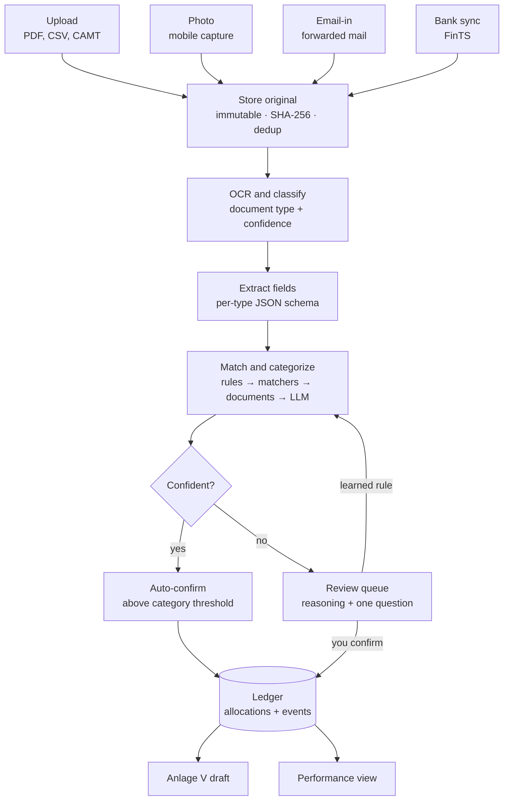
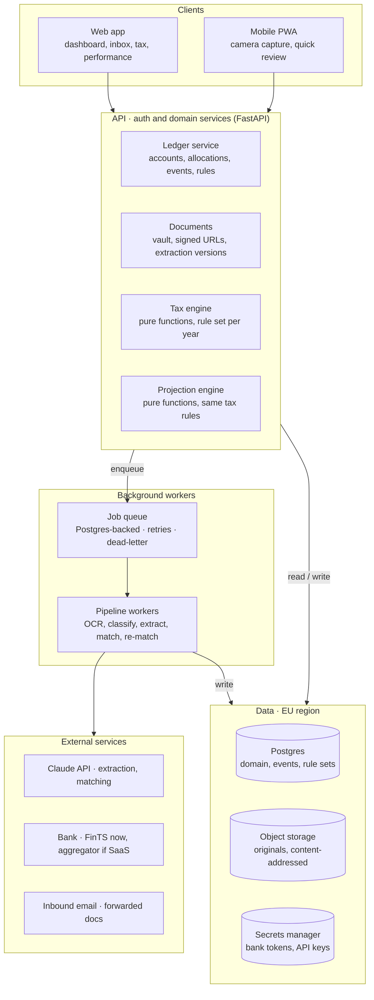

# Hausbuch — Architecture Spec

Nov 4, 2026 · Luis

## Purpose and scope

Hausbuch is a single-household finance workspace, built SaaS-ready. Its first module, the landlord ledger, turns bank statements, invoices and letters into a traceable property ledger, a draft Anlage V each year, and a running profit view through to sale; planned phases 6–9 add every account and asset of the household, the capital-income and crypto forms (Anlage KAP, Anlage SO), and financial health (agreed 6 Nov 2026, design in `docs/design/household-finances.md`).

**In scope (v1)**

- Properties, units, tenancies and tenants, with a full event history per unit
- A document vault: upload, photo capture, email-in; typed and linked to what it proves
- AI-assisted ingestion of bank statements and documents into categorized, split transactions
- A human review queue for anything the system is not sure about
- A deterministic Anlage V draft per property and tax year, every figure traceable to sources
- Performance: actuals plus an adjustable projection to sale, including the 10-year Spekulationsfrist
- Exports: a field-by-field sheet for typing into ELSTER, plus a yearly CSV + PDF archive

**Non-goals (v1)**

- Filing directly to ELSTER (ERiC integration is a later option, not a launch need)
- Multi-user property management for third parties (WEG-Verwaltung, Hausverwaltung)
- Tenant-facing portal, rent collection or payments
- Betriebskostenabrechnung generation (data is captured so it can be added in phase 4)
- Tax advice: the app drafts and explains; the user decides. No DATEV export
- Trading, payments or any write access to an account; naming investment products the household does not already hold (no Anlageberatung)

## Architecture principles

Six rules every component and every agent-written PR is checked against.

1. **AI explains, code calculates.** LLMs extract, classify, match and explain. Every euro figure in a tax or performance view is computed by deterministic, tested code from stored data.
2. **Every number is traceable.** Each derived figure links to the allocations, transactions and documents it came from. No orphan totals.
3. **Human-in-the-loop by confidence.** Auto-accept only above a per-category threshold; everything else lands in the review queue with the model's reasoning and a concrete question.
4. **Append-only history.** Domain changes are recorded as events; corrections are new events, never overwrites. The History timeline and the audit trail are the same data.
5. **Tax rules are versioned data, not branches in code.** A rule set is keyed by tax year and effective dates, so 2026 stays reproducible after 2027 rules change.
6. **Originals are immutable.** Uploaded files are stored content-addressed (SHA-256) and never modified; extractions, splits and categories are layers on top.

## Domain model

The core chain is Property → Unit → Tenancy → Tenant; money flows in as Transactions and is split into Allocations, which are what every tax and performance figure sums over.

| Entity | Key fields | Relations | Notes |
| --- | --- | --- | --- |
| Owner | name, tax ID ref, ownership share, expected gross pay per year, church tax yes/no, optional marginal-rate override | owns Properties | Two owners at 50/50, married and filing jointly: one Anlage V carrying both shares. The marginal rate is derived from income, not typed in (see Performance) |
| Property | address, type (ETW, EFH, MFH), build year, purchase date, notarized date, price, Nebenkosten, building/land split + split source (Kaufvertrag, BMF Arbeitshilfe, appraisal) | has Units, Loans, Documents | Notarized date starts the Spekulationsfrist; split drives AfA |
| Unit | label (WE 3), m², rooms, MEA share (WEG) | belongs to Property; has Tenancies | One Unit for an ETW; many for an MFH |
| Tenancy | start, end, type (unbefristet / Staffel / Index), Kaltmiete, NK-Vorauszahlung, Kaution + account, rent due day, running-cost terms (Vorauszahlung / Pauschale / inklusive; phase 3 spec D67, D72) | links Unit and Tenant(s); has RentSchedule | Rent changes are dated RentSchedule rows, never edits |
| Tenant | name, contact, IBAN (hashed for matching) | in Tenancies | Personal data; see privacy section |
| Loan | lender, principal, rate, fixed until, follow-up rate (user-set), annuity, schedule | belongs to Property | Schedule splits each payment into interest and Tilgung |
| Account | bank, IBAN (masked), source (upload / FinTS; aggregator only if SaaS) | has Transactions | The rental runs on a dedicated account, so every line is property-related; transfers to and from the owners' private accounts are recognized by their IBANs |
| Transaction | booking date, value date, amount, counterparty, IBAN, purpose text, source line hash | from Account; has Allocations | Immutable as imported; dedup on source line hash |
| Allocation | amount, category, tax treatment, property, unit, service period, recurring flag, confidence, status (the tax year it counts in is derived by that year's tax rules from the dates, period and flag, not stored; decided 6 Nov 2026) | splits one Transaction; links Documents | Sum of allocations = transaction amount (enforced) |
| Document | file hash, type, extracted fields, dates, amounts | links to any entity | Original immutable; extraction versioned |
| Rule | matcher (counterparty, IBAN, text pattern), output (category, split template) | created from reviews | How the system learns from your answers |
| Event | type, entity ref, payload, actor (user / system / AI), timestamp | on every entity | Source of the History timeline and audit trail |

Categories are a fixed taxonomy mapped to Anlage V lines through the tax rule set (next sections), so renaming a category never changes a return.

## Ingestion pipeline

Every input — upload, photo, forwarded mail or bank sync — runs through the same asynchronous pipeline, and only confirmed allocations reach the ledger.



The review queue is the only place a person has to act; each answer can become a rule, so the same counterparty is never asked about twice.

- **Idempotent imports:** a statement re-uploaded or overlapping a sync is deduplicated on the source line hash, so imports can be retried safely.
- **Jobs, not requests:** each stage is a queued job with retries and a dead-letter state shown in the inbox as "couldn't read this".
- **Re-run on new evidence:** when a missing document arrives (e.g. the Wirtschaftsplan), affected allocations are re-matched and their splits updated as new events.

## AI layer

The AI does four bounded jobs, each with a strict output schema and a fallback to the review queue; it never writes ledger data directly.

| Job | Input | Output (schema) | Model tier | Fallback |
| --- | --- | --- | --- | --- |
| Classify document | file + OCR text | type ∈ {statement, invoice, letter, contract, Bescheid, Zinsbescheinigung, Wirtschaftsplan, Hausgeldabrechnung, other}, confidence | small, fast | type = other → review |
| Extract fields | file + type | per-type fields (dates, amounts, IBANs, parties, line items, periods), each with page + quote | mid | missing required field → review |
| Pre-fill proposal | extraction + existing records | records to create or patch, applied only through the existing commands after the user verifies each value | none (code) | nothing applied without the user |
| Match and categorize | transaction + candidate tenancies, loans, documents, rules | allocations[], links[], confidence, reasoning, question? | mid; large only for ambiguous cases | confidence < threshold → review |
| Explain and ask | allocation + rule context | plain-language reasoning + one concrete question | small | template text |

**Matching order (cheapest first)**

1. Exact rules learned from your past answers (counterparty IBAN + pattern)
2. Deterministic matchers: tenant IBAN + amount = rent; loan account + amount = annuity, split by schedule
3. Document match: amount ± 0.01, date window ±10 days, IBAN or invoice number in purpose text
4. LLM categorization with retrieved context (similar past allocations, the property's open items)

**Guardrails**

- Structured outputs validated against JSON Schema; invalid output is retried once, then sent to review. Extraction of document fields uses citations instead (page + quoted text per value) because the API does not combine citations with JSON-schema output; the lines are parsed and validated against the Pydantic field types in code, and a value not recoverable from its quote is marked low-confidence (phase 2, D15)
- Allocation sums must equal the transaction amount; the validator, not the model, enforces it
- The model sees only the minimum context: no other tenants' data, IBANs masked except the one being matched
- Prompt-injection hardening: document text is passed as fenced data; extracted instructions are ignored
- Every AI decision stores model, prompt version, input hash and output, so a category can be explained and replayed
- An eval set of real (anonymized) statements and invoices gates prompt and model changes in CI

## Tax rules engine (Anlage V)

A pure function `draft(property, taxYear, ruleSet) → AnlageVDraft` turns confirmed allocations into form lines, each carrying the ids of its sources; nothing here calls a model.

**Shape**

- `RuleSet` = tax year + effective dates + a list of rules + a form mapping (category → Anlage V field for that year's form), keyed by stable line codes with the Zeile and the ELSTER Kennzahl per form year; a year whose form is not yet published reuses the previous mapping marked provisional (phase 3 spec D53). Form line numbers move between years, so the mapping is maintained per year, never hard-coded.
- Each rule is a small tested function over allocations and property facts, returning lines, warnings and open items.
- Output `AnlageVDraft` = income lines, Werbungskosten lines, result, warnings, missing documents, and a source list per line.

**Rules for v1**

| Rule | Logic | Data it needs |
| --- | --- | --- |
| Zuflussprinzip (§11 EStG) | Income and costs in the year paid; recurring payments within 10 days of year end, *and due within the same days* (BFH X R 2/21), go to the year they belong to | booking date, recurrence flag, service period, due date (loan schedule, the tenancy's rent due day, the period) |
| AfA linear (§7 Abs. 4) | Rate by completion year: before 1925 2.5%, 1925–2022 2%, from 2023 3%; pro rata by month in the purchase year | build year, transfer-of-ownership month, building share of the purchase price *and of the Nebenkosten rows*, split source; `purchase_price` and `acquisition_cost` allocations are evidence only (phase 3 spec D55); costs capitalised later join the basis gross (D73, awaiting sign-off) |
| Anschaffungsnahe Herstellungskosten (§6 Abs. 1 Nr. 1a) | Renovation within 3 years of purchase above 15% of building cost (net of VAT) → capitalized into AfA basis, not expensed | renovation allocations, net amounts, purchase date |
| Erhaltungsaufwand | Deductible in year paid; optional spread over 2–5 years (§82b EStDV) as a user choice | category, user election |
| Schuldzinsen vs. Tilgung | Interest deductible, repayment not; Geldbeschaffungskosten deductible | loan schedule, Zinsbescheinigung to reconcile |
| Hausgeld split | Umlagefähig and Verwaltung deductible when paid; Erhaltungsrücklage only when the WEG spends it (from the Hausgeldabrechnung) (BFH IX R 19/24: contributions to the Erhaltungsrücklage are deductible only when the WEG spends them; the Hausgeldabrechnung's Entnahme, confirmed by the user, goes to the Erhaltungsaufwand line) | Wirtschaftsplan, Hausgeldabrechnung |
| Umlagen | NK prepayments and settlement back-payments are income; refunds to tenant reduce income | tenancy, settlement documents |
| Verbilligte Vermietung (§21 Abs. 2) | Rent below 50 % of the local comparable (warm) rent → the letting is split and only the paid share's costs count (Z87); 50–66 % → warning that a Totalüberschussprognose is needed; ≥ 66 % → full deduction (§21 Abs. 2 EStG as of 2021) | Mietspiegel net cold rent per m² entered by user, plus the year's umlagefähige costs from the ledger (phase 3 spec D61) |
| Private sale (§23) | Sale more than 10 years after the notarized purchase → tax-free; otherwise gain = sale price − selling costs − (cost − AfA claimed) | notarized dates, AfA history |

Each rule ships with fixture tests built from worked examples, reviewed against the official guidance for that year before the year's rule set is published.

**Ownership:** the property is held 50/50 by spouses filing jointly, so the engine produces one Anlage V with both owners' shares and no separate Feststellungserklärung. Unmarried co-owners would need one (ESt 1 B); that is a SaaS-phase extension.

**AfA split source:** when a property is added, the user picks the Kaufvertrag split, the BMF Arbeitshilfe (guided input, result stored), or an appraisal (Gutachten stored as evidence). The engine records which one was used and warns when a contract split gives a building share far above the BMF result, since that is what the Finanzamt tends to question.

The draft is a planning aid; the UI says so on every export.

## Performance and projection

Performance = actuals from confirmed allocations, plus a year-by-year projection to a chosen sale year that reuses the same tax rules, so the forecast and the return never disagree on treatment.

**Actuals (per property, per year)** — rent in (Kaltmiete), cash paid out, tax effect (result × that year's marginal rate), net cash, and principal repaid. Umlagen are shown as pass-through so cash isn't distorted by settlement timing.

**Projection inputs**

- User levers: value growth %, rent growth %, expected gross pay per owner (or a marginal-rate override), sale year
- From the ledger: loan schedule, AfA basis and rate, current rent, Hausgeld split, purchase and Nebenkosten
- Defaults the user can edit: upkeep per year, cost inflation, selling costs %

**Per projected year**

1. Rent = current Kaltmiete × (1 + rent growth)^n
2. Interest and Tilgung from the loan schedule (after the fixed period, a user-set follow-up rate, defaulting to today's rate)
3. Taxable result = rent − interest − AfA − deductible costs; tax effect = −result × marginal rate
4. Cash after tax = rent − annuity − costs paid + tax effect
5. Value = purchase price × (1 + value growth)^n; equity = value − loan balance

**Marginal rate (decided 6 Nov 2026)**

The rate is computed, not remembered: people know their gross pay, not their Grenzsteuersatz, and the assessment (Einkommensteuerbescheid) that states the real taxable income arrives months after the year it covers, so the current and future years always need an estimate.

1. Per owner and year, the user enters expected gross pay; standard deductions (Werbungskosten-Pauschbetrag, employee social-insurance share, Sonderausgaben) are estimated by default and editable. The result is marked as an estimate.
2. The rental result for that year comes from the ledger (actuals) or the projection, and is added to the estimated taxable income (zvE) automatically.
3. The joint splitting tariff (§32a EStG) gives the marginal rate at that zvE, plus the solidarity surcharge where it applies and church tax (8 or 9% by state) when the user says yes. The tariff is versioned rule data per tax year like every other rule; a projected year without a published tariff reuses the latest one.
4. When a Bescheid arrives, its zvE replaces the estimate for that year as a new event (append-only, the estimate stays in History); phase 2 extraction can read it from the document, or the user types it in.
5. An explicit rate entered by the user always overrides the derived one for that year, and the UI shows which source each year used (estimate, Bescheid, override).

**At sale**

```
Profit = (V_sale − C_sell − T_sale − L_sale) + Σ CF_y − E₀
```

V = sale value, C = selling costs, T = tax on the sale (zero after the Spekulationsfrist), L = remaining loan, CF = yearly cash after tax, E₀ = initial equity. A profit bridge (appreciation, debt paid down, cash flow, buying costs, selling costs, sale tax) explains where it came from. Annualized return on equity is shown as a simple CAGR; an IRR on dated cash flows is a phase-4 upgrade.

The sale-year lever shows the §23 cliff explicitly: a sale inside 10 years adds the claimed AfA back into the taxable gain.

## System architecture and stack

A modular monolith on one Postgres: one API, one worker pool, no microservices until there is a second user to justify them. It is SaaS-ready from day one: every table carries a workspace id (the household, distinct from the Owner entity) that Postgres row-level security enforces.



Requests never wait on a model: the API enqueues, workers call the LLM and write results back as pending allocations for the review queue.

In v1 the job worker runs inside the API process (a FastAPI lifespan task) in the one container that serves port 8080, so "Background workers" is a task in the API container rather than a second deployable; a separate worker container comes only when load justifies it (decided 5 Nov 2026, see Decisions; phase 2: Procrastinate, its schema applied by migration 0005, its tables outside row-level security, spec D20).

| Layer | Choice | Why |
| --- | --- | --- |
| Language | Python 3.12 for API, workers and rule engine; TypeScript only in the frontend | python-fints for bank sync; Pydantic models double as LLM output schemas; frontend types generated from OpenAPI |
| Web + PWA | Next.js with a PWA manifest for capture | One codebase; camera access works in mobile browsers |
| API | FastAPI with OpenAPI generated from Pydantic models; py_webauthn for passkeys | Agents can code against a typed contract |
| Database | Postgres 16+, SQLAlchemy + Alembic migrations, row-level security keyed on workspace | Relational ledger, JSONB for extractions, events in the same transaction |
| Queue | Procrastinate (Postgres-backed) on the same Postgres | No extra infrastructure; jobs commit atomically with data |
| Files | S3-compatible object storage in an EU region | Cheap, immutable originals, signed URLs |
| AI | Claude API: Haiku 5.5 to classify and explain, Sonnet 5.5 to extract and match, Opus 5.5 for ambiguous matches; citations for extraction, structured outputs for classification and matching; one `ModelClient` interface so an EU-hosted route (Bedrock, Vertex) can replace it | Schema-valid JSON, tiering keeps cost per statement low |
| Bank | CSV/CAMT/PDF uploads (phase 2), FinTS via python-fints for your own accounts (phase 5); licensed aggregator only if it goes SaaS | Value first; FinTS needs only a free product registration; all behind one BankSource interface |
| Market and chain data (planned, phases 6–8) | Helius (Solana), Etherscan API V2 (EVM; free tier covers Ethereum, Arbitrum, Polygon, Linea), plain RPC for balance-only wallets, CoinGecko + Kraken public daily prices, ECB FX; behind `ChainSource` and `PriceSource` | Free tiers cover own use; providers are non-EU and must be replaced or contracted for SaaS |
| Hosting | Scaleway (EU): Serverless Containers for API+worker and web, Managed PostgreSQL on a private network, Object Storage; one-off admin commands run from the operator's computer with `uv` (decided 5 Nov 2026) | EU-only vendor, DPA, data and backups; about €20/month ex VAT at this load; compatibility tested 5 Nov 2026 |
| Tests | pytest for rules, golden-file tests for extraction evals, Playwright for flows | Rules and prompts change safely |

## Security, privacy and retention

The app holds bank data, tenant personal data and tax records, so it is built as if it will be audited: EU-only hosting, encryption everywhere, least-privilege access, and explicit retention per document type.

**Security**

- EU region for database, object storage and backups; AI calls through a provider and settings with no training on inputs and EU data processing where offered. Checked 6 Nov 2026: the Claude API offers US or global inference only, no EU option; data is processed under the DPA's standard contractual clauses and deleted within 30 days; tenant documents are sent only after the controller's explicit decision (phase 2 spec §11)
- Encryption at rest (storage + DB) and in transit; IBANs stored masked plus a keyed hash for matching
- Passkey login (decided 5 Nov 2026); short-lived sessions; FinTS PIN and any bank tokens in a secrets manager, never in the DB
- Object storage private; files served via short-lived signed URLs
- Wallets are tracked by public address only; no private keys, seeds or exchange trading keys are ever accepted; chain and price provider keys live in the secrets manager; addresses and hashes are masked in events and never sent to the model (agreed 6 Nov 2026, phases 6–9)
- Audit log = the Event table; admin actions and AI decisions included (sign-in and passkey actions go to the server log in phase 1 and join the Event table in the phase 2 spec PR, decided 5 Nov 2026)
- Database reachable on the private network for the app, plus a public endpoint that accepts only the operator's IP for the rare admin commands; `CONNECT` revoked from `PUBLIC` and granted to the two Hausbuch roles only

**Privacy (GDPR)**

- The landlord is the controller for tenant data; the app documents what it stores and why (lease performance, deposit, Betriebskostenabrechnung)
- Data minimization in AI prompts (see AI layer); no tenant data in logs
- Export and delete per person; deletion respects retention holds below

**Retention defaults (user-adjustable)**

| Document class | Default retention | Why |
| --- | --- | --- |
| Purchase contract, Kaufpreisaufteilung, loan contract | Life of ownership + 10 years | AfA basis and §23 gain calculation |
| Bank statements, invoices, Bescheide | 10 years after the tax year | Covers assessment and correction periods with margin |
| Lease, handover protocol, deposit records | End of tenancy + 4 years | Claims after move-out and deposit settlement |
| Tenant contact data | End of tenancy + 4 years, then deleted | Minimization |

Retention periods are conservative defaults, not legal advice; confirm with a Steuerberater before enabling auto-delete.

## Delivery phases

Nine phases, each shippable on its own; phase 3 is the first one that saves real time at tax season, so phases 1–3 are the MVP of the landlord module, and phases 6–9 (planned, agreed 6 Nov 2026) extend it to the whole household.

| Phase | Delivers | Done when |
| --- | --- | --- |
| 1 · Vault and ledger | Properties, units, tenancies, tenants, loans; document upload with manual typing and linking; History timeline from events; a per-property document checklist from the data phase 1 holds (added 6 Nov 2026) | Closed 6 Nov 2026 with everything built and live; the real data moves to phase 2's AI pre-fill (Decisions) |
| 2 · AI inbox | AI pre-fill of property, Nebenkosten, loan, tenant, tenancy and rent records from uploaded documents, each value shown with its page and quote so it is verified, not typed (first, added 6 Nov 2026); CSV/CAMT/PDF statement import, document classification and extraction, matching pipeline, review queue, learned rules, PWA mobile capture | The real flat, loan and tenancy were entered through pre-fill; a month's statement imports with ≥ 80% auto-matched, zero allocation-sum errors, every statement reconciling to its balances, and a repeat answer is never asked twice |
| 3 · Tax year | Spec `docs/phases/phase-3.md` drafted 9 Nov 2026, its step 0 (schemas, migration 0013, rule sets, fixtures) written the same day, not merged. Rule set 2026 (form mapping provisional until ELSTER publishes the 2026 Anlage V), Anlage V draft with source links, missing-document checklist (extends the phase 1 checklist's requirement list with rule-derived items), 15% limit tracker, ELSTER field sheet and yearly CSV + PDF archive | The 2026 draft reproduces a hand-calculated return to the euro, and every line opens its sources |
| 4 · Performance | Actuals, projection, profit bridge, §23 sale check, IRR, marginal rate derived from expected income; Betriebskostenabrechnung generator | Projection matches a spreadsheet model for 3 scenarios; one settlement generated from real 2026 data |
| 5 · Automation | FinTS sync for your own Sparkasse account (pushTAN), email-in address, deadline reminders, rule set 2027 | Statements arrive without manual upload; reminders fire for Grundsteuer and settlement deadlines |
| 6 · Konten & Vermögen (planned) | Account kinds with owner shares, private Sparkasse accounts with a household taxonomy, generalized internal-transfer matcher, quirion depot via document extraction (statements, quarterly reports, dividend notes, trade confirmations, tax certificate), BISON CSV import, assets, prices and valuations, Konten and Anlagen screens, household overview | Every account in with an owner share; second month ≥ 80 % auto-categorized; all internal transfers linked, zero counted as income or cost; one month-end net worth equals a spreadsheet to the euro |
| 7 · Krypto-Ledger (planned) | Chain registry, Helius (Solana) and Etherscan V2 `ChainSource`, balance-only wallets via RPC, wallet sync with on-chain balance reconciliation, movement categories, protocol decoders as data, lots with FIFO per wallet and the holding-period countdown, year-end holdings statement | Every wallet reconciles to its balance; the Solana wallet's full history classified with ≥ 90 % auto on the second sync; the 31 Dec 2026 statement exists for every wallet and BISON |
| 8 · Steuern KAP + SO (planned) | Rule set SO (BMF letter of 6 Mar 2025), KAP from Jahressteuerbescheinigungen, Termingeschäfte, per-owner Freigrenzen and Pauschbetrag, Steuern tabs, three-form field sheet, Steuerreport export | A year's SO draft reproduces a hand calculation to the euro with every line opening its lots and prices; the KAP verdict matches a hand check |
| 9 · Finanzgesundheit & Planung (planned) | Net worth, savings rate, reserve months, debt ratios, LTV, investable surplus; household plan with levers; AI explanation limited to amounts, asset classes and existing accounts, with a validator; `advice_mode` | Metrics match a spreadsheet for three months; the validator rejects every instrument name in the eval set |

Phases 6–9 were agreed on 6 Nov 2026 in this order, after 4 and 5 (Luis kept the original order). Design: `docs/design/household-finances.md`; each still starts with its own spec PR; none is specced or built. Because they come after phase 5, the 2026 Anlage SO may not come from the app in time for the 31 Jul 2027 deadline; it is then prepared by hand or from a tax tool's export, and the app takes over from 2027.

Each phase starts with a short spec PR (schemas, rule fixtures, eval cases) before agents write implementation code.

**Input for the phase 2 spec (agreed 6 Nov 2026).** A design check before the spec PR found five places where the pipeline above assumes something the real account and paperwork do not do. The spec PR settles each one in its schemas and fixtures:

1. **Owner transfers, not private lines** (corrected the same day). This point first assumed private and property money share one account; Luis confirmed the rental has a dedicated account, so there are no private lines to filter. What remains: top-ups from and withdrawals to the owners' own accounts are neither income nor cost. A deterministic matcher recognizes the owners' IBANs and books them as owner transfers without the model or the review queue.
2. **Dedup that neither misses nor merges.** The source line hash uses the bank's own reference where the format has one (CAMT entry and end-to-end references); otherwise it includes the line's position among identical lines in the file, so two genuinely equal payments on one day both survive. The same payment imported in two formats (CSV and CAMT) hashes differently, so a likely cross-format duplicate (same account, amount, date, counterparty) goes to review rather than being booked twice or dropped.
3. **Statements reconcile.** Each imported statement must satisfy opening balance + Σ lines = closing balance, checked by code. A statement that fails (typically a misread PDF amount) goes to review as a whole and none of its lines reach matching. Reconciliation uses an opening anchor per account and a closing balance declared per import: read from the file for Sparkasse's camt.052 XML export (checked 6 Nov 2026: every daily report states both balances) and for PDF statements, typed only for the CSV export, which carries none (phase 2 spec D21, D33).
4. **Allocations carry the period they pay for.** An allocation stores the service period (e.g. rent for January 2027) and whether the payment is recurring. The §11 ten-day rule in phase 3 and rent-arrears tracking both need it; it is set at match time, defaulting from the purpose text and the schedule.
5. **Learned rules store how to split, not amounts.** A rule for a Hausgeld or annuity payment says "split by the current Wirtschaftsplan" or "split by the loan schedule", never this year's euro amounts, so a new Wirtschaftsplan or a rate change cannot be silently mis-split by an old rule.

Also for the spec: how documents are read (the OCR step has no engine named; the API container is too small for a classic OCR engine, so the default is Claude reading the PDF or image directly, plus the text layer of digital PDFs); confirming the Claude API's data-processing terms (EU processing, no training, retention) before tenant documents are sent; and moving sign-in and passkey events into the Event table (deferred to this spec on 5 Nov 2026).

**Input for the phase 3 spec (7 Nov 2026, not decided).** The Finanzamt usually receives no documents with the return (since 2017 they are kept and sent only on request, then as PDFs through ELSTER), but what is sent must open everywhere. Two of Luis's real documents do not: the Darlehensvertrag is an Adobe-only XFA form (D43 in the phase 2 spec; only Adobe can draw it), and a room lease has its hand-drawn signatures as PDF annotations that some viewers do not draw (no digital signature in either). The yearly PDF archive could carry a "Finanzamt copy" per document, made by the app by merging annotations into the page and stored next to the untouched original (principle 6); an XFA form still needs a copy printed from Adobe Reader by hand. → Settled by the phase 3 spec D65/Q8 (9 Nov 2026): copies by hand for 2026, with a warning per document that needs one.

**Input for the phase 3 spec: rent before the handover (7 Nov 2026; decided 9 Nov 2026: rental income, see the end of this paragraph).** Luis's purchase contract pays the price in two instalments and passes Besitz, Nutzen und Lasten only on full payment. Until then the rent claims belong to the parties in proportion to the price already paid, assigned to the buyer for the buyer's share (an "Ersatzmiete" in that share while the flat is empty), so the seller forwarded that share of the rent for several months in 2026 from the seller's own account. The first room leases named the seller as landlord; they were replaced by new leases from May 2026 that name Luis as landlord (corrected the same day: this note first said the seller was the landlord, read from one of the replaced leases), while the rent still reached Luis through the seller until full payment. The same contract carries a rent guarantee (the seller pays the shortfall below an agreed Kaltmiete for 24 months) and hands the tenants' deposits over at the handover. How the forwarded share counts is a tax question the spec must settle with evidence, not assume: Vermietung income (with Luis as landlord from May, the likelier reading; then also whether the income is the full rent or only the forwarded share, and how the share the seller kept counts), a reduction of the purchase price (lowering the AfA basis), or capital income for paying early; a search on 7 Nov 2026 found no ruling on exactly this case (BFH V R 2/09 treats a rent-guarantee payment as damages, not a price reduction, but for VAT). Interest on the loan for the first instalment is deductible before the handover either way (vorab entstandene Werbungskosten). Until then, these lines are booked as `other_income` from the seller's IBAN, never as the tenant's rent; the property's purchase date (the AfA start) is the day of full payment, which the Kaufvertrag pre-fill already leaves empty with the clause quoted (phase 2 spec §6.2). **Decided 9 Nov 2026 (Luis):** the share was forwarded only for months in which the leases already named Luis as landlord (from the month after the first instalment), so it is his Vermietung income, the share he received only; the phase 3 draft adds those lines to the flat's rent line through a recorded `pre_handover_income` input (phase 3 spec D63/Q1). Still open, only if it occurs: a payment under the rent guarantee.

**Input for the phase 3 spec: the purchase price paid from the account (8 Nov 2026).** Luis's rental account paid the purchase price to the seller and received the loan's payout; these lines are booked as `purchase_price` (capitalized) and `loan_disbursement` (pass_through) since phase 2 D44. The AfA basis comes from the property record's price, price split and Nebenkosten rows, so the phase 3 rules must not sum `purchase_price` allocations into it as well (and must decide how an `acquisition_cost` allocation and the cost row it pays relate, so a Nebenkosten bill is not counted twice either). → Settled by the phase 3 spec D55 (9 Nov 2026): the basis comes from the property record only; both kinds of allocation are payment evidence and never summed.

**Input for the phase 4 spec: flat-rate Nebenkosten (7 Nov 2026; the field is settled by the phase 3 spec D72 on 9 Nov 2026: a tenancy's `operating_costs_terms` = prepayment, flat rate or included, which phase 4's generator reads).** Luis's room leases charge one Nebenkostenpauschale that covers Betriebs-, Heiz-, Warmwasser- and Stromkosten, with "Eine gesonderte Neben- oder Betriebskostenabrechnung erfolgt nicht" (only a claim for misuse, and a raise when costs drift by more than €10 a month). Phase 2 stores it as the rent row's `operating_costs_prepayment` (PR #53), which has no flag for a Pauschale. The Betriebskostenabrechnung generator must not produce a settlement for such a tenancy, so the phase 4 spec needs a way to tell a Pauschale from a Vorauszahlung (a rent-row or tenancy field, read from the lease). For the tax return both are rental income in the year received either way.

## Decisions

All open questions were settled on 4 Nov 2026; the sections above reflect them. Later decisions carry their date.

| Question | Decision | What it changes |
| --- | --- | --- |
| Audience | Personal tool, built SaaS-ready | Workspace id + row-level security on every table; no sign-up or billing yet |
| Bank data | Uploads in phase 2, FinTS for own accounts in phase 5, licensed aggregator only if it goes SaaS | One `BankSource` interface; no provider contract needed for v1 |
| Ownership | Joint 50/50 with spouse, married, filing jointly | One Anlage V with both shares; no Feststellungserklärung |
| AfA split | Support all three sources: Kaufvertrag, BMF Arbeitshilfe, appraisal | Property stores the split plus its source and evidence document |
| Mobile | PWA | One codebase; no app-store releases |
| Tax adviser | None | ELSTER field sheet is the main export; yearly CSV + PDF archive; no DATEV |
| Refinancing | User-set follow-up rate, defaulting to today's rate | One extra projection input per loan |
| Language | Python API, workers and rules; Next.js frontend | FastAPI, Pydantic, python-fints; TypeScript types generated from OpenAPI |
| Login (5 Nov 2026) | Passkeys (WebAuthn) only; no passwords, no TOTP | Phase 1 API step builds passkey registration and sign-in |
| Hosting (5 Nov 2026) | Scaleway, all in an EU region | Compatibility test passed: non-superuser roles, `btree_gist`, forced RLS and workspace creation work without a superuser; database creation needs one setup step (`deploy/scaleway.md`) |
| Worker placement (5 Nov 2026) | The job worker runs inside the API process in the container that serves port 8080, min-scale 1 | Scaleway Serverless Containers stop a process that does not listen on 8080; a separate worker only when load justifies it |
| Provisioning (5 Nov 2026) | Workspaces and first users are created by `hausbuch bootstrap`, a CLI running as the schema-owner role; members join by one-time enrollment link; recovery is a new link from the CLI | No sign-up endpoint; the owner DB URL is an operator secret the API never holds |
| Admin commands (5 Nov 2026, revised) | `bootstrap`, `invite` and migrations run from Luis's computer with `uv` (no Docker), against the database's public endpoint allow-listed to his IP | Scaleway Serverless Jobs cannot join a private network (found while building the deploy artefacts), so the planned Jobs could not reach a private-only database; the owner URL stays on Luis's machine |
| Image builds (5 Nov 2026) | The API and web images are built and pushed to the Scaleway registry by a hand-started GitHub Actions job (`publish-images`), from `main` only; tags come from the commit and are never overwritten | No Docker on Luis's computer, which is not powerful enough to run it comfortably; GitHub holds one Scaleway key that can only push images |
| Sessions (5 Nov 2026) | Opaque server-side sessions in Postgres, 12 h absolute / 2 h idle, `SameSite=Lax` + Origin check | Gives "short-lived sessions" a number; tunable per environment |
| UI style (5 Nov 2026) | The app uses the mockups' visual style (`docs/mockups/`): green palette, Manrope self-hosted from npm, left sidebar shell; dark mode kept with a green-derived palette | Replaces the original teal, system-font look and the top bar; still plain CSS, no component library, German labels |
| Marginal rate (6 Nov 2026) | Derived from each owner's expected gross pay plus the ledger's rental result on the joint splitting tariff, with church tax and Soli; a Bescheid's zvE replaces the estimate for its year as a new event; a user-set rate overrides | Owner stores expected income and church-tax flag instead of a typed rate; the §32a tariff becomes per-year rule data; the phase 4 spec PR starts from this |
| Document checklist (6 Nov 2026) | Build a per-property, per-year document checklist in phase 1 from what phase 1 already knows (purchase, price split, acquisition costs, loans, tenancies, ETW paperwork); its requirement catalogue is data that phase 3's tax rules extend | Moves the first part of phase 3's missing-document checklist forward so the real data can be checked while it is entered (phase 3 extends it with two entries, spec D64/§8); one new document subtype (`grundsteuerbescheid`, migration `0004`); spec amendment 3 in `docs/phases/phase-1.md` |
| Phase 2 inputs (6 Nov 2026) | Owner transfers recognized by IBAN (the rental account is dedicated, so no private-line filter); reference-based dedup with cross-format duplicates sent to review; statement balance reconciliation; service period and recurrence on allocations; learned rules store split methods, not amounts (Delivery phases, input for the phase 2 spec) | Phase 2 done-criterion requires reconciled statements; the Allocation schema gains period and recurrence fields |
| Tenant retention after a party change (6 Nov 2026) | A tenant's retention hold follows every tenancy they were ever a party of, including one they were later removed from | Erasure reads the event log as well as the current parties; a co-tenant who moved out early stays held until that tenancy ends + 4 years (or on request after it ends) |
| Phase 1 closed, data by AI pre-fill (6 Nov 2026) | Phase 1 is closed with everything built and live; the real flat, tenancy, loan and paperwork are entered by AI pre-fill instead of by hand: the AI reads each uploaded document and fills the forms, Luis checks every value against its source quote, and nothing is saved until he confirms | Pre-fill becomes phase 2's first step, ahead of statement import; Luis's accept/edit per field is the first eval signal; the phase 2 spec PR (`docs/phases/phase-2.md`, being drafted) settles it |
| Pre-fill, value by value (6 Nov 2026) | Master data is entered by AI pre-fill from documents, each value verified against its page and quote and applied through the existing commands only | Phase 2 step 1; `proposal` and `ai_call` tables; phase 2 spec D13–D15 |
| Tenant documents and the model (6 Nov 2026) | Tenant documents (lease, handover protocol, deposit proof, tenant letters) are not sent to the model until the landlord enables `ai_tenant_documents`, after choosing between first-party US processing under the DPA, an EU-hosted route, or manual entry. Luis chose first-party US processing on 6 Nov 2026; the tenants were told about the AI processing on 7 Nov 2026, so the setting is switched on through the settings page (Einstellungen), deployed with step 2 the same day; it stays off until Luis switches it | A workspace setting and a classifier gate; phase 2 spec §11.2 |
| Extraction via citations (6 Nov 2026) | Field extraction uses citations (page + quote), parsed and validated in code; structured outputs stay for classification and matching | The structured-outputs guardrail wording (AI layer) |
| Statement balances (6 Nov 2026) | Reconciliation on balance anchors: an opening balance per account and a declared closing balance per import. Sparkasse's camt.052 XML export (a ZIP of daily reports) is the primary format and states both balances, so nothing is typed; the CSV is a fallback | `account.opening_balance`, `statement_import.declared_*`; statement format `camt` covers camt.052 and camt.053; ZIP uploads accepted; phase 2 spec D21, D33, D34 |
| Sign-in events (6 Nov 2026) | Sign-in and passkey events go to the Event table on entity `user`, with no IP or user agent | Closes the 5 Nov 2026 deferral |
| Eval set (6 Nov 2026) | Recorded synthetic evals run in CI; real documents are evaluated from Luis's computer, never committed | Refines "an eval set of real (anonymized) statements … in CI" |
| AI processing location and account (6 Nov 2026) | All documents are processed with `inference_geo = us` (one named location, +10 % price); a `hausbuch` Console workspace with a $25 monthly limit for the live app and a `hausbuch-evals` workspace with a $10 limit for runs from Luis's computer | `HAUSBUCH_AI_INFERENCE_GEO` defaults to `us`; two API keys; phase 2 spec §11.3 |
| Allocation tax year (6 Nov 2026) | An allocation stores no tax year; phase 3's rule set derives it (the §11 ten-day rule) from booking and value date, service period and the recurring flag. The due date was missing; phase 3 adds `tenancy.rent_due_day` (D67) and takes the loan's from the schedule (9 Nov 2026) | Keeps a tax year reproducible under the rule set that applies to it; phase 2 spec D31 (from the step 0 review) |
| Household finances (6 Nov 2026) | Hausbuch grows into the household's finance workspace; the landlord ledger is its first module; phases 6–9 follow phases 4 and 5 (Luis kept the original order) | Scope line; sidebar grows to Übersicht, Zu prüfen (named Posteingang until 8 Nov 2026), Konten, Anlagen, Haushalt, Immobilien, Steuern, Planung, Dokumente; one inbox and one tax screen for all forms (`docs/design/household-finances.md` §1) |
| Household accounts and owners (6 Nov 2026) | Every account carries owner shares: quirion depot joint 50/50; BISON in Luis's wife's name; the old Solana wallet Luis's; the BNB cold wallet joint 50/50 because its coins were paid from the joint account (reason stored with the record) | Per-owner Freigrenzen and Pauschbetrag; the SO tab shows BISON's own (wife's-name) figures next to the split |
| Chains and wallets (6 Nov 2026) | Solana wallet read in full via Helius; the BNB cold wallet only by balance via a free RPC node, its lots from the BISON export through the transfer link; Ethereum and Arbitrum stay in the chain registry; no Etherscan paid plan needed now; no bot wallets yet (when the bots trade real money: one balance plus the bot's trade log) | Chain registry rows; a balance-only wallet kind; a flag when coins leave a balance-only wallet |
| Crypto tax treatment (6 Nov 2026) | Rule set SO per year as data: FIFO per wallet and token, one-year holding period, €1,000 Freigrenze per spouse, §22 Nr. 3 rewards with €256, perps as Termingeschäfte on KAP; wrapping and canonical bridges are not disposals; LP deposits stay `undecided` with both results shown until Luis picks a position; daily close prices, the trade's own euro leg first | Phase 8 spec; the Steuerreport export attaches settings and positions |
| History range (6 Nov 2026) | Bank accounts from 1 Jan 2026; crypto with full history (Solana wallet, full BISON export), used before 2026 for lots only | Phase 6 and 7 imports |
| Advice and budgets (6 Nov 2026) | `advice_mode = own_use`: the AI may name existing accounts and plans, never a new product; no budgets, measured figures only; no account write access, ever | Phase 9 spec; non-goals line |
| AI auto-confirm limits (7 Nov 2026) | Even with auto-accept switched on, a model answer for rent, Nebenkosten prepayment, loan interest or principal, Hausgeld or an owner transfer, or any model answer that splits an amount, always goes to the review queue (phase 2 spec D40) | Principle 3 gets a hard floor: only the deterministic matchers and learned rules book those categories without a person; the model never computes a euro split on its own |
| Pre-fill fills, the user completes (7 Nov 2026) | The AI pre-fills only what it can read; every other field of a record a suggestion creates can be typed by hand, and a matched link (a tenancy's unit, a Kaution's tenancy) can be picked when code found none or the wrong one | The review shows every field of the create model, not only the proposed ones; a suggestion is never stuck because a value was not found (phase 2 spec §6.4, PR #56) |
| Purchase categories and the inbox re-check (7 Nov 2026, live 8 Nov) | Two categories: `loan_disbursement` (Darlehensauszahlung, neither income nor cost) and `purchase_price` (Kaufpreiszahlung, capitalized); a learned rule or a change to a loan, a tenant's IBAN, a tenancy or an owner account re-checks the payments already waiting in the inbox, with rules and matchers only | Migration 0009; phase 3 must never add `purchase_price` allocations to the AfA basis, which comes from the property record (phase 2 spec D44, D45) |
| Loans paid out in parts (8 Nov 2026) | A loan can be marked "interest only before the first payment": the bank's interest-only debits between the payout and the first annuity are booked as loan interest from the amount the bank states in the purpose text, and the first schedule period covers one month; a payment from a loan's own account is matched only to that loan | Migration 0010; amends the phase 1 schedule convention (D10); phase 2 spec D46, PR #64 |
| Review page name (8 Nov 2026) | The review queue is called "Zu prüfen", not "Posteingang": it holds decisions, not messages. It is grouped by what needs deciding and shows its open count in the sidebar, and each bank line on Konten › Umsätze shows whether it is booked | Labels only; route `/inbox` and the API keep their names; phase 2 spec D48, PR #69 |
| Several kinds of payment from one IBAN (8 Nov 2026) | Learned rules still store no amount. When a counterparty's confirmed history holds more than one kind of booking (e.g. the Hausverwaltung's Hausgeld and its management fee), a rule books a line only when its amount equals the latest confirmed line of its own kind, or when its split checks the amount itself (Wirtschaftsplan, loan schedule). Otherwise the closest kind is proposed for review. When other waiting amounts exist, ticking "Künftig immer so zuordnen" asks whether they belong too, and "Nein" stores a yes/no flag on the rule. A correction of a line a rule booked replaces that rule; a second kind adds one | Refines the "learned rules store how to split, not amounts" input (phase 2 spec D25); migration 0011 (`matching_rule.same_amount_only`); phase 2 spec D49, PR #71 |
| Rental management fee and learned splits (9 Nov 2026) | A category `property_management` (Mietverwaltung, deductible), separate from the WEG administrator's share inside the Hausgeld. A split answer no other split method explains (e.g. a Hausgeld split typed from the payment text) can become a rule "wie zuletzt aufgeteilt": it copies the parts of the latest confirmed line of the same kind dated on or before it, but only at exactly the same amount, never over a line already confirmed, and never for rent or a loan's interest and repayment; it stores categories, never amounts. A model's loan suggestion names the only loan, and a payout names its contract | Migration 0012; phase 2 spec D51 |
| Lines of 0 € (9 Nov 2026) | When the model reads a bank line of exactly 0 € (the rental account's monthly fee line) as one ordinary category, such as bank fees, its answer is booked without review even while model answers otherwise always go to review (the one exception to the first-month rule). Not for rent, a loan's payments, Hausgeld, owner transfers, deposits, the purchase, an answer it could not categorize, or a part tied to a tenancy or a loan: those still go to a person. A 0 € booking changes no total, tax figure or balance | One new review routing rule; no migration; phase 2 spec D52 |
| Phase 3 spec (9 Nov 2026) | Tax rules are YAML rule sets per tax year with a form mapping keyed by stable line codes, the Zeile and the ELSTER Kennzahl per form year; the 2026 form is not published, so 2026 reuses 2025's mapping marked provisional (D53). A payment's tax year follows §11 with the Fälligkeit condition, from a new `tenancy.rent_due_day` and the loan schedule (D54, D67). The AfA basis comes from the property record only; `purchase_price` and `acquisition_cost` allocations are evidence (D55). Contributions to the Erhaltungsrücklage count only when the WEG spends them, read from the Hausgeldabrechnung and confirmed (D57, BFH IX R 19/24). User tax decisions and confirmed certificate figures live in an append-only `tax_input` table, exports in an immutable `tax_export` table (D58, D65). Drafts are computed on read from confirmed allocations only; exports are snapshots (D59). Written in step 0: costs capitalised into the AfA basis (a Herstellungskosten election, or the 15 % limit crossed) enter it gross, VAT included, under §9b Abs. 1 EStG (D73, **awaiting the orchestrator's and Luis's sign-off**) | Migration 0013 (`tenancy.rent_due_day`, `tenancy.operating_costs_terms`, `property.living_area_m2`, tables `tax_input`, `tax_export`); rule sets under `rules/tax/rulesets/`; fixtures under `tests/fixtures/phase3/`; the Zuflussprinzip, AfA, Hausgeld and Verbilligte Vermietung rows above; phase 3 spec D53–D73 |
