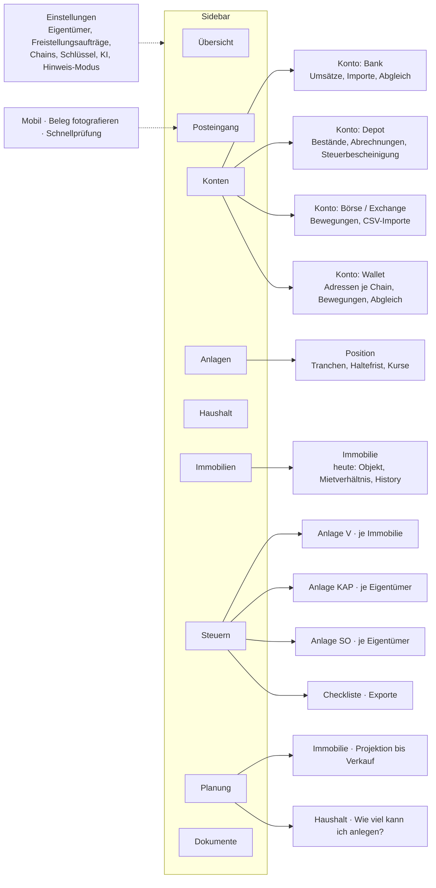

# Hausbuch as a household-finance app ("super app")

**Status: design plan, not built. 6 Nov 2026 (architect, from the orchestrator's brief).** Nothing
here is a phase spec; each planned phase still starts with its own spec PR (schemas, a hand-written
migration, YAML rule fixtures with worked examples) before any implementation. Every external
fact (limits, prices, tax rules) was read on the date in the Sources section and is cited there;
anything I could not open is marked "not verified".

## Summary for Luis (two minutes)

**The recommendation:** finish the landlord MVP first (phase 3, the 2026 Anlage V draft), then
grow Hausbuch in four planned phases: all accounts and net worth (phase 6), the crypto ledger
(phase 7), the tax forms for capital income and crypto (Anlage KAP and Anlage SO, phase 8), and
financial health with "how much could I invest" (phase 9). The property projection (phase 4) and
automation (phase 5) slot in between; the order is argued in section 9.

**What stays the same:** everything you already have. Properties, the document vault, the inbox,
statements, allocations, rules and the six principles carry over unchanged. A crypto wallet or a
BISON export becomes just another account whose lines run through the same import → match →
review → confirm pipeline. Nothing a model says ever becomes a euro figure; a model only
classifies, matches and explains.

**How the app will look:** the sidebar grows from six entries to nine. "Übersicht" becomes the
household overview (net worth, monthly cash flow, cash reserve in months, open items).
"Immobilien" is today's landlord module, one level down. New are "Konten" (every account, of any
kind), "Anlagen" (ETF and crypto holdings with the one-year holding-period countdown per lot),
"Haushalt" (income and spending by category, savings rate), and "Planung" (the flat's projection
plus a household plan). "Steuern" shows one tax year with three tabs, Anlage V, KAP and SO, and
the field sheet export covers all three. Section 1 has the screen list and a sitemap.

**Where the data comes from, realistically:** Sparkasse as today (camt export now, FinTS in
phase 5); quirion only through its PDF statements in the vault (no API, no confirmed FinTS; the
AI extraction already built for statements reads them); BISON through its transaction-history CSV
(no API; cashback and referral bonuses arrive labelled "Deposit" and must be reclassified as
rewards); wallets read-only by public address through Etherscan's V2 API (one key for 60+ EVM
chains, but on the free plan only Ethereum, Arbitrum, Polygon, Linea and Mantle; BNB Chain,
Base and OP Mainnet need the $49 Lite plan) and Helius for Solana (free plan, 1 million credits a
month, which covers about 10 million transactions). Historic euro prices come from CoinGecko
(free plan limited to the past 365 days) with Kraken's public candles as a free fallback for
major coins, and from the trade itself whenever a trade has a euro leg. Section 3 has the numbers.

**The tax rules, checked against the current sources:** crypto gains are private sales under
§23 EStG, tax-free after one year, with a €1,000 cliff per person (a Freigrenze: at €1,000 the
whole gain is taxed, not just the part above). The Finance Ministry's letter of 6 March 2025 fixes
FIFO per wallet and per token, accepts daily prices from CoinGecko-type sources if applied
consistently, and says tax reports from software are accepted when plausible and when their
settings are attached. Staking, lending and bonus rewards are "other income" (§22 Nr. 3) with a
€256 cliff. Perpetual futures are not §23 at all: they are Termingeschäfte, capital income at the
flat 25 % rate, declared on Anlage KAP. Exchanges report your trades to the tax office from
1 January 2026 (DAC8, first report by 31 July 2027); self-custody wallets are not reported. A
reform that would tax coins bought from 2027 like shares exists only as a ministry draft (30 Sep
2026) that the cabinet had not adopted as of 28 Oct 2026; if it passes, coins bought by 31 Dec
2026 keep today's rules, so the app must be able to prove year-end 2026 holdings per wallet.
Section 4 has the rules as versioned rule-set data.

**What the AI may say about investing:** code computes the numbers (net worth, savings rate,
reserve in months, loan-to-value, monthly investable surplus); the AI explains them and lists
options by amount and asset class ("you could add about €400 a month to your ETF plan" or "top
up the reserve first"). It never names a product you do not already hold, and never trades. That
keeps own use clearly outside regulated investment advice, and a switch keeps the SaaS version
generic. Section 6 has the boundary and the sources.

**Three things to do before building any of it (section 10):** download the BISON transaction
history for every year to date (the BMF letter puts the burden of incomplete exchange data on
you), list every wallet address you own or have owned, and decide whether bot wallets are tracked
line by line or as one position with the bot's own trade log.

---

## 1. Layout and information architecture

### 1.1 How the landlord module sits inside a household app

Today's sidebar is Overview, Properties, Inbox, Tax year, Performance, Documents (mockups
`01`–`05`). The landlord features keep their screens and routes; they move one level down under
"Immobilien", and the four cross-cutting screens (Übersicht, Posteingang, Steuern, Dokumente)
widen to cover every account and every form. Two rules keep it coherent:

- **One inbox.** A wallet movement nobody could classify, a BISON line, a transfer that found no
  counterpart, an on-chain balance that does not reconcile: all are review items of the kinds
  phase 2 already renders (one line of reasoning, one question, one action). No second queue.
- **One tax screen per year.** Anlage V (per property), Anlage KAP (per owner) and Anlage SO
  (per owner) are tabs of one "Steuerjahr" page, with one checklist and one export.

### 1.2 Sitemap

### 1.3 Screens

Labels are German in the app (the mockups' English is placeholder). Each row names the figures
the screen shows and where they come from; every euro figure is a backend rule result with a
source link (principles 1 and 2).

| Screen | Purpose | Main figures (all from backend rules) | Actions |
| --- | --- | --- | --- |
| **Übersicht** (grows out of mockup 01) | The household at a glance | Nettovermögen and change vs last month; Cashflow last full month (Einnahmen, Ausgaben, Sparquote); Liquiditätsreserve in months; "Braucht deine Antwort" count; asset mix bar (Bank, ETF, Krypto, Immobilie net of loan); the property card as today; "Demnächst" list (Grundsteuer, Vorabpauschale debit in January, Verlustbescheinigung request by 15 Dec, Freistellungsauftrag check, DAC8 reconciliation when BISON's report year closes); recent activity | Upload, Review now, open each figure's sources |
| **Posteingang** (mockup 03, widened) | The one review queue | As today plus item kinds: unclassified movement, transfer without counterpart, balance mismatch on a wallet or exchange, tax position needed (LP, wrap, bridge), spam token, duplicate across CSV and chain | Confirm, choose, "künftig immer so", skip |
| **Konten** | Every account of every kind | Per account: kind, provider, owner(s) and shares, balance or value, last import/sync, reconciliation status; group totals | Add account (bank: upload/FinTS; depot: documents; exchange: CSV; wallet: address + chains), disable, archive |
| Konto · Bank | Today's statement screens | Balance chain, imports, transactions with allocations | Import, declare balance, reallocate |
| Konto · Depot (quirion) | Holdings from statements | Positions (ISIN, units, value), cost basis from Abrechnungen, withheld tax YTD from the Jahressteuerbescheinigung, Vorabpauschale forecast for next January | Upload Kontoauszug / PM-Reporting / Steuerbescheinigung; verify pre-fill |
| Konto · Exchange (BISON) | Movements from CSV | Buys, sells, deposits, withdrawals, staking rewards, reclassified bonuses; euro balance; crypto balance per asset; "Info-Report" link | Import CSV, resolve deposits as internal transfers from Sparkasse |
| Konto · Wallet | One wallet, N chains | Addresses per chain, native and token balances (on-chain now vs Σ movements), sync time and provider, counts of movements by category | Add chain, sync, reconcile mismatch |
| **Anlagen** | Holdings across all accounts | Table: asset, total units, value, cost basis, unrealized gain, owner, holding-period status per lot ("steuerfrei ab 14.03.2027", "steuerfrei", "Neubestand ab 2027" once the reform is law); concentration (top assets, crypto share) | Filter by owner / class; open position |
| Anlage · Position | One asset in one account | Lots (acquired on, units, cost, source line), disposals with gain, prices used and their source | Change lot method election (where the rule set allows), add note |
| **Haushalt** | Private cash flow | Last 12 months income and spending by category, Sparquote, recurring commitments (rent/loan, insurance, subscriptions), uncategorized count, Elterngeld/Kindergeld shown as their own income rows | Categorize, set budgets (optional, phase 9) |
| **Immobilien** (mockup 02) | Unchanged landlord module | As today | As today |
| **Steuern** (mockup 04, with tabs) | One tax year, all forms | Tab Anlage V per property (as today); tab Anlage KAP per owner: withheld tax, Sparer-Pauschbetrag used vs €1,000/€2,000, Günstigerprüfung verdict, Termingeschäfte result, loss pots; tab Anlage SO per owner: §23 gains per lot, Freigrenze headroom meter (€1,000 cliff), §22 Nr. 3 income with €256 cliff, Werbungskosten; checklist; exports | Field sheet (PDF, all forms), yearly archive (ZIP), Steuerreport with settings (BMF Rn. 90), year-end holdings statement |
| **Planung** (mockup 05 + new tab) | Projection | Tab Immobilie: unchanged; tab Haushalt: investable surplus per month and its derivation, reserve target, levers (reserve months, target savings rate, expected income changes such as Elternzeit), 12-month plan, AI explanation panel | Adjust levers, save scenario |
| **Dokumente** | Unchanged vault | New document kinds: `depot_statement`, `depot_quarterly_report`, `tax_certificate` (Jahressteuerbescheinigung), `exchange_export`, `wallet_export` | As today |
| Einstellungen | Owners and connections | Owners with shares; Freistellungsaufträge per owner per institution; chain registry (enabled chains, provider, key status); AI settings; `advice_mode` (own use / generic) | Edit |
| Mobil | Capture (as phase 2) and quick review | — | Photograph a Beleg; answer one inbox question |

### 1.4 How today's Overview grows

Mockup 01's top row is four cards: Rent received, Deductible costs, Est. Anlage V result, Needs
your input. The household version keeps the fourth card and replaces the first three with
Nettovermögen, Cashflow (last month) and Liquiditätsreserve; the property figures move into the
property card below, which stays as it is. The "AI processed a statement" banner stays and now
also announces wallet syncs and CSV imports. This is the mockup the orchestrator should draw
first; the others are variations of the existing ones.

## 2. Domain model additions

Phase 2's `account`, `transaction`, `allocation`, `matching_rule`, `document` and `event` are the
base. Additions follow their conventions (workspace id, append-only where phase 2 is append-only,
text + CHECK enums, forced RLS). Nothing below changes phase 2's tables except where marked.

| Entity | Key fields | Relations | Notes |
| --- | --- | --- | --- |
| Account (**extended**) | `kind` ∈ {bank_current, bank_savings, depot, exchange, wallet}, `provider` (sparkasse, quirion, bison, self_custody), `custody` ∈ {custodial, self}, `source` gains `csv_export`, `chain_sync`, `documents` | has Transactions (bank) or AssetMovements (others); has AccountOwnership; wallet has WalletAddresses | Phase 2's `is_owner_account` becomes the private Sparkasse accounts once they import (they stop being "never hold transactions") |
| AccountOwnership | account, owner, share | Account ↔ Owner | Joint account 50/50; a depot has one owner. Generalizes phase 1's property `ownership`; same pattern |
| Chain (registry, data) | code, family ∈ {evm, solana}, `chain_id`, name, native asset, explorer provider + plan needed, RPC provider, `enabled`, `wrapped_pairs` (ETH↔WETH), `bridge_equivalents` (USDC on Arbitrum ≡ USDC on Ethereum, user-confirmed) | referenced by WalletAddress, Asset | A YAML fixture in the repo seeds it; adding a chain is a row, not code (§3.6) |
| WalletAddress | account, chain, address, label, `added_on`, `sync_cursor` (last block/signature), `last_synced_at` | Account ↔ Chain | One EVM address may appear on several chains as separate rows; never a key, never a seed |
| Asset | `kind` ∈ {cash, etf, fund, stock, crypto_token, lp_position, nft, derivative}, identifiers (ISIN/WKN or chain + contract/mint), symbol, decimals, `tax_class` ∈ {currency_token, security_token, fund_equity, fund_mixed, fund_other, lp, derivative, unknown}, `teilfreistellung_rate` for funds, `price_source_ref` (CoinGecko id, Kraken pair), `is_spam` | referenced everywhere | Tax class is data the rule sets read; `unknown` routes to review |
| AssetMovement | account, asset, `quantity` (signed, exact decimal), `occurred_at` (timestamp), `tx_ref` (hash + log index, or CSV row id), `kind_raw` (what the source said), counterparty address (masked in events), `fee_quantity` + `fee_asset`, `raw jsonb`, `line_hash` | from Account; has MovementAllocations; may be in a TransferLink | The non-euro twin of Transaction: immutable as imported, dedup on `line_hash` (tx hash + log index + account, else canonical tuple + ordinal, like D22) |
| MovementGroup | `tx_ref`, account | groups the movements of one on-chain transaction (swap = out A, in B, fee) | Lets the matcher reason about a swap as one thing |
| MovementAllocation | movement, `category` (§2.2), `tax_treatment`, `quantity`, `value_eur` + `price_id` (nullable until priced), `method`, `confidence`, `status` ∈ {proposed, confirmed, superseded}, `supersedes_id`, `rule_id`, `ai_call_id`, reasoning, question | splits one AssetMovement | Same append-only pattern as `allocation` (D23); Σ quantities = movement quantity, enforced by the service |
| TransferLink | out movement, in movement (or bank transaction), `kind` ∈ {same_asset, bridge, wrap, exchange_deposit, exchange_withdrawal, bank_to_exchange}, fee quantity, `matched_by` | pairs two legs | Both legs become `internal_transfer`; lots move with their acquisition date and cost; never income or cost (§2.3) |
| Price | asset, quote (`EUR`), `at` (date or timestamp), value, `source` ∈ {trade_leg, swap_implied, coingecko_daily, kraken_daily, ecb_fx, statement, user}, `source_ref`, `fetched_at` | referenced by MovementAllocation, Valuation | A dated series with provenance; never overwritten, a better price is a new row and the rule set says which one wins |
| TaxLot (derived, cached) | account, asset, `acquired_at`, units, remaining units, cost EUR, `acquired_via` movement allocation, `rule_set_id` | computed from confirmed MovementAllocations by the year's rule set | Not user-editable; rebuilt when allocations or the election change; the holding-period countdown reads it |
| LotMethodElection | account, asset, method ∈ {fifo, average}, `effective_from` | Account × Asset | The BMF letter's per-wallet, per-token choice (Rn. 62); recorded as an event |
| Valuation | `as_of` date, account, asset, units, price, value EUR, owner shares | one row per account × asset per snapshot day | Net-worth snapshots are sums over Valuations; a snapshot is a dated set of rows, each with its price source |
| HouseholdCategory (data) | code, group ∈ {income, housing, living, family, insurance, transport, subscriptions, transfers, savings}, `tax_relevance` (e.g. `progressionsvorbehalt_check` for Elterngeld, `sonderausgaben_candidate` for insurance) | used by Allocation.category on private accounts | Taxonomy fixture; the Anlage V mapping ignores it |
| Freistellungsauftrag | owner, institution, amount, valid_from/to | Owner | Sum across institutions ≤ €1,000 per owner (€2,000 jointly), checked by a rule |
| TaxCertificate (extraction kind) | document, owner, institution, year, the certificate's lines (Kapitalerträge gesamt, davon Aktienveräußerungen, Vorabpauschale, Sparer-Pauschbetrag in Anspruch genommen, KapESt, Soli, KiSt, Verlusttöpfe) | Document | Read by phase 2's extraction with page + quote; the KAP draft sums these |
| Loan (**extended**) | `kind` ∈ {property, consumer, other}, optional `account_id` | Property optional | Non-property loans count in net worth and debt ratios only |

**Allocation.category on private bank accounts.** Phase 2's `AllocationCategory` is the
property taxonomy mapped to Anlage V. Two options: (a) one enum, extended with household codes,
`categories.yaml` giving each a treatment and the Anlage V mapping skipping household codes; (b)
a second column `household_category` used when the account is private. I recommend (a): one
column, one validator, one review screen; the Anlage V mapping is per-year data anyway and
simply has no row for `hh_*` codes. Tradeoff: the enum grows to ~50 values; the thresholds
fixture gets a row per code.

### 2.1 Account kinds and what flows through them

| Kind | Lines are | Balance check (reuse of D21's reconciliation) |
| --- | --- | --- |
| bank_current / bank_savings | `transaction` (EUR) | opening anchor + Σ lines = declared closing (file or typed) |
| depot (quirion) | `asset_movement` from statement extraction (buys, sells, distributions, Vorabpauschale, fees) | positions on the quarterly report = Σ movements per ISIN; cash on the Verrechnungskonto statement |
| exchange (BISON) | `asset_movement` from CSV (per asset, incl. EUR as an asset) | the Info-Report's or the app's shown balance per asset, typed by Luis, = Σ movements |
| wallet | `asset_movement` from chain sync | on-chain balance now (one RPC call per asset) = Σ movements since the sync start; a mismatch is a review item, and nothing after the mismatch is matched (same guard as an unreconciled statement) |

### 2.2 Movement categories (the crypto and depot taxonomy)

`acquisition` (buy with EUR), `disposal` (sell to EUR), `swap_out` / `swap_in` (crypto for
crypto), `internal_transfer` (own account to own account, incl. bridges), `wrap` / `unwrap`,
`fee`, `staking_reward`, `lending_interest`, `airdrop_with_consideration`,
`airdrop_without_consideration`, `cashback_reward`, `lp_deposit`, `lp_withdraw`, `lp_fee_claim`,
`perp_realized_pnl`, `perp_funding`, `perp_collateral_move`, `gift_in`, `gift_out`, `spam`,
`distribution` (fund), `vorabpauschale`, `uncategorized`. Tax treatment per category per year is
rule-set data (§4), not a column.

### 2.3 Internal transfers never count

A transfer between two own accounts is matched by code: same asset (or a registry-declared
equivalent for bridges and wraps), quantity equal within the fee, out before in, within a window
(minutes for same-chain, up to 24 h for bridges, 3 banking days for bank ↔ exchange EUR). The
matcher is the phase 2 owner-transfer matcher generalized (`matcher_owner` already books Sparkasse
↔ private account as pass-through). A leg without a counterpart within the window is a review item
("Abgang 0,5 ETH am 3.3. ohne Eingang auf einem bekannten Konto: eigene Wallet, Verkauf oder
Zahlung?"); the answer can add a new wallet address. Linked legs are `pass_through` for cash flow
and move tax lots unchanged (BMF Rn. 32: the beneficial owner is what counts; Rn. 54: a disposal
needs a transfer to a third party for consideration).

### 2.4 Owner attribution

Every account carries owner shares; every Valuation and every tax figure is split by them. The
per-person limits (€1,000 §23 Freigrenze, €256 §22 Nr. 3, €1,000 Sparer-Pauschbetrag) are
applied per owner, then the joint return adds the two. A wallet is one owner's unless Luis says
otherwise (open question 3).

## 3. Data connections per source

| Source | Mechanism | Cadence | Failure mode | Effort |
| --- | --- | --- | --- | --- |
| Sparkasse (rental account) | As phase 2: camt.052 ZIP export; FinTS in phase 5 | Monthly export; daily with FinTS | Unreconciled import → whole import to review (D21) | Built in phase 2 |
| Sparkasse (private and joint accounts) | Same `BankSource`; the accounts stop being "owner accounts that hold no transactions" and import like the rental one | Same | Same | Small: a flag flip plus the household taxonomy |
| quirion (ETF depot) | **Documents only.** Monthly Kontoauszug PDFs (one for the Globales Portfolio, one for the Verrechnungskonto), the quarterly PM-Reporting with holdings and "Wertpapierumsätze", dividend Einzelabrechnungen, and the Jahressteuerbescheinigung, all downloaded from the Postbox and uploaded to the vault; phase 2's extraction (citations, page + quote) reads them as new extraction kinds. No public API, no confirmed FinTS (orchestrator's check, 6 Nov 2026); Portfolio Performance's community importer still fails on the Kontoauszug and has an open pull request for the quarterly report as of Oct 2026, which confirms the PDFs are the only machine-readable path | Monthly upload (or quarterly from the report) | Extraction reconciliation: holdings on the quarterly report must equal Σ movements, else review | Medium: four extraction kinds, fixtures from anonymized real PDFs (as phase 2 did for camt) |
| BISON (crypto exchange) | **CSV export** from Account → Reports → Transaction History, delivered to the BISON mailbox; columns include Transaction ID, type, asset, EUR amount, fee; buys/sells, Deposit/Withdrawal (EUR and crypto, without external addresses), Staking Reward; cashback and referral bonuses appear as **Deposit** and are reclassified to `cashback_reward` by a deterministic rule (BISON's own article says to do so) | Per import; at least once per tax year, and before any filing | Unknown transaction type → review; a crypto "Withdrawal" without a matching wallet inflow → review | Small: one parser, one fixture |
| EVM wallets (Ethereum, Arbitrum, Base, OP, BNB Chain, …) | **Etherscan API V2**: one key, chain selected by `chainid`; normal transactions, internal transactions, ERC-20 and ERC-721 transfers by address, paginated. Free plan: 3 calls/s, 100,000 calls/day, "Personal & Research" use, and only selected chains: **Ethereum, Arbitrum One, Polygon, Linea, Mantle are free-tier; BNB Smart Chain, Base and OP Mainnet require a paid plan** (Lite, $49/month, all chains, still personal use). Plain RPC (dRPC, free plan 210 M compute units per 30 days, no trace/debug/filter methods) is used for balances now and for `eth_getLogs` on ERC-20 transfers as a cross-check, but cannot cheaply give native-ETH history (needs traces), so an indexed API stays the primary | Sync on demand and weekly; before a filing | Provider down or rate-limited → job retry; a balance mismatch after sync → review; a chain without a free tier → "sync blocked: plan needed" shown on the account | Medium: one `ChainSource` interface (like `BankSource`) with an Etherscan implementation; the chain registry carries the plan flag |
| Solana wallets | **Helius**: `getTransactionsForAddress` (Helius-only RPC method; full transactions by address with token-account activity, pagination, unlimited mainnet retention; 10 credits per 100 transactions) and the Parsed Events API (10 credits per request) for decoded swaps. Free plan: 1,000,000 credits/month, 10 requests/s. Raw `getSignaturesForAddress` + `getTransaction` on dRPC as the fallback | Same as EVM | Same; program-specific events the parser does not decode (e.g. Meteora DLMM position changes) → review or the bot's own log (open question 1) | Medium: a Helius `ChainSource`; a decoder table per program is data |
| Historic EUR prices | Order of preference, recorded per price row: (1) the trade's own EUR leg (BISON, quirion); (2) swap-implied: value of the received asset at the market price, else the given-up asset's price (BMF Rn. 58–59); (3) daily close from **CoinGecko** (free Demo key: 10,000 calls/month, history limited to the past 365 days, attribution required; Analyst plan $129/month for full history from 2013, or Basic $35/month for two years) or **Kraken public OHLC** (no key, 720 daily candles ≈ two years, EUR pairs for majors); (4) USD → EUR via ECB reference rates for USD-quoted sources. Prices are fetched when a movement arrives and stored, so history accumulates and a backfill beyond a year is a one-month paid plan at most | On import; a nightly job for valuations | Missing price → movement stays unpriced, counted in units, flagged on the tax tab | Small-medium: a `PriceSource` interface with three implementations |

**Why the balance check matters as much as the parser.** Phase 2's lesson (every statement must
reconcile before its lines are matched) transfers directly: an on-chain balance and an exchange
balance are "declared closings" the app can read, so a wallet whose movements do not add up to
its balance is caught before a single gain is computed.

### 3.1 Which L2s first, and why

Start with **Ethereum mainnet and Arbitrum One**: both are on Etherscan's free tier, Arbitrum is
where the perps bot runs, and mainnet is where bridges originate. Add **Base and OP Mainnet** as
registry rows marked "paid plan" so they work the month a Lite key is present (a tax run needs the
history once a year; a one-month subscription at $49 is enough for a backfill). **BNB Chain** is
the same case (paid on Etherscan V2). Other L2s (zkSync, Scroll, Blast) were not in the chain
list I read and stay out until Luis names a holding there.

### 3.2 Chain registry: adding a chain is data

`backend/tests/fixtures/household/chains.yaml` (seeded into the `chain` table by migration) lists
per chain: `code`, `family`, `chain_id`, `native_asset`, `explorer: {provider: etherscan_v2,
plan: free|lite}`, `rpc: {provider: drpc}`, `wrapped_pairs`, `bridge_equivalents`, `enabled`.
Program/contract decoders (Uniswap-style swap, ERC-20 transfer, Meteora DLMM, the perps venues)
are a second fixture `decoders.yaml` keyed by chain and program id. Adding a chain = one row and a
key with the right plan; adding a protocol = one decoder row, with a fixture case.

### 3.3 Data residency and privacy

A wallet address is personal data once linked to Luis (which the app does). Etherscan, Helius,
CoinGecko and Kraken are outside the EU (Etherscan's and Helius's own pages do not state a
processing location; I did not find DPAs on the pages I opened). For **own use** this is Luis's
own data sent to look up public chain data, and the consequence is only that these providers
learn which addresses one API key is interested in; mitigations: calls only from the API
container (never from the browser), no address in logs or events (masked, like IBANs), one key per
provider in Scaleway Secret Manager, addresses never sent to the LLM (the model sees movement
categories and amounts, never addresses or transaction hashes). For a **SaaS** this becomes
processing of users' personal data by non-EU processors: it needs processor agreements, a privacy
note naming them, and Etherscan's free/Lite/Standard plans do not allow commercial use at all
(Advanced, $299/month, is the first commercial plan). The design keeps every provider behind an
interface so a self-hosted indexer (Blockscout for EVM) or an EU provider can replace it; that is
a SaaS-phase decision, not a v1 one.

## 4. Crypto tax: Anlage SO and related, as versioned rule data

A pure function `draft_so(owner, taxYear, ruleSet, confirmedMovementAllocations, lots) →
AnlageSODraft`, the sibling of phase 3's `draft`. No model. Every line carries the ids of the
lots, movements and prices it summed. Unclear classifications never reach the draft: they are
`undecided` allocations that the tab lists as "offen" and the inbox asks about.

### 4.1 Rules (rule set 2026; each is a fixture with worked examples)

| Rule | Logic (checked against the BMF letter of 6 Mar 2025 and §§ 22, 23 EStG) | Data it needs |
| --- | --- | --- |
| Disposal recognition | Sale for EUR, swap crypto → crypto (Rn. 54: a swap is a disposal and an acquisition), paying with crypto. Not a disposal: internal transfer (§2.3), and by default wrap/unwrap and canonical bridges per the registry (the letter does not cover them; the rule set records the position taken, and the draft warns "Position: Wrap gilt nicht als Tausch", switchable per asset pair) | movement allocations, transfer links, registry pairs |
| Lot order and method | Einzelbetrachtung if units are identifiable; otherwise FIFO for the holding period and the average method or, as a simplification, FIFO for cost (Rn. 61); **per wallet and per token** (Rn. 62), the choice kept until that wallet holds none of the token, then re-electable | LotMethodElection, lots per account × asset |
| Holding period | Taxable if ≤ one year between acquisition and disposal (§23 Abs. 1 Nr. 2); a swap starts a new period for the received token (Rn. 55); the ten-year extension for income-producing assets does not apply to currency/payment tokens (Rn. 63) | lot `acquired_at`, disposal `occurred_at` |
| Gain per lot | Proceeds (EUR market value at disposal; for swaps the received token's value, else the given-up token's, Rn. 58) − cost (incl. acquisition fees, Rn. 59) − disposal fees as Werbungskosten (Rn. 59); Werbungskosten split between taxable and tax-free disposals | prices with source, fee movements |
| Freigrenze §23 | Total §23 gains of the year below €1,000 → tax-free; at or above → fully taxable (Freigrenze, not Freibetrag; §23 Abs. 3 S. 5, "weniger als 1.000 Euro"); **per spouse** when each has own gains; the pot includes a property sale inside ten years (phase 4's §23 check feeds the same pot) | per-owner gains, incl. phase 4's sale gain |
| §23 losses | Offset only against §23 gains; carry back one year and forward (§23 Abs. 3 S. 7–8) | per-owner loss history (new `tax_position` rows per year) |
| Rewards (§22 Nr. 3) | Staking (Rn. 48), lending (Rn. 65), airdrops with consideration (Rn. 70–72), BISON cashback/referral: other income at market value on receipt, simplified to the wallet booking/claim (Rn. 48a; unclaimed by year end counted at year end); tax-free if the year's total is below €256 (§22 Nr. 3 S. 2, Rn. 45; a cliff). The received units become a lot at that value with a new one-year period | reward movements, prices, per owner |
| Airdrops without consideration | Valued at €0 when no market price exists at receipt (CMS summary of the letter); classification and later-disposal treatment routed to review with the question "Gegenleistung erbracht?" | airdrop movements |
| Liquidity positions | **Not covered by the letter** (Rn. 20a describes DeFi only). Two positions as rule-set data: (A) deposit = swap of the deposited tokens into the position (disposal), fees claimed = §22 Nr. 3; (B) deposit = no disposal, withdrawal differences = §23/§22 Nr. 3. Default `undecided`; the first LP event of a year creates one review item with both positions explained and a note to ask a Steuerberater | lp_* movements |
| Spam and dust | `spam` tokens are ignored (no lot, no income) | registry/asset flag |
| Perpetual futures | **Not §23.** Cash-settled derivatives are Termingeschäfte, capital income under §20 Abs. 2 S. 1 Nr. 3a EStG at the flat rate (25 % + Soli, church tax), **Anlage KAP** (2025 form: line 19 gross foreign income, line 22 losses), no holding period, no Werbungskosten but the Sparer-Pauschbetrag; the €20,000 loss cap was removed by the JStG 2024 for all open cases, so losses offset other capital income. Realized PnL per closed position in EUR at settlement, funding and fees inside the result; collateral moves are internal transfers. **Open:** whether bot-scale trading is still private asset management (gewerblich?) is a Steuerberater question the draft flags | perp_* movements from decoders or the bot's trade log |
| Form mapping 2025/2026 | Anlage SO "Kryptowerte" section (2025 form: lines 45–51 per the Blockpit guide: indicator, description, period, proceeds, cost, Werbungskosten, gain; 58 carry-over) and "Leistungen" lines 14–21; maintained per year as mapping data, never hard-coded; the 2026 form is checked when published | mapping fixture per year |
| Steuerreport | The export includes the settings the letter asks to attach (price sources and method, lot method per wallet, positions taken on wrap/bridge/LP; Rn. 90) and a per-disposal list with units, cost, proceeds, times, rates and holding period (Rn. 102–104), plus wallet addresses, hashes and 31 Dec holdings for the year and the prior year on request | everything above |

### 4.2 Year-end 2026 and the 2027 reform

The ministry's draft (Referentenentwurf, 30 Sep 2026) would tax crypto bought from 1 Jan 2027 as
capital income at 25 % with no holding period, keep today's §23 rules for coins bought by 31 Dec
2026 (Altbestand), and have providers assume a post-2026 purchase (withholding on 50 % of
proceeds) where the acquisition date cannot be shown; the cabinet had not adopted it on 14 or 28
Oct 2026 and the Union parliamentary group criticised the cut-off date (sources: cash-online 27 Oct
2026, Winheller 4 Nov 2026). Design consequences, whatever happens:

- Lots already carry `acquired_at`; a rule set 2027 keys the treatment on it (`≤ 2026-12-31` →
  §23 rules; later → §20 rules). No schema change.
- A **year-end holdings statement** per wallet and exchange (units, lots with acquisition dates and
  costs, addresses, the on-chain balance at the last block of the year with its block number) is
  an export of the Anlagen screen; it can be produced later from permanent chain data and the
  BISON CSV, so nothing has to ship before 31 Dec 2026. What Luis should do now is in section 10.
- The lot-order question under the new regime (which coins count as sold first when old and new
  lots sit in one wallet) is unknown; Winheller's practical advice is separate wallets or
  accounts for post-2026 purchases. The app can flag mixed wallets once the law is known.

### 4.3 DAC8 / CARF

Germany's Kryptowerte-Steuertransparenzgesetz (22 Dec 2025, BGBl. 2025 I Nr. 352) makes crypto
service providers, BISON included, report identity and transaction data (purchases, sales, swaps,
staking, lending, airdrops) from 1 Jan 2026, first report due 31 Jul 2027; purely self-custodied
activity is not reported. The app's job is reconciliation: the per-year BISON totals it computes
are what the tax office will hold, so the SO tab shows "BISON 2026: Σ Verkäufe … laut Export" next
to the draft, and a mismatch between CSV and the Info-Report is a review item.

## 5. ETFs: Anlage KAP

**What quirion (Quirin Privatbank as custodian) already does.** As a German bank it withholds
Kapitalertragsteuer 25 % plus Soli (and church tax if registered) on distributions, realized
gains and the Vorabpauschale, after Teilfreistellung and after any Freistellungsauftrag, and issues
a Jahressteuerbescheinigung. (The withholding mechanics are the general German rule; quirion's own
help centre pages I could open only confirm that a Steuerbescheinigung can be requested and that
Freistellungsaufträge are handled; see open question 6.)

**What the app computes, deterministically, from documents and the ledger:**

| Figure | Rule | Source |
| --- | --- | --- |
| Vorabpauschale forecast for next January | Basisertrag = value at 1 Jan × Basiszins × 0.7, capped at the year's actual gain, minus distributions, then Teilfreistellung (30 % for equity funds); Basiszins is per-year rule data (2025: 2.53 %, 2026: 3.20 %, BMF letter 13 Jan 2026 per etf.capital; verify against the BMF text in the spec PR) | quirion holdings and prices; `vorabpauschale.yaml` |
| Sparer-Pauschbetrag use | €1,000 per person, €2,000 jointly assessed; Freistellungsaufträge may be split across institutions but must not exceed the total | Freistellungsauftrag rows, the certificates' "in Anspruch genommen" line |
| Freistellungsauftrag split suggestion | Allocate the €2,000 across institutions in proportion to expected taxable yield (quirion: Vorabpauschale forecast + distributions; Sparkasse: interest; BISON: securities only) | forecast above |
| Günstigerprüfung | Pays off when the derived marginal rate (ARCHITECTURE's "Marginal rate" decision) is below 25 %; the KAP tab says "lohnt sich nicht" or "lohnt sich: ≈ €X" with the derivation | §32a tariff rule data, certificate lines |
| Loss offset across banks | Losses in one bank's pot only reach gains elsewhere via a Verlustbescheinigung requested by 15 Dec; a deadline item in "Demnächst" when a pot is negative | certificate lines, Loan of the calendar |
| Termingeschäfte | From §4.1: the perps result per owner, into KAP lines without withholding | movement allocations |

Everything above is per owner; a certificate belongs to one owner (open question 3).

## 6. Financial health and "how much could I invest"

### 6.1 Metrics (pure rules, `rules/health.py`, fixture `health.yaml`)

| Metric | Definition | Inputs |
| --- | --- | --- |
| Nettovermögen | Σ Valuations (bank balances, depot and crypto at latest price, property at the estimate used by phase 4's projection) − Σ loan balances | Valuation, loans, projection value |
| Sparquote | (income − spending) / income over the trailing 12 months, internal transfers excluded, owner transfers to the rental account excluded, rental net result added once | household allocations, property actuals |
| Liquiditätsreserve | liquid cash (bank_current + bank_savings + exchange EUR) / median monthly essential spending (housing, living, family, insurance, transport) of the last 6 months, in months | allocations by category group |
| Verschuldung | debt-to-income (annual debt service / annual income); the flat's loan-to-value (loan balance / property value estimate); debt-to-assets | loans, income, valuations |
| Anlegbarer Überschuss | median of the last 3 months' (income − spending − committed savings) minus the monthly top-up needed to reach the reserve target within the chosen horizon; shown as a monthly amount with a range (min/median of the 12 months) | the above plus levers |
| Konzentration | share of net worth in crypto, in one asset, in the property | valuations |

Levers (Planung · Haushalt): reserve target in months (default 3), horizon, expected income
changes (e.g. Elternzeit months with reduced income), target savings rate. All stored as a
scenario, like phase 4's property levers.

### 6.2 What the AI does and does not do

The AI job "explain the plan" receives the metrics, their derivation, the levers and the
household's existing asset classes and account labels; it returns (structured output) a
plain-language explanation of each metric, up to three options phrased as **amounts and asset
classes or existing accounts** ("etwa €400 im Monat zusätzlich in den bestehenden ETF-Sparplan";
"erst die Reserve auf 3 Monate bringen, dann anlegen"; "Sondertilgung prüfen: Zins 3,4 % vs.
erwartete Rendite") and the trade-off of each. A validator rejects any output naming an ISIN,
ticker, token or product the household does not already hold, any output with a figure that is
not one of the metrics passed in, and any imperative to buy or sell. Nothing is executed; there
is no write access to any account.

### 6.3 The regulatory boundary

Investment advice (Anlageberatung) under §1 Abs. 1a S. 2 Nr. 1a KWG and §2 Abs. 2 Nr. 4 WpIG is
a personal recommendation of transactions in **specific financial instruments**, based on a
review of the person's circumstances or presented as suitable, not made only to the public, given
commercially; general statements about asset classes or sectors and explanations of existing
holdings without proposing changes are expressly not advice; and the appearance of a personal
review is enough, which is why a disclaimer does not change the classification (BaFin/Bundesbank
Merkblatt, Feb 2025 version). The feature is designed so that:

- **Own use** is outside the definition on two counts: not commercial, and no third party.
- **SaaS** stays outside by construction: a workspace setting `advice_mode = own_use | generic`.
  In `generic` the explainer may name only asset classes and amounts (no account labels, no
  existing products), the validator enforces it, and the text carries "keine Anlageberatung" as a
  statement of fact about what it contains, not as a shield. Anything beyond that (naming a fund)
  would need a licensed partner, out of scope.

## 7. Tax-declaration help across the forms

| Form | The app fills (deterministic) | The app explains | Optimisation hints it computes |
| --- | --- | --- | --- |
| Anlage V (phase 3) | As specified | As specified | Renovation timing vs the 15 % limit; §82b spread election |
| Anlage KAP | Per owner: certificate lines summed across institutions; Termingeschäfte result; Sparer-Pauschbetrag used; Günstigerprüfung tick recommendation | Why KAP is or is not worth filing this year; what Vorabpauschale is | Freistellungsauftrag split; Verlustbescheinigung deadline; expected January Vorabpauschale cash |
| Anlage SO | Per owner: Kryptowerte section from lots; Leistungen from rewards; §23 pot incl. a property sale | Each lot's story: bought when, sold when, held how long, priced how | Holding-period countdown per lot ("steuerfrei ab …"); Freigrenze headroom ("noch €620 unter der 1.000-€-Grenze; ein weiterer Verkauf mit Gewinn > €620 macht alles steuerpflichtig"); €256 headroom for rewards; loss harvesting within the year (sell a lot under a year old at a loss to stay under the cliff, shown as an option, never executed); mixed-wallet warning once the 2027 rules are law |
| Hauptvordruck inputs | Expected gross pay per owner and church-tax flag (already in the marginal-rate decision); Elterngeld and Kindergeld rows from household categories, so the marginal-rate estimate can account for them (whether Elterngeld raises the rate via Progressionsvorbehalt is to be verified in the phase 8 spec, not assumed here) | — | — |

Exports: the field sheet grows to three forms with one page per form per owner; the yearly
archive adds the Steuerreport (§4.1) and the year-end holdings statement (§4.2). ELSTER filing
stays out of scope.

## 8. Security

- **Read-only everywhere.** Wallets by public address only; exchange data by CSV only; the depot
  by documents. The app never holds an exchange API key with trading or withdrawal rights, never
  a seed phrase, private key, FinTS PIN outside the secrets manager (phase 5), or a quirion
  login. The "add wallet" form rejects anything that is not a valid public address and states
  this on the form.
- **Keys**: one key per provider (Etherscan, Helius, CoinGecko) in Scaleway Secret Manager →
  container secret env, like `HAUSBUCH_ANTHROPIC_API_KEY`; rotation as documented in phase 2
  §11.3; `Settings.repr` hides them.
- **What is never stored**: private keys, seeds, exchange secrets, full counterparty addresses in
  events (masked like IBANs; the full address lives on the movement row only), provider responses
  beyond the parsed `raw` of a movement.
- **What never reaches the model**: addresses, transaction hashes, ISINs with names of other
  people; the categorize job sees movement kinds, quantities, EUR values and the household's own
  account labels.
- **Spending caps**: provider plans are free or monthly; a monthly budget per provider is logged
  and the sync job stops at the cap rather than silently degrading.

## 9. Phasing

### 9.1 Order, with the reasons

The orchestrator's recommendation (finish phases 1–3 first) holds, and the deadline argument is
stronger than it looks: **the 2026 Anlage SO is due with the same return as the 2026 Anlage V
(31 July 2027 without an adviser).** So the crypto ledger and SO must exist by mid-2027 anyway,
which puts them right after phase 3 and before the property projection. Proposed order:

3 (Anlage V 2026) → **6** (all accounts and net worth) → **7** (crypto ledger) → **8** (KAP and
SO 2026) → 4 (property performance) → 5 (automation) → **9** (health and planning).

Two things to consider: pull FinTS (phase 5) forward into phase 6 if monthly exports of three
Sparkasse accounts prove tedious; and let phase 4 land before 8 if phase 4's §23 sale check is
wanted for the SO pot (it is a planning figure, not a filing need, so I would not).

### 9.2 The planned phases

| Phase | Delivers | Done when | Reuses |
| --- | --- | --- | --- |
| **6 · Konten & Vermögen** | Account kinds, owner shares per account, private Sparkasse accounts importing with the household taxonomy, internal-transfer matcher generalized, quirion depot from documents (four extraction kinds), BISON CSV import, Asset/Price/Valuation tables, Konten and Anlagen screens, household Übersicht with net worth and cash flow | Every account Luis owns is in with an owner share; three months of private statements import with ≥ 80 % auto-categorized on the second month; every internal transfer between own accounts is linked (zero counted as income or cost, checked by `transfers.yaml`); net worth on the Übersicht equals a hand-built spreadsheet to the euro for one month-end | `BankSource`, D21 reconciliation, D22 hashing, the matching order, the inbox, phase 2 extraction |
| **7 · Krypto-Ledger** | Chain registry, `ChainSource` (Etherscan V2, Helius), wallet sync with balance reconciliation, movement groups and categories, decoders for the protocols Luis uses, lots and the lot election, the holding-period countdown, the year-end holdings statement | Every wallet address reconciles to its on-chain balance; one year of movements across Ethereum, Arbitrum and Solana classified with ≥ 90 % auto-classified on the second sync and the rest answered once; `lots.yaml` (FIFO per wallet) and `holding_period.yaml` pass; the 31 Dec 2026 statement is produced for every wallet and BISON | Jobs, inbox, rules, Price rows from phase 6 |
| **8 · Steuern KAP + SO** | Rule set SO 2026, KAP computation from certificates, Termingeschäfte, per-owner limits, the Steuern tabs, the field sheet for three forms, the Steuerreport export | The 2026 SO draft reproduces a hand-calculated return to the euro for Luis's real movements; every line opens its lots and prices; the KAP tab's Günstigerprüfung verdict matches a hand check; the Steuerreport contains the settings the BMF letter asks for | Phase 3's `RuleSet` shape and form-mapping pattern, the marginal-rate tariff data, phase 4's §23 check if present |
| **9 · Finanzgesundheit & Planung** | Health metrics, Planung · Haushalt with levers and scenarios, the explain job with its validator, `advice_mode`, budgets (optional) | Metrics match a spreadsheet for three months; the explainer never names an instrument in 50 recorded eval runs (validator test); Luis reads one month's plan and can say what he will do differently | Phase 4's projection and scenario pattern, Haiku explain job, eval record |

### 9.3 Shape of each spec PR (so it lands the way the repo expects)

- **Phase 6**: schemas `schemas/household.py` (`AccountKind`, `AccountOwnership`, `Asset`,
  `AssetMovement`, `MovementAllocation`, `TransferLink`, `Price`, `Valuation`,
  `HouseholdCategory`), migration `0008_accounts_assets` (account columns, `account_ownership`,
  `asset`, `asset_movement`, `movement_group`, `movement_allocation`, `transfer_link`, `price`,
  `valuation`, `freistellungsauftrag`), fixtures `tests/fixtures/household/`: `transfers.yaml`
  (same-asset within fee; bank → BISON EUR in 2 days; out without in → review; two candidates →
  review), `household_categories.yaml` (every code with group and relevance),
  `bison_csv.yaml` (buy, sell, EUR deposit, crypto withdrawal, staking reward, cashback as
  Deposit → `cashback_reward`), `quirion_statements.yaml` (Kontoauszug lines, PM-Reporting
  holdings, a dividend Einzelabrechnung, a Steuerbescheinigung; built from anonymized real PDFs),
  `valuation.yaml` (price precedence, missing price, USD via ECB), `net_worth.yaml` (one month
  with all kinds and a joint account).
- **Phase 7**: `schemas/chain.py` (`Chain`, `WalletAddress`, `MovementCategory`, `TaxLot`,
  `LotMethodElection`), migration `0009_chains_wallets_lots`, fixtures `chains.yaml`,
  `decoders.yaml`, `movement_hash.yaml`, `wallet_reconcile.yaml` (balance equals Σ; mismatch
  blocks; sync cursor), `swap_group.yaml` (out, in, fee from one hash), `lots.yaml` (FIFO per
  wallet per token; election kept until empty; transfer moves a lot intact; swap starts a new
  period), `holding_period.yaml` (364 vs 366 days; swap resets), `spam.yaml`.
- **Phase 8**: `schemas/tax_so.py`, `schemas/tax_kap.py`, migration `0010_tax_positions` (per-owner
  loss pots and elections), fixtures `so_2026/`: `disposal_gain.yaml`, `freigrenze.yaml` (€999.99
  free, €1,000 fully taxable, per spouse, with a property sale in the pot), `rewards_256.yaml`,
  `losses_23.yaml` (carry back and forward), `wrap_position.yaml` (both positions),
  `lp_position.yaml` (both positions), `perps_kap.yaml` (realized PnL, funding, loss offset
  uncapped), `form_mapping_2026.yaml`; `kap_2026/`: `vorabpauschale.yaml` (Basiszins per year,
  cap, Teilfreistellung), `pauschbetrag_split.yaml`, `guenstigerpruefung.yaml`,
  `certificate_sum.yaml`.
- **Phase 9**: `schemas/health.py`, no migration beyond scenarios (`household_scenario`),
  fixtures `health.yaml`, `surplus.yaml`, `explain_validator.yaml` (rejects an ISIN, a ticker, a
  "kaufe"), and recorded evals for the explain job.

## 10. Open questions for Luis

| # | Question | Recommended default | What changes with the answer |
| --- | --- | --- | --- |
| 1 | **Bot wallets.** Are any tracked wallets the LP bot's or the perps bot's? Thousands of DLMM and perps events per month would dominate the ledger, and generic decoders will not fully decode Meteora positions or the perps venues' settlement | Track bot wallets as **one position each** (balance and value from the chain) and take the tax-relevant events from the bot's own trade log via a CSV `BotLogSource` (realized PnL, fees, funding; LP deposits/withdrawals and claimed fees) with the same movement categories | If "line by line": phase 7 gains two decoders and the review queue needs batch answers ("alle 1,200 Swaps dieses Programms wie den ersten"); if "position only": the phase 7 done-criterion excludes those wallets |
| 2 | **Which chains now.** Confirm holdings on Base, OP Mainnet, BNB Chain | Ethereum + Arbitrum + Solana first (free tiers); Base/OP/BNB as registry rows that activate with a Lite key for the annual backfill | A paid Etherscan month ($49) per tax year, or a different provider for BNB |
| 3 | **Who owns what.** quirion depot, BISON account, each wallet: Luis, wife or joint? Does the wife have her own depot or crypto? | Wallets and BISON = Luis; quirion = as the contract says; joint Sparkasse account 50/50 | Per-person limits and the KAP/SO tabs are per owner; a second quirion depot doubles the document kinds' volume, not the design |
| 4 | **Wrap, bridge and LP positions.** Accept the defaults (wrap and canonical bridge = no disposal; LP = undecided until you and a Steuerberater pick position A or B)? | Yes, with the positions printed in the Steuerreport | A conservative choice (everything is a swap) raises taxable events and the Freigrenze risk; the rule set holds both |
| 5 | **Price method.** Daily close (CoinGecko/Kraken, free, consistent per Rn. 91) or minute-level where available (paid)? | Daily close, one source per asset, recorded; the trade's own EUR leg where it exists | Minute-level needs a paid plan and is not required by the letter |
| 6 | **quirion documents.** Which PDFs does your Postbox actually contain (monthly Kontoauszug ×2, quarterly PM-Reporting, Einzelabrechnungen, Jahressteuerbescheinigung)? One of each, anonymized, is the fixture input, as with the camt export | Build the four extraction kinds from your real PDFs | If quirion offers a CSV or FinTS after all, phase 6 gets a parser instead of extraction (cheaper, more exact) |
| 7 | **Private account imports.** How far back does the Sparkasse export reach for the private and joint accounts, and do you want history before 2026 at all? | From 1 Jan 2026 (the household figures need a year, the tax figures need 2026) | Older years come in as PDF statements through extraction |
| 8 | **Advice mode.** Own-use mode (explainer may name your existing accounts and plans) from the start? | Yes, `own_use` | `generic` only if someone else ever uses it |
| 9 | **Budgets.** Do you want category budgets with alerts, or only the measured figures? | Measured only in phase 9; budgets optional later | A budget table and a monthly job |
| 10 | **Steuerberater for 2026?** The reform and the LP/perps questions are the kind of thing a one-off consultation settles | One consultation before filing 2026, with the Steuerreport as the input | With an adviser the 2026 deadline moves to 30 Apr 2028 (standard rule; verify in the phase 8 spec), which relaxes the phase 7/8 timing |

**Do now, regardless (no code needed):** (a) request the BISON transaction history for every year
since the account opened and keep the files (the BMF letter puts missing exchange data on the
taxpayer, Rn. 89, and notes some providers limit how far back exports reach, Rn. 29a); (b) write
down every wallet address you have ever used, with the chain and roughly when; (c) keep every
quirion PDF from the Postbox; (d) read Winheller's year-end checklist (Sources) and decide, with an
adviser, whether 2027 purchases should go to separate wallets.

## 11. Proposed spec changes (for the orchestrator to apply)

**Scope line (ARCHITECTURE.md, Purpose and scope).** Replace "Hausbuch is a single-household
landlord workspace, built SaaS-ready, that turns …" with "Hausbuch is a single-household finance
workspace, built SaaS-ready. Its first module, the landlord ledger, turns bank statements, invoices
and letters into a traceable property ledger, a draft Anlage V each year, and a running profit view
through to sale; planned phases 6–9 add every account and asset of the household, the capital-income
and crypto forms (Anlage KAP, Anlage SO), and financial health." Add to **Non-goals**: "Trading,
payments or any write access to an account; naming investment products the household does not
already hold (no Anlageberatung)." Add to **In scope (planned)** the four phase lines below.

**Principles.** None change. Principle 2 gains a clarifying clause: "… links to the allocations,
transactions, movements, lots, prices and documents it came from." Principle 6 covers CSV exports
and chain-sync raw payloads as originals (stored content-addressed like uploads).

**Domain model table.** Add the rows of §2 (Account kinds, AccountOwnership, Chain,
WalletAddress, Asset, AssetMovement, MovementAllocation, TransferLink, Price, TaxLot, Valuation,
HouseholdCategory, Freistellungsauftrag), marked "planned (phases 6–8)".

**Stack table.** Add a row "Market and chain data | Etherscan API V2 (EVM), Helius (Solana),
dRPC (RPC), CoinGecko + Kraken public (prices), ECB (FX), all behind `ChainSource` and
`PriceSource` interfaces | Free tiers cover own use; swappable for EU or self-hosted providers for
SaaS". Add to the Bank row: "quirion via documents, BISON via CSV".

**Security section.** Add: "Wallets are tracked by public address only; no private keys, seeds or
exchange trading keys are ever accepted; provider keys live in the secrets manager; addresses and
hashes are masked in events and never sent to the model."

**Delivery phases table (append, marked planned):**

| Phase | Delivers | Done when |
| --- | --- | --- |
| 6 · Konten & Vermögen (planned) | Account kinds with owner shares, private Sparkasse accounts with a household taxonomy, generalized internal-transfer matcher, quirion depot via document extraction, BISON CSV import, assets, prices and valuations, Konten and Anlagen screens, household overview | Every account in with an owner share; second month ≥ 80 % auto-categorized; all internal transfers linked, zero counted as income or cost; one month-end net worth equals a spreadsheet to the euro |
| 7 · Krypto-Ledger (planned) | Chain registry, Etherscan V2 and Helius `ChainSource`, wallet sync with on-chain balance reconciliation, movement categories, protocol decoders as data, lots with FIFO per wallet and the holding-period countdown, year-end holdings statement | Every wallet reconciles to its balance; one year classified with ≥ 90 % auto on the second sync; the 31 Dec 2026 statement exists for every wallet and BISON |
| 8 · Steuern KAP + SO (planned) | Rule set SO 2026 (BMF 6 Mar 2025), KAP from Jahressteuerbescheinigungen, Termingeschäfte, per-owner Freigrenzen and Pauschbetrag, Steuern tabs, three-form field sheet, Steuerreport export | 2026 SO draft reproduces a hand calculation to the euro with every line opening its lots and prices; the KAP verdict matches a hand check |
| 9 · Finanzgesundheit & Planung (planned) | Net worth, savings rate, reserve months, debt ratios, LTV, investable surplus; household plan with levers; AI explanation limited to amounts and asset classes with a validator; `advice_mode` | Metrics match a spreadsheet for three months; the validator rejects every instrument name in the eval set |

**Decisions table (new rows, 6 Nov 2026, each marked "planned, from docs/design/household-finances.md"):**

| Question | Decision | What it changes |
| --- | --- | --- |
| Household scope (planned) | Hausbuch grows into the household's finance workspace; the landlord ledger is its first module; phases 6–9 follow phase 3 | Scope line, sidebar (Übersicht, Posteingang, Konten, Anlagen, Haushalt, Immobilien, Steuern, Planung, Dokumente), one inbox and one tax screen for all forms |
| Phase order (planned) | 3 → 6 → 7 → 8 → 4 → 5 → 9, because the 2026 Anlage SO is due with the 2026 Anlage V | Phases 4 and 5 move behind the crypto ledger and the KAP/SO forms |
| Account kinds and movements (planned) | Non-euro accounts hold `asset_movement` rows (units of an asset) with their own append-only allocations, transfer links and balance reconciliation; the matching order, inbox and rules are shared | Migration 0008; `BankSource` gets siblings `ChainSource`, `PriceSource`, CSV sources |
| Internal transfers (planned) | Matched by code across all own accounts, incl. bridges and wraps declared in the chain registry; linked legs are pass-through and carry tax lots unchanged | `transfer_link`; a leg without counterpart is a review item |
| Chain data providers (planned) | Etherscan API V2 for EVM (free tier: Ethereum, Arbitrum, Polygon, Linea, Mantle; Lite $49/month for Base, OP, BNB), Helius for Solana (free tier), dRPC for RPC; all keys in the secrets manager; providers are non-EU and acceptable for own use, to be replaced or contracted for SaaS | Chain registry carries the plan per chain; SaaS needs Etherscan's commercial plan or another provider |
| Prices (planned) | Trade leg → swap-implied → daily close (CoinGecko Demo, Kraken public) → ECB FX; each price row stores its source; the rule set records the method (BMF Rn. 43, 91) | `price` table; a backfill older than a year is a one-month paid plan |
| Crypto tax rules (planned) | Rule set SO per year as data: FIFO per wallet and token with election (Rn. 61–62), one-year period, €1,000 Freigrenze per spouse, §22 Nr. 3 rewards with €256, perps as Termingeschäfte on KAP; wrap/bridge/LP positions are rule data with `undecided` defaults routed to review | Phase 8 spec; the Steuerreport export attaches the settings |
| Reform 2027 (planned) | Lots carry acquisition dates; a rule set 2027 keys treatment on them once a law exists; the year-end holdings statement is an export | No schema change; a checklist item for Luis now |
| Advice boundary (planned) | Code computes health metrics; the AI explains and lists options by amount and asset class or existing account; a validator forbids instrument names; `advice_mode` keeps SaaS generic; no account write access, ever | Phase 9 spec; non-goals line |
| Read-only connections (planned) | Public addresses, CSV exports and documents only; no private keys, seeds or trading API keys | Security section |

## Sources (all opened 6 Nov 2026)

On-chain and price providers
- Etherscan API V2 overview (one key, `chainid`): https://docs.etherscan.io/etherscan-v2
- Etherscan chain list with free-tier marking (JSON): https://api.etherscan.io/v2/chainlist
- Etherscan rate limits per plan: https://docs.etherscan.io/rate-limits.md
- Etherscan plans, prices and "Personal & Research" vs "Commercial": https://etherscan.io/api/pricing
- Helius pricing (Free 1 M credits, 10 RPS; credit costs): https://www.helius.dev/pricing.md
- Helius `getTransactionsForAddress` (credits, retention, pagination): https://docs.helius.xyz/docs/rpc/gettransactionsforaddress.md
- dRPC free plan changes from 1 Jun 2025 (210 M CU / 30 days): https://blog.drpc.org/upcoming-changes-to-drpcs-free-plan-effective-june-1-2025/
- Alchemy pricing plans (Free 30 M CU, Transfers API included; chains not listed on the page): https://www.alchemy.com/docs/reference/pricing-plans.md
- Moralis compute units (no self-serve free plan): https://docs.moralis.com/web3-data-api/evm/reference/compute-units-cu
- CoinGecko API plans (Demo 10k calls/month, 1-year history, attribution; Analyst $129; Basic $35): https://www.coingecko.com/en/api/pricing
- CoinGecko Demo `market_chart` (365-day limit, daily interval): https://docs.coingecko.com/demo/reference/coins-id-market-chart.md
- Kraken historical data guide (OHLC 720 candles, public, no auth): https://docs.kraken.com/exchange/guides/general/historical-data

Exchange and depot
- BISON transaction-history CSV (menu path, columns, bonuses as Deposit): https://support.bisonapp.com/hc/en-gb/articles/35998662174237-Your-Transaction-History-CSV-How-to-Use-It-Correctly
- BISON taxes overview (no withholding on crypto; reports; DAC8 mention; FIFO, €1,000): https://support.bisonapp.com/hc/en-gb/articles/31588303605021-Taxes-at-BISON-Overview-Important-Notes
- quirion help centre, tax documents section (article titles only): https://kundenforum.quirion.de/hc/de/sections/35076229441821-Steuerunterlagen-Freistellung
- Portfolio Performance forum on quirion statements (PDF types, importer status Oct 2026): https://forum.portfolio-performance.info/t/import-von-quirion-kontoauszugen/34467

Crypto tax
- BMF letter of 6 Mar 2025 "Einzelfragen zur ertragsteuerrechtlichen Behandlung bestimmter Kryptowerte" (Deubner mirror of the PDF; Rn. cited above): https://www.deubner-steuern.de/fileadmin/media/Steuern/downloads/files/kryptowerte_bmf_2025-03-06.pdf
- PwC summary of the letter (date, reference, what changed): https://blogs.pwc.de/de/steuern-und-recht/article/247870/bmf-einzelfragen-zur-ertragsteuerrechtlichen-behandlung-bestimmter-kryptowerte/
- CMS summary (wallet-based FIFO, price sources, plausible Steuerreports, record duties): https://cms.law/de/deu/legal-updates/Update-des-BMF-Schreibens-zu-Kryptowerten
- Deubner summary (staking, lending, airdrops, swaps): https://www.deubner-steuern.de/themen/bitcoin-steuer/bmf-632025.html
- §23 EStG text (one year, Freigrenze "weniger als 1.000 Euro", losses): https://www.buzer.de/23_EStG.htm
- Freigrenze per spouse on joint assessment, €1,000 from 2024: https://www.lohnsteuer-kompakt.de/steuerwissen/private-veraeusserungsgeschaefte-erhoehung-der-freigrenze-auf-1-000-euro/
- Perpetual futures as Termingeschäfte on Anlage KAP (practitioner article, not official): https://cryptoticker.io/de/krypto-futures-perps-steuer/
- JStG 2024 removal of the €20,000 Termingeschäft loss cap for all open cases: https://cms.law/de/deu/legal-updates/ade-verlustabzugsbeschraenkung-fuer-termingeschaefte-gesetzgeber-bereinigt-verfassungswidrigkeit
- Anlage SO / KAP line numbers for tax year 2025 (Blockpit guide): https://www.blockpit.io/de-de/steuer-guides/krypto-steuererklaerung-eintragen-anleitung
- Reform 2027 status, 27 Oct 2026 (cabinet postponed; Referentenentwurf 30 Sep 2026): https://www.cash-online.de/a/bundeskabinett-verschiebt-beschluss-zur-kryptosteuer-reform-728781/
- Reform 2027 content and remaining steps (CoinTracking, updated 15 Oct 2026): https://cointracking.info/de/blog/krypto-steuer-kabinettsbeschluss-2027/
- Winheller year-end checklist, 4 Nov 2026: https://winheller.com/blog/kryptoreform-2027-checkliste-jahresende/
- DAC8 in Germany: Kryptowerte-Steuertransparenzgesetz, 22 Dec 2025, reporting from 1 Jan 2026, first report 31 Jul 2027 (Forvis Mazars): https://www.forvismazars.com/de/en/who-we-are/news/press-media/newsletters/newsletter-steuern/newsletter-steuern-1-2026/dac8-meldepflicht-fuer-kryptotransaktionen-ab-2026

ETF tax
- Vorabpauschale 2026: Basiszins 3.20 %, formula, Teilfreistellung (etf.capital; secondary source, verify against the BMF letter of 13 Jan 2026 in the phase 8 spec): https://etf.capital/vorabpauschale-2026-rechner/
- Sparer-Pauschbetrag €1,000/€2,000, Freistellungsauftrag split, Günstigerprüfung (secondary): https://nexvyra.de/fakten/sparerpauschbetrag-2026.html

Regulatory boundary
- BaFin/Bundesbank Merkblatt "Hinweise zum Tatbestand der Anlageberatung", comparison version Feb 2025 (PDF hosted by PayTechLaw): https://paytechlaw.com/wp-content/uploads/Vergleichsversion-Merkblatt-Hinweise-zum-Tatbestand-der-Anlageberatung-Stand-02-2025.pdf
- GvW summary of the updated Merkblatt and finfluencers: https://www.gvw.com/aktuelles/blog/detail/aktualisiertes-merkblatt-der-bafin-zur-anlageberatung-und-einordnung-von-finfluencern

Not verified (could not open or not found on the pages opened): Alchemy's chain coverage for BNB
Chain and Solana; whether dRPC's free plan allows `eth_getLogs`; Etherscan's and Helius's data-
processing locations and DPAs; the BMF letter of 13 Jan 2026 on the Basiszins (secondary source
only); quirion's withholding and certificate details from quirion's own pages (general German rule
applied); the Progressionsvorbehalt treatment of Elterngeld (left to the phase 8 spec); the
standard filing deadlines for 2026 with and without an adviser (left to the phase 8 spec).
